# How the 2011 Room Reverb works (illustrated)

Companion to [`HOW_IT_WORKS.md`](HOW_IT_WORKS.md). Diagrams live in [`diagrams/`](diagrams/).  
Tags stay honest: **VERIFIED** = Structure / ens · **ASSUMED** / **PROPOSAL** = labeled as such.

Current UI: **Desktop FastAPI** at http://127.0.0.1:7860 (`Launch Tweak App.bat`) — **not** Gradio.  
Regenerate diagrams: `/workspace/doc-venv/bin/python docs/generate_diagrams.py` (or any venv with matplotlib).

---

## 1. Design goals

The 2011 Reaktor ensemble models a rectangular room in two cooperating layers:

1. **Early field (image sources)** — mirrors, 3D distance, `c = 340`, Air Abs `1/r²`.
2. **Late field (unscaled Hadamard FDN)** — N lines, ±1 matrix; UI Feedback = Structure Gain, `g = Gain/N`. The FDN loop **is** the 2011 wet. Early FIR overlay only if `early_wet > 0` (ASSUMED).

The Desktop rebuild keeps Structure locks readable, exposes a drag UI that does not invent OCR coefficients, and tags ASSUMED Surfaces / Colour / Polar desks clearly.

---

## 2. Signal flow

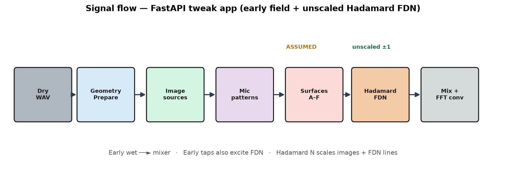

| Step | Block | Tag |
|------|-------|-----|
| 1 | Prepare geometry (`sy` / `my` / MCZ) | VERIFIED locks; modern height split ASSUMED |
| 2 | Image sources (N mirrors) | VERIFIED macros; N grids partly ASSUMED |
| 3 | Distances & Delays (`c=340`; amp is Air Abs `1/r²`) | VERIFIED |
| 4 | Mic pattern + Surfaces colour | Pattern LIKELY; Surfaces ASSUMED |
| 5 | Early overlay (`early_wet`, default 0) | ASSUMED FIR |
| 6 | FDN (N, unscaled ±1, Gain/N) | Size 32 from-them; matrix construction ASSUMED |
| 7 | Mix → Play live (AudioWorklet) and/or Render `software/renders/out.wav` | — |

---

## 3. Room Floor · Side (and legacy XZ)

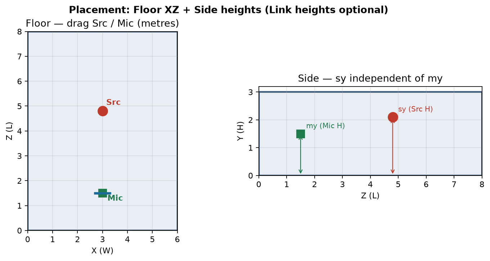

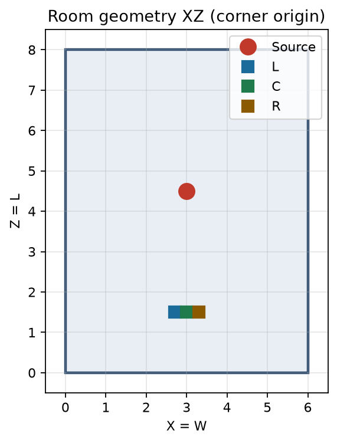

- **Floor** — drag source and mic stand in XZ metres.
- **Side** — drag source height `sy` and mic height `my` independently; **Link heights** optional.
- **3D** — orbit / pan / zoom only; place on Floor or Mic desk.
- Prepare historically locked **SY = MY** (VERIFIED). Modern independent `sy` is an ASSUMED extension.
- **MCZ = L − MZ** remains LOCKED.

---

## 4. Prepare / MCZ algebra

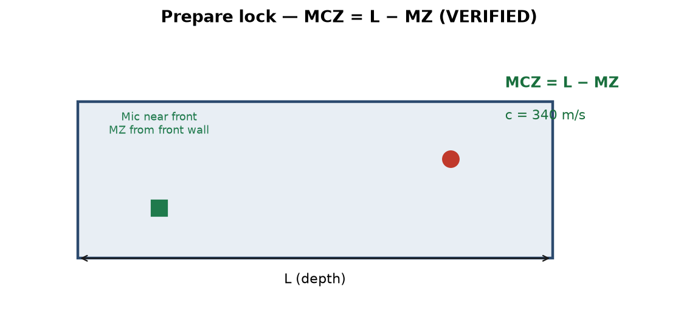

| Symbol | Formula | Tag |
|--------|---------|-----|
| `MCX` | `W × 0.5` | VERIFIED (parity); free `mcx` modern |
| `MCZ` | `L − MZ` | VERIFIED / LOCKED |
| `MLX` / `MRX` | `MCX ∓ Space/2` | VERIFIED |
| Mic Y/Z | shared `MY`, `MCZ` | VERIFIED |
| `MLALR` / `MRALR` | Diverg×0.5 − 0.25 / + 0.25 | VERIFIED Add (403) |
| Source | free `sx,sz`; `sy` editable | Prepare SY=MY VERIFIED; modern `sy` ASSUMED |
| `c` | 340 m/s | VERIFIED |

---

## 5. Image-source mirrors + leaf table

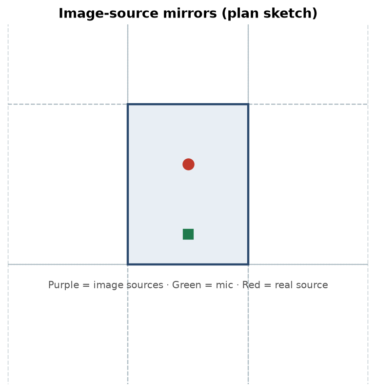

VERIFIED leaf algebra (corner origin, full room size `R`):

| Macro | Formula |
|-------|---------|
| pass / `−S` | `S` / `−S` |
| `2R−S` / `2R+S` | `(2·R)−S` / `(2·R)+S` |
| `−2R+S` | `S−(2·R)` |
| `4L−Z` | `(4·L)−Z` (Z only) |

Delay `(d/340)×1000` ms · Air Abs level `1/r²` · image distance 3D Euclidean — all VERIFIED.

---

## 6. Direct Field 2D vs image 3D

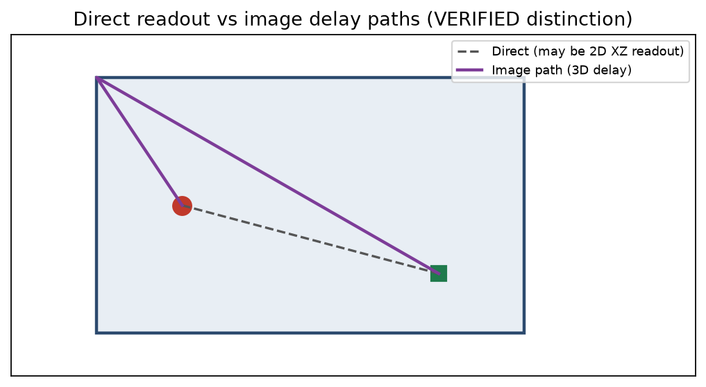

| Path | Distance | Use |
|------|----------|-----|
| Direct Field | 2D XZ | `DD` readout |
| Image Distances | 3D Euclidean | early taps |

Do not collapse these into one law.

---

## 7. Unscaled Hadamard FDN

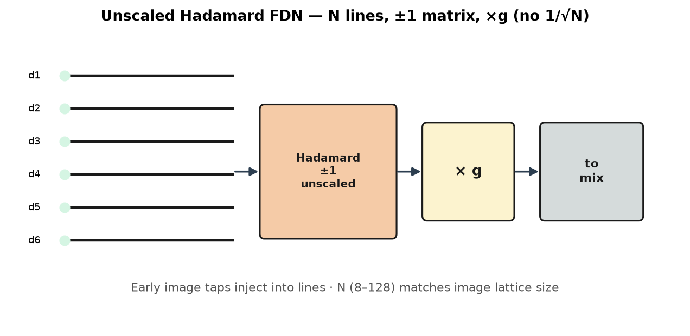

- **N** chips 8 · 16 · 32 · 64 · 128 (default 32) — same N for images + FDN lines.
- Unscaled ±1 Sylvester Hadamard — **no `1/√N` on H**. UI Feedback is Structure Gain; loop `g = Gain/N`. Desktop clamps `g` to `0.99/√N`.
- Image delays **are** the FDN lines (inject t=0). Early FIR overlay only if `early_wet > 0`.
- Do **not** invent Structure OCR Hadamard sign rows.

---

## 8. Mic desk · L/C/R polars · MS

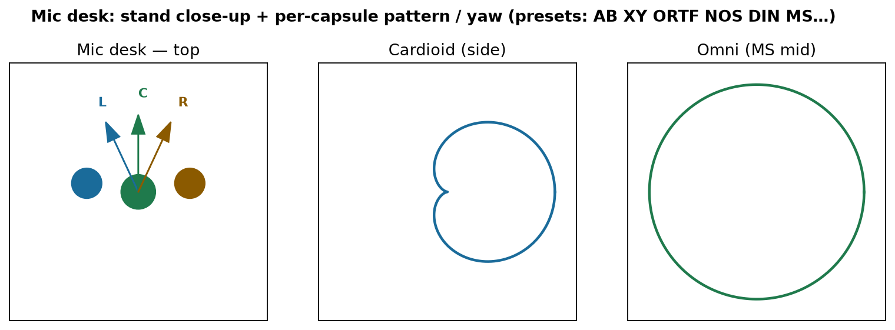

The **Mic** tab is a zoomed stand: top plan, side height, 3D orbit, and three polar plots. Each capsule has its own **pattern** and **yaw** (not one global Car/Omni).

Mic setups include AB, XY, ORTF, NOS, DIN, **MS** (UI label: omni mid + inward cardioids; preset mid currently still cardioid), MS classic (fig‑8 Side ASSUMED), mono centre. Absolute yaw is a modern extension beyond VERIFIED Diverg.

---

## 9. Lattice · Paths

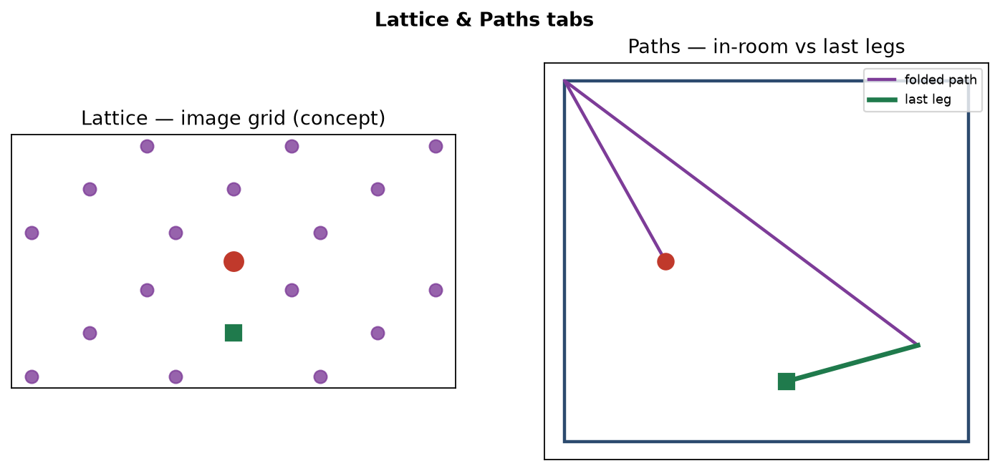

**Lattice** — mirrored-room tiling from the image index table; home room highlighted; polarity colouring. N from Mix Hadamard size.

**Paths** — toggle **In-room paths** (folded specular bounce polylines) ↔ **Last legs** (final arrival segment). L / C / R mic chips select listeners. Folding uses VERIFIED Prepare + image algebra via `image_geometry`.

---

## 11. Colour · Surfaces

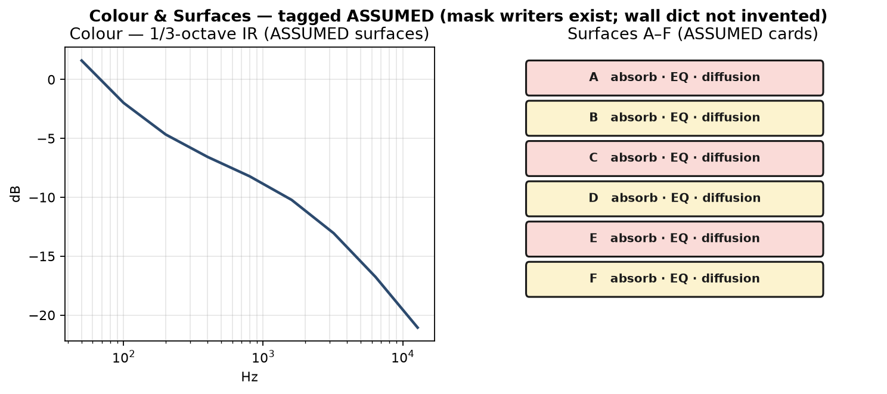

- **Colour** — 1/3-octave wet-IR magnitude after Render; Hold A/B; peak-band or 1 kHz 0 dB reference (**ASSUMED** long-term view).
- **Surfaces** — A–F cards with absorb / EQ / diffusion. Panel names **B Ahead · D Behind · E Floor · F Ceiling** VERIFIED; **A+C = Sides** (Left/Right split ASSUMED). EQ/jitter DSP **ASSUMED**. Masks tabulated, not in the audio path.

---

## 12. Polar × frequency field

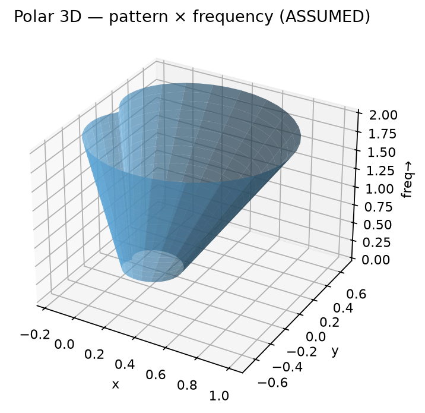

**Polar 3D** stacks mic pattern strength vs angle across 1/3-octave bands in the mic–source plane. Low → omni-ish; high → cardioid morph (**ASSUMED**). Plane tilts when `sy ≠ my`. This is **not** a plot of image-arrival directions.

---

## 13. Studio One linked track-FX (vision)

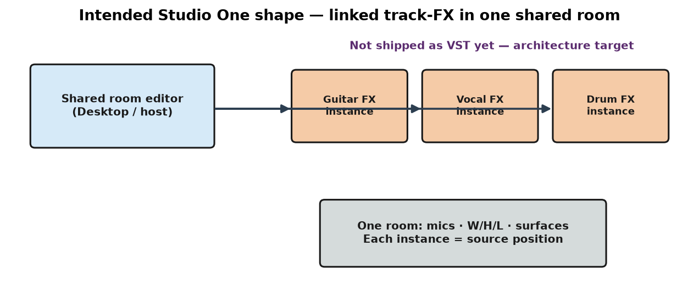

**Intended architecture only** (PROPOSAL): each linked track-FX instance is a source in one shared room; shared editor outside the plugins owns room / Surfaces / Colour. Not a claim that a Studio One plugin ships in this pack.

---

## 14. Verified vs assumed summary

**Locked:** `c = 340` · `MCZ = L − MZ` · mirror leaf algebra · unscaled ±1 FDN (no `1/√N`) · Direct Field 2D vs image 3D.

**ASSUMED / PROPOSAL / open:** independent `sy` · free `mcx` · absolute mic yaw presets · A vs C Left/Right · Surfaces EQ & diffusion jitter · Colour / Polar desks · FDN delay stagger & inject · full Hadamard OCR rows (Sylvester kept) · N≠32 image grids · fig‑8 fidelity · `-2W+X` leaf · Studio One linked-FX shipping. Next session: [`../HANDOVER.md`](../HANDOVER.md).

---

## 15. A/B checklist

1. `Launch Tweak App.bat` → http://127.0.0.1:7860  
2. Same dry WAV into Reaktor and the app.  
3. Match W/H/L and positions; mind Diverg vs absolute yaw.  
4. Compare early field first; expect FDN / Surfaces differences.  
5. Output: `software/renders/out.wav`.

```bat
.venv\Scripts\activate
cd engine
python selfcheck.py
```

---

## Further reading

| Doc | Role |
|-----|------|
| [`HOW_IT_WORKS.md`](HOW_IT_WORKS.md) | Text-first twin |
| [`QUICKSTART.md`](QUICKSTART.md) | Launch / render |
| [`UI_GUIDE.md`](UI_GUIDE.md) | Tab / control → engine |
| [`../software/UI_NOTES.md`](../software/UI_NOTES.md) | Developer UI / API |
| [`../findings/structure-findings.md`](../findings/structure-findings.md) | Structure log |

Diagram inventory under [`diagrams/`](diagrams/): `01_signal_flow`, `02_room_geometry_xz`, `03_image_mirrors`, `04_prepare_algebra`, `05_fdn_schematic`, `06_direct_vs_image_distance`, `07_floor_side_heights`, `08_mic_desk_polars`, `09_lattice_paths`, `10_colour_surfaces`, `11_polar_field`, `12_track_fx_instances`.
