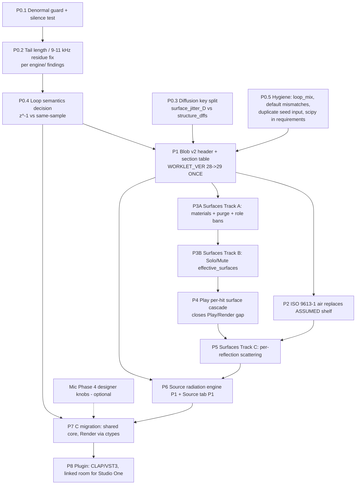

# 2011 Room Reverb — merged Build roadmap

Written 27 Sep 2026 (BST), for Grok Build (the coder). This is a planning document only: nothing in `software\` was changed.

**Tags used here**

- **VERIFIED** means I read it in the code snapshot (`planning/snapshot/software/`, a read-only copy of `C:\Users\IdleHanz\Desktop\2011 Room Reverb\software\` taken 27 Sep 2026, with file mtimes 17–26 Sep) or in a handoff brief on the box.
- **ASSUMED** means it is my estimate or design proposal.
- **BRIEF** means the claim comes from a pending handoff brief. The brief is the authority for detail; this roadmap only orders the work and resolves clashes between briefs.

**Source briefs this roadmap merges**

| Pack | Path on the box | Status in the code |
|---|---|---|
| Engine bugs, parity, tests, bench | `/workspace/build_support/engine/` (produced by a **parallel worker**; was still empty when this was written) | Phase 0 references it |
| Mic colour v2.x | `/workspace/mic_fitter/` (+ GROK_BUILD_BRIEF) | **Implemented through Phase 3**, VERIFIED. Phase 4 (designer knobs) is not done (ASSUMED) |
| ISO 9613-1 air | `/workspace/air_fitter/` (pack only, no separate brief) | **Not implemented**, VERIFIED: no `9613` or climate preset anywhere in the code |
| Surfaces A/B/C | `/workspace/handoff_surfaces_for_build/` (README, BUILD_HANDOFF, Track A, B, C, findings/) | **None implemented**, VERIFIED: no `heavy_curtain`, `surfaces_solo`, `surfaces_mute` or `scatter` in the code |
| Source radiation engine + Source UI tab | `/workspace/source_radiation/` | **Not implemented**, VERIFIED: no `src_rad` or directivity in the code, and no Source tab |

---

## 0. The shape of it



**Ordered phase list, with sizes**

Size key: S ≈ ≤1 day, M ≈ 2–4 days, L ≈ 1–2 weeks. All sizes are ASSUMED and based on reading the code and briefs.

| # | Phase | Size | Blocks |
|---|---|---|---|
| P0 | Engine fixes (denormal S, tail/residue M, diffusion split S–M, loop semantics decision S, hygiene S) | M overall | everything |
| P1 | Blob v2 + a single version bump | S | P2–P6 Play work |
| P2 | ISO 9613-1 air (Render, then Play) | S–M | P5 (stage order) |
| P3A | Surfaces Track A (materials) | S | P3B |
| P3B | Surfaces Track B (Solo/Mute) | M | P4 |
| P4 | Play per-hit surface cascade | M–L | P5 |
| P5 | Surfaces Track C (scattering) | L | P6 CPU budget |
| P6 | Source radiation, engine P1 + UI P1 | L | P7 |
| P7 | C migration (see `C_MIGRATION_PLAN.md`) | L (over several PRs) | P8 |
| P8 | Plugin + linked track-FX instances | L+ | — |
| opt | Mic colour Phase 4 designer knobs | M | none |

**Why this order**

- P0 comes first because every later A/B listening test is meaningless while the tail runs 2.6–4.5 s against 1.8 s dialled, and while silence costs 3.8 ms per block (VERIFIED in the brief figures).
- P1 comes before any new Play feature so the blob layout changes once, not three times. The scattering and source briefs each propose their own bump; this plan replaces both.
- Air (P2) goes before scattering (P5) because the canonical stage order puts air before scattering. Also, air replaces a filter that already exists (the ASSUMED shelf), so it is the smallest DSP change and a good first use of the v2 blob.
- A/B surfaces work before C because the Track C brief assumes the purged material list and Solo/Mute exist (BRIEF).
- The P4 cascade is inserted by this roadmap; it is not in any brief. Today Play's early taps lack the per-hit surface cascade (VERIFIED: `live_stereo.c` early lane is one tap per line at `line->delay`, filtered only by `tint()` and in-loop peaking). Scattering in Play would otherwise have no surface filter to sit next to.

---

## 1. Canonical per-image stage order (lock this before P2)

**VERIFIED current Render per-tap order** (`early_field.py` / `surface_colour.py`):

`_apply_ir_at` (allpass) → gradient HP / beaming LP toys → peaking → air (`humidity` 1-pole + ASSUMED shelf) → `apply_surface_to_buffer` cascade → `_colour_apply` (mic)

**BRIEF conflicts**

- The Track C scattering brief inserts scatter right after `_apply_ir_at`, i.e. before air.
- The source radiation brief puts source first, then allpass/surfaces, then air, then mic.
- In Play, source filters sit on the **write** side (before `tint()`), and the scattering brief puts scatter on the **read** side (after air).

**Decision to lock (ASSUMED, as requested by Idle):**

```
source radiation → air (Structure 1-pole humidity + ISO shelf) → surface per-hit cascade + scattering → mic colour
```

- Every stage is LTI per image, so reordering changes only rounding. It is still worth fixing one order so that:
  - Render and Play null-test at ≤ −100 dBFS after P7;
  - code reviewers know where a new stage goes.
- Direct path: **source → mic colour only.** No air on direct (lock), and no surfaces.
- FDN inject: **source diffuse filter (one per source) → air (Structure humidity 1-pole + ISO shelf) → Hadamard loop.**
  - No air and no scattering on the FDN **return** (lock).
  - The early images excite the FDN (lock). Today the one-source mode shares one `tint()` for the early lane and the FDN input (VERIFIED). Keep that.
- Render must be refactored to the same order in P2 (move air to right after source, i.e. before the surface cascade, where it already is), and the scatter insertion point in P5 must be *after* air, not after `_apply_ir_at` as the Track C brief says. **Tell Build the brief is overridden on that point.**

---

## 2. Shared parameter-blob plan (one bump)

**VERIFIED today**

- `live_stereo.c` checks `(int)rf(&r) != 1 → return`: magic 1, with no version and no lengths.
- `BLOB_LEN = 1981` in `fdn_worklet.js`, `MAX_BLOB = 8192` floats in C, and `WORKLET_VER = 28` in `live_fdn.js`.
- `loop_mix` is computed in Python (`_attach_loop_mix`, `render_pipeline.py:1337`) but never packed. It is dead payload.

**Plan (ASSUMED design; all later phases fill sections, none re-bump the major)**

```
float[0]  magic      = 2          (old wasm sees !=1 and safely refuses → silence, not garbage)
float[1]  blob_major = 2
float[2]  blob_minor = 0          (+1 whenever a section gains a trailing field)
float[3]  n_sections
float[4]  total_len
then n_sections × {id, offset, length, section_version}
sections:
  1 CORE        existing magic-1 layout minus the magic (unchanged order → easy port)
  2 AIR         per-kind shelf coefficients (P2)          — optional
  3 SURF        per-line per-hit cascade biquads (P4)     — optional
  4 SCATTER     per-line spec/scat shelves + cluster table (P5, ~40 floats/line per BRIEF)
  5 SRC_RAD     per-source ~330 floats (P6, BRIEF) + rad_on_A/B
  6 SOLO_MUTE   6 inject gains (P3B) – or fold into CORE as trailing fields
  last: CRC32 or simple float checksum of everything before it (optional in WASM, required in plugin state)
```

- A missing section means the stage is bypassed. That gives the bit-exact null tests the briefs ask for: an omni source and scatter = 0 must null bit-exactly (BRIEF).
- `WORKLET_VER` 28 → **29 once**, in P1. Later sections bump `blob_minor` and the section's own version, not WORKLET_VER, unless the JS glue changes.
- Size estimate (ASSUMED):

  | Part | Floats |
  |---|---|
  | CORE | 1981 |
  | SCATTER (2 tanks × 32 lines × ~40) | ~2560 |
  | SRC_RAD (2 sources × 330) | ~660 |
  | SURF (32 lines × up to 3 hits × 2 biquads × 5 coefficients × 2 tanks) | ~1920 |
  | **Total** | **~7100** |

  That is under 8192 but tight. **Raise `MAX_BLOB` to 16384 in P1** (64 kB, trivial).
- `hadamard_n` needs a CORE field reserved now (value 32 in Play until P7 enables variable N).
- P0.4 adds a `loop_semantics` field (0 = z⁻¹ as today, 1 = same-sample) to CORE in P1, even if only one value is supported.
- Python: one `pack_blob_v2()` next to `live_fdn_params` (`render_pipeline.py:1347`). Add a pytest that round-trips the header and checks section offsets.

---

## 3. Phase by phase (PR-sized steps)

Every step lists the files touched, the acceptance tests, and an A/B listening check. The file paths are relative to `software\` and VERIFIED to exist in the snapshot, unless marked *(new)*.

Standing rules for **every** PR:

- Rebuild the wasm with the command in the `live_stereo.c` header (VERIFIED): `zig cc -target wasm32-freestanding -O3 -msimd128 -nostdlib -ffreestanding -Wl,--no-entry -Wl,--export-memory ...`.
- Run `pytest tests/`.
- Run the bench (see `engine/bench` from the parallel worker).
- Never change `live_stereo.wasm` without the matching C.

### P0 — Engine fixes (reference `../engine/`)

The parallel worker owns diagnosis. This roadmap only sequences the fixes.

| Step | What | Files | Acceptance | A/B listen |
|---|---|---|---|---|
| P0.1 | Denormal guard. Currently none, VERIFIED (no FTZ, no offset). Add an alternating ±1e-20 DC offset on the FDN write, or flush `|x| < 1e-15` to 0 in line state and biquad state. WASM has no FTZ mode, so an explicit guard is needed (see C plan §6). | `engine/live_stereo.c`, `static/wasm/live_stereo.wasm`, `tests/test_live_stereo.py` | New `test_silence_cost`: 60 s of silence costs ≤ 1.5× the playing cost (per `c_wasm_performance_roadmap.md`). Silence was 3.8 ms/block and must drop to about 0.5 ms. The output of a normal IR must not change by more than −120 dBFS. | Play a drum loop, stop, wait 30 s, play again: no crackle or dropout on restart. |
| P0.2 | Tail length (2.6–4.5 s measured vs 1.8 s dialled) plus the 9/11 kHz residue. The fix comes from the `engine/findings` diagnosis. Hypothesis (ASSUMED, for the worker to confirm or reject): decay lock computes g from the delay lengths but ignores the Dffs allpass group delay and the in-loop peaking. The Play z⁻¹ diffuser loop (see P0.4) changes loop gain at HF. | `engine/live_stereo.c`, `engine/fdn.py`, `render_pipeline.py` (decay lock), tests | T60 (EDC −60 dB, octave bands) within ±10 % of `decay_s` for 0.3–8 s, in both Play and Render. No narrow-band peak > 6 dB above its neighbours at 9 or 11 kHz in a 1 s late window. | 1.8 s dialled on snare: tail ends where expected. Sweep Dffs 0→max: T60 stays put, no whistle. |
| P0.3 | **Diffusion key split (lock violation, VERIFIED).** The card key `diffusion` feeds both `jittered_distance` (Surfaces Δd jitter, `surface_colour.py:311`) and `tap_dff` → `dff_after_master` (Structure Dffs, `engine/fdn.py:201`). Split it into card `jitter_D` (Surfaces) and card `structure_dif` (Structure Dffs). Migrate old saves by copying `diffusion` into both, so the sound is unchanged. The UI shows them in separate groups (see PARAMETERS.md). | `surface_colour.py`, `engine/fdn.py`, `render_pipeline.py`, `app_server.py`, `static/js/colour_surfaces.js`, `static/js/app.js`, tests | Old save → identical blob (bit-exact). Setting `jitter_D = 0` leaves Dffs unchanged, and vice versa. | Surfaces jitter up with Dffs fixed gives tap smear only. Dffs up with jitter fixed gives denser tail onset only. |
| P0.4 | **Loop semantics decision.** VERIFIED: with Dffs, Play `diffuse()` uses fb = g·H·y[n−1], while Render (`fdn.py` `process_block_poly`) solves the same-sample implicit system y = M(u − D·xin), with M = (I + g·diag(dffs)·H)⁻¹. See C plan §3. Recommendation: pick **z⁻¹ in both** unless the engine/ worker shows it causes the residue. Record the choice in the blob `loop_semantics` field. | `engine/fdn.py` (Render adopts z⁻¹ or Play adopts M), tests | Render vs Play null ≤ −60 dB now, and ≤ −100 dBFS after P7. | 30-s comparison: Play vs Render bounce of the same room. |
| P0.5 | Hygiene. (a) `loop_mix`: delete it, or pack it if P0.4 picks same-sample. (b) Server/client default mismatches (VERIFIED): `space` 0.25 vs 0.17, `humidity` 0.0 vs 0.35, `decay_lock` false vs true, `decay_s` 0 vs 1.8, `mirror_b` false vs true, `yaw_l/r` None vs ∓55. Make the server DEFAULTS the single source and have the client read `/api/defaults`. (c) The duplicate `diffusion_seed` input (Surfaces tab + `diffusion_seed_mix` in the Mix panel): keep only the Surfaces one. (d) Add `scipy` to `requirements.txt`, because Render imports `scipy.signal.lfilter` (VERIFIED). (e) `diffusion_master` is −0.25 in `fdn.py` but −0.5 live: pick one. | `app_server.py`, `static/js/app.js`, `static/index.html`, `render_pipeline.py`, `requirements.txt` | `/api/defaults` equals the client state at load (new test). No save-file key is lost. | none (no sound change except (e); A/B that). |

### P1 — Blob v2 (single bump)

| Step | What | Files | Acceptance | A/B |
|---|---|---|---|---|
| P1.1 | v2 header + section table (§2). The CORE section is the existing layout. Reserve CORE fields for `hadamard_n`, `loop_semantics` and `solo_mute[6]`. Raise `MAX_BLOB` to 16384. `WORKLET_VER` → 29. | `engine/live_stereo.c`, `static/js/fdn_worklet.js` (BLOB_LEN becomes computed), `static/js/live_fdn.js`, `render_pipeline.py` (packer), tests | v1 and v2 give bit-identical audio for the default room. An old wasm loaded with a v2 blob stays silent and does not crash. | none (must be inaudible). |

### P2 — ISO 9613-1 air (air_fitter)

| Step | What | Files | Acceptance | A/B |
|---|---|---|---|---|
| P2.1 | Render: replace **only** the ASSUMED RBJ shelf (`gain_db = −0.15·d·humidity`, corner ≈ 0.35·Nyquist, VERIFIED) with the air_fitter winner `dual_high_shelf` (candidate C). Add the climate presets `studio_20C_50RH` (default) / dry / humid / warm. The Structure `humidity` 1-pole stays separate and untouched (lock). Direct stays air-free. No air on the FDN return. Air applies to early images and to the FDN inject only (air_fitter placement lock). | *(new)* `engine/air_iso.py` (port of the fitter's coefficient function), `early_field.py`, `render_pipeline.py`, `app_server.py` (`air_climate` key), `static/index.html` (Mix panel select), tests | Fit error vs the ISO 9613-1 curve within the air_fitter pack's stated tolerance at 1, 5, 10 and 30 m. `air_shelf = 0` nulls bit-exactly with the ISO shelf off. Direct is unchanged (bit-exact). | 20 m room, dry vs humid: early HF dulling changes, direct click unchanged. |
| P2.2 | Play: the shelf biquad coefficients already live per kind in `tint()` (VERIFIED). Send the ISO coefficients in the AIR section (or reuse the CORE shelf fields). | `engine/live_stereo.c`, `render_pipeline.py`, wasm | Play vs Render early-only null ≤ −60 dB. | Play vs Render toggle. |

### P3A — Surfaces Track A: real materials + purge (BRIEF: `handoff_surfaces_for_build/` Track A)

| Step | What | Files | Acceptance | A/B |
|---|---|---|---|---|
| P3A.1 | Add 12 `ASSUMED_TEXTBOOK` presets and purge the crazy-kit chips. Current chips are Plaster / Wood / Concrete / Curtain / Carpet (VERIFIED, unrestricted). Role bans (BRIEF): curtain wall-only; carpets floor-only; parquet floor; glass/brick/plywood/absorber wall; ceiling tile ceiling; plaster/gypsum wall + ceiling; concrete any. No curtains on the floor or ceiling (product lock). | `surface_colour.py`, *(new)* `presets/surfaces/*.json`, `app_server.py` (`/api/surfaces`), `static/js/colour_surfaces.js`, tests | Track A checklist in the brief. Banned chips are hidden or disabled per role. Old saves with banned materials fall back to the nearest allowed one, with a toast. | Floor carpet vs parquet on a snare: low-mid body changes, no comb artefacts. |

### P3B — Surfaces Track B: panel Solo/Mute (BRIEF Track B)

| Step | What | Files | Acceptance | A/B |
|---|---|---|---|---|
| P3B.1 | A single gate, `effective_surfaces()`. Mute = ×0 inject short-circuit (bypasses the 0.95 ᾱ clamp in `tap_reflect_gain`, VERIFIED clamp). Mute also sets jitter D = 0 and Structure Dffs contribution = 0 for that panel (both layers, BRIEF). Solo is exclusive. Implement in Play and Render in the same PR (BRIEF Phase 1). The keys `surfaces_solo` and `surfaces_mute` are distinct from the Mix-desk `solo_*`/`mute_*` (VERIFIED separate). | `surface_colour.py`, `early_field.py`, `render_pipeline.py`, `engine/live_stereo.c` (per-line inject gains in CORE), `static/js/colour_surfaces.js`, tests | Track B acceptance list. Muting all 6 leaves direct + FDN with no early. Solo A gives only images whose last hit is A (or whatever rule the brief defines). Play and Render match. | Solo each wall in turn on a clap: you can hear where each reflection comes from. |

### P4 — Play per-hit surface cascade (roadmap-added)

| Step | What | Files | Acceptance | A/B |
|---|---|---|---|---|
| P4.1 | Add a per-line cascade slot on the early **read** side after `tint()`: the serial per-hit peaking (Q 0.9) + card EQ, from `surface_filter_stages` (`surface_colour.py:360`). It is feed-forward (not in the loop). Constraint: Play has one early tap per line (VERIFIED), so the cascade is per line (the image assigned to that line). Pack at most H hits per line (H = 3, ASSUMED; images with more hits merge by multiplying responses in a fitted 2-biquad approximation). | `engine/live_stereo.c` (SURF section, SoA biquads), `render_pipeline.py` / `surface_colour.py` (packer), wasm, tests | Play vs Render early-only null ≤ −60 dB, with default and extreme cards. CPU ≤ +0.15 ms/block with 1 source (ASSUMED budget). Null when all cards are flat (bit-exact bypass). | Change a wall EQ in Play: audible live, same as Render. |

### P5 — Surfaces Track C: per-reflection scattering (BRIEF Track C)

| Step | What | Files | Acceptance | A/B |
|---|---|---|---|---|
| P5.1 | Render: new `engine/scatter.py` `scatter_tables`. Per tap, a spec shelf √∏(1−s) and a scat shelf. Lambert cluster K = 16, W = clamp(0.778·t, 1–30 ms), 1/√K amplitude (BRIEF). **Insert after air, with the surface cascade**, not right after `_apply_ir_at` (roadmap override, §1). Card `scatter[7]` default 0, `scatter_preset`. Global `scatter_amount`, `scatter_pulses` (16, or 8 for two sources), `scatter_seed`. | *(new)* `engine/scatter.py`, `early_field.py`, `surface_colour.py`, `app_server.py`, `static/js/colour_surfaces.js`, tests | BRIEF tests: null bit-identical at s = 0; energy ±0.5 dB; feed-forward proof; skip rule max(1−S) < 0.01. | Concrete vs heavy_curtain-proxy scatter at s = 0.7: early field smoother, no pre-echo. |
| P5.2 | Play: block-major cluster in the SCATTER section (~40 floats per line, BRIEF), on the read side. | `engine/live_stereo.c`, wasm, packer, tests | Parity ≤ −60 dB. CPU ≤ +0.25 ms (BRIEF). | Play vs Render. |

### P6 — Source radiation engine P1 + Source UI P1 (BRIEF `/workspace/source_radiation/`)

| Step | What | Files | Acceptance | A/B |
|---|---|---|---|---|
| P6.1 | Engine (Render): new `engine/source_radiation.py`, model `radiation_shelf_plus_soft_one_pole`. One filter per image, shared across buses (mic-centre direction). Direct gets one per capsule. FDN inject gets one diffuse filter per source (tail is yaw-invariant). `src_rad` per source A/B: `preset` omni, `yaw_deg`, `pitch_deg`, `size_m`, `level_ref`, `tail_follow` (Advanced). Ship the presets in `presets/source/` (BRIEF first set: omni, talking_head, singer_soprano, acoustic_guitar, trumpet, violin, cello, cab_1x12_closed, cab_4x12_closed, piano_grand_lid_open). **Licence gate: see LICENCE_AUDIT.md.** The TU-Berlin-derived presets (singer_soprano, acoustic_guitar, trumpet, violin, cello) must not go in the public repo until cleared; ship trumpet_byu / violin_byu instead. | *(new)* `engine/source_radiation.py`, *(new)* `presets/source/*.json`, `early_field.py`, `render_pipeline.py`, `app_server.py` (`GET /api/source_presets`, `POST /api/source_preview`), tests | Omni null bit-exact (BRIEF). Level-ref on-axis vs power as in the brief. | Rotate trumpet yaw 0→180°: direct and early darken, tail level constant. |
| P6.2 | Play: SRC_RAD section (~330 floats/source) on the **write** side, before `tint()` = source → air (§1). Ramp coefficients over one block (BRIEF). | `engine/live_stereo.c`, wasm, packer | Parity ≤ −60 dB. CPU within the table below. | Drag the facing handle while playing: no zipper noise. |
| P6.3 | Source UI P1: new **Source** tab between Floor and Mic (BRIEF), a facing handle on Floor, hover info on Paths. Only source controls on this tab (uncluttered lock). Hadamard stays hidden, as on Floor/Mic today (VERIFIED `syncSidebar`). | `static/index.html`, `static/js/app.js`, `static/js/room_editor.js`, *(new)* `static/js/source_tab.js`, `static/css/app.css` | UI checklist in the Source UI brief. `syncSidebar` shows no panelMix controls on Source. | — |
| P6.4 (later) | Engine Phase 2: `src_coef` into shared C (`src_radiation.c`); size jitter, roll, emit points. | see C plan | | |

### P7 / P8

- P7: see `C_MIGRATION_PLAN.md` (split `live_stereo.c` into kernels, Render via ctypes, retire `fdn_core.c`, variable N).
- P8: plugin wrapper plus linked track-FX instances (C plan §9).

---

## 4. CPU budget per phase (per 128-sample block, budget 2.667 ms at 48 kHz)

VERIFIED figures are from the briefs' WASM bench on the box. Native is 1.2–1.4× faster (BRIEF).

| After phase | 1 source | 2 sources | Note |
|---|---|---|---|
| today (colour on) | 1.214 ms (46 %) | 1.770 ms (66 %) | VERIFIED. Colour bypass 1 source: 0.482 ms. |
| today, silence | 3.8 ms (143 %!) | — | VERIFIED denormal bug; P0.1 fixes it |
| P0 | ≈ same | ≈ same | guard adds < 0.02 ms (ASSUMED) |
| P2 air | +~0 | +~0 | replaces an existing biquad |
| P3B | +~0 | +~0 | 6 gains |
| P4 cascade | +~0.10–0.15 | +~0.2–0.3 | ASSUMED (2 SoA biquads × 32 lines × tanks) |
| P5 scatter | ~1.40 (+K=16) | ~2.12 (K=8, 79 %) | BRIEF |
| P6 source rad | ~1.43–1.46 | ~2.14 (80 %) | BRIEF |
| P4+P5+P6 all on | ~1.7 (ASSUMED) | ~2.4–2.5 (90–94 %, ASSUMED) | **over the comfort line** → needs the colour FIR win |
| BRIEF recommended 2-src config | | 2.03–2.08 (76–78 %) | BRIEF |

- **Colour FIR is ~60 % of cost (BRIEF).** Non-uniform partitioned convolution (a short first partition, longer later ones) is the biggest lever. Schedule it as P7.3, or pull it forward if P6 goes over 80 %.
- **Shed order under overload** (all briefs agree; the watchdog applies it block by block, with hysteresis):
  1. scattering off (spec only);
  2. source filters → omni;
  3. early reflections reduced (fewer lines, or early off);
  4. never shed the FDN tail or the direct path.
- Add a `cpu_watchdog` counter to the blob-return / stats path (from the `c_wasm_performance_roadmap.md` plan).

## 5. Conflicts to avoid (checklist for reviewers)

1. **Stage order**: source → air → cascade + scatter → mic. Track C's "after `_apply_ir_at`" is overridden.
2. **Write vs read side in Play**:
   - Source filters go on the write side (before `tint`, so they shape the FDN inject too). The inject gets the diffuse variant, so in practice this means two write-side filters per source: an image-directional one on the early lane and a diffuse one on the FDN lane.
   - Scatter and cascade go on the read side of the early lane only.
   - Nothing goes on the FDN read side except the existing in-loop peaking.
3. **Blob sections**: only P1 changes the header. Each later phase adds one section. Don't append fields to the end of CORE in P4–P6 (they would collide).
4. **Diffusion**: after P0.3, three separate things exist and must stay separate:
   - `jitter_D` (Surfaces Δd);
   - `structure_dif` (Structure Dffs);
   - `scatter[7]` (Track C).

   Solo/Mute zeroes the first two for muted panels (BRIEF). Scatter is skipped because the tap is gone.
5. **Two Solo/Mute systems**: Mix-desk `solo_*`/`mute_*` (buses) ≠ `surfaces_solo`/`surfaces_mute` (panels). Use different UI styling.
6. **`hadamard_n`**: Render supports 8–128, Play is fixed at 32 (VERIFIED). Until P7, grey out N ≠ 32 while Play is running, or label it "Render only".
7. **Two sources**: the scatter K drops to 8 and the source filters double. Test the CPU with `two_sources=true` in every PR from P4 on.
8. **Licences**: no TU-Berlin-derived preset, DirPat data, or raw BYU CSV lands in `software\presets` in the public repo (LICENCE_AUDIT.md).

## 6. What is implemented vs not (VERIFIED from the snapshot unless marked)

| Item | State |
|---|---|
| Image-source early field, 1/r², per-hit serial cascade (Render) | implemented (`early_field.py`, `surface_colour.py`) |
| Unscaled ±1 Hadamard FDN (`fwht`) | implemented, Play and Render |
| Early images excite FDN | implemented |
| Mic colour Phases 1–3 (MEASURED_SHELF, SM57 default, HPF, Play FIR) | implemented, with tests |
| Mic Phase 4 designer knobs | not implemented (ASSUMED from the brief vs UI) |
| Structure humidity 1-pole + ASSUMED shelf | implemented |
| ISO 9613-1 air | **not implemented** |
| Denormal guard | **not implemented** |
| Diffusion split | **not implemented** (single key, lock violation) |
| Blob version | **not implemented** (magic 1 only) |
| Surfaces A / B / C | **not implemented** |
| Play per-hit cascade | **not implemented** |
| Source radiation / Source tab | **not implemented** |
| `fdn_core.c` | exists, used only as an optional Render fast path (no Dffs, no mic 1-pole); retire in P7 |
| Hadamard hidden on Floor and Mic | implemented (`syncSidebar`: panelMix shown only on mix/lattice/paths/colour/surfaces/polar) |
