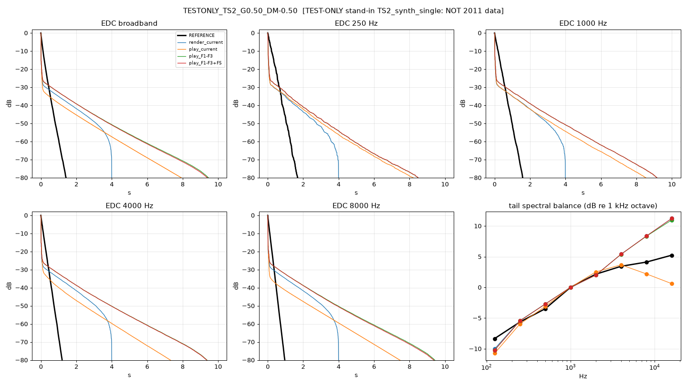

# 2011 reference vs rebuild: comparison report [TEST-ONLY stand-in TS2_synth_single: NOT 2011 data]

Generated 2026-09-27 19:11 BST by compare_ref.py. Trees: `current`, `F1-F3`, `F1-F3+F5`.

> **TEST-ONLY stand-in TS2_synth_single: NOT 2011 data**

## Verdicts

**(a) two-stage tail vs F2:** APPLY F2 generally: the 2011 reference decays single-slope (late/early median 1.00); the rebuild's long second stage is not in the original.

| metric | value |
|---|---|
| n_captures_with_diffusion | 1 |
| ref_late_over_early_1k_median | 1.00 |
| ref_two_stage_fraction | 0.00 |
| late_T60_log_spread_vs_GainF | n/a |
| late_T60_log_spread_vs_DiffMaster | n/a |
| rebuild_unlocked_late_T60_logerr_median | 3.67 |

**(b) loop timing:** INCONCLUSIVE at sample level (first-pass images of the F1-F3 trees do not line up with the reference, or neither loop timing nulls it). Weak evidence from decay/spectral score: same-sample (F5 / Render) (6.02 vs 6.50, lower = closer). Default to same-sample (F5): it nulls Render.

| metric | value |
|---|---|
| score_lower_is_closer | {"one-sample (z^-1, F1-F3 tree)": 6.503, "same-sample (F5 / Render)": 6.016} |
| ref_near_nyquist_db_median | -15.17 |
| play_current_near_nyquist_db_median | -15.39 |
| play_F1-F3_near_nyquist_db_median | 0.12 |
| play_F1-F3+F5_near_nyquist_db_median | 0.46 |
| render_current_near_nyquist_db_median | -1.34 |
| fine_timing | {"play_current": {"c1_median": 0.039, "loop_window_null_db_median": -0.003, "trip_lag_median": 2.0}, "play_F1-F3": {"c1_median": 0.037, "loop_window_null_db_median": -0.002, "trip_lag_median": 5.0}, "play_F1-F3+F5": {"c1_median": 0.038, "loop_window_null_db_median": -0.002, "trip_lag_median": 5.0}, "render_current": {"c1_median": 0.038, "loop_window_null_db_median": -0.002, "trip_lag_median": 5.0}} |
| fine_timing_valid | False |
| best_first_pass_match | play_current |

## TESTONLY_TS2_G0.50_DM-0.50

GainF 0.5, Diffusion Master -0.5, humidity(ui) 0.500, room 6.0x3.0x8.0, dffs knob 0.0333 (code default)

Notes:
- Diverg/MDPC not read: rebuild default diverg=1.0 used (ASSUMED)

| IR | T30 250 | T30 1k | T30 4k | T30 8k | T1 early 1k | T2 late 1k | two-stage 1k | late T60 9k/11k | near-Nyq dB | corr0 | IACC | tail/direct dB | direct ms | t=0 dB re direct | EDC rms dB | c1 / loop-window null / trip lag |
|---|---|---|---|---|---|---|---|---|---|---|---|---|---|---|---|---|
| REFERENCE | 1.31 | 1.18 | 0.91 | 0.73 | 1.18 | 400.00 | no | 0.72/0.71 | -15.2 | -0.02 | 0.03 | -2.8 | 9.50 | -3000.9 | - | - |
| render_current | 4.77 | 5.59 | 6.44 | 6.08 | 0.20 | 7.31 | no | 5.37/5.31 | -1.3 | 0.93 | 0.93 | -26.5 | 9.56 | -11.9 | 11.31 | 0.04 / -0.0 dB / +5 |
| play_current | 5.20 | 5.47 | 1.87 | 0.52 | 0.28 | 9.52 | yes | 4.37/4.77 | -15.4 | 0.96 | 0.96 | -28.4 | 9.56 | -8.6 | 12.10 | 0.04 / -0.0 dB / +2 |
| play_F1-F3 | 5.31 | 6.93 | 7.59 | 7.35 | 0.26 | 10.19 | yes | 5.77/5.77 | 0.1 | 0.94 | 0.94 | -24.1 | 9.56 | -8.6 | 11.01 | 0.04 / -0.0 dB / +5 |
| play_F1-F3+F5 | 5.35 | 6.96 | 7.54 | 7.21 | 0.26 | 10.18 | yes | 5.70/5.67 | 0.5 | 0.92 | 0.92 | -24.0 | 9.56 | -9.4 | 10.96 | 0.04 / -0.0 dB / +5 |

Tail spectral balance, dB re 1 kHz octave (reference, then variant minus reference):

| IR | 125 | 250 | 500 | 1000 | 2000 | 4000 | 8000 | 16000 |
|---|---|---|---|---|---|---|---|---|
| REFERENCE | -8.3 | -5.6 | -3.5 | 0.0 | 2.1 | 3.4 | 4.1 | 5.2 |
| render_current | -1.7 | 0.2 | 0.8 | 0.0 | -0.2 | 2.0 | 4.2 | 6.0 |
| play_current | -2.4 | -0.3 | 0.4 | 0.0 | 0.4 | 0.2 | -1.9 | -4.6 |
| play_F1-F3 | -1.9 | 0.2 | 0.8 | 0.0 | -0.2 | 2.0 | 4.2 | 5.7 |
| play_F1-F3+F5 | -1.9 | 0.2 | 0.8 | 0.0 | -0.2 | 2.0 | 4.2 | 6.0 |
