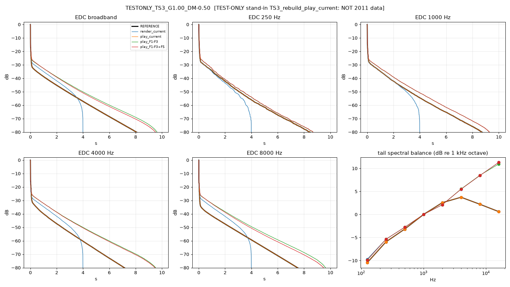

# 2011 reference vs rebuild: comparison report [TEST-ONLY stand-in TS3_rebuild_play_current: NOT 2011 data]

Generated 2026-09-27 19:11 BST by compare_ref.py. Trees: `current`, `F1-F3`, `F1-F3+F5`.

> **TEST-ONLY stand-in TS3_rebuild_play_current: NOT 2011 data**

## Verdicts

**(a) two-stage tail vs F2:** KEEP the two-stage tail as the authentic 2011 behaviour: the reference shows it (late/early T60 median 31.68, two-stage in 100% of Dffs captures) and the rebuild unlocked path reproduces the late slope (median |log err| 0.07). Apply F2 ONLY to the decay-lock path (dial honesty) and keep unlocked/GainF = 2011 mode untouched (F2 already leaves it alone).

| metric | value |
|---|---|
| n_captures_with_diffusion | 1 |
| ref_late_over_early_1k_median | 31.68 |
| ref_two_stage_fraction | 1.00 |
| late_T60_log_spread_vs_GainF | n/a |
| late_T60_log_spread_vs_DiffMaster | n/a |
| rebuild_unlocked_late_T60_logerr_median | 0.07 |

**(b) loop timing:** INCONCLUSIVE at sample level (first-pass images of the F1-F3 trees do not line up with the reference, or neither loop timing nulls it). Weak evidence from decay/spectral score: same-sample (F5 / Render) (2.80 vs 3.49, lower = closer). Default to same-sample (F5): it nulls Render. The first-pass images line up best with play_current: the reference delays look like ms rounded at 44.1 kHz + fractional read (not 48 kHz integer): relevant to F3, not to (b).

| metric | value |
|---|---|
| score_lower_is_closer | {"one-sample (z^-1, F1-F3 tree)": 3.489, "same-sample (F5 / Render)": 2.801} |
| ref_near_nyquist_db_median | -15.21 |
| play_current_near_nyquist_db_median | -15.21 |
| play_F1-F3_near_nyquist_db_median | -0.22 |
| play_F1-F3+F5_near_nyquist_db_median | 0.23 |
| render_current_near_nyquist_db_median | -1.33 |
| fine_timing | {"play_current": {"c1_median": 1.0, "loop_window_null_db_median": -120.0, "trip_lag_median": 0.0}, "play_F1-F3": {"c1_median": 0.878, "loop_window_null_db_median": -0.943, "trip_lag_median": -1.0}, "play_F1-F3+F5": {"c1_median": 0.884, "loop_window_null_db_median": -0.943, "trip_lag_median": -1.0}, "render_current": {"c1_median": 0.884, "loop_window_null_db_median": -0.943, "trip_lag_median": -1.0}} |
| fine_timing_valid | True |
| loop_null_z_minus_same_db | 0.00 |
| best_first_pass_match | play_current |

## TESTONLY_TS3_G1.00_DM-0.50

GainF 1.0, Diffusion Master -0.5, humidity(ui) 0.500, room 6.0x3.0x8.0, dffs knob 0.0333 (code default)

Notes:
- Diverg/MDPC not read: rebuild default diverg=1.0 used (ASSUMED)

| IR | T30 250 | T30 1k | T30 4k | T30 8k | T1 early 1k | T2 late 1k | two-stage 1k | late T60 9k/11k | near-Nyq dB | corr0 | IACC | tail/direct dB | direct ms | t=0 dB re direct | EDC rms dB | c1 / loop-window null / trip lag |
|---|---|---|---|---|---|---|---|---|---|---|---|---|---|---|---|---|
| REFERENCE | 5.18 | 5.42 | 1.94 | 0.52 | 0.30 | 9.56 | yes | 4.39/4.82 | -15.2 | 0.93 | 0.93 | -28.2 | 9.56 | -8.5 | - | - |
| render_current | 4.74 | 5.54 | 6.33 | 6.04 | 0.20 | 7.26 | no | 5.31/5.25 | -1.3 | 0.88 | 0.88 | -26.3 | 9.56 | -12.9 | 3.36 | 0.88 / -0.9 dB / -1 |
| play_current | 5.18 | 5.42 | 1.94 | 0.52 | 0.30 | 9.56 | yes | 4.39/4.82 | -15.2 | 0.93 | 0.93 | -28.2 | 9.56 | -8.5 | 0.00 | 1.00 / -120.0 dB / +0 |
| play_F1-F3 | 5.25 | 6.80 | 7.56 | 7.58 | 0.28 | 10.33 | yes | 5.82/5.84 | -0.2 | 0.91 | 0.91 | -24.0 | 9.56 | -8.6 | 6.03 | 0.88 / -0.9 dB / -1 |
| play_F1-F3+F5 | 5.28 | 6.84 | 7.37 | 7.08 | 0.28 | 10.30 | yes | 5.86/5.87 | 0.2 | 0.87 | 0.87 | -23.8 | 9.56 | -10.4 | 5.91 | 0.88 / -0.9 dB / -1 |

Tail spectral balance, dB re 1 kHz octave (reference, then variant minus reference):

| IR | 125 | 250 | 500 | 1000 | 2000 | 4000 | 8000 | 16000 |
|---|---|---|---|---|---|---|---|---|
| REFERENCE | -10.5 | -5.9 | -3.2 | 0.0 | 2.6 | 3.7 | 2.2 | 0.6 |
| render_current | 0.8 | 0.6 | 0.4 | 0.0 | -0.5 | 1.8 | 6.2 | 10.7 |
| play_current | 0.0 | 0.0 | 0.0 | 0.0 | 0.0 | 0.0 | 0.0 | 0.0 |
| play_F1-F3 | 0.6 | 0.6 | 0.4 | 0.0 | -0.5 | 1.8 | 6.3 | 10.3 |
| play_F1-F3+F5 | 0.5 | 0.6 | 0.4 | 0.0 | -0.5 | 1.8 | 6.2 | 10.7 |
