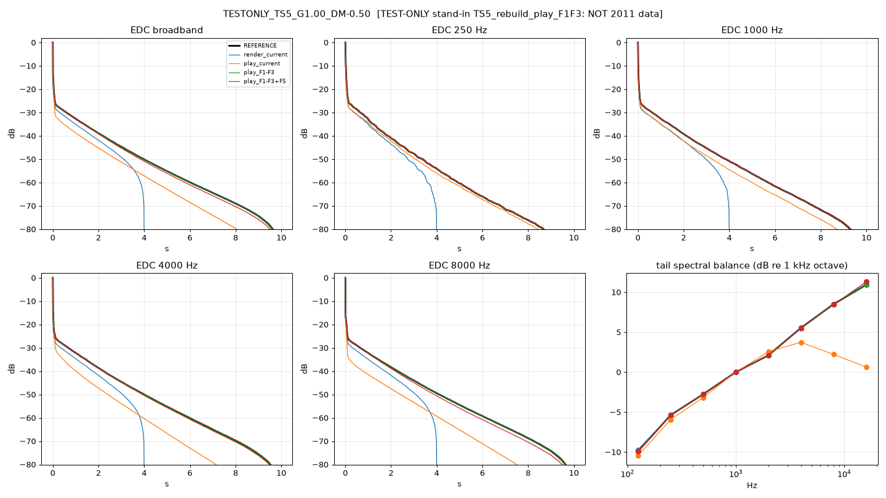

# 2011 reference vs rebuild: comparison report [TEST-ONLY stand-in TS5_rebuild_play_F1F3: NOT 2011 data]

Generated 2026-09-27 19:12 BST by compare_ref.py. Trees: `current`, `F1-F3`, `F1-F3+F5`.

> **TEST-ONLY stand-in TS5_rebuild_play_F1F3: NOT 2011 data**

## Verdicts

**(a) two-stage tail vs F2:** KEEP the two-stage tail as the authentic 2011 behaviour: the reference shows it (late/early T60 median 37.51, two-stage in 100% of Dffs captures) and the rebuild unlocked path reproduces the late slope (median |log err| 0.00). Apply F2 ONLY to the decay-lock path (dial honesty) and keep unlocked/GainF = 2011 mode untouched (F2 already leaves it alone).

| metric | value |
|---|---|
| n_captures_with_diffusion | 1 |
| ref_late_over_early_1k_median | 37.51 |
| ref_two_stage_fraction | 1.00 |
| late_T60_log_spread_vs_GainF | n/a |
| late_T60_log_spread_vs_DiffMaster | n/a |
| rebuild_unlocked_late_T60_logerr_median | 0.00 |

**(b) loop timing:** ONE-SAMPLE (z^-1 loop, Reaktor-style unit delay) matches the 2011 reference at sample level: loop-trip window (40-150 ms) null vs reference z^-1 -120.0 dB, same-sample -18.5 dB (first-pass images line up, c1 >= 0.5).

| metric | value |
|---|---|
| score_lower_is_closer | {"one-sample (z^-1, F1-F3 tree)": 0.0, "same-sample (F5 / Render)": 0.122} |
| ref_near_nyquist_db_median | -0.22 |
| play_current_near_nyquist_db_median | -15.21 |
| play_F1-F3_near_nyquist_db_median | -0.22 |
| play_F1-F3+F5_near_nyquist_db_median | 0.23 |
| render_current_near_nyquist_db_median | -1.33 |
| fine_timing | {"play_current": {"c1_median": 0.878, "loop_window_null_db_median": -0.943, "trip_lag_median": 1.0}, "play_F1-F3": {"c1_median": 1.0, "loop_window_null_db_median": -120.0, "trip_lag_median": 0.0}, "play_F1-F3+F5": {"c1_median": 0.995, "loop_window_null_db_median": -18.513, "trip_lag_median": 0.0}, "render_current": {"c1_median": 0.995, "loop_window_null_db_median": -18.497, "trip_lag_median": 0.0}} |
| fine_timing_valid | True |
| loop_null_z_minus_same_db | -101.49 |

## TESTONLY_TS5_G1.00_DM-0.50

GainF 1.0, Diffusion Master -0.5, humidity(ui) 0.500, room 6.0x3.0x8.0, dffs knob 0.0333 (code default)

Notes:
- Diverg/MDPC not read: rebuild default diverg=1.0 used (ASSUMED)

| IR | T30 250 | T30 1k | T30 4k | T30 8k | T1 early 1k | T2 late 1k | two-stage 1k | late T60 9k/11k | near-Nyq dB | corr0 | IACC | tail/direct dB | direct ms | t=0 dB re direct | EDC rms dB | c1 / loop-window null / trip lag |
|---|---|---|---|---|---|---|---|---|---|---|---|---|---|---|---|---|
| REFERENCE | 5.25 | 6.80 | 7.56 | 7.58 | 0.28 | 10.33 | yes | 5.82/5.84 | -0.2 | 0.91 | 0.91 | -24.0 | 9.56 | -8.6 | - | - |
| render_current | 4.74 | 5.54 | 6.33 | 6.04 | 0.20 | 7.26 | no | 5.31/5.25 | -1.3 | 0.88 | 0.88 | -26.3 | 9.56 | -12.9 | 4.81 | 0.99 / -18.5 dB / +0 |
| play_current | 5.18 | 5.42 | 1.94 | 0.52 | 0.30 | 9.56 | yes | 4.39/4.82 | -15.2 | 0.93 | 0.93 | -28.2 | 9.56 | -8.5 | 6.26 | 0.88 / -0.9 dB / +1 |
| play_F1-F3 | 5.25 | 6.80 | 7.56 | 7.58 | 0.28 | 10.33 | yes | 5.82/5.84 | -0.2 | 0.91 | 0.91 | -24.0 | 9.56 | -8.6 | 0.00 | 1.00 / -120.0 dB / +0 |
| play_F1-F3+F5 | 5.28 | 6.84 | 7.37 | 7.08 | 0.28 | 10.30 | yes | 5.86/5.87 | 0.2 | 0.87 | 0.87 | -23.8 | 9.56 | -10.4 | 0.45 | 0.99 / -18.5 dB / +0 |

Tail spectral balance, dB re 1 kHz octave (reference, then variant minus reference):

| IR | 125 | 250 | 500 | 1000 | 2000 | 4000 | 8000 | 16000 |
|---|---|---|---|---|---|---|---|---|
| REFERENCE | -9.9 | -5.4 | -2.8 | 0.0 | 2.1 | 5.5 | 8.5 | 10.9 |
| render_current | 0.2 | 0.0 | -0.0 | 0.0 | -0.0 | -0.0 | -0.1 | 0.4 |
| play_current | -0.6 | -0.6 | -0.4 | 0.0 | 0.5 | -1.8 | -6.3 | -10.3 |
| play_F1-F3 | 0.0 | 0.0 | 0.0 | 0.0 | 0.0 | 0.0 | 0.0 | 0.0 |
| play_F1-F3+F5 | -0.0 | -0.0 | -0.0 | 0.0 | 0.0 | -0.0 | -0.1 | 0.4 |
