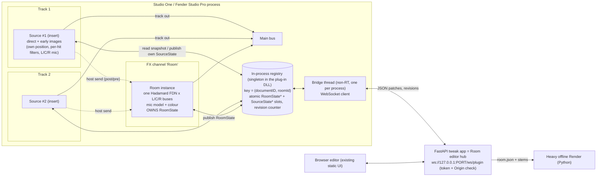

# Linked "2011 Room Reverb" plug-in for Studio One / Fender Studio Pro: design

Written 27 Sep 2026 (BST). Tags: **VERIFIED** means checked on the source listed in `SOURCES.md` (the [n] numbers here). **ASSUMED** means my inference or design choice, to be proven by the prototype. **FORUM** means a user report, not vendor documentation.

## 0. Goal (Idle's vision, restated)
- Each track that should sit in the room gets a **Source** instance as a track insert. The instance is that track's source position in **one shared room**.
- Room size, surfaces, the three L/C/R mics and all source positions are edited in **one place outside the plug-ins**, the existing FastAPI/web tweak app. A change reaches every instance at once.
- A later offline "heavy" render (the Python Render path or a better model) reproduces the same session from the same room description.

## 1. Host facts that shape the design

| # | fact | status |
|---|---|---|
| H1 | Studio One 7.0.0 (9 Oct 2024) added **CLAP plug-in and instrument support**. 7.0.1 fixed "[CLAP] Freeze on instantiating certain plug-ins"; 7.2 (3 Jun 2025) fixed "[CLAP] Latency compensation not working properly". | VERIFIED [S1] |
| H2 | Studio One became **Fender Studio Pro 8** (8.0.0, 13 Jan 2026; 8.0.2, 3 Mar 2026). The 8.0.x notes fix "[CLAP] plug-ins cannot be scanned" and "[CLAP] plug-in doesn't show its multi-outs". Songs are now "Sessions". v8 installs alongside v7 but the two cannot run simultaneously. | VERIFIED [S2] |
| H3 | Formats: VST3 (sidechain docs [S4]), CLAP (from 7.0 [S1]) and AU on macOS. | VERIFIED for VST3 and CLAP; AU (and VST2 status) not checked here, ASSUMED |
| H4 | **VST3 sidechain** is supported. The source can be a pre- or post-fader **send** or a channel output. Several tracks can feed one sidechain input. | VERIFIED [S4][S4b] |
| H5 | **Automatic plug-in delay compensation**, with no manual offset needed. There are user reports of PDC failures involving sidechains or buses. | VERIFIED (auto PDC) [S3]; failures are FORUM [S6] |
| H6 | **Dropout Protection** / dual buffer. The playback block size (large) is separate from the monitoring block size (small). Only plug-ins adding **< 3 ms** latency stay active on the low-latency monitoring path. | VERIFIED [S3] |
| H7 | **PreSonus plug-in extensions** (public domain, VST3 interfaces). `IContextInfoProvider` exposes the channel name, type (track/bus/FX…), index, colour, **send count and send levels**, and **kDocumentID / kActiveDocumentID / kDocumentName**. `ISlaveControllerHandler` with `kSlaveModeLowLatencyClone` means the host may create **hidden clone instances** (low-latency monitoring, grouped channels) that the plug-in must keep in sync. | VERIFIED [S7] |
| H8 | Plug-in sandboxing or out-of-process hosting in Studio One: **not found**. A user feedback request asks for it, which suggests it does not exist. All instances in one Session are then expected to be in one process and share a DLL's static memory. | ASSUMED (supported by [S8]) |
| H9 | Several Sessions open at once, and whether only the active one processes audio. | ASSUMED; must be tested (P3). This is why the registry is keyed by kDocumentID (H7). |
| H10 | Insert effects exposing extra output buses to the mixer (a dedicated "inject" aux out). | ASSUMED **not** practical for effects in Studio One (H2 mentions CLAP *instrument* multi-outs). The design does not rely on it. |

## 2. Routing options compared

| | **A. Source inserts + host send → Room on an FX channel (shared FDN)** | B. Per-instance full engine sharing only state | C. Shared-memory audio pipe between instances (Spat/Fiedler style) |
|---|---|---|---|
| How | The Source renders direct + early images for its position. A normal send (post- or pre-fader) feeds an FX channel whose **Room** instance runs the one FDN + mic model. | Every instance runs direct + early + its own FDN. Only room, mic and position state are shared. | Sources push audio into an in-process or shared-memory ring; the Room pulls it. |
| CPU | Early × N + **one** FDN (×3 buses) | Early × N + **FDN × N**, the worst case | Early × N + one FDN |
| Latency / PDC | 0 samples, and the host's own send graph handles order and PDC (H5). | 0 samples | Needs a forced processing order (route Sources into the Room channel) or 1 block of latency. FLUX says LAP audio is **not** DAW-latency-compensated and needs a manual input delay [P2]. |
| Sample sync | By construction (host graph) | By construction | Only if the host order is forced. FLUX warns about anticipative processing and CPU-saving modes [P2]. |
| Bounce / offline / freeze | Works: the host treats it as normal audio. Freezing a Source track freezes direct + early, and the send still feeds the Room. | Works. Freeze bakes the tail into each track. | Risky: faster-than-real-time rendering, freeze and parallel threads can break the pipe (ASSUMED; vendors require special routing [P1][P2]). |
| Faithful to 2011 "images excite the tail" | Partly. The tail is excited by the *sum* of Source outputs (direct + early), not by per-image line injection (see §3.2). | Fully (unchanged engine) | Could be full if 32 inject channels per source were piped (heavy) |
| Session save/restore | The Room owns the room state; Sources own their position. | Each instance stores a copy; the newest revision wins. | Same as A plus pipe re-binding |
| User setup | Insert the Source, add one send per track to the "Room" FX channel (or use the Source's "send level" via IContextInfoProvider, H7) | Insert only | Insert + forced routing |
| Verdict | **Recommended** | Fallback, e.g. for hosts without sends, or "solo" use of one instance | Rejected for v1 (also rejected in `C_MIGRATION_PLAN.md` §9, Design B) |

Sidechain variant of A: the Room sits on any bus and takes Source audio through its VST3 sidechain input, with sends targeting the sidechain (H4). It is useful if the user wants the Room on an existing bus. It is secondary because of the FORUM PDC reports (H5). ASSUMED.

## 3. Recommended architecture (A)



### 3.1 Responsibilities
- **Source** (track insert, stereo in/out):
  - sums its input to mono (the source signal)
  - renders the **direct + early field** for its own position using the shared room and mic snapshot: image-source list, per-hit serial surface filters, 1/r or 1/r² law, and the L/C/R capsules with their measured colour
  - outputs stereo on the track, so the track fader and pan behave normally, and has a **dry passthrough** option
  - adds no latency
  - publishes its `SourceState` (id, position, track name from `IContextInfoProvider`) to the registry
- **Room** (FX channel, stereo in/out):
  - its input is the sum of the Source sends (direct + early, stereo)
  - maps the input to the FDN injection and runs **one** Hadamard FDN per L/C/R bus with room-fixed delays, then the mic fold and colour
  - outputs the wet tail
  - **owns** `RoomState`: saves it in its chunk, exposes the automatable room parameters (decay, size scale, wet level) as host parameters, and publishes snapshots
  - only one Room per roomId is authoritative. A second Room instance with the same roomId becomes a mirror (UI shows "linked copy").
- **Registry**: process-wide singleton keyed by `(documentID, roomId)`. It holds the current `RoomState*`, the `SourceState*` slots and revisions. It is lock-free for readers.
- **Bridge**: one non-RT thread per process, started with the first instance and stopped with the last. It is a WebSocket client to the tweak app and applies editor patches by building new snapshots. The app is a hub: several DAW processes or sessions can connect, each identified by documentID.

### 3.2 A deliberate change from 2011 (flag to Idle)
- In 2011 every image *is* an FDN line (line delay = image delay) and the per-image inject excites the tail.
- With N sources and one FDN the line delays cannot follow every source. In A, the shared FDN uses **room-fixed line delays**: the LIVE_32 image delays for a reference source at the room centre, or the mean over sources. It is excited by the summed direct + early signal coming from the Sources, split to the L/C/R buses.
- This is ASSUMED to sound very close (the tail is diffuse after about 80 ms, and the early field stays exact per source). It must be A/B tested against the per-instance full engine (option B), which the same C core can run in "solo" mode.
- The heavy offline render stays exact per source (§6).

## 4. Data model

```text
RoomState  (immutable snapshot; published by pointer swap)
  schema: 1                      # bump on incompatible change
  room_id: UUID                  # created by the Room instance
  document_id: string            # from IContextInfoProvider kDocumentID (VST3/Studio One); "" otherwise
  revision: uint64               # monotonic, set by the registry on publish
  geometry: {W, H, L}            # metres
  surfaces[6]: {absorb[7 octaves], diffusion, eq preset}     # A..F as in the tweak app
  mics[3]: {x, y, z, pattern, yaw_deg, gain, pan, phase, preset, hpf}
  tail: {decay_s, decay_lock, hadamard_n, air_lp, air_shelf, humidity, fdn_wet}
  early: {law: "2011_1r2" | "physical_1r", image_set: "LIVE_32" | ...}
  c_mps, temperature_c
SourceState (one per Source instance)
  source_id: UUID                # stored in the Source's own chunk (survives reload)
  room_id: UUID                  # which room it joins
  label: track name (context info), colour
  pos: {x, y, z}, directivity, gain_db, mute, early_wet, direct_wet
  revision: uint64
Registry (per process)
  rooms: fixed array[16] of {key=(document_id, room_id), atomic<RoomState*> current,
                             sources: fixed array[128] of {atomic<SourceState*>, atomic<uint32> heartbeat, is_clone}}
  retire list: snapshots waiting for reclamation (epoch-based)
```

- **Versioning**: every patch from the editor carries `base_revision`. If it is stale, the registry rebases field-wise when there is no conflict, or rejects it and the app refetches. The chunk blob is `RR2011` magic + `schema` + CRC32 + JSON (or a binary equivalent), as `C_MIGRATION_PLAN.md` §10 suggests.
- **Save/restore**:
  - The Room saves the full RoomState.
  - Each Source saves its own SourceState **plus a cached copy of the RoomState it last saw**. If the Room loads later than a Source, or is missing, the Source still renders the early field with the cached room. When the Room appears, the higher revision wins, and the Room's copy wins on a tie.
- **Clones** (H7): an instance told `kSlaveModeLowLatencyClone` does not register a new SourceState. It attaches read-only to its master's source_id.
- **Duplicated tracks**: a copied Source carries the same source_id. If an id is already live in the same document, the newcomer generates a new id (keeping its position) and the app shows "Track 2 (copy)".

## 5. Real-time and threading rules
1. The audio thread never locks, allocates, frees, logs, does file or socket I/O, or waits on another instance.
2. Once per `process()` block, read `atomic<RoomState*>` and your own `SourceState*` with acquire ordering. Use only that pointer for the block. Reclamation is epoch-based: each instance stores the epoch it last read, and the bridge or a worker frees retired snapshots when every live instance has passed it.
3. Heavy derivations run on a worker thread and are published as a prepared `EngineConfig` alongside the snapshot:
   - image list
   - per-hit filter coefficients
   - FDN delays and gains
   - mic colour filters
   
   The audio thread only switches configs. For geometry changes, crossfade old/new engine outputs over 20–50 ms (ASSUMED inaudible), because delay lengths jump.
4. Set FTZ/DAZ at the start of `process()` and restore on exit. This matches the F3 denormal fix already in `engine/work`.
5. Cross-instance sample alignment of parameter changes is **not** guaranteed: each instance picks up a new revision at its next block. Treat room edits as UI-rate events with a crossfade. Host-automatable parameters live on exactly one instance (the Room, for room params; each Source, for its own position), so the host's sample-accurate automation stays per-owner.
6. Offline bounce and freeze: the render must not depend on the bridge. Ignore editor patches while the host reports offline processing (VST3 `ProcessSetup.processMode == kOffline`; CLAP has a similar render-mode extension; ASSUMED to be checked in the SDK headers).
7. The bridge reconnects with backoff. With the app closed, the plug-ins keep working from the saved state.

## 6. Heavy offline render path
- The app keeps `session_room.json` (RoomState + all SourceStates, with track labels from `IContextInfoProvider`).
- Workflow:
  1. Export dry stems from Studio One with the Sources bypassed (or tap them pre-insert).
  2. The app/Python Render convolves each stem with the exact per-source model: the image = line structure as in 2011, or a heavier model.
  3. Sum the results.
- Labels map stems to sources. This keeps "render with a heavier model" independent of plug-in real-time limits. ASSUMED workflow.

## 7. Formats and libraries

| option | licence (VERIFIED where cited) | fit |
|---|---|---|
| **VST3 SDK** (Steinberg) | **MIT since 3.8**. VSTGUI and some example (mda) files carry BSD-style licences [L1] | Needed for Studio One's PreSonus extensions (H7), which are VST3 interfaces. **First target.** |
| **CLAP** | **MIT** [L2] | Supported since S1 7.0 with PDC and scan fixes through 7.2/8.0.x (H1/H2). **Second target.** A C ABI, so the C core drops in. The PreSonus context and clone extensions are VST3-only, so CLAP has no documentID: fall back to roomId-only matching. |
| AU | Apple SDK, terms not checked | mac only; later |
| JUCE | Dual **AGPLv3** or commercial. The repo points to the **JUCE 9 EULA (published 17 Jun 2026)**: Starter free up to $20k revenue, Indie $40/mo or $800 perpetual up to $300k, Pro $175/mo or $3,500 [L3] | Fastest to build, but AGPL or paid. Not needed. |
| iPlug2 | zlib-style [L4] | Light C++ wrapper (VST3/CLAP/AU). Its web-view UI support would match the web editor (ASSUMED; check the current repo). A good alternative to raw SDKs. |
| DPF | ISC [L5] | Light, Linux-first; VST3 and CLAP support (ASSUMED details) |
| nih-plug (Rust) | ISC, **but** its VST3 bindings (vst3-sys) are **GPLv3** per the README [L6] | Avoid unless GPL is fine |

**Recommendation**: a C/C++ plug-in shell on the **VST3 SDK (MIT)** for Studio One first, linking the existing C core (`fdn_core.c`, `live_stereo.c` lineage), with **CLAP (MIT)** as a second entry point in the same binary or a sibling binary. iPlug2 (zlib) is an acceptable wrapper if Grok Build prefers one. No JUCE unless Idle accepts AGPL or a paid tier.

If the VST3 and CLAP builds are **separate DLLs**, their static singletons are separate: a VST3 Source and a CLAP Room would not see each other. Either ship one binary with both entry points, or back the registry with named shared memory scoped to the process (e.g. `Local\RR2011_<pid>`). ASSUMED; for P0–P2, VST3 only.

## 8. Central editor: web app vs embedded UI

| | FastAPI/web app as hub (recommended) | UI embedded in each plug-in |
|---|---|---|
| One place for all sources | Yes: one room view shows all SourceStates (labels and colours from the host) | Each plug-in window would need the full room view anyway |
| Reuse | Existing tweak app, 3D and geometry UI, Python Render | Rebuild in VSTGUI, or a web view per instance |
| Works with the app closed | Yes, from the saved state. Each plug-in keeps a small native panel: roomId, link status, position XY pad, "open editor" button. | Yes |
| Risks | Localhost security: **any web page can open ws://127.0.0.1**. Require a random token (written to `%LOCALAPPDATA%\RR2011\bridge.json`) and check the `Origin` header. Firewall prompts are unlikely for loopback (ASSUMED). | Size and complexity per instance |

- Direction: **plug-in = WebSocket client, app = server/hub**. The DAW process then runs no server and has no port clashes, and several DAW sessions can join one app.
- The DAW session is authoritative for saved state: on connect a plug-in pushes its room, and the app mirrors it.
- The prior art is compatible: Vienna MIR Pro 3D uses a standalone room app with DAW plug-ins routing to it [P5].

## 9. Prior art (only what was checked)
- **Fiedler Audio Dolby Atmos Composer + Beam**: Beam instances on tracks send audio and position to the Composer over an internal connection. If the Composer is not on the master, the manual requires Beam tracks to be routed to the Composer track so they are processed first; otherwise crackles or delays occur [P1]. This is the same order problem as option C.
- **FLUX SPAT Revolution Local Audio Path**: shared-memory audio between Send/Return plug-ins and the SPAT app, up to 64 channels per instance. "Audio and Automation" mode is sample-accurate. Tracks with a Send must be routed to tracks with a Return. LAP audio is not DAW-latency-compensated, so the user reports the delay manually [P2].
- **Audio Ease 360pan suite**: each 360reverb has a "private ambisonics input" backdoor reachable only from 360pan instances, and appears as a send destination inside every 360pan [P3]. A linked source → room pattern.
- **2CAudio Precedence + Breeze (PBJ)**: Precedence Link inter-plug-in communication, multi-instance editing, edit groups and global broadcast. Distance Link: per-instance reverbs on inserts forming one space [P4].
- **Vienna MIR Pro 3D**: a standalone room application, with DAW plug-in instances routing audio to and from it [P5].
- **iZotope inter-plug-in communication**: Relay, Neutron and Visual Mixer share session data across instances [P6].
- **Blue Cat's Connector**: audio between instances or apps (app / local host / network) with buffering and latency compensation [P7].
- Not confirmed from primary pages in this pass, so they are **not relied on**: Sound Particles Space Controller (a search summary said up to 128 instances via communication links), sonible "group mode" details, dearVR, Waves, Nugen, IRCAM Spat, Klevgrand.

## 10. Phased prototype (details in `GROK_BUILD_BRIEF_Plugin_prototype.md`)
- **P0** Singleton proof: two VST3 instances in Studio One share one "room size" value through a static registry. Changing it on one changes the other's tone or UI within one block. Save/reload works.
- **P1** Registry + bridge: a versioned RoomState/SourceState and a WebSocket link to a minimal FastAPI endpoint (a separate new module, not inside `software\` until Idle approves). The browser moves a source, and the Source instance follows.
- **P2** Audio: the Room instance runs one C-core FDN from the send input; Source instances render direct + early. A/B against the per-instance full engine (option B) for the §3.2 question.
- **P3** Studio One hardening: clones (low-latency monitoring, H6/H7), freeze, real-time and offline bounce equality, several Sessions open (documentID), duplicate tracks, missing Room, PDC with sends and with the sidechain variant.
- **P4** CLAP build, heavy-render export (`session_room.json` + stems), polish.
