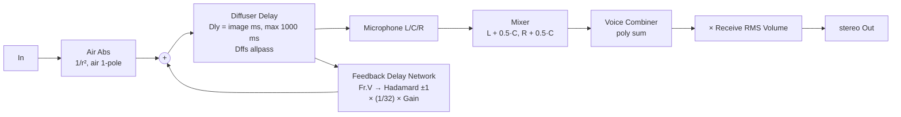
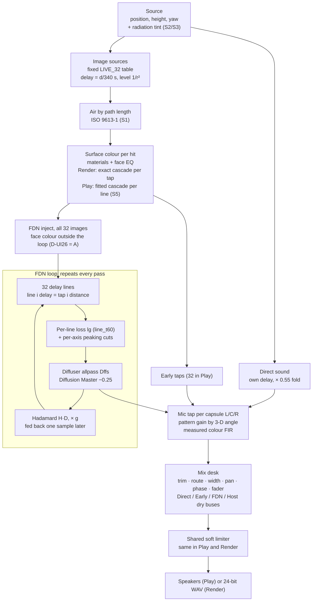
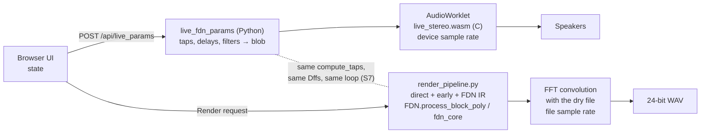
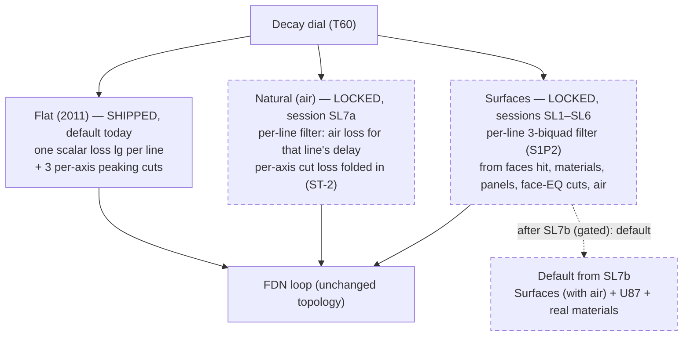

# Chapter 2 — Signal flow

> **Status: DONE (draft 2026-10-05).** Describes build 51 (S-AUDIT tree, `WORKLET_VER` 51) and marks every later stage as LOCKED or PLANNED.
> **Tags:** VERIFIED / ASSUMED as in Chapter 1. **Diagram key:** solid boxes = in the build 51 tree; dashed boxes = LOCKED or PLANNED, not merged.

**Chapter purpose.** This chapter follows one sound from the source to the speakers, stage by stage, so that every later chapter has a place on the map. It shows the 2011 wet path that the rebuild must keep reproducible, the modern chain as it runs today, how Play and Render split, and where the planned Natural and Surfaces decay modes plug in. If you only remember one picture from the book, make it Figure 2.2.

---

## 2.0 The whole picture in plain English

Clap your hands in a real room and listen closely. First you hear the clap itself, straight from your hands to your ears: the **direct sound**. A few thousandths of a second later come a handful of distinct echoes off the nearest walls, floor and ceiling: the **early reflections**. After that the echoes pile up so fast that you can no longer tell them apart; they melt into a smooth, fading wash: the **tail** (the reverb proper). How long that wash lasts, and whether it is boomy or bright as it fades, is what makes a bathroom sound different from a carpeted studio.

The program builds those three parts on purpose, in that order:

1. **Direct sound** — the source, delayed and made quieter by its distance to each microphone.
2. **Early reflections** — 32 echoes worked out from the room's shape, as if each wall were a mirror (Chapter 5 explains the "mirror" trick).
3. **The tail** — the same 32 echoes are fed into a recirculating network of 32 delay lines, the **FDN** (feedback delay network). Each line is like a corridor the sound runs down; at the end, the sound from all corridors is shuffled together and sent round again, a little quieter each time. Round after round, the echoes multiply into the smooth wash.

Three virtual **microphones** (left, centre, right) listen to all of it. A small **mixing desk** balances them, and the result goes to the speakers (**Play**, live) or into a file (**Render**, offline).

One more idea is needed to understand the future of the program. *Where* a filter sits decides what it can do. A filter applied **once**, before the sound enters the recirculating network, can only change the tail's tone, like tinted glass in front of a lamp. A filter **inside** the network acts again on every round, so its effect piles up over time and changes how fast each pitch range dies away. Today the walls are mostly "tinted glass". The planned **Surfaces** mode moves the walls inside the network, so that a carpeted room really does stop ringing in the treble sooner than a tiled one (§2.5, §2.7 and Chapter 6).

## 2.1 The 2011 wet path (locked)

The HANDOVER keeps the 2011 wet path as a locked diagram (VERIFIED, `roadmap/eq_plan/src/HANDOVER.md`, "2011 wet path (locked)"):

*Figure 2.1. The 2011 wet path, redrawn from the HANDOVER's ASCII diagram. "× (1/32) × Gain" is the lock-off / `reaktor_parity` rule; with Decay lock on the desktop uses `g = 1/√N` and a per-line `line_t60` loss.*

Three rules from the same section matter everywhere (VERIFIED, HANDOVER):
- "First read at each image time **is** that image." Each of the 32 voices is one image source, and its delay line length is that image's delay. The FDN's first pass therefore *is* the early field; there is no gap or lump between early and late "by construction" (VERIFIED, `roadmap/sound_tricks/SOUND_TRICKS.md`, "Already done or locked", citing `fdn_delays_from_taps`, `fdn.py` 785–814).
- "Hadamard is mix/invert only."
- "Mixer has **no** Delay."

> **In plain English.** Figure 2.1 is Idle's 2011 design in one line. Sound goes **in**, is made quieter with distance (`1/r²`: twice as far, a quarter of the level) and slightly duller by the air. It then enters the **Diffuser Delay**: 32 delay lines, each exactly as long as the travel time of one echo, each with a small "smearing" filter (the **allpass** or **Dffs**, which spreads a click out in time without changing its tone). The microphones listen to those lines. The lines also feed the **FDN**, which shuffles all 32 together with a fixed pattern of plus and minus signs (the **Hadamard** matrix), turns them down, and sends them back to the start. The three mics are folded to stereo as left + half the centre, right + half the centre.
> The three rules say: the first time you hear each line, *that is* the echo (so early echoes and tail join seamlessly); the shuffle only mixes and flips signs, it adds no delay or filtering; and the mixer adds no delay either.

## 2.2 The modern chain today (build 51, Flat (2011) decay)

*Figure 2.2. Signal chain in build 51. The order of the boxes inside the loop is schematic: see Chapter 5 for exactly where `lg`, the peaking cuts and the allpass sit in each engine.*

Stage by stage:

1. **Source.** A position in metres and a height; since S2/S3 also a facing direction and a radiation pattern (instruments beam), with a tail that stays yaw-invariant (VERIFIED, `BIG_JOBS_ROADMAP_2026-10-01.md` J1 "Done in S2/S3"). The K3 default source is x 2.6 m, height 1.2 m (VERIFIED, `DECISIONS_LOCKED_2026-09-28.md` K3).
2. **Image sources.** A fixed index table, not "the loudest 32 at the mic". `LIVE_32` uses reflection orders 0–4 as 1 / 6 / 11 / 10 / 4 images; the direct image is voice 3, line index 2 (VERIFIED, `roadmap/nonrect/NONRECT_RESEARCH.md` §1 citing `early_field.py:257`; HANDOVER hard locks). Mic patterns change tap *gains* only; they never change which images are chosen (VERIFIED, `roadmap/THURSDAY_LIST.md` U9).
3. **Air.** ISO 9613-1 air by path length on the early images and the FDN inject (S1, J6). The direct sound stays air-free (VERIFIED, BIG_JOBS J6; `3_phase_acceptance_tests/README.md`, `test_p2_air.py`: "Direct is air-free in Play and Render").
4. **Surfaces.** Each face A–F has a material card (absorption per octave) and a face EQ. Each reflection is coloured by the faces it hits (a serial per-hit cascade). Since S5 (D-UI26 = A) the face colour also reaches the tail, through a per-line feed-forward filter on the FDN inject, *outside* the loop (VERIFIED, HANDOVER "S5 — D-UI26 = A"). Being outside the loop, it changes tail **tone and level, not decay time** (VERIFIED reasoning, `roadmap/eq_plan/EQ_PLAN.md` "plan in five lines" item 3).
5. **FDN loop.** 32 lines, Hadamard mixing with fixed column signs (H·D), one diffuser allpass per line, a per-line loss set by the Decay dial, and three per-axis peaking cuts inside the loop. Details in Chapter 5.
6. **Mic tap.** Each capsule listens to the direct sound, the early taps and the FDN output. "Mic is the listen tap off the diffuser output, in parallel with feedback. It is not on the inject, and the coloured signal is not written back." (VERIFIED, HANDOVER "Mic, air, and wall cards".) The pattern gain uses the 3-D angle between capsule aim and the arriving ray. Details in Chapter 7.
7. **Desk.** Three mic strips (L, C, R) and four buses (Direct, Early, FDN, Host dry), with trim, route, width, pan, phase and fader (VERIFIED, HANDOVER "S-MIX"; `roadmap/THURSDAY_LIST.md` U7). There is no EQ on the desk (VERIFIED, EQ_PLAN §5).
8. **Limiter and output.** A shared soft limiter, the same in Play and Render, landed in S-AUDIT (VERIFIED, `roadmap/THURSDAY_LIST.md` "Done since 3 Oct"). Render writes 24-bit WAV.

The 28 Sep K4 decision made the default mix **FDN-first**: the FDN fader up, Direct and Early faders down, with the early bus ready to be raised at once without a stale replay (VERIFIED, `DECISIONS_LOCKED_2026-09-28.md` K4). In build 51 the client defaults are still `fader_direct: 0, fader_fdn: 0.5, fader_early: 0, fader_dry: 0` (VERIFIED, `ui_audit_1004/app/software/static/js/app.js` line 112). How 0.5 maps to dB on the S-MIX desk is not stated in the sources read; the HANDOVER describes the faders as "dB, 0 dB at mid-throw" (VERIFIED, older one-source live-mix note), so 0.5 = 0 dB is ASSUMED.

> **In plain English.** Figure 2.2 is the same journey with today's extras. A **source** (an instrument at a spot in the room, facing a direction) produces a **direct sound** and **32 mirror-image echoes**. Each echo is dulled by the **air** it travels through (a longer path loses more treble) and coloured by the **walls** it bounces off (each wall has a material and an EQ). The echoes are heard as **early reflections** and also sent into the **FDN loop**, where they circulate: each round they lose a little level (set by the **Decay** dial), get smeared by the diffusers, and are shuffled together. The **microphones** listen to the direct sound, the early reflections and the circulating tail, each according to where it points and what kind of mic it is. The **desk** balances everything, a **limiter** stops it clipping, and you hear it or get a file.
> Important for later: today the wall colour reaches the tail only on the way *in* (outside the loop), so the walls change the tail's tone but not how long it lasts. The Decay dial alone sets the length, the same for bass and treble.

## 2.3 Two sources

A stereo file can be split into two sources: file left → source A, file right → source B. Each source has its own image set, its own direct pattern and its own 32-line tank; "Do not fold B's tail back into A's tank" (VERIFIED, HANDOVER "Two-source image"). Mirror places B at `(W − sx, sy, sz)` (VERIFIED, same section).

The **Shared tail** option (Play only, default off, stereo setups only) runs one network for all mics to save CPU: 2.001 ms → 1.507 ms per block, a 24.7 % saving (VERIFIED, HANDOVER "Shared tail").

> **In plain English.** A stereo recording can be treated as two instruments in the room: its left channel at one spot and its right channel at another. Each gets its own echoes and its own tail, so the two sides stay distinct. "Mirror" places the second one at the mirror-image spot across the room. The optional "Shared tail" runs one tail for both in Play to save about a quarter of the processing time.

## 2.4 Play and Render: one design, two engines

*Figure 2.3. Play and Render share the geometry and coefficient code in Python; the sample loop runs in C/wasm for Play and in Python (or `fdn_core.so`) for Render. Chapter 3 explains what is identical and what still differs.*

Key facts (VERIFIED unless marked):
- Play uses the same `compute_taps` as Render (THURSDAY_LIST U9, citing `render_pipeline.py` 2029; Render 1433/1462).
- Since S7 both loops store `g·H·y` and apply it on the next sample ("z⁻¹ in both"); the FDN-only Play-vs-Render null is −71.8 dB (HANDOVER S7 and S5 fix-up).
- Render builds an impulse response and convolves the dry file with it (`fft_convolve`), so it can only carry time-invariant processing (EQ_PLAN §4e).
- Play runs at the sound card's rate; Render at the file's rate. "They null sample-for-sample only when the file rate and the device rate are the same number." (HANDOVER "Fix 1".)

> **In plain English.** There are two engines. **Play** runs live in the browser and must finish each tiny slice of audio (2.667 thousandths of a second) on time, so it is written in C and compiled for the browser (**wasm**). **Render** has no deadline: it builds the room's complete "echo fingerprint" (the **impulse response**, what you would record if you fired a starting pistol) and then applies it to your file in one go (**convolution**). Both are fed by the same Python code that works out the geometry and the filter settings, and since session S7 their recirculating loops are built the same way, so their tails match to within −71.8 dB (far below hearing). Chapter 3 explains what still differs.

## 2.5 Where the decay modes plug in

Today every line loses the same amount per pass at every frequency: **Flat (2011)**. Two in-loop modes are designed and locked but **not merged** (VERIFIED status, `roadmap/DECISIONS_LOCKED_2026-10-04.md`):

*Figure 2.4. Decay modes. The FDN topology (Hadamard, 3 × 32 lines, mic and source directivity) does not change in any mode; only the per-line loss changes (VERIFIED, `roadmap/sound_tricks/SURFACES_IN_LOOP.md` §2 step 7).*

- **Flat (2011)** stays selectable for ever, and its references are planned as a frozen bit-exact parity suite (LOCKED, D-SL10).
- **Natural (air)**: "Each pass round the loop now loses a little more treble than bass, by exactly the amount a sound wave loses in air while travelling that line's delay length." (VERIFIED quote, SOUND_TRICKS §1; status LOCKED as ST-1/ST-2, built in SL7a.)
- **Surfaces**: the decay per band "is therefore *not drawn*. It **emerges** from the treatment." (VERIFIED quote, SURFACES_IN_LOOP §1; LOCKED as D-SL1–9.) Chapter 6 explains it.
- **One default switch** (SL7b) makes Surfaces (with air), the U87 Ai Cardioid mics and the real default materials the default in one re-recording, only after Idle's written OK on the SL7a A/B (LOCKED, D-SL10, D-UI38 amended).

> **In plain English.** A **decay mode** decides how much each of the 32 corridors loses on every round, at each pitch.
> - **Flat (2011)**, today: every corridor loses the same amount at every pitch, so bass and treble fade at exactly the same speed. The Decay dial sets that speed. Real rooms don't behave like this, but this is the 2011 sound and it stays available forever.
> - **Natural (air)**, planned for SL7a: each round, each corridor also loses the treble that air would absorb over that corridor's length. Treble now fades a bit faster than bass, as in any real space.
> - **Surfaces**, planned for SL1–SL6: each corridor gets a small tone control worked out from the walls its echo actually hits (materials, absorber panels, cuts in the face EQ) plus the air. The fade per pitch range is no longer set by hand; it *follows from* what the room is made of. A bare brick room rings long and bright; a treated studio dies quickly and evenly.
> Nothing else in the engine changes: same 32 corridors, same shuffle, same mics. Only the "loss per round" changes. After Idle has listened and agreed in writing, one session (SL7b) makes Surfaces the default.

## 2.6 Where EQ lives (and where it cannot)

The EQ plan's rule of thumb (VERIFIED, `roadmap/eq_plan/EQ_PLAN.md` §1 and "plan in five lines"):
- **Colour EQ** (air, materials, face EQ) sits on Surfaces, *before* the FDN.
- A cut on the FDN inject "cannot build up over passes. The FDN is LTI, so it acts exactly like a post EQ on the tail. It is a level control, not a decay control."
- Only filters **inside the loop** change decay time per band: the existing per-axis cuts, the planned resonance cuts (dB ∝ delay), and the planned Natural/Surfaces filters.
- One **Output EQ** is planned on the Mix tab after the desk (D-UI24 = A, session S-OUT, not scheduled for Thursday). There is no strip EQ.

*Figure 2.5. The EQ plan's signal-order diagram (copied from `roadmap/eq_plan/signal_order.png`). Note: it includes stages that are not built — 4b per-band T60, 4c delay modulation, 4a resonance control and 7 Output EQ. FWHT rotation, shown there as rejected, stays rejected.*

> **In plain English.** Think of the recirculating loop as a hall of mirrors with a tinted pane.
> - A tint **in front of** the hall (before the FDN) colours the light once: the tail comes out with a different tone, but it fades just as fast. That is why an EQ cut on the inject is "a level control, not a decay control".
> - A tint **on one of the mirrors** (inside the loop) acts on every bounce, so its effect multiplies: a 0.2 dB cut per round becomes several dB after half a second. That is the only way to make, say, the treble die sooner than the bass.
> - An EQ **after** the desk shapes the finished mix, like the tone control on a hi-fi.
> **LTI** ("linear, time-invariant") means a process that treats every moment the same way and simply adds signals up; a whole LTI chain can be squashed into one fixed filter, which is why order doesn't matter outside the loop but does matter inside it.

## 2.7 Preview: how Surfaces will shape the sound (plain English)

*Status: LOCKED, DESIGNED and pre-built on the box, not merged (sessions SL1–SL6; default only after SL7b). Full detail in Chapter 6.*

Picture the sound of one echo as a ball that bounces round the room. At every bounce the surface it hits takes a bite out of it. A hard plaster wall takes a tiny bite; a thick absorber panel takes a big one. The bite also depends on pitch: a foam or mineral-wool panel bites hard at mid and high pitches but hardly touches the bass; a **tuned panel** (a membrane or a perforated "Helmholtz" board) is like a sponge that only soaks up one narrow band of bass, around the frequency it is built for. Air takes its own small bite of the treble all the time.

In Surfaces mode the program does that bookkeeping for each of the 32 corridors:
1. For each wall it works out how much it absorbs at each pitch, from the base material plus any panels you add.
2. From the whole room it predicts a decay time per pitch band (a classical formula; shown in a "Room result" panel).
3. For each corridor it looks at the walls that corridor's echo hits and turns the bites into "lose this many dB per round at this pitch".
4. It sets the corridor's small tone control (three filter stages) to match, checks that nothing could ring forever, and after one test render nudges any octave that came out too long or short.

The result is that the decay per pitch band is not a curve someone drew: it **comes out of** the room's materials and treatment, the way it does in a real room.

**Auto-treat** is a helper button. You say how long you want the room to ring (the Decay dial); it suggests a list of treatment — first broadband panels spread over four walls, then up to four tuned bass panels aimed at the worst boomy bands — and shows before/after. Nothing changes until you accept or edit the list. With Decay lock on, the dial still sets the mid-band length and the materials set the shape around it.

## Open / gaps

- Fader value → dB mapping on the S-MIX desk (0.5 = 0 dB is ASSUMED).
- **Resolved while writing:** the sources disagree on whether Play follows Render's Hadamard size chips (the HANDOVER's older "Engine notes" say "Play live N locked to 32"; BIG_JOBS lists "Play `hadamard_n` (t17)" as done in S3). The build 51 code settles it: `live_fdn_params` "honours hadamard_n 8, 16, and 32. 64 and 128 stay on the 32-line network" (VERIFIED, `ui_audit_1004/app/software/render_pipeline.py` 1940–1962). The HANDOVER engine note is out of date.
