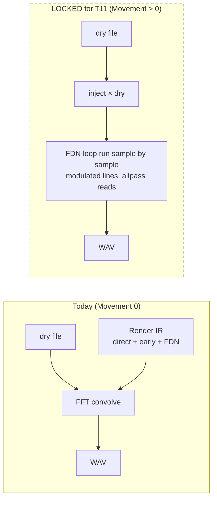

# Chapter 3 — Play versus Render

> **Status: DONE (draft 2026-10-05).** Build 51 facts plus the locked plans that touch parity (Movement, Surfaces, Natural). Numbers are copied from the named files.

**Chapter purpose.** The program has two engines that must sound like one room: **Play**, which runs live in the browser, and **Render**, which writes a file. This chapter explains why there are two, what is guaranteed identical between them today, what still differs and why, and which planned features put that parity at risk. It is the chapter to read before any change that touches the FDN loop.

---

## 3.1 Why two engines

- **Play** has to finish every audio block in time. The block budget is 128 samples at 48 kHz, i.e. 2.667 ms (VERIFIED, HANDOVER S5 "Gate 0.8 × 2.667 = 2.133 ms"; `BUDGET_MS` stays `128/48`, HANDOVER S5 fix-up). It runs as one C function, `live_stereo` in `software/engine/live_stereo.c`, compiled to WebAssembly and called from an AudioWorklet (VERIFIED, HANDOVER "NOW — Play is one C block").
- **Render** has no deadline. It is Python (`render_pipeline.py`, with `engine/fdn.py` and an optional C helper `fdn_core.so`), builds an impulse response and convolves the dry file with it (VERIFIED, EQ_PLAN §4e: "Today's Render builds one IR and convolves the dry file with it (`render_pipeline.py` `fft_convolve`)").

Both are driven from the same Python geometry and coefficient code: Play's parameters come from `live_fdn_params`, which uses "Same geometry / inject / Dffs / cut-only peaking as the offline IR" (VERIFIED, docstring, `ui_audit_1004/app/software/render_pipeline.py` 1940–1950).

> **In plain English.** Live sound has a deadline. The sound card asks for the next 128 samples (2.667 thousandths of a second at 48 kHz) and if the program is late you hear a click. So **Play** is one compact piece of C code running inside the browser. **Render** has all the time it wants: it calculates the room's complete echo fingerprint (the **impulse response**, what a microphone would record after a single click in the room) and then applies it to the whole file (**convolution**: every sample of the file triggers a copy of the fingerprint, and all copies are added up). Both engines get their settings from the same Python code, so they start from the same room.

## 3.2 What is identical today (VERIFIED)

| Part | Status in build 51 | Evidence |
|---|---|---|
| Image selection | Both use `compute_taps` and the same image tables | THURSDAY_LIST U9 |
| FDN loop structure | "z⁻¹ in both": Play and Render both save `g·H·y` and add it on the next sample when any Dffs is set; the no-Dffs path is same-sample in both | HANDOVER S7 (D3) |
| Loop trims | Equal −1.70 dB F3 trim on both paths (D3b) | HANDOVER S7 |
| FDN-only null (t18) | −71.8 / −71.8 dB after the S5 fix-up (gate −30 dB; target −60 dB) | HANDOVER S5 fix-up D-S5c-3 |
| Tail T30, std room 1.8 s | Play and Render 1.70, 1.72, 1.80, 1.80, 1.80 s (500 Hz–8 kHz), ratio 1.000 | HANDOVER S7 |
| Face colour on the tail | Render inject uses Play's fitted cascade (`fit_line_cascade`, same K and f32 rounding); worst tail band difference 0.019 dB on the default scene | HANDOVER S5 fix-up D-S5c-3 |
| Mirror | `test_mirror_exact`: Render −232.3 dB, Play max-abs 0 (gate ≤ −120 dB) | HANDOVER D-MIX-J |
| Limiter | One shared soft limiter, same in Play and Render | THURSDAY_LIST "Done since 3 Oct" |

> **In plain English.** Today the two engines agree on everything that matters for the tail: which echoes are used, how the recirculating loop is built, the level trims, the decay times (identical to three decimal places in the standard room), the wall colour on the tail, mirror symmetry and the limiter. "Null" is the test used: play both versions, flip one upside down and add them; whatever is left is the difference. −71.8 dB means the difference is about 4,000 times quieter than the signal (computed here: 10^(71.8/20) ≈ 3,900).

### How "z⁻¹ in both" was found

Before S7, Render solved the diffuser and Hadamard on the same sample, which needs a matrix solve, while Play fed back one sample later. The F5 research (2 Oct) showed that Play's diffuser "is already a true allpass", that Idle's proposed restructure "is what Play already does", and that the fix was to give **Render** Play's loop (VERIFIED, `research_f5_allpass/REPORT.md` §0). The alternative — porting the same-sample solve into Play — gave the same parity at **+18.5 % Play CPU**, estimated to fail the CPU gate, whereas "z⁻¹ in both" cost 0 ms on Play and made Render's loop 14 % faster (VERIFIED box, PC estimate ASSUMED, same §0). Idle accepted D3/D3b; S7 landed it.

The lesson for the book: when Play and Render disagree, prefer changing Render to match Play, because Play carries the CPU constraint (ASSUMED as a general rule; it is what happened in S7 and in D-S5c-3).

> **In plain English.** "z⁻¹" is engineering shorthand for "one sample later". Before session S7 the two engines built the loop slightly differently: Render worked out the feedback on the same sample, which needs heavy maths, while Play fed it back one sample later. Research showed Play's way was already correct and cheaper, so Render was changed to match Play. The general lesson: when they disagree, change Render, because Play is the one with the deadline.

## 3.3 What still differs (and why)

1. **The early field.** Render's early field is "the full geometric image set with the absolute cascade"; Play's is "32 FDN-timed taps with the relative fit" (VERIFIED, HANDOVER S5 "Misses"). Harness test t13 still XFAILs on the early field: L energy +3.25 dB, R +3.37 dB (VERIFIED, HANDOVER S7). The 0–80 ms full-mix gap for all-faces HS+6 was 0.964 dB, reported but not gated (VERIFIED, HANDOVER S5 fix-up D-S5c-4). Listed as known open gate L11 (VERIFIED, THURSDAY_LIST §3).
2. **Sample rate.** Play runs at the sound card's rate (Chrome picks the device rate; a 44.1 kHz file is resampled to 48 kHz on a 48 kHz device); Render runs at the file's rate. "They null sample-for-sample only when the file rate and the device rate are the same number." (VERIFIED, HANDOVER "Fix 1".) In build 51, `live_fdn_params` designs delays, the decay-lock mean, air, the shelf and peaking at the posted rate when one is sent (VERIFIED, docstring lines 1946–1949).
3. **44.1 kHz interpolation (D-INT, open as N6).** On a 44.1 kHz device all Play delays become fractional and `read_lane` interpolates linearly, giving "−0.05 to −2.4 dB per pass at 10 kHz, uneven per line". Computed, not rendered: the 10 kHz T60 would fall from 1.8 s to about 0.63 s in the default room (VERIFIED as computed, EQ_PLAN §2). "Parity tests run at 48 kHz, so they cannot see it" (ASSUMED, same row). The recommendation is to round delays to whole samples at the device rate (EQ_PLAN §6, D-INT); not scheduled on Thursday.
4. **Small-room decay in Play (D7 / D21).** The long-standing `--slow` fail: the small room's 1 kHz band decays in 0.732 s against a 0.8 s dial (−8.5 %) (VERIFIED, THURSDAY_LIST N10). D21 (locked) says: re-measure Play on the PC after T4; if Play ≈ Render (≈ −4 % at 1 kHz) accept and widen the tolerance; if Play is still ≈ −8 %, treat it as a live-tank bug, and report before any change (VERIFIED, DECISIONS_LOCKED_2026-10-04 D21). Session P-D7, a PC step with no code.
5. **Colour at other rates.** Measured mic colour has SOS tables for 44.1 and 48 kHz only; "other rates turn colour **off with a visible notice**" (VERIFIED, DECISIONS_LOCKED_2026-09-28 item 7).

> **In plain English.** Five known differences remain. (1) The early echoes: Render uses the complete set, Play only the 32 that also feed the tail, so Play's early part is about 3 dB louder; a known open item. (2) Play runs at the sound card's sample rate, Render at the file's, so they match sample-for-sample only when those are the same. (3) On a 44.1 kHz sound card Play's delays fall between samples and the in-between values are estimated in a way that dulls the treble on each trip; a fix (rounding to whole samples) is recommended but not scheduled. (4) The small room's mid band decays a little fast in Play; it will be re-measured on the PC before anything is changed. (5) Measured mic colour only exists for 44.1 and 48 kHz; at other rates it switches off and says so.

## 3.4 The CPU budget

Play's limits are measured on the PC with harness test t19 (two directional sources, colour on). The gate is the **median**, not the mean, since S7 (VERIFIED, HANDOVER S7 "CPU gate"). The ceilings and recent numbers:

| Measure | Ceiling | Recent value | Source |
|---|---|---|---|
| t19 shared tail off | 2.40 ms (0.90 × 2.667) | median 2.22415 ms (after D-MIX-J) | HANDOVER S5 fix-up, D-MIX-J |
| t19 shared tail on | 2.133 ms (0.80 × 2.667) | median 1.74235 ms | HANDOVER D-MIX-J |
| FDN fader at 0 | — | 2.17 ms (tank keeps running for unmute) | THURSDAY_LIST N17 |

Acceptance uses a 12-round paired ABBA comparison against the previous wasm (VERIFIED, HANDOVER S5 fix-up D-S5c-2). Headroom is therefore small — the EQ plan estimates Output EQ 0.003 + delay modulation 0.015 + up to three extra in-loop slots 0.141 ≈ 2.38 ms, "It fits, only just" (ASSUMED estimates, EQ_PLAN §5).

> **In plain English.** Play has a fixed time budget per slice of audio, 2.667 thousandths of a second, and the hardest test case (two directional sources with mic colour on) already uses about 2.2 of them on Idle's PC. The safety ceiling is 2.40 (90 %). Because timings on a computer jitter, new and old versions are timed alternately (old, new, new, old, twelve times) and the middle value (**median**) is compared. The margin is small, which is why every new feature has to say what it costs.

## 3.5 Planned features that touch parity

| Feature | What it does to parity | Status |
|---|---|---|
| **Smooth** (Dffs cap 0.7) | Applied where Dffs is made (`tap_dff`), "used by both the offline FDN and `live_fdn_params`. Play and Render then get identical values from one source." | LOCKED, session T4 (`roadmap/eq_plan/EQ1a_PROMPT.md`) |
| **Movement** (delay modulation) | Time-varying, so it cannot live in a single IR. "Render runs the dry signal through the loop when Movement > 0; at Movement 0 it keeps today's IR + convolution path." LFO phase indexed by absolute sample from a seed, one shared C function, so sample-exact is possible if both start at t = 0 (ASSUMED design) | LOCKED, session T11 (EQ_PLAN §4c, §4f) |
| **Surfaces in the loop** | One Render calibration pass; "Play uses the Render-designed coefficients" (D-SL4). Box SL3 cost: +0.031 ms per block (wasm). Flat Play bit-exact | LOCKED, SL2–SL4 (`roadmap/prebuild/sl/README.md`) |
| **Natural (air)** | Same per-line hook as Surfaces, Render + Play; stop if it needs > +0.05 ms of Play CPU over Flat on top of Surfaces' budget | LOCKED, SL7a |
| **C migration (J2)** | "one C core for Play, Render and later the plug-in, so Play and Render can no longer drift" | PLANNED, not started (BIG_JOBS J2) |
| **Lean convolution mode** (Idle's idea) | A partitioned convolution of a rendered IR for many stacked instances. "A convolution engine is LTI, so it cannot carry modulation exactly"; options: no modulation, or a few cross-faded IR variants | PLANNED idea, L6 (EQ_PLAN §4e; THURSDAY_LIST L6) |

*Figure 3.1. Render today versus Render with Movement. Only time-varying features force the loop path; LTI features (cuts, Dffs cap, EQ) keep the IR path (VERIFIED, EQ_PLAN §4e).*

> **In plain English.** Each planned feature has a plan for keeping the two engines in step. Smooth is calculated in one place for both. Surfaces is designed once in Render and then copied into Play. Movement is the hard one: a tail that changes over time cannot be captured in a single fingerprint, so Render will run the loop sample by sample whenever Movement is turned up. Further ahead, moving everything into one shared C engine would make drift impossible. A convolution-only plug-in (Idle's idea) would be very efficient but could not carry Movement exactly.

## 3.6 Rules of thumb (for future sessions)

- Any change to the loop must keep t18 (FDN-only null) at or near −71.8 dB and `test_mirror_exact` at ≤ −120 dB (VERIFIED as gates, `roadmap/eq_plan/EQ1a_PROMPT.md` G6).
- Default-off features must be **bit-exact** when off, in both engines (VERIFIED as the pattern of every locked prompt, e.g. EQ1a G1, SL2 "Flat default bit-exact null test").
- Never put a 32×32 matrix multiply back in the audio thread; never drop Play below 32 lines (VERIFIED, HANDOVER "NOW — Play is one C block").
- Do not raise `--perf-scale` or loosen `BUDGET_MS` to pass t19 (VERIFIED, HANDOVER S5 / S7).

> **In plain English.** Four rules protect the match: the tails must keep nulling deeply and mirror tests must stay perfect; any new feature, when switched off, must give exactly the old sound in both engines; never put back the heavy per-sample maths or reduce Play's 32 lines; and never pass the CPU test by loosening the test.

## Open / gaps

- Render length (D-AUD-2) was locked as "Render length follows Decay + short end fade (default 1.8 s unaffected: old cut at −93 dB; Decay 4 s T30 3.40 → 3.98 s, VERIFIED)" (`BIG_JOBS_ROADMAP_2026-10-01.md`, D-AUD list) and is listed as landed in S-AUDIT; the PC measurements from the S-AUDIT session itself are not on the box.
- No source states how Play and Render will be checked against each other at 44.1 kHz once D-INT is fixed.
