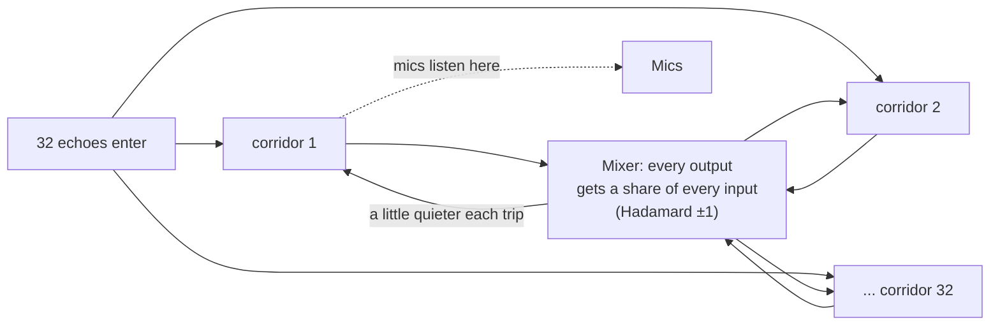

# Chapter 5 — The early field and the FDN tail (Smooth, Movement, the EQ split)

> **Status: DONE (draft 2026-10-05)** for what is in build 51. Smooth and Movement are **LOCKED, not merged** (sessions T4 and T11); they are described from their locked prompts and box prototypes, not as shipped behaviour.

**Chapter purpose.** This chapter opens the engine: how the 32 reflections are chosen and timed, how they become the 32 lines of the feedback delay network, what happens to the sound on every pass round the loop, and why the tail sounds the way it does today (including its metallic ringing). It then explains the two locked fixes — **Smooth** and **Movement** — and the "EQ split": which filters can change decay time and which can only change level. Chapter 6 builds on this to explain Surfaces. §5.0 explains the engine without formulas, and §5.6a walks slowly through why decay-shaping filters must sit inside the loop.

---

## 5.0 The engine in plain English (read this first)

*No formulas here; §5.1–§5.7 give the precise version with sources.*

**Mirrors for walls.** To find where the echoes in a rectangular room come from, pretend each wall is a mirror. Stand at the microphone and look at a wall: you "see" a copy of the instrument behind it. That copy is an **image source**. The sound from it travels in a straight line to the mic, exactly as long as the real bouncing path. Mirrors of mirrors give echoes that bounce twice, three times and so on. For each image the program knows the distance, so it knows how late the echo arrives (distance ÷ the speed of sound, 340 m/s) and how quiet it is (`1/r²`: twice as far, a quarter of the level). The program uses a fixed list of 32 images: the direct sound plus 31 echoes of one to four bounces.

**From 32 echoes to a tail: corridors that feed each other.** Real reverb has thousands of echoes per second. Calculating them all would be far too slow, so the 2011 design uses a trick, the **feedback delay network (FDN)**. Imagine 32 corridors of different lengths. Each corridor is exactly as long as the travel time of one of the 32 echoes, so the first time a sound comes out of corridor 7, that *is* echo 7. At the far end of the corridors, all 32 outputs are poured into a mixer that blends them with a fixed pattern of pluses and minuses (the **Hadamard matrix**: every output gets a bit of every input, some flipped upside down) and pours the blend back into the starts of all 32 corridors. So echo 7 comes back as part of every corridor, comes out again at 32 different later times, gets mixed again, and so on. After a few rounds there are hundreds, then thousands of overlapping echoes: the smooth tail.

**Why it fades.** On every trip each corridor turns the sound down a little (the **loss**). The Decay dial sets how much. A long corridor is visited less often, so it must lose more per trip; the program sets each corridor's loss so that all of them fade at the same speed in dB per second. If the losses were zero the tail would ring for ever; if anything gained level, it would grow out of control. That is why "stability" comes up so often.

**The smearing filter.** Each corridor also has a **diffuser** (an **allpass** filter, controlled by **Dffs**). It does not change the tone; it smears each click slightly in time, so the echoes blur into a smoother wash sooner. Turned up too far, it can ring at its own pitches.

**The ringing problem.** Today's tail has some metallic, pitched ringing in the mids, measurably more "peaky" than real noise. **Smooth** (session T4) and **Movement** (session T11) are the two approved fixes (§5.4, §5.5).

**The one rule to remember.** Anything done to the sound *before* it enters the corridors happens once: it changes the tail's tone or level, never its length. Anything done *inside* the corridors happens on every trip, so it piles up and changes how fast the tail dies. That is why per-pitch decay (Natural and Surfaces modes) needs filters *inside* the loop (§5.6).

*Figure 5.0. The corridors picture of the FDN (explanatory drawing; the exact order of loss, diffuser and mixer is in §5.2).*

## 5.1 The early field: image sources

**Geometry.** The room is a rectangle W × H × L metres. Images are mirror copies of the source, built with the 2011 mirror macros (`2W−X`, `−X`, `4L−Z` and so on; "full-R; never half-W") (VERIFIED, HANDOVER hard locks). For each image and each capsule:
- distance `d` is the 3-D Euclidean distance;
- delay is `(d / 340) × 1000` ms with `c = 340` m/s (VERIFIED, HANDOVER hard locks, "VERIFIED Const", "(420–433)");
- geometric level is `1/r²` — "Air Abs geometry is `1/r²` VERIFIED — do not change it" (VERIFIED, HANDOVER "Cause").

**Which 32.** Images come from a fixed table, `LIVE_32` in `engine/early_field.py` (line 257 in the build 51 copy), using reflection orders 0–4 as 1 / 6 / 11 / 10 / 4 (VERIFIED, `roadmap/nonrect/NONRECT_RESEARCH.md` §1). Variants exist for `reaktor_parity` (`LIVE_32_REAKTOR`) and binaural (`BINAURAL_REAR32`, with 5 rear images); other line counts come from `enumerate_scaled_grid` (VERIFIED, THURSDAY_LIST U9). The direct image `(0,0,0)` is voice 3, line index 2 (VERIFIED, HANDOVER "Live voices"). `compute_taps` picks the table and then only computes gains per capsule from the pattern: "Patterns change gains only. A reflection in a fig-8 null keeps its line" (VERIFIED, U9).

**What colours each reflection** (in order; VERIFIED, `3_phase_acceptance_tests/README.md` `test_p2_air.py`: "Render stage order image → air → surfaces → mic"):
1. **Air** by path length (ISO 9613-1, session S1).
2. **Surfaces**: the material and face EQ of every face the path hits, as a serial cascade (`stages([A,B]) == stages(A)+stages(B)`, VERIFIED same README). Render applies the exact cascade per tap; Play uses a fitted cascade per line (VERIFIED, EQ_PLAN §1 diagram; HANDOVER S5).
3. **Jitter**: a seeded path-length jitter `Δd` per reflection (the Surfaces "diffusion" layer, kept separate from the Structure Dffs, VERIFIED, `3_phase_acceptance_tests` P0.3). Since D-MIX-J it is mirror-invariant: mirror pairs share one random draw (VERIFIED, HANDOVER D-MIX-J).
4. **Mic**: pattern gain and measured colour (Chapter 7).

**Solo and Mute** on a face act on the early field only (D11, D12, D15, D16): Solo keeps every image that touches the face, Mute drops every image that touches it, and the FDN inject is unaffected (VERIFIED, HANDOVER S4b).

> **In plain English.** The program finds echoes by mirroring the source in the walls, and uses a fixed list of 32 of them (always the same images, wherever the mic points). Each echo is then made duller by the air it travels through, coloured by every wall it bounces off, given a tiny random change in path length so the pattern sounds less rigid, and finally heard by each mic according to where that mic points. Soloing a wall lets you hear only the echoes that touch it; muting a wall removes them (early echoes only; the tail is unaffected).
> The direct sound and the reflections use "voices": 32 parallel copies of the same processing, one per image. **Reflection order** means the number of bounces: order 0 is the direct sound, order 1 has bounced once, and so on.

## 5.2 From reflections to tail: the FDN

**One line per reflection.** "FDN line i delay = tap i distance" (`fdn_delays_from_taps`, `engine/fdn.py` 785–814) (VERIFIED, THURSDAY_LIST U9). All 32 early images inject into the FDN (VERIFIED, `test_locks.py` in package 3). The default source position was chosen so that the default scene has 29 distinct delays per bus (was 20 / 12 / 20) (VERIFIED, DECISIONS_LOCKED_2026-09-28 K3). Delays are deliberately **not** made unique: "Do not uniquify delays" (VERIFIED, HANDOVER).

> *Plain first:* on each sample, a corridor takes what is arriving (new input plus the mixed feedback from the previous sample), reads its own delayed sound with the loss and its fixed dip applied, smears the two together in the allpass way, and writes the result back into the corridor. The formulas below are the exact recipe.

**One pass round the loop (Play, build 51).** The F5 research read the C code (VERIFIED, `research_f5_allpass/REPORT.md` §1):
- `s = xin + fb`, where `fb = g·(H·D·y)[n−1]` is stored for the next sample;
- `y = −d·s + r`, where `r` is the delay read with the loss `lg` and the peaking cuts applied inside `read_peaked`;
- the line writes `s + d·y`.

So each line is a delay wrapped in a Schroeder allpass with coefficient `d` (the Dffs): per line `Y/S = (lg·z⁻ᴰ − d) / (1 − d·lg·z⁻ᴰ)`, with |T| = 1 when lossless (VERIFIED, same report §2). Since S7, Render runs the same structure (Chapter 3).

**The matrix.** An unscaled ±1 Hadamard (Sylvester construction; "construction ASSUMED", no OCR sign table) applied by a fast Walsh–Hadamard transform `fwht32` (VERIFIED, HANDOVER hard locks; package 3 `test_locks.py`). Since S4b the 32-line loop is **H·D**, with a fixed mirror-safe diagonal of column signs, which fixed a comb in the default room; `reaktor_parity` keeps plain H (VERIFIED, HANDOVER S4b). Shared-tail mode flips entries 3 and 24 of that diagonal (locked) (VERIFIED, HANDOVER "Shared-loop signs").

> *Plain first:* two ways of setting how fast the tail fades. In the 2011 way, the whole mixer is turned down by one gain knob. In today's default ("Decay lock on"), the mixer is kept at a neutral level and each corridor gets its own loss per trip, sized so that every corridor drops by 60 dB in the time on the Decay dial.
>
> *Worked illustration (computed here):* with the dial at 1.8 s, a 20 ms corridor loses 0.67 dB per trip and a 40 ms corridor 1.33 dB per trip. The first makes 50 trips a second, the second 25, so both lose 33.3 dB per second and reach −60 dB at 1.8 s together.

**The loop gain.** Two laws (VERIFIED, HANDOVER "Engine notes"; `engine/fdn.py` 862–870 in build 51):
- **2011 / `reaktor_parity` / Decay lock off:** `g = Gain / N`, i.e. `Out = In × (1/32) × Gain`, clamp `0.99/√N`.
- **Decay lock on (desktop default):** `g = 1/√N` (about 0.177) and a per-line loss `lg = 10^(−3·dᵢ/(sr·T))` where `dᵢ` is the line delay in samples and `T` the Decay dial — that is −60·τᵢ/T dB per pass, so every line decays at the same rate in dB per second (VERIFIED, `fdn.py` line 870).

**The diffuser.** Each line's Dffs comes from the surface "diffusion" sum times **Diffusion Master**, clipped to ±1 (`dff_after_master`, VERIFIED `fdn.py` 211–218). Diffusion Master defaults to the Structure default −0.25 and is clamped to [−0.5, 0] (VERIFIED, DECISIONS_LOCKED_2026-09-28 item 5; `fdn.py` 200–208).

**Per-axis peaking cuts (inside the loop).** Every line carries one cut-only RBJ peak at the first axial mode of X, Y or Z (line i % 3), −1.5 dB per pass, Q 1.5, whatever its length (VERIFIED, EQ_PLAN §2; `live_peaking_banks` in `fdn.py` 581–609). Play restores each peak's `b2` in double precision so DC gain is exactly 1; that stops long decays from growing (VERIFIED, HANDOVER S4b "DC restore"). The EQ plan measured that these cuts over-cut the bass: default room octave T20 with / without them 31.5 Hz 0.58 / 1.53 s, 63 Hz 0.97 / 1.65 s at a 1.8 s dial (VERIFIED, EQ_PLAN §2).

**Level trims.** Each loop change that altered loudness got a fixed makeup row in `LOOP_LEVEL_TRIM_DB`: F2 line absorption −2.81 dB (both paths, only while Decay lock carries the decay), F3 play-rate delays −1.70 dB (both paths, always), F5 0 (VERIFIED, `fdn.py` 244–248). Trims only ever reduce level.

**Denormals.** After the input stops, filter states could sink into subnormal floats and multiply CPU cost; the guard flushes air and shelf states under about 1e-20 and adds a tiny offset to the loop (VERIFIED, HANDOVER "Fix 2"; SOUND_TRICKS "Already done": `ls_flush` 1e-20 at `live_stereo.c` 501, plus an `LS_DC` offset).

> **In plain English.** Each of the 32 echoes gets its own corridor, exactly as long as that echo's delay. On every trip: the corridor's output is turned down (loss), passed through one small fixed dip (each corridor in turn gets the dip for the room's lowest length, width or height resonance), smeared by the allpass diffuser, mixed with all other corridors by the ±1 Hadamard pattern (with a fixed set of sign flips that removed a comb-like colouring), and fed back one sample later. The **Diffusion Master** knob (default −0.25) scales all the smearing filters together. Two housekeeping details: whenever a loop change made the tail louder, a fixed level trim was added so loudness did not jump; and a tiny guard stops the processor slowing down when the sound has died to almost nothing (**denormals** are extremely small numbers that some processors handle very slowly).
> **Sample**: one measurement of the waveform; at 48 kHz there are 48,000 a second. **RBJ peak**: a standard EQ bell filter. **Q**: how narrow a filter is (higher Q = narrower).

## 5.3 How today's tail sounds (measured)

**Decay against the dial.** At diffusion −0.25 the Play T30 sits within ±8 % of the dial in 14 of 15 band × scene values; the exception was the small room at 500 Hz (+10.5 %) (VERIFIED, DECISIONS_LOCKED_2026-09-28 tail table). After the S4b column signs the small room's worst band moved to 1 kHz (−8.5 % → −3.5 % in one measurement; still listed as −8.5 % in THURSDAY_LIST N10), which is why D21 asks for a PC re-measure (VERIFIED, BIG_JOBS §0.G; THURSDAY_LIST N10).

**Flat decay across bands.** "The tail decays at the same rate in every band" — `lg` is one scalar per line (VERIFIED, SOUND_TRICKS "Short answer", citing `fdn.py` 866–872 and `live_stereo.c` 1893–1907). Real rooms lose treble faster. This is what Natural and Surfaces modes address (Chapter 6).

**Metallic ringing.** The EQ plan's measurements (VERIFIED, EQ_PLAN §2, §4a):
- Late-tail peakiness (std of fine-bin dB, 0.3–1.3 s): **engine 7.20 dB** against **noise 5.53 dB** (textbook Rayleigh 5.57).
- Strongest lines at 724, 1285, 781 and 2008 Hz, +18.5 to +21 dB over the local median — "in the mid band, **not at room modes, and not from the banks**."
- Box room (3 × 2.4 × 4 m) is worse: line peaks 19.6 dB against noise 8.6–8.8, and 15 of 32 diffuser gains at the −0.98 clamp.
- Likely causes: uneven modal excitation by a plain Hadamard, diffuser gains at the clamp, and duplicate delays (ASSUMED, EQ_PLAN §4a).
- Room modes do **not** ring in the tail beyond chance: "FDN modes are not room modes" (VERIFIED, EQ_PLAN §2).

> **In plain English.** Measured today: the tail's length matches the Decay dial to within 8 % almost everywhere; the small room's mid band is the exception still being checked. Bass and treble fade at exactly the same speed (unlike a real room). And the tail has a few pitched "rings" in the mids, around 700 Hz to 2 kHz, standing about 20 dB above their neighbours. They are not the room's own resonances and not caused by the fixed dips; the likely causes are the shuffling pattern, diffusers turned up to their limit and corridors with identical lengths (an educated guess, marked ASSUMED). **Peakiness** is the measure used: how much the fine detail of the tail's spectrum jumps up and down. Real random noise scores about 5.5 dB; the engine scores 7.2 dB.

## 5.4 Smooth (EQ-1a) — LOCKED, session T4

*Status: LOCKED by Idle 4 Oct 10:13; not merged. Source: `roadmap/eq_plan/EQ1a_PROMPT.md`, EQ_PLAN §4f.*

- **What:** cap the diffuser gain |Dffs| at **0.7**, **default ON**. Off = today's engine, bit-exact.
- **Where:** where Dffs is made (`tap_dff` in `render_pipeline.py`), so Play and Render get identical values from one source.
- **Decay correction:** the uncapped-to-capped change lengthened octave T30 by +4–8 % at 63–500 Hz with HF unchanged. The correction must be computed, not hand-tuned, and folded into an existing per-line coefficient (`lg`), "likely" because the allpass group delay changes the effective loop time (ASSUMED cause, stated as such in the prompt).
- **Forced off** in `reaktor_parity`, flat cards and the mirror/null test modes.
- **Gates:** G1 bit-exact off; G2 T30 within ±5 % (default, box, carpet rooms); G3 t19 CPU; G4 peakiness at least 0.4 dB lower (prototype −0.64 dB); G5 regenerate only the goldens the Smooth default changes; G6 t18 ≤ −60 dB, mirror ≤ −120 dB.
- **Stop rule:** if G2 and G3 cannot both pass, ship Smooth default **OFF** (no golden change) or revert.

Prototype numbers (VERIFIED, EQ_PLAN §4e, `proto_mod/`): the Dffs cap ("dcap") alone took peakiness from 7.21 to 6.57 dB.

> **In plain English.** The diffusers' smearing strength (Dffs) can range from 0 to nearly ±1. Near ±1 a diffuser starts to behave like a tuned pipe and rings. In one test room 15 of 32 diffusers sat at the −0.98 limit. **Smooth** simply never lets any diffuser go beyond 0.7. In the prototype, capping made the bass (63–500 Hz) ring 4–8 % longer, probably because the smearing filters change the effective timing of each corridor (the prompt marks this cause as ASSUMED). So Smooth also applies a calculated correction, folded into each corridor's loss, to keep the decay where the dial says. It is on by default and can be turned off to get today's sound exactly. In the prototype the cap alone cut peakiness from 7.21 to 6.57 dB. If the session cannot keep both the decay accuracy and the processing cost within limits, Smooth ships switched off.

## 5.5 Movement (EQ-1b) — LOCKED, session T11

*Status: LOCKED; not merged; the biggest Thursday session. Source: EQ_PLAN §4b, §4e, §4f; `roadmap/eq_plan/EQ1b_PROMPT.md`.*

- **What:** a Movement knob on the Room tab, **default 0**. 0 = off; 50 % = "mod10" (0.10 ms peak); 100 % = "mod15" (0.15 ms peak); linear in between. The 50 % midpoint is the plan's reading of Idle's request and is listed as needing a quick yes (ASSUMED, THURSDAY_LIST N14).
- **Frenette set:** sine LFOs at 0.7 Hz × 0.6–1.4 per line, phases k·112.5°, on 16 of 32 lines, with **first-order allpass reads** on the modulated lines only (linear interpolation showed a −24 dB HF tilt and T30 −14 % in the box prototype).
- **Render must run the loop** when Movement > 0 (Chapter 3).
- **Forced off** in parity, flat and mirror/null modes.
- Prototype (VERIFIED, `proto_mod/`): peakiness 7.21 → mod10 6.51, mod15 6.28, mod10 + dcap 6.07 dB (noise 5.53); named peaks down 0–9 dB; pitch wobble on a sustained 440 Hz tone 0.2–0.3 cents rms.

> **In plain English.** A pitched ring happens when a corridor-and-mixer pattern repeats exactly, over and over. **Movement** keeps 16 of the 32 corridors very slightly changing length, each swinging slowly (about once every 1.4 seconds, varied per corridor) by at most 0.10–0.15 thousandths of a second. That is about 3.4–5 cm of path length (computed here at 340 m/s), like the walls breathing by a few centimetres. The rings can no longer lock in, so they smear out. The pitch wobble this causes on a held note was measured at 0.2–0.3 cents (a cent is a hundredth of a semitone), far too small to hear as vibrato (ASSUMED judgement). Because the tail now changes over time, Render can no longer use one fixed "echo fingerprint" and has to run the loop sample by sample when Movement is on. The knob defaults to 0, so nothing changes unless you turn it up. **LFO** = low-frequency oscillator, a slow wobble generator.

## 5.6 The EQ split: level versus decay

The single most useful idea in the EQ plan (VERIFIED, EQ_PLAN "plan in five lines" and §3c). In plain words first: where you put a filter decides whether it changes the tail's *tone* or its *length*. The table sorts every filter by place; §5.6a explains why, step by step.

| Where a filter sits | What it can do | Examples |
|---|---|---|
| **Before the FDN** (on the inject) | Level and tone of the tail only. "LTI and outside the loop: the same dB at every moment" | Air, materials, face EQ, D-UI26 face colour |
| **Inside the loop, same dB on every line** | Changes decay, but unevenly: "neighbouring modes decay at different rates" | Today's per-axis cuts (kept for 2011 parity only) |
| **Inside the loop, dB ∝ line delay** (Jot) | Changes decay per band homogeneously: cᵢ = 60·dᵢ·(1/T_target − 1/T_now) dB per pass | Planned resonance control (N5); Natural; Surfaces |
| **After the desk** | Overall tone of the wet sum | Planned Output EQ (S-OUT, D-UI24 = A) |

The formula in the third row reads: the cut per trip cᵢ equals 60 dB × the corridor's length in seconds × (1/the decay you want − 1/the decay you have now). Worked example from the plan: shortening a band from 2.4 s to 1.8 s needs 0.17 dB per pass on a 20 ms line and 0.33 dB on a 40 ms line, adding up to 0.8 dB at 0.1 s, 4.2 dB at 0.5 s and 8.3 dB at 1 s — "transients are barely touched and the long tail is re-timed" (VERIFIED, EQ_PLAN §3b, §2).

### 5.6a Why the filters must be inside the loop — step by step

This is the idea that the whole Surfaces chapter rests on, so here it is slowly.

1. **A filter before the loop acts once.** Suppose you cut 3 dB of treble from the echoes before they enter the corridors. Every echo that enters is 3 dB less bright. Everything the loop then makes from those echoes is also 3 dB less bright, at the start of the tail and at the end. The tail is duller, but it fades at exactly the same speed. In the language of the plan: "the same dB at every moment" — a level control, not a decay control.
2. **A filter inside the loop acts on every trip.** Now put a small treble cut on a corridor itself. The sound passes through it every time round. After one trip it has lost that cut once, after ten trips ten times. The longer the tail goes on, the more treble has been removed: the treble dies sooner while the start of the sound is barely touched.
3. **The plan's worked example** (VERIFIED, EQ_PLAN §3b): to shorten one band from 2.4 s to 1.8 s, a 20 ms corridor needs only 0.17 dB of cut per trip. That adds up to 0.8 dB after 0.1 s, 4.2 dB after 0.5 s and 8.3 dB after 1 s: "transients are barely touched and the long tail is re-timed".
4. **Why the cut must depend on corridor length.** A long corridor is visited less often than a short one. If every corridor had the same cut per trip, short corridors would remove more per second than long ones, and the tail would fade unevenly (the plan's words: "neighbouring modes decay at different rates"). So the right recipe, from Jot, gives each corridor a cut in proportion to its length: twice as long, twice the cut per trip (the 40 ms line needs 0.33 dB where the 20 ms line needs 0.17 dB).
5. **Never boost inside the loop.** A boost on every trip adds energy every time. Enough of it and the loss per trip at that pitch turns into a gain, and the tail grows instead of fading. That is why Surfaces only lets EQ **cuts** into the loop.

Natural and Surfaces modes are both just smarter versions of point 4: a per-corridor tone control whose cut per trip follows the corridor's length and, for Surfaces, the walls that corridor's echo hits.

## 5.7 Shipped versus Thursday

| Item | Status |
|---|---|
| LIVE_32 image set, 1/r², c = 340, air, per-hit surfaces, jitter | SHIPPED (build 51) |
| 32-line H·D loop, one-sample feedback in both engines, Decay lock law, per-axis cuts, DC restore, trims | SHIPPED |
| D-UI26 face colour on the inject (tone, not decay) | SHIPPED (S5) |
| Smooth (Dffs cap 0.7, default ON) | LOCKED → T4 (golden YES) |
| Movement (default 0) | LOCKED → T11 |
| D-INT 44.1 kHz rounding | OPEN (N6) |
| Resonance control (in-loop, dB ∝ delay, ≤ 4 rows) | OPEN (N5) |
| Natural (air) mode | LOCKED → SL7a; default in SL7b |
| Surfaces mode | LOCKED → SL1–SL6; default in SL7b |
| Tank gating after the tail dies (D23), velvet smear (D24) | LOCKED, later |

> **In plain English.** Already in the program: the mirror-image echoes, the 32-corridor tail with its shuffle, losses, diffusers and fixed dips, and wall colour on the way into the tail. Approved and coming: Smooth (T4) and Movement (T11). Approved for the Surfaces sessions: per-pitch decay from air (Natural) and from walls and panels (Surfaces). Still undecided: rounding delays at 44.1 kHz, and a "resonance control" for taming individual rings.

## Open / gaps

- The exact Smooth decay-correction method is for Build to compute in T4; no formula exists yet in the sources.
- The SURFACES_IN_LOOP mode table gives the default-room axial modes as 28.6 / 57.2 / 21.4 Hz. Those match c = 343 m/s, and the Surfaces prebuild indeed sets `C_AIR = 343.0` (VERIFIED, `roadmap/prebuild/sl/engine/surf_target.py` line 20), whereas the engine's locked value is `c = 340` (about 28.3 / 56.7 / 21.3 Hz, computed here). This mismatch is OPEN for SL1/SL2 to settle (see Chapter 6 §6.11).
