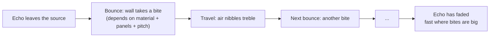
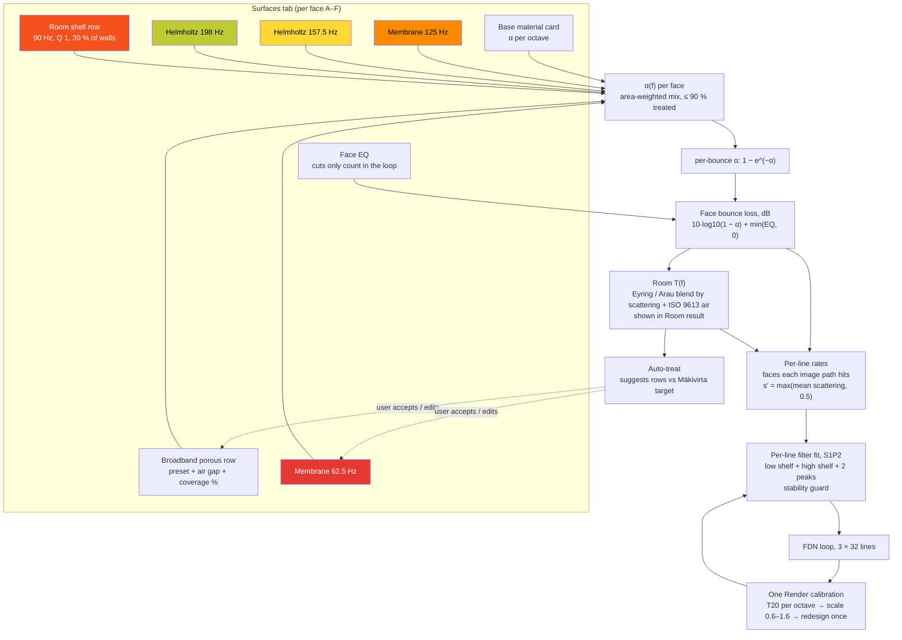
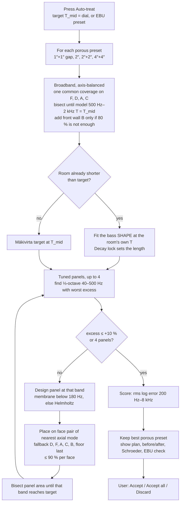

# Chapter 6 — Surfaces, panels and auto-treat

> **Status: DONE as a description of the design (draft 2026-10-05). The feature itself is NOT merged.** Surfaces-in-the-loop is researched, prototyped, listened to and locked (D-SL1–D-SL10), and its code is pre-built and tested on the box; it lands in Build sessions SL1–SL6, with the default switch in SL7b only after Idle's written OK. Everything below that is not in build 51 is marked **DESIGNED** (box prototype / prebuild) rather than shipped.
> **Main sources:** `roadmap/sound_tricks/SURFACES_IN_LOOP.md` (research, 4 Oct 17:21–18:20 BST), `roadmap/prebuild/sl/README.md` and `roadmap/prebuild/sl/engine/*.py` (tested prebuild, 4 Oct 21:50 BST), `roadmap/DECISIONS_LOCKED_2026-10-04.md`.

**Chapter purpose.** This is the chapter Idle asked for most: how the panels, absorbers, materials and face EQ all work together to give the tail its frequency response, and exactly what the automation (auto-treat) does. It separates what the Surfaces tab does today from the in-loop design, walks through the design step by step with its formulas, shows how auto-treat chooses panels, gives the measured accuracy, and lists what is still unknown. Read Chapter 5 first: the key fact is that only filters *inside* the loop can change decay time. **If you are not an engineer, start with §6.0**, which tells the whole story without formulas; every design step in §6.5 then opens with a "Plain first" note, and §6.5a sums the steps up in one table.

---

## 6.0 The whole idea in plain English (read this first)

*This section uses no formulas. Everything in it is restated with sources in §6.1–§6.11.*

**The bouncing ball.** Follow one echo round a room as if it were a ball. Every time it hits a surface, the surface takes a bite of its energy. Between bounces, the air nibbles away a little of its treble. After enough bounces the ball has nothing left: the echo has died. How fast that happens is the room's **decay time**. Acousticians call it **T60**: the time it takes the sound to fall by 60 dB, roughly from "loud" to "gone".

**Bites depend on pitch.** Each material bites differently at different pitches. Its **absorption coefficient α** (alpha) says what fraction of the sound energy a surface swallows at each bounce, from 0 (a perfect mirror) to 1 (an open window). Plaster has a small α at every pitch. Carpet and mineral-wool panels have a large α in the mids and treble but a small one in the bass. So a room full of soft furnishings dies quickly in the treble but can still boom in the bass.

**Tuned sponges.** Bass is hard to absorb with soft panels, so studios use **tuned panels**. A **membrane panel** is a thin board over an air gap: it vibrates like a drum skin at one pitch and soaks up the bass there. A **Helmholtz panel** is a perforated board over a cavity: the air in the holes bounces on the air behind like a mass on a spring, again at one pitch (the same effect as blowing across a bottle). Both are like sponges that only soak up one narrow band and ignore the rest. Choosing their size and depth chooses the band.

**What the program does today.** In build 51 the walls already have materials and an EQ, and they colour the echoes and the tone of the tail. But the *length* of the tail is set by the Decay dial alone and is the same at every pitch. In the bouncing-ball picture: the walls tint the ball, but the ball always loses the same fixed share per second, whatever it hits.

**What Surfaces mode will do (LOCKED, DESIGNED, not merged).** It lets the walls take their real bites. The tail is made by 32 recirculating corridors (the FDN, Chapter 5). Each corridor stands for one echo path that hits particular walls. Surfaces mode gives each corridor its own small tone control, set so that on every trip round the loop the corridor loses, at each pitch, what its walls and the air would really take. Because that loss repeats on every trip, it shapes how fast each pitch range dies. Nobody draws the decay curve; it **comes out of** the materials and treatment, as in a real room.

**The yardstick and the helper.** Studio designers aim for a decay that is even across the mids, rising slightly in the deep bass. In this project that is the **Mäkivirta target**: flat at the mid-band time, rising by 0.2 s from 300 Hz down to 50 Hz, following air alone above 2 kHz (VERIFIED, SURFACES_IN_LOOP §3 table). **Auto-treat** compares the room's predicted decay with that target and suggests a shopping list of panels to bring it close: broadband panels spread over four walls first, then up to four tuned panels aimed at the boomiest bass bands. It only *suggests*. Nothing changes until you accept or edit the list.

**Why bother?** On a measured real room (BRAS CR2), Flat (2011) came out 20–105 % too long per octave and kept the treble far too long. Surfaces mode came within about −2 to +26 % and got the treble-to-mid balance right (VERIFIED, §6.8). And when Idle listened to the A/B files his verdict was "sounds good, certainly a lot better than flat".

*Figure 6.0. The bouncing-ball picture behind Surfaces mode (an explanatory drawing, not a code diagram).*

## 6.1 What Surfaces does today (build 51, SHIPPED)

- **Six faces, A–F.** The UI orientation is A Left (−X), B Front (+Z), C Right (+X), D Back (−Z), E Floor (−Y), F Ceiling (+Y) (ASSUMED orientation, `/workspace/docs-publish/docs/HOW_IT_WORKS.md` §4; D = back wall −Z is VERIFIED by the D17 hint text, HANDOVER S4b). The prebuild groups them in axis pairs x = A/C, y = E/F, z = B/D (VERIFIED, `surf_target.py` line 24).
- **Material cards** with absorption per octave: 12 real materials with role bans (no carpet on the ceiling), plus porous-panel-with-air-gap presets (VERIFIED, BIG_JOBS J9 "Done in S4"). The *default* card is not a real material ("α 0.05 → 0.22, ASSUMED plaster-ish") (VERIFIED, EQ_PLAN §5).
- **Face EQ** per face: low shelf, peak, high shelf (VERIFIED, EQ_PLAN §5).
- **Solo / Mute** per face, early field only (D11–D17, Chapter 5).
- **Air card** on Surfaces (VERIFIED, THURSDAY_LIST L15).
- **Face colour on the tail (D-UI26 = A).** The absorption shape relative to the card mean, plus face EQ, filters each line's FDN inject in both engines. It is outside the loop, so "T60 stays the Decay" (VERIFIED, BIG_JOBS §0.0 D-UI26; HANDOVER S5).

So today the walls colour the tail but **do not shorten it per band**. Every line loses the same dB per second at every frequency: "Flat (2011) gives the same T in every band, whatever the walls are made of." (VERIFIED, SURFACES_IN_LOOP Figure 2 caption.)

> **In plain English.** Today each of the six surfaces (left, front, right, back, floor, ceiling = A–F) has a **material card** (how much it absorbs in each octave) and a **face EQ** (bass shelf, mid peak, treble shelf). You can solo or mute a surface to hear its early echoes. These settings colour the early reflections and, since session S5, the tone of the tail too. They do **not** change how long the tail lasts at each pitch: the Decay dial does that, equally for all pitches. "Octave" here means a band of pitches whose top is twice its bottom (for example 500–1000 Hz).

## 6.2 Where the in-loop design stands

| Stage | Status | Evidence |
|---|---|---|
| Research and formulas | Done, 4 Oct | SURFACES_IN_LOOP §1–§8 |
| Box prototype + 26 A/B WAVs | Done; Idle listened: "sounds good, certainly a lot better than flat" | `sound_tricks/proto2/`, `surfaces_ab/`; lock 20:37 BST |
| Decisions | D-SL1–D-SL9 locked 20:37; D-SL10 20:41 | DECISIONS_LOCKED_2026-10-04 |
| Pre-built engine, Play C, UI, tests | Done on the box: fast 36/36; slow SL2 4/4, SL5/SL6 2/2, SL4 4 pass + 1 xfail; Flat bit-exact 9/9 scenes | `prebuild/sl/README.md` "Test results" |
| Merged into `software\` | **No** | sessions SL1–SL6 |
| Default | **No** — Flat (2011) stays default until SL7b, gated on Idle's written OK | D-SL1, D-SL10 |

> **In plain English.** The design is finished on paper, prototyped, listened to and approved by Idle, and its code is pre-written and tested on the research machine. It is **not** in the program on Idle's PC yet. Six Build sessions (SL1–SL6) will add it as an *option*, while today's sound stays the default and is protected by tests. Only after a final listening comparison and Idle's written OK does one session (SL7b) make it the default.

## 6.3 The idea in one paragraph

"The proposed **Surfaces** mode gives each line its own small loss filter (3 biquads), designed from the physics of its own image path: which faces it hits; what each face is made of; what treatment is on the face (porous panels, tuned membrane or Helmholtz panels); the face EQ (cuts only); air. The decay curve per band is therefore *not drawn*. It **emerges** from the treatment. The Mäkivirta target becomes the yardstick that **Auto-treat** uses to size panels, not a curve imposed on the tail." (VERIFIED quote, SURFACES_IN_LOOP §1.)

> **In plain English.** Each of the 32 corridors in the tail gets its own small tone control, worked out from the physics of the walls its echo bounces off, the panels on those walls, any cuts in the face EQ, and the air. The decay per pitch band is not drawn by hand; it emerges from the room. The target curve is only used by Auto-treat, to decide what panels to suggest. "Biquad" means one standard second-order filter stage, the basic building block of most digital EQs; three biquads make one small, cheap tone control.

## 6.4 The pieces and how they connect

*Figure 6.1 (copied from `roadmap/sound_tricks/surfaces_in_loop_overview.png`). Left: how the pieces come together. Right: T20 per ⅓-octave in the default 6 × 3 × 8 m room, rendered by the engine. Untreated (plaster + parquet) runs at about 2.6 s mid and about 5 s bass; broadband panels alone leave 50–160 Hz at +35–100 %; auto-treat puts 16 of 23 bands inside the Mäkivirta ±10 % band. Dot colour is the band, red (low) to violet (high).*

*Figure 6.2. Panels and materials feeding the loop (DESIGNED, not merged). Tuned-panel boxes are coloured by frequency, red = low → violet = high, using the four panels of the default-room plan (§6.7). The porous row works mostly from about 200 Hz up and is left uncoloured.*

> **In plain English.** Read Figure 6.2 from top to bottom. Everything you put on a wall (base material, broadband panels, tuned panels, a "room shell" allowance for doors and windows, face-EQ cuts) is combined into one absorption-per-pitch curve for that wall. That curve is turned into "dB lost per bounce". From all the walls together the program predicts the room's decay per band (shown to you), and for each corridor it works out a loss rate from the walls that corridor's echo hits. A fitting step sets each corridor's tone control to match. One test render checks the result and nudges it once. Auto-treat sits on the side: it reads the predicted decay and suggests panels, which you can accept or edit.

## 6.5 Step by step

All steps below are DESIGNED (box prototype, then prebuild). Formulas are VERIFIED as written in the cited files; values marked ASSUMED are assumed in the source too.

**Step 1 — α(f) per face.**

> *Plain first:* for each wall, add up what is on it. If 20 % of a wall is covered by a panel and the rest is plaster, the wall's absorption at each pitch is 20 % "panel" plus 80 % "plaster". Panels may cover at most 90 % of a wall, because real walls have doors, sockets and edges. Each kind of treatment has its own pitch curve: broadband panels absorb from the mids up, tuned panels absorb one bass band. The formulas below predict a tuned panel's pitch (f0) from its weight and air gap: heavier boards or deeper gaps tune it lower.
>
> *Worked illustration (numbers chosen for the example and computed here, not a project setting):* a board of 5 kg per square metre over a 0.1 m gap gives f0 ≈ 60/√(5 × 0.1) ≈ 85 Hz, or about 71 Hz with mineral wool in the gap. With the ASSUMED membrane curve (Q 2, αmax 0.6) it absorbs 0.6 at 85 Hz, about 0.16 at 1.5 × that pitch and only 0.06 an octave above: a sponge for one band.

Each face's absorption is the area-weighted mix of its base material, its porous coverage and any panels, as a continuous α(f) (SURFACES_IN_LOOP §2). A face holds at most 90 % treatment ("doors, sockets, edges") (VERIFIED, `surf_panels.py` `MAX_FACE_COVER = 0.9`). Treatment models (SURFACES_IN_LOOP §3; `surf_panels.py`):
- **Membrane panel:** f0 ≈ 60/√(m·d), or ≈ 50/√(m·d) with mineral-wool fill (m in kg/m², d in m) — Cox & D'Antonio ch. 7 (formula VERIFIED).
- **Helmholtz (perforated) panel:** f0 = (c/2π)·√(ε/(t′·d)), t′ = t + 2·0.85·a (formula VERIFIED).
- **Resonant α curve:** α(f) = αmax / (1 + Q²(f/f0 − f0/f)²); membrane Q 2, αmax 0.6; Helmholtz Q 3, αmax 0.7; off resonance the panel face counts as α ≥ 0.05 (**ASSUMED** values, "needs datasheet or impedance-tube fit").
- **Porous plus air gap:** the app's library presets 1″+1″ gap, 2″, 2″+2″, 4″+4″ (library VERIFIED in the app); the prebuild adds a Miki model with the Paris random-incidence integral as a check (VERIFIED, prebuild README; porous presets within 0.012 α of the library).
- **Room shell (D-SL6):** doors, glazing and stud walls as a broad 90 Hz membrane, Q 1, on 30 % of each wall, αmax 0.35 in the prebuild (**ASSUMED** values, `surf_panels.room_shell_rows`). On by default in Surfaces mode, removable.

**Step 2 — per-bounce loss.**

> *Plain first:* absorption figures in catalogues are measured in a special test room and tend to overstate high absorption, so they are softened first with the conversion 1 − e^(−α). Then "fraction absorbed" becomes "dB lost per bounce". Face-EQ **cuts** add to the loss; face-EQ **boosts** are ignored inside the loop, because a boost on every trip would add energy each time and could make the tail grow instead of fade.
>
> *Worked illustration (computed here):* a library α of 0.10 becomes 0.095 per bounce, a loss of 0.43 dB; α 0.30 becomes 0.26, a loss of 1.30 dB; α 0.60 becomes 0.45, a loss of 2.61 dB. A surface with α 0.10 in the bass and 0.60 in the treble therefore takes about six times as many dB from the treble on every bounce, so the treble dies roughly six times faster (before air and the other walls are counted).

Library α is random-incidence (chamber) data; it is converted to a per-bounce α with 1 − e^(−α), which "tames the HF overstatement of high-α library data in small rooms" (ASSUMED, Kuttruff). Each face's loss per bounce is 10·log₁₀(1 − α) plus the face EQ's **cuts only**: "No boosts in the loop: they can only add energy and break stability." (VERIFIED, SURFACES_IN_LOOP §2; `surf_target.face_bounce_db`.)

**Step 3 — the room's own T(f).**

> *Plain first:* before touching the tail, the program predicts the decay time per band for the whole room with classical formulas. The idea behind all of them: a big room rings longer (sound travels further between bounces), and a room with more absorption rings shorter. **Eyring's** formula does this for an evenly absorbing room. **Arau-Puchades'** handles rooms where one direction (say floor-to-ceiling) is much deader than the others. Because real rooms scatter sound partly in all directions, the two answers are blended according to how much the surfaces scatter. Air absorption is added. The result is shown in the "Room result" panel, so you can see what your treatment should do before you render.

Eyring with area-weighted ᾱ plus air, T_E = 0.161·V / (−S·ln(1 − ᾱ) + 4·m·V); Arau-Puchades = area-weighted geometric mean of the per-axis Eyring T; the two are blended by the mean scattering s: T = exp(s·ln T_E + (1 − s)·ln T_Arau) (VERIFIED formulas; the blend is ASSUMED, SURFACES_IN_LOOP §3; code `surf_target.room_target`). With Decay lock on, the 500 Hz–1 kHz mean is anchored to the dial and the other bands keep the material ratios; with lock off, the materials set the absolute length and the dial *shows* it (DESIGNED, SURFACES_IN_LOOP §8).

**Step 4 — per-line rates (directional, D-SL2).**

> *Plain first:* the room has one predicted decay per band, but the tail has 32 corridors, each standing for an echo path that hits particular walls. A corridor whose echo bounces between the treated ceiling and floor should die faster than one bouncing between bare side walls. So each corridor's loss rate is a mix: part "room average" (because real sound scatters and spreads its energy over all walls) and part "my own walls". The design makes the room-average part at least half (s′ ≥ 0.5), because a stronger directional effect made the tail sound like two decays one after the other (a "double slope") in the prototype. κ (kappa) is just a scale factor that keeps the average of all corridors equal to the room's prediction.

Each line's loss rate in dB/s is
rate_i(f) = air + s′·(room surface rate) + (1 − s′)·κ·(line i's own faces' loss per metre of its path),
where κ is normalised so the delay-weighted mean equals the room target, and **s′ = max(mean scattering, 0.5)** (VERIFIED, SURFACES_IN_LOOP §2 step 5; `surf_loop.line_rates`). The floor of 0.5 exists because the raw directional variant (s′ = 0.15) ran +10–27 % long with a double slope (VERIFIED, §6). The fallback, "room average", gives every line the same rate 60/T(f).

**Step 5 — the line filter (S1P2, D-SL7).**

> *Plain first:* now each corridor needs a tone control that removes the right number of dB per trip at every pitch. A longer corridor is visited less often, so it must lose more per trip to fade at the same speed (loss per trip = time per trip × loss rate). The tone control has three stages: a bass shelf and a treble shelf (gentle tilts) and two adjustable bumps. A computer **fitting** routine tries settings, measures how far the result is from the wanted decay at 56 pitches, and adjusts, rather like tuning a guitar string by ear but with arithmetic ("least squares" = make the sum of squared errors as small as possible). It also adds a heavy penalty to any setting that would let the corridor lose too little somewhere, because that pitch would ring on far too long.

Three biquads per line: a first-order low shelf times a first-order high shelf packed into one biquad, plus two peaks. The wanted loss per pass is −τᵢ·rate_i(f) dB; the loss already in the loop (`lg` and any kept per-axis cut) is subtracted first (VERIFIED, `surf_loop.design_line`). How the fit works in the prebuild (VERIFIED from code):
- target points: 56 log-spaced frequencies from 20 Hz to 20 kHz;
- residual: the relative T error at each point, plus a stability penalty (weight 50) wherever the total loop gain on a dense grid from 0.01 Hz to Nyquist rises above a margin that keeps T ≤ 2× the longest target;
- solver: bounded non-linear least squares (`scipy.optimize.least_squares`), at most 600 function evaluations, starting from shelves at 200 Hz and 5 kHz and peaks at 700 and 2500 Hz.

**Step 6 — the guard.**

> *Plain first:* a safety inspection for every corridor. If its fitted tone control would let any pitch ring more than three times longer than the longest wanted decay, or if it misses its target badly, it is replaced by a simpler control (one stage), and if that also fails, by the plain Flat-style loss. In every prototype render the loop always lost energy at every pitch (it could never grow), with margin.

After the fit, a line is rejected if its loop gain anywhere implies T > 3× the longest target (or its octave error exceeds 50 %); it is refitted with one shelf biquad (S1), and if that also fails it falls back to the plain broadband loss (VERIFIED, SURFACES_IN_LOOP §7; `surf_loop.design_bus`). Stability on every prototype render: max loop gain −0.006 to −0.40 dB from DC to Nyquist, max pole ≤ 0.99902, every IR finite with peak ≤ 0.53 (VERIFIED, §7).

**Step 7 — the 2011 per-axis cuts (D-SL3).**

> *Plain first:* the 2011 engine has small fixed dips inside the loop at the lowest resonance of each room dimension; each corridor carries one of the three (Chapter 5). In Surfaces mode the walls and panels take over that job, so those dips are dropped, except for the very deepest resonances (21–29 Hz in the default room) where no practical panel exists. Doing it this way made the corridors match their targets better than keeping the dips and fitting on top of them.

In Surfaces mode the in-loop cuts are **replaced** by materials and panels; engine cuts stay only for the 21–29 Hz modes where no practical panel exists. Replacing gave 0 guard hits and median line error about 5 %, against 14–23 % when folded (VERIFIED, §5, §9). The prebuild reads this as "keep cuts below 30 Hz, fold them in; drop the rest" (`KEEP_CUT_BELOW_HZ = 30`) — an interpretation still listed for Idle (§6.10).

**Step 8 — one Render calibration (D-SL4).**

> *Plain first:* the formulas are good but not perfect, and the engine has its own small quirks. So the program renders the room once, measures how long each octave actually rang, and if an octave came out, say, 10 % too long it makes that octave's loss 10 % stronger (never more than a factor of 0.6–1.6), then redesigns the tone controls one time. This corrects the engine against the model; it does not "fix" the room to sound like something it isn't. Play then uses the same corrected settings as Render. **T20** is a way of measuring decay time from the first 20 dB of the fade (−5 to −25 dB), scaled up to 60 dB.

Render once, measure T20 per octave (Schroeder slope −5 to −25 dB), scale each band's loss by T20_measured / T_target clamped to 0.6–1.6, and redesign once. "This corrects engine-against-model error only; the room stays the room." Play uses the Render-designed coefficients. Over 12 renders × 7 octaves, bands within ±10 % of target went from 65/84 to 76/84 (VERIFIED, §2 step 8, §9; `surf_loop.calibration_factors`).

### 6.5a Summary of the eight steps in plain English

| Step | What it does, in one sentence |
|---|---|
| 1 | Adds up everything on each wall into one "absorption per pitch" curve. |
| 2 | Turns absorption into "dB lost per bounce", counting EQ cuts but never boosts. |
| 3 | Predicts the whole room's decay per band with classical formulas plus air, and shows it to you. |
| 4 | Gives each of the 32 corridors a loss rate: at least half room average, the rest from its own walls. |
| 5 | Fits each corridor's three-stage tone control to lose the right dB per trip at every pitch. |
| 6 | Checks every corridor for safety; falls back to something simpler if needed. |
| 7 | Drops the old 2011 fixed dips except the deepest, because the walls now do that job. |
| 8 | Renders once, measures, nudges each octave once, and hands the result to Play. |

## 6.6 How auto-treat works (the automation)

Auto-treat is a button on Surfaces: "Auto-treat to target T_mid = [dial]". It **suggests** Treatment rows; nothing counts until the user accepts, edits or discards them (D-SL5; VERIFIED, SURFACES_IN_LOOP §4; prebuild `surf_autotreat.auto_treat`: "The scene is never modified").

*Figure 6.3. Auto-treat (DESIGNED; algorithm from SURFACES_IN_LOOP §4, details VERIFIED from `prebuild/sl/engine/surf_autotreat.py`).*

Details from the prebuild code (VERIFIED):
- The broadband bisection runs 30 halvings of the coverage interval [0, 80 %]; each tuned-panel bisection runs 25 halvings of [0, min(50 %, free space on the face)]. These are fixed iteration counts, not tolerance tests.
- The tuned-panel loop makes at most 3 × 4 attempts, stops when the worst band is within +10 % of target, and skips a band if no panel can be designed for it.
- Membranes are chosen from a list of 6 real boards with cavities 50–300 mm; Helmholtz panels use 12 mm board, 6 mm holes, open area 0.5–20 % (VERIFIED, SURFACES_IN_LOOP §4).
- "Why axis-balanced": the first version put 80 % on the ceiling and 90 % on the rear wall; the directional render then showed a double slope because the untreated side-wall axis kept ringing. Spreading panels over the axes removed it (VERIFIED, §4).
- **EBU preset (D-SL9):** target Tm = 0.25·(V/100)^(1/3) s (0.28 s for 144 m³), with pass/fail per band against EBU Tech 3276 tolerances (VERIFIED formula, §3).
- **"Make it a panel"**: on an EQ_PLAN resonance row below 300 Hz, design one tuned panel at that frequency (rows above about 500 Hz stay as decay cuts, because they are engine ringing, not room modes) (VERIFIED, §5; `make_it_a_panel`). This depends on the resonance rows (N5), which are not built.

> **In plain English.** Auto-treat behaves like an acoustician with a tape measure and a catalogue:
> 1. **Broadband first.** It picks a thickness of absorber panel and covers the same share of the ceiling, back wall and two side walls, increasing the share until the mid-band decay matches your target (adding the front wall only if 80 % coverage is not enough). Spreading panels evenly matters: an early version piled them on the ceiling and back wall, and the untreated side walls kept ringing on their own, which you hear as a double decay.
> 2. **Then the bass.** It looks for the third-octave band between 40 and 500 Hz that rings longest compared with the target, designs a tuned panel for that pitch (a membrane below 180 Hz, a perforated Helmholtz board above), places it on the pair of walls whose resonance is closest to that pitch, and grows the panel until that band reaches the target. It repeats up to four times, or until every band is within 10 % of target.
> 3. **Pick the best.** It does this for each of four absorber thicknesses and keeps the one with the smallest overall error from 200 Hz to 8 kHz.
> 4. **Show, don't do.** It shows you the list, the before/after curves and a pass/fail check, and waits. You can accept all, accept some, edit or discard.
> "Bisect" means halving the search range each time, like guessing a number with "higher / lower"; the program does a fixed number of halvings rather than stopping at a tolerance.

## 6.7 The default-room plan and results

Default room 6 × 3 × 8 m, plaster walls and ceiling, parquet floor, target T_mid 0.8 s (VERIFIED, SURFACES_IN_LOOP §4):

| # | Face | Kind | Build | f0 | Area / coverage |
|---|---|---|---|---|---|
| 1 | F, D, A, C | broadband porous | 4″ panel on 4″ air gap | — | 21 % of each face |
| 2 | D (rear) | membrane | 3 mm hardboard on 59 mm cavity with wool | 125 Hz | 9.0 m² |
| 3 | F (ceiling) | membrane | 9 mm plywood on 119 mm cavity with wool | 62.5 Hz | 10.3 m² |
| 4 | D (rear) | Helmholtz | 12 mm board, 6 mm holes, 2.3 % open, 100 mm cavity | 198 Hz | 3.4 m² |
| 5 | B (front) | Helmholtz | 12 mm board, 6 mm holes, 1.4 % open, 100 mm cavity | 157.5 Hz | 8.5 m² |

- Model: 20/24 ⅓-octaves within ±10 %. **Rendered** (engine + calibration, T20): **16/23 within ±10 %, 19/23 within ±20 %** (VERIFIED). The prebuild reproduces this plan exactly (VERIFIED, prebuild README).
- Remaining misses: 50–80 Hz +23…+65 % (below the lowest panel, modal; EBU allows +0.3 s at 63 Hz), 157 Hz +26 %, 250 Hz +17 %, 400 Hz and 8 kHz −12 %.
- Strict EBU ±0.05 s is not met (worst 0.136 s over 200 Hz–4 kHz), but EBU is a control-room standard (Tm 0.28 s here), while 0.8 s is a treated live-room target.

> **In plain English.** For the default 6 × 3 × 8 m room with plaster walls and a parquet floor, aiming for 0.8 s, auto-treat suggests five items: 4-inch absorber panels on a 4-inch gap covering about a fifth of four surfaces, two membrane panels (tuned to 125 Hz and 62.5 Hz) and two perforated panels (157.5 Hz and 198 Hz). After rendering, 16 of 23 third-octave bands land within 10 % of target. What remains is mostly the deep bass between 50 and 80 Hz, below the lowest panel, which real rooms also struggle with. A "third-octave" is a band one third of an octave wide, so three of them make one octave.

## 6.8 Accuracy

*Figure 6.4 (copied from `roadmap/sound_tricks/surfaces_in_loop_rooms.png`). Changing materials changes decay per band; Flat (2011) does not. Right: accuracy against the measured BRAS CR2 room.*

Against a measured room, BRAS CR2 (T20 125 Hz–8 kHz: 1.34 / 1.72 / 2.00 / 1.94 / 1.74 / 1.54 / 1.11 s) (VERIFIED, SURFACES_IN_LOOP §6):

| Mode | Error per octave | 8k/1k ratio (measured 0.57) |
|---|---|---|
| Flat (2011) | +58 / +29 / +20 / +22 / +33 / +50 / +105 % | 0.96 |
| Surfaces, room average + cal | +24 / −2 / +14 / +16 / +15 / +15 / 0 % | 0.50 |
| Surfaces, directional + cal | +26 / +3 / +10 / +15 / +14 / +18 / +3 % | 0.51 |

The engine sits within −6…+10 % of its own target; the source attributes the remaining +10–18 % at mid to the material data and a humidity mismatch (app 0.35 against BRAS 41.7 % RH). Material contrast (T20, VERIFIED): studio 1.0 / 0.94 / 0.44 s at 125 Hz / 1 kHz / 8 kHz against bare brick 6.2 / 3.45 / 1.03 s.

> **In plain English.** To check the design against reality, a real measured room (BRAS CR2, a published research room) was rebuilt in the program. The 2011 Flat mode rang 20–105 % too long depending on the octave and kept the treble almost as long as the mids (real: treble about half as long as mid; Flat: nearly equal). Surfaces mode came within about −2 to +26 % and got that treble-to-mid ratio right. The source puts most of the leftover error down to the material data and to the air humidity setting not matching the real room. And changing materials now really changes the decay: a carpeted, panelled studio rings 0.44 s at 8 kHz while a bare brick room rings 1.03 s there and 6.2 s at 125 Hz.

## 6.9 Filter choice and CPU

Of the structures studied offline, one shelf biquad (S1) was too coarse for directional lines (worst octave error 26–46 %), a ~9-band graphic EQ was most accurate (3–7 %) but estimated at ~0.42 ms, too much for Play; **S1P2** (3 biquads) gave 6–14 % room-average and 8–13 % directional (VERIFIED errors, ASSUMED costs, SURFACES_IN_LOOP §7). The prebuild's measured Play cost: Flat 0.677 ms → Surfaces 0.708 ms per block, **+0.031 ms** (wasm, box; VERIFIED, prebuild README). The PC t19 gate decides. Render could use the graphic EQ later if listening asks (D-SL7).

> **In plain English.** A tone control with more stages would be more accurate but costs more processing in Play, which has a strict time budget per slice of audio. One stage was too crude, nine stages too expensive for live use; three stages (S1P2) were the sweet spot. On the research machine, Surfaces mode added only 0.031 thousandths of a second per audio slice. The real test is on Idle's PC.

## 6.10 Open questions and findings (for Idle, before SL4–SL6)

From `roadmap/prebuild/sl/README.md` "Findings" and `NEXT_SESSION_PLAN.md` (VERIFIED as open):
1. **Helmholtz Q:** the physical model resonates 5–10 % below the formula f0 with Q ≈ 1–2, not the ASSUMED 3. Changing it moves auto-treat plan numbers, not goldens.
2. **D-SL3 reading:** keep cuts below 30 Hz (16/23 bands in the treated render) or drop all (15/23).
3. **SL4 double slope (xfail, not hidden):** untreated plaster room with directional lines, EDT/T30 0.62 / 0.46 / 0.57 at 250 Hz / 4 k / 8 k against Flat 1.04 / 0.85 / 0.89. Directional or room average to be decided by listening (A/B 3–4).
4. **Treatment also colours the early reflections** in Surfaces mode (treated α goes into the cards for early reflections and injection).
5. When the target is longer than the room can be, auto-treat suggests no porous rows and fits only the bass shape (`shape_only`); the UI must say so.
6. SL2 room average before calibration is −12 / −33 % at 125 / 250 Hz; calibration is what brings it in.

> **In plain English.** These are the questions Idle will be asked before the later Surfaces sessions: how sharply the perforated panels should be tuned (the physics says less sharply than first assumed); whether to keep the old deepest dips; how strongly each corridor should follow its own walls (to be settled by listening, because the strong version gives a slight double decay in a bare plaster room); and the reminder that treatment will also change the early echoes, not just the tail. When you ask for a decay longer than the bare room can give, auto-treat suggests no absorbers and only shapes the bass, and the screen must say so.

## 6.11 What is not known yet

- **Fitter convergence is not specified.** The line fit runs a bounded least-squares solve capped at 600 evaluations; the prebuild does not test or log whether the solver converged, and no tolerance is set beyond the solver's defaults (VERIFIED by reading `design_line`). Quality is judged afterwards by the guard and the octave error. A convergence report per line is OPEN.
- **The calibration is one pass by design**, not an iteration; whether one pass suffices for rooms far from the test set is not proven (OPEN; tested on default, studio, brick and CR2).
- **Speed of sound:** the Surfaces model uses `C_AIR = 343.0` m/s (VERIFIED, `surf_target.py` line 20); the engine's locked value is `c = 340` (HANDOVER). Mode labels and air-per-path differ slightly; whether this matters audibly is not tested (OPEN).
- **Panel α values** (Q, αmax) and the room-shell values are ASSUMED until fitted to datasheets or measurements.
- The **Room result panel** UI (target vs rendered per band, Treatment list, Auto-treat button, Schroeder and mode markers) exists as a mockup and a prebuild proof only (DESIGNED, SURFACES_IN_LOOP §8; `prebuild/sl/shots/`).
> **In plain English.** Some things are honestly unknown. Nobody has checked that the fitting routine always "finishes" properly for every corridor; the design relies on the safety check afterwards. The one-pass calibration has only been tested on four rooms. The Surfaces model uses a speed of sound of 343 m/s while the engine uses 340 m/s, a small mismatch still to be settled. The exact absorption of the tuned panels is an educated guess until it is fitted to real data. And the "Room result" screen exists only as a mock-up.

