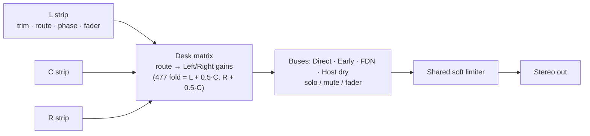

# Chapter 7 — Microphones and the mix desk

> **Status: DONE (draft 2026-10-05)** for build 51. Thursday's desk and mic sessions (T1, T2, T3, T3b, T4b, T5, T7–T9) and the U87 default (SL7b) are **LOCKED, not merged**.

**Chapter purpose.** The room is heard through three virtual microphones and a small mixing desk. This chapter explains how a capsule "hears" a reflection (position, aim, pattern and measured colour), which stereo setups exist, how the desk folds L/C/R to stereo, and what Thursday will change. It also records the conventions that must never be flipped (left is left), because they took the longest to settle.

---

## 7.1 The stand and the capsules

**Positions.** Three capsules L, C, R sit on one stand. The stand X (`mcx`) and Z (`mcz`) are free in the modern UI (2011 locked `MCX = W × 0.5`); L and R sit at `MCX ∓ Space/2`; the centre's Z follows the locked rule `MCZ = L − MZ` (VERIFIED, HANDOVER hard locks; `/workspace/docs-publish/docs/HOW_IT_WORKS.md` §3). Today L and R are always symmetric about the stand: dragging either capsule sets `space = 2·|x − mcx|`; only C has its own offset (VERIFIED, THURSDAY_LIST U2, citing `mic_desk.js` 1056–1062).

**Heights.** Per-mic heights landed in S-AUDIT with the locked variant H-1: "FDN lines stay at stand height" (tail change ≤ 0.42 dB, against up to 4.6 dB for the rejected full version) (VERIFIED, BIG_JOBS §0.0).

**Aim and the left/right convention (K1).** One sign constant, `YAW_X_SIGN = +1` in `engine/early_field.py`, mirrored as `RoomMath.YAW_X_SIGN` in `room_math.js`, is used by every look/angle formula. It fixed "crossed capsules": with a source 32° left, the direct sound is now +3.5…+8.9 dB louder in L (it was −1.7…−8.7) and L arrives first or no later (VERIFIED, DECISIONS_LOCKED_2026-09-28 K1). Default ORTF is L −55° / R +55°, aiming outward: "the left capsule looks toward −X and the right capsule looks toward +X … Do not flip L/R to chase the picture." Floor plan, 3-D and speakers agree: room −X = left capsule = bus `l` = `output[0]` (VERIFIED, HANDOVER "Two-source image", "Still open" item 2).

> **In plain English.** Think of a real mic stand with a bar holding three microphones: left, centre and right. You can move the stand around the room and set how far apart the left and right mics are ("Space"). Each mic can now have its own height, but the tail is still calculated from the stand's height (a locked compromise, H-1, that changes the tail by less than half a dB). Each mic points somewhere ("aim" or "yaw"). After a long hunt for "crossed" left/right images, one rule was fixed for good: the left capsule is on the room's left, points left, and feeds the left speaker. A **capsule** is the sensing part of a microphone.

## 7.2 How a capsule hears a reflection

"**Mic** is the listen tap off the diffuser output, in parallel with feedback. It is not on the inject, and the coloured signal is not written back." (VERIFIED, HANDOVER "Mic, air, and wall cards".) For each arrival — direct, each early tap, each FDN line:

1. **Angle.** "The angle is the 3D angle between capsule aim and the incoming ray (dot product), not the floor-plan angle." (VERIFIED, same.)
2. **Pattern gain.** The capsule's polar pattern at that angle scales the tap gain. Patterns never change which images are used (Chapter 5).
3. **Measured colour.** A measured capsule response at that angle, built as a minimum-phase FIR. In Play it is an 80 ms FIR at the AudioContext rate, applied on the way out of the direct read, the early left/right read and the FDN output; those copies are not written back (VERIFIED, HANDOVER "NOW — Play is one C block" and "Mic, air, and wall cards", Phase 3).
4. **Direct fold.** The direct sound is filtered per capsule *before* the fold, then × 0.55 (VERIFIED, HANDOVER; "do not retune … the 0.55 Direct fold").

**Where the colour data comes from.** Measured presets are fitted by `mic_fitter` into SOS tables; there are 20 tables per rate, at 44.1 and 48 kHz only, worst fit 0.408 dB at 44.1 kHz; other rates switch colour off with a notice (VERIFIED, DECISIONS_LOCKED_2026-09-28 item 7). The Neumann presets are U87 Ai Cardioid / Omni / Bidirect from the Franco et al. dataset (Zenodo 10.5281/zenodo.4633508); U87 Ai Cardioid is the only measured Neumann cardioid; other measured cardioids include AKG C414, Røde NT2-A, Schoeps CMC5-U (VERIFIED, THURSDAY_LIST U3).

**Colour modes.** Measured · User defined · Bypass (VERIFIED, BIG_JOBS §0.0 S-UI2 fix-up). In Measured the preset owns the pattern (D-UI21); Bypass = preset pattern, no measured colour (D-UI22). "Assumed toys" was renamed User defined (VERIFIED, BIG_JOBS §0.H).

> **In plain English.** For every sound arriving at a mic (the direct sound, each early echo, each corridor of the tail) the program asks: from which direction does it arrive, compared with where the mic is pointing? The mic's **polar pattern** says how loud it hears sound from each direction. An **omni** hears all directions equally, a **cardioid** (heart-shaped) mainly the front, a **figure-8** front and back but not the sides. Real mics also change tone with direction, so each mic model's measured response is applied too (its **colour**). That uses a short filter worked out from lab measurements of real mics (the U87 Ai, AKG C414, Schoeps CMC5-U and others), and it only exists at 44.1 and 48 kHz. The mic only listens; what it hears is never fed back into the room. **FIR** (finite impulse response) is a filter made from a short recorded "fingerprint"; **minimum-phase** means built so that it adds as little delay as possible. **SOS** (second-order sections) is a compact chain of small filter stages.

## 7.3 The setups

The Mic setup menu in build 51 (VERIFIED, `ui_audit_1004/app/software/static/index.html` 547–558):

| Setup | Notes |
|---|---|
| AB spaced pair (omni / cardioid) | spaced pair |
| XY coincident 90°, XY 120° | coincident |
| **ORTF** (default) | ±55°; today includes the C mic at 0 dB (the 2011 477 fold) |
| NOS, DIN | near-coincident |
| MS — omni mid, cardioids inward | labelled MS |
| MS classic (Mid cardioid + Side fig-8) | M/S decode on the desk |
| Mono centre | C only; L/R locked (D-AUD-1) |
| Binaural (dummy head) | see below |
| Custom | free tweak |

**Binaural.** Default head SADIE II KU100; ears 0.18 m apart (0.175 m for THK); `1/r²` from the head centre with ILD from the HRTF only; head yaw turns the ears as one unit; centre mic muted; K = 6 biquads per ear with a 60-entry mirror table; a 32-image set with 5 rear images (`BINAURAL_REAR32`); the diffuse FDN tail is matched to the head's interaural coherence in Render and Play (VERIFIED, BIG_JOBS §2). Still missing (UI): head drawing, HRTF polar/ILD panel, floor rotate handle, Play rate notice (VERIFIED, BIG_JOBS §2 and J12; session S6, not on Thursday).

**Default mics today:** SM57 × 3 (VERIFIED, THURSDAY_LIST U3, citing `app.js` 97, `app_server.py` 636 / 1028–1030 / 1317–1319, `render_pipeline.py` 1351–1353). Changing to U87 Ai Cardioid is D-UI30, merged into the single default switch SL7b and gated on Idle's written OK on the SL7a final A/B (LOCKED). T5 renders an early SM57 vs U87 A/B (with CMC5-U Cardioid as a third reference) for listening only.

> **In plain English.** A **setup** is a recipe for arranging the mics, as recording engineers do. **AB**: two mics spaced apart (good sense of space). **XY**: two directional mics at the same point angled apart (sharp, mono-safe image). **ORTF**, **NOS**, **DIN**: in between, slightly spaced and angled (ORTF is the default; in the recording world it means two cardioids about 17 cm apart angled ±55°: the ±55° is VERIFIED in this program, the 17 cm is general background). **MS**: one mic facing forward (Mid) plus a sideways figure-8 (Side), decoded into left and right on the desk, which lets you change the stereo width afterwards. **Binaural**: a dummy head with ears, for headphones. **Mono centre**: just the centre mic. The default mics today are three Shure SM57s; the plan is to switch to Neumann U87 Ai cardioids in the final default switch, after Idle has listened.

## 7.4 The desk (S-MIX, build 51)

Idle locked D-UI3 (three independent mics and L/R link modes), D-UI4 (desk matrix, Width, route chips including "S → +L, −R" on any strip) and the 2011 linear pan law as default on 3 Oct 15:57 (VERIFIED, HANDOVER "S-MIX").

**Strips and buses.** Mic strips L, C, R and buses Direct, FDN, Early, Host dry. Each strip has trim, route, width (on route s), pan, phase and a fader in dB. There is no EQ on the desk (VERIFIED, THURSDAY_LIST U7; EQ_PLAN §5). Solo and Mute exist on the four buses only; "Solos and mutes zero the send and leave the fader" (VERIFIED, THURSDAY_LIST U7; HANDOVER older Mix note).

**Routes** (VERIFIED, THURSDAY_LIST U7, citing `app.js` `pair()` 442–457), with `a` the strip gain:

| Route | Left, Right |
|---|---|
| centre | 0.5a, 0.5a (equals pan at centre under the linear law) |
| both | a, a |
| l / r | a, 0 / 0, a |
| s | a, −a (MS side; Trim becomes Width) |
| pan | a(1 − t), a·t (locked 2011 linear law) |

Phase (`phase_l/c/r` = ±1) flips the whole strip. MS classic sets C = both with `gain_exact_c = 1.5` (+3.5 dB) and S at 0 dB (VERIFIED, UI_AUDIT Q2).

**Array and Room.** "Array = this mic stays on the stand with the others. Room = this mic is unplugged from the stand and placed at the room-mic spot typed in the Mic tab (X, Z, height, yaw)." All Room mics share one spot today (VERIFIED, THURSDAY_LIST U7, U2).

**Known desk bugs** (VERIFIED, UI_AUDIT §A): B1 pan/trim knobs nearly uncontrollable (whole range in about 16 px; trim 1.5 dB per px); B2 width needle never moves; B5 Host strip hidden at 1280 px; B8 Pan live but ignored off the Pan route; B3/B4 MS classic flips to "Custom" and has a cardioid S in Measured.

*Figure 7.1. Desk, simplified. In the engine the per-bus split happens before the matrix; the order here is schematic (ASSUMED simplification).*

> **In plain English.** Each mic has a channel strip on the desk: **trim** (input level), **route** (where it goes: left only, right only, both, panned, or "side" which goes +left and −right for MS), **width** (for the side signal), **pan**, **phase** (flip upside down) and a **fader**. The finished mix is made of four **buses** (groups): direct sound, early echoes, the tail (FDN) and the untouched dry signal, each with its own solo, mute and fader. A mic can stay "on the stand" with the others (**Array**) or be taken off and put somewhere else in the room as a room mic (**Room**). Some knobs are currently very hard to use (the whole range in a few pixels); that is the first Thursday fix. The **pan law** says how level is shared between left and right as you pan: in the 2011 linear law, the two sides always add up to the same total.

## 7.5 What Thursday changes (LOCKED, not merged)

From `NEXT_SESSION_PLAN.md` and THURSDAY_LIST §5 (VERIFIED as plan):

| Session | Change | Sound / goldens |
|---|---|---|
| T1 | Knobs: relative drag over 200 px (trim 0.12 dB/px, pan 0.01/px), Shift = fine, double-click reset, wheel step, ±6 px detent, value readout, click-to-type everywhere (37 static + 14 per-face sliders) | none |
| T2 | D-UI31: L and R buttons with phase invert on **every** strip (truth table below); L+R = "both" when the strip is the Mid of an MS pair, otherwise pan; Ø buttons removed; Trim as text; mic-strip **solo-in-place**; "On stand" / "Room mic" names (D-UI36) | none (old scenes map 1:1) |
| T3 | D-UI29: MS presets (a) fig-8 S + omni M, (b) fig-8 S + cardioid M — **default (b) = U87 Ai Bidirect + U87 Ai Cardioid**, (c) back-to-back cardioids as S; (d) dropped; fixes B3/B4 | new MS tests |
| T3b | D18: unity MS decode, −3 dB on M and S (gain 0.708); D19: with route s, the direct sound uses the pattern spikes in Render and Play | MS references only |
| T4b | D20: ORTF = C off by default; "ORTF + C" preset = today's sound | **main golden YES** |
| T5 | SM57 vs U87 A/B renders (box job), early listen | none |
| T7 / T8 | D-UI37: one **Mirror / Linked / Split** control; in Split, R gets its own preset, pattern, HPF, position and yaw, also in MS; one room spot per strip; drag R and room mics; wall drag with "stop" | none (Mirror bit-exact) |
| T9 | Mic tab clean-up (binaural and mono-centre dead controls, overlapping drag targets) | none |

**T2 truth table** (proposed buttons → existing routes; VERIFIED as specified in THURSDAY_LIST U7):

| L button | R button | Route | Pot |
|---|---|---|---|
| on | off | l | greyed |
| off | on | r | greyed |
| on | on | pan (centre detent) — or *both* for an MS Mid | balance |
| on | inverted | s (+L, −R) | width |
| inverted | on | s with Ø (−L, +R) | width |
| inverted | inverted | pan with Ø | balance |
| off | off | muted | — |

Why D19 matters: with one source, the direct sound ignored the mic pattern, so an MS direct sat 11.2 dB to the left (VERIFIED as finding R18, THURSDAY_LIST §5 note).

> **In plain English.** Thursday's mic and desk sessions, none of which changes today's default sound except T4b: knobs you can actually control and values you can type (T1); simple L and R buttons on every strip, where pressing both or inverting one picks the right route automatically (T2); three proper MS presets, defaulting to the classic U87 figure-8 plus cardioid (T3); two MS sound fixes, so MS decodes at the right level and the direct sound respects the mic patterns (T3b, which changes MS reference recordings only); ORTF without the centre mic by default (T4b, which does change the main reference); an early U87-versus-SM57 listening test (T5); and Mirror / Linked / Split so the right mic and the room mics can be moved freely (T7, T8).

## Open / gaps

- Q3 (should AB omni / MS omni-mid stay Measured with an omni preset?), Q4 (keep "Heavy curtain"), Q6 (yaw boxes under the polar plots) are open (UI_AUDIT §C).
- A unity-at-centre balance law would change locked D-UI4; it is a question for Idle, not a default (THURSDAY_LIST U7).
- The exact per-bus order of the desk matrix in the C engine is not described in the sources read; Figure 7.1 is schematic.
