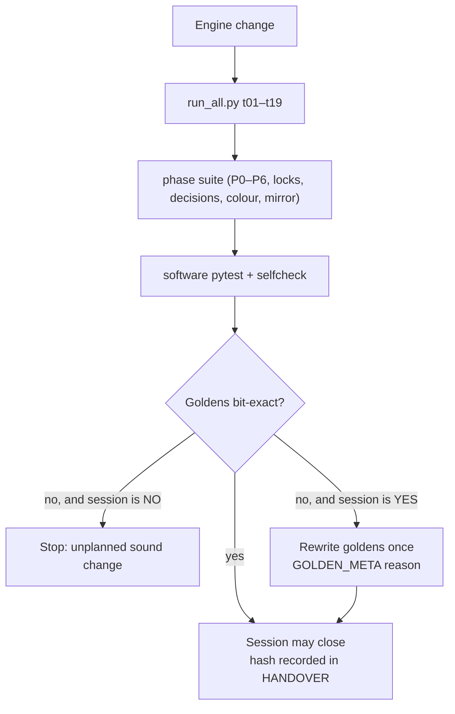

# Chapter 8 — Testing, goldens and how nothing changes by accident

> **Status: DONE (draft 2026-10-05)** for the test system as it stands at build 51. The Flat (2011) parity suite (SL7a) and the SL7b re-recording are **LOCKED, not built**.

**Chapter purpose.** This project's promise to Idle is "no sound changes without your decision". That promise is kept by tests, not by good intentions. This chapter explains the four layers of checking (golden files, the run_all harness, the phase acceptance suite and the software unit tests), what each status word means, how a golden is allowed to change, how CPU is measured fairly, and which gates are still open. It is the chapter to read before trusting any "bit-exact" claim elsewhere in the book.

**Sources:** `3_phase_acceptance_tests/README.md`; `3_phase_acceptance_tests/harness/run_all.py` (vendored copy of `engine/tests/run_all.py`); `roadmap/eq_plan/src/HANDOVER.md`; `roadmap/THURSDAY_LIST.md` §5 and session rules; `roadmap/DECISIONS_LOCKED_2026-10-04.md` (D-SL10); `roadmap/prebuild/sl/README.md`; `BIG_JOBS_ROADMAP_2026-10-01.md`.

---

## 8.1 Why goldens

A **golden** is a stored impulse response for a fixed scene. After any change the engine renders the scene again and compares sample by sample. If the null is perfect (max-abs 0, or ≤ −100 dB for the golden tests), nothing audible could have changed (VERIFIED, `run_all.py` t03/t04 docstrings).

There are five golden files (VERIFIED, `run_all.py` t03/t04; HANDOVER):

- four **Play** goldens: `play_std_unlocked_byp`, `play_std_unlocked_col`, `play_std_lock18_byp`, `play_std_lock18_col` (decay unlocked and locked at 1.8 s, colour bypassed and on);
- one **Render** golden: `render_std_unlocked_byp.f32` (Render, BYPASS colour, 0.5 s).

Next to them, `GOLDEN_META.json` records the SHA1 of every file and a **reason** string. A golden may only be rewritten on purpose, with a reason, and that change is the only sound change in its session (VERIFIED, THURSDAY_LIST session rules: "**NO** = the main Render golden `ebd77c3b…` must stay bit-exact. **YES** = the session regenerates goldens on purpose, and it is the only change in that session").

**The recent chain of the Render golden** (VERIFIED unless noted):

| When | SHA1 | Reason (GOLDEN_META) | Source |
|---|---|---|---|
| 2 Oct 19:22 | — | "S7 z^-1 in both + equal F3 trim (D3/D3b)" | eq_plan HANDOVER |
| 3 Oct (S5 CPU fix-up) | `7894bab0da4526c975e78084ecdf62163fada1bc` | Render inject uses Play's fitted surface filters (D-S5c-3); max-abs 9.894e-04 | eq_plan HANDOVER |
| 3 Oct (D-MIX-J) | `3e992bf0f3b29d7cbf2614b93af5e529ae7a4235` | "D-MIX-J mirror-invariant early jitter" | eq_plan HANDOVER |
| after S-AUDIT | `ebd77c3b599e80a037f4a3c552c93f6e37343d1b` | not on the box | THURSDAY_LIST (it cites HANDOVER and GOLDEN_META on the PC) |

In each of those steps the four Play goldens stayed byte-identical (t03 max-abs 0) (VERIFIED for S5 fix-up and D-MIX-J).

**Which sessions may change goldens** (VERIFIED as plan, `NEXT_SESSION_PLAN.md`): T4 Smooth and T4b ORTF C off (main golden YES), T3b (MS references only), and the SL7b default switch (all defaults, once). Everything else is NO; T11 Movement and SL2–SL6 add new references for new modes but leave the default bit-exact.

> **In plain English.** A **golden** is a reference recording of a fixed test scene, stored as a file. After any change, the program records the same scene again and compares it sample by sample with the golden. If not a single sample differs ("bit-exact"), nothing you could possibly hear has changed. Each golden also has a **SHA1**, a 40-character fingerprint of the file: change one bit of the file and the fingerprint changes completely, so comparing fingerprints is a quick way to prove two files are identical. A golden may only be replaced on purpose, in a session allowed to do so, with the reason written down (in `GOLDEN_META.json`).

## 8.2 The run_all harness (t01–t19)

`run_all.py` drives Play through node + wasm and Render through the Python app, on fixed scenes (`std_unlocked`, `std_lock18` and others). Descriptions are from the vendored copy's docstrings (VERIFIED; thresholds in the PC copy may have moved since, e.g. t19 was re-based in the S5 fix-up):

| Test | Checks |
|---|---|
| t01 | Packed parameter blob matches the worklet layout |
| t02 | wasm output equals a native build of `live_stereo.c` (skips without gcc/clang) |
| t03 / t04 | Play / Render goldens, null ≤ −100 dB |
| t05 | Omni source radiation reproduces the golden |
| t06 | Scattering 0 reproduces the golden (pending: scattering not built) |
| t07 | Tail energy (80 ms–1 s) within 0.5 dB over source yaw 0/90/180 |
| t08 | FDN stability: no NaN/Inf/growth over the full Dffs range, 8 s decay, 15 s noise then silence |
| t09 | Silence costs ≤ 1.3 × playing (no denormal blow-up) |
| t10 / t12 | Play / Render T30 per octave 500 Hz–8 kHz within ±15 % of the dial |
| t11 | HF residue in Play |
| t13 | Play vs Render parity (T30 within 10 %, tail level, early level) |
| t14 | Level sanity: peak < 0.95 and FDN bus within ±0.5 dB of the pre-F2 level |
| t15 | Active CPU: 1 source + colour ≤ 60 % budget, 2 sources ≤ 85 % |
| t16 | Surface jitter and Structure Dffs are separate keys |
| t17 | Play follows `hadamard_n` |
| t18 | FDN-only Play tail nulls Render ≤ −30 dB (slow) |
| t19 | Two directional sources + colour within the CPU ceiling |

Latest full run on the PC (S5 fix-up, VERIFIED, eq_plan HANDOVER): **16 pass, 0 fail, 1 skip (t02), 1 pending (t06), 1 xfail (t13)**; t19 shared-off median 2.238 ms (limit 2.40), shared-on 1.760 ms (limit 2.133). t18 measured −71.9 / −71.8 dB on quiet runs (VERIFIED, same).

> **In plain English.** The **harness** is a set of 19 automatic checks run after every change. In everyday terms they ask: do the live engine and its source code agree? Is the reference sound unchanged? Does the tail die away instead of growing? Is the decay time what the dial says? Do Play and Render match? Does it stay within the processing budget? Each check prints PASS, FAIL, SKIP (could not run here) or XFAIL (expected to fail because the feature it tests is not built yet). On the PC, the latest full run had 16 passes, no failures, one skip, one pending and one expected failure (the known early-echo difference).

## 8.3 The phase acceptance suite (package 3)

`3_phase_acceptance_tests/` is a pytest package that encodes the roadmap's success criteria (P0 engine, P1 blob, P2 air, P3/P4 surfaces, P5/P6 scattering and radiation), the product locks (unscaled ±1 Hadamard, 1/r² level, all 32 early images inject into the FDN, no scattering inside the loop, no air on the FDN return), the 28 Sep decisions (K1 left-is-louder-and-earlier for XY/ORTF/NOS/DIN/MS, K3 29 distinct delays per bus), mic colour (20 SOS tables, ≤ 0.5 dB at 48k, ≤ 0.6 dB at 44.1k, unsupported rates off with a notice) and mirror symmetry (≤ 0.1 dB per third-octave, null ≤ −60 dB) (VERIFIED, package README).

**Status words** (VERIFIED, package README):

- **PASS** — criterion met.
- **FAIL** — the feature *is* in the tree and misses: a real bug.
- **XFAIL** — a probe says the feature is not in the tree yet; when it lands the probe flips and the real assertion runs. This is how planned work is tested before it exists, without lying about it.
- **SKIP** — node, zig or `--slow` missing.

The last recorded box results are from 28 Sep and 1 Oct (e.g. 60 / 2 / 22 / 0 on the patched tree); they predate builds 46–51 and are history, not current status (VERIFIED as dated).

> **In plain English.** This is a second, larger set of tests written from the roadmap itself: every promise in the plan ("the direct sound has no air filter", "left source means left mic louder and earlier", "20 mic colour tables within 0.5 dB"...) becomes a test. The clever part is **XFAIL**: a test for a feature that does not exist yet first checks whether the feature is there; if not, it reports "expected to fail" instead of a false alarm. The day the feature lands, the real test switches on automatically.

## 8.4 Software tests, selfcheck and prebuild tests

- `software/tests` (pytest): **55 passed, 0 failed** after D-MIX-J (VERIFIED, eq_plan HANDOVER).
- `engine/selfcheck.py`: **45/45** at the S5 fix-up (VERIFIED, same). It asserts structural facts such as the direct image at index 2 and the 29-unique delay count (VERIFIED, MIRROR_ASYMMETRY_BRIEF).
- Surfaces prebuild (`roadmap/prebuild/sl/tests`): fast **36/36**; slow SL2 4/4, SL5/SL6 render 2/2, SL4 4 pass + 1 xfail; `hash_scenes.py` checks the PC golden hash (VERIFIED on the box, prebuild README). These are box results on a copy, not the PC.

Suggested order after any engine change: `run_all.py`, then `run_phase_tests.py --slow`, then `pytest software/tests` (VERIFIED, package README). Every session ends with the full suite green and the Render golden hash recorded in HANDOVER (VERIFIED, THURSDAY_LIST session rules).

*Figure 8.1. The gate every session passes (VERIFIED as described in THURSDAY_LIST session rules; drawn here).*

> **In plain English.** Two more layers: the program's own unit tests (55 passing) and a built-in self-check (45 of 45) that confirms basic facts such as "the direct sound is image number 3". The Surfaces code waiting on the research machine has its own tests too, all passing there apart from one honest expected failure. The order to run them after any engine change is harness, then phase tests, then unit tests.

## 8.5 Measuring CPU fairly

Single CPU numbers drift with machine load, so the locked method is a **paired ABBA run**: old and new wasm alternate in the same session, 12 rounds, `bench 4 10` on the t19 scene, and the result is the median of per-round paired differences. At the S5 fix-up this gave a median 2.2355 ms (ceiling 2.40) and a paired +5.88 % (VERIFIED, eq_plan HANDOVER D-S5c-2; locked as D-S5c-2 in BIG_JOBS). The box can disagree with the PC (box +8–9 % in the same comparison); **the PC is the gate** (VERIFIED, same).

> **In plain English.** Computer timings wobble with whatever else the machine is doing. To compare an old and a new version fairly, they are run alternately (old, new, new, old: "ABBA") twelve times in the same sitting, and the middle result is used. Idle's PC is the judge, because the research machine can give different numbers.

## 8.6 Flat (2011) parity suite (LOCKED, not built)

D-SL10: when the defaults switch to Surfaces + natural decay + U87, "Flat (2011) stays a selectable mode, and its 2011 references are kept as a **separate frozen parity test** (`tests/refs_flat2011/`, bit-exact with a legacy profile)." SL7a builds it together with `legacy_2011_profile()` and leaves the `DEFAULT_SET` flag at 2011; SL7b flips it, regenerates every reference once with GOLDEN_META "SL7b default switch", and Flat must stay bit-exact (VERIFIED as plan, DECISIONS_LOCKED_2026-10-04; THURSDAY_LIST SL7a/SL7b). The number of references the suite will hold is not fixed in the sources read (Open).

> **In plain English.** When the new sound becomes the default, the 2011 sound must not be lost or quietly altered. So, before the switch, its reference recordings will be frozen into a separate test set with a "2011 profile" that recreates the old settings. From then on, any change that alters the 2011 sound by even one sample fails that test.

## 8.7 Open gates

- **t13** early parity XFAIL: Play early about +3 dB vs Render (32 taps vs the full set); last measured L +3.1 dB, R +3.25 dB (VERIFIED, THURSDAY_LIST L11; eq_plan HANDOVER).
- **P5 coherence** miss (VERIFIED as open, THURSDAY_LIST L11).
- **Small-room decay**: the figures differ between sources (−8.5 % vs −3.5 % after the S4b signs); the P-D7 step re-measures it in Play on the PC (Open; see Chapter 5).
- **Movement** (EQ-1): modulated output cannot null against a golden; the plan uses statistical gates and keeps goldens bit-exact with modulation off (VERIFIED as plan, EQ_PLAN decision 4). The exact statistical thresholds are for the session to write.
- **Surfaces accuracy** gate ST-7 is open (Chapter 6).
- The latest golden's GOLDEN_META and the S-AUDIT HANDOVER section are on the PC only; this chapter's last row is second-hand until they are mirrored.
> **In plain English.** The known open items: Play's early echoes are about 3 dB louder than Render's; one coherence test misses; the small room's decay figure needs re-measuring on the PC; Movement will need statistical tests (it can never match a fixed recording because it changes over time); and the Surfaces accuracy gate is still open.

