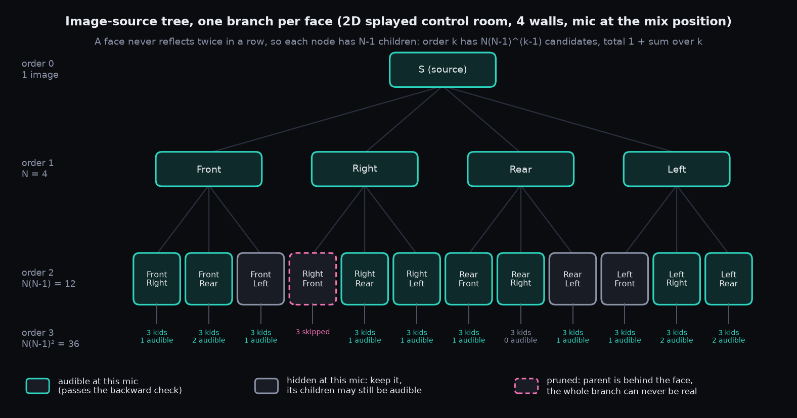

# Chapter 9 — Non-rectangular rooms

> **Status: STUB, expanded 2026-10-05 — PLANNED (research only, no engine code).** Nothing here is in the app. The Box stays the default.

**Chapter purpose.** Idle proposed studio-shaped rooms (splayed walls, booths, L-shapes) that scale with the W/L/H sliders, with image sources found as a tree, one branch per face. This page records what the research found, so the idea is not lost; the full chapter is written only if the work is scheduled after SL7b.

**Sources:** `roadmap/nonrect/NONRECT_RESEARCH.md` (4 Oct 2026); figures `figures/D1_branch_tree.png`, `figures/D3_counts.png`.

> **In plain English.** Today every room in the program is a shoebox. Real studios often are not: control rooms have angled side walls, vocal booths can be six-sided, ceilings slope. The idea is to offer a few such shapes as presets that still grow and shrink with the usual width/length/height sliders. The mirror trick (Chapter 5) still works for any flat-walled room, but with a catch: in an odd-shaped room many "mirror images" are fake, because the wall you would have to bounce off isn't actually in the way of the path. So each image has to be checked, and most are thrown away. The research shows there are still plenty of real echoes to fill the 32 slots.

## What the research says (VERIFIED in the source unless marked)

- **The tree is right.** This is Borish's (1984) extension of the image model to polyhedra. A face cannot reflect twice in a row, so each node has N−1 children: total candidates up to order K = **1 + N[(N−1)^K − 1]/(N−2)** (a box at order 4: 937).
- **Most candidates are not real.** Each image is checked backwards (mic → deepest image → through each face outline in turn). A **parent-side test** (the parent image must be in front of the face) is independent of the mic and prunes whole branches. In the prototype only 2–9 % of order-4 candidates are valid, yet every shape tested has more than 32 valid images by order 3, enough for today's 32 taps.
- **Presets proposed:** Splayed control room (RFZ-style), LEDE-style and Non-parallel live room first (convex, no blocking tests); then Hexagon and Gable booths; the non-convex L-shape last.
- **Staged plan:** 1 Render-only `room_shape` with 3 convex presets (Box bit-exact) → 2 A/B renders → 3 Play support → 4 UI with N-face Surfaces → 5 optional non-convex/beam tree/diffraction.
- **Decisions for Idle:** D-NR1–D-NR8 (presets first, tap picking, frozen FDN delays per preset, Render-first, 15 ms tap fade ASSUMED, face mapping to A–F, whether to do the L-shape, park SDN).

## What it could feel like (PLANNED, plain English)

*A description of the intended experience, not of built behaviour.*

You pick "Splayed control room" from a shape menu. The floor plan redraws with the front side walls angled out; the Surfaces tab shows the same faces, now not all parallel. The early reflections change, because the angled walls throw the first echoes away from the listening position, which is why studios build rooms this way. In the first stage this would be heard in Render only, compared side by side with a shoebox of the same volume, before anyone decides whether Play should support it (D-NR4).

## Open / not yet built

No `room_shape` parameter exists. How Surfaces-in-loop (Chapter 6) maps onto N faces is undecided (D-NR6). Not scheduled in T1→SL7b.
