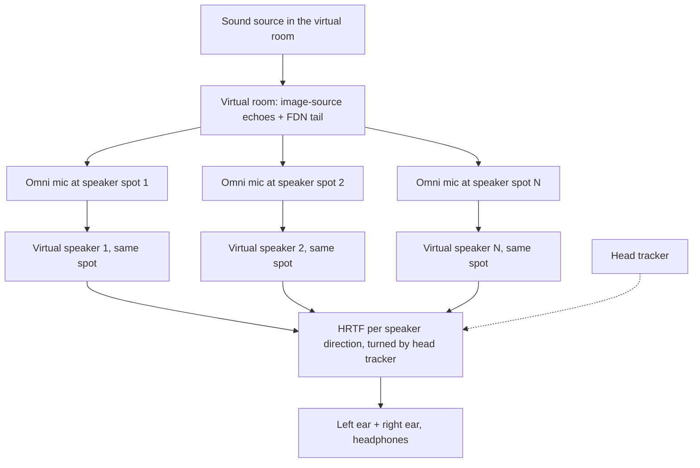

# Chapter 11 — Variants and a reverb designer

> **Status: STUB, expanded 2026-10-05 — PLANNED (ideas only; no design document, no code).**

**Chapter purpose.** Idle sees the engine as a source for other products, and the app as a *designer*: once a room sounds right, it exports something another product can use. This page lists the ideas as Idle stated them (parent conversation, 5 Oct 2026) so they are kept with the book. None has a source file or a decision yet.

**Sources:** Idle's brainstorm (5 Oct 2026, relayed in the book brief); Chapter 10 for the shared-room plug-in. No research files exist for these items.

## The ideas (all ASSUMED / unscheduled)

- **Reverb designer / code export.** Tune a room, then export code, IR packs or presets for a fixed product. What "code" means (C core plus a frozen parameter set? IRs?) is not decided.
- **Source files for variants.** The documented engine (this book) as the starting point for spin-offs.
- **3-D delay.** Echoes that ping-pong around the room in three dimensions, reusing the image geometry.
- **A nice room with cut-down controls.** A few knobs over a fixed, well-tuned room.
- **Game / film binaural walkthrough.** A listener moving through a virtual environment, rendered binaurally (the binaural mic path exists today, Chapter 7; movement through a scene does not).

## The ideas as pictures (PLANNED, plain English)

*How each idea might feel to a user. No designs or algorithms exist; these are Idle's ideas restated.*

- **The designer.** You use the full program as a workbench: shape the room, choose walls and panels, place mics, listen. When it sounds right you press "export", and out comes something a simpler product can load: a fixed preset, a set of echo fingerprints, or code with the settings baked in. The workbench stays complicated so the product can be simple.
- **The "nice room" plug-in.** One carefully tuned room and three or four knobs (perhaps size, distance, decay, tone). Under the hood it is the same engine with almost everything fixed by the designer.
- **3-D delay.** Instead of echoes bouncing between two speakers, the repeats travel around a virtual room in three dimensions, coming back from the walls and ceiling with the right timing and colour for each surface, and through the right mic pattern or binaural ears.
- **A walk-through for games and film.** A listener (the camera or the player) moves through a virtual building. Each room has its own surfaces; the echoes and tail change smoothly as you walk from a tiled corridor into a carpeted office, rendered binaurally for headphones. The binaural mic exists today (Chapter 7); moving through a scene, several connected rooms, and smooth changes are all unbuilt.
- **Source files for variants.** Because this book documents the engine, a developer (or Ben) could start a new product from the engine and the book rather than from scratch.

## What would have to be true first

The C migration (J2) for a portable core, a stable parameter set after SL7b, and this book's Surfaces and auto-treat chapters complete enough that someone else can rebuild the behaviour (ASSUMED).

## Open / not yet built

All of it. No item is in T1→SL7b.

## Virtual speakers as virtual microphones (PLANNED, idea of 2026-10-07)

*Status: PLANNED. An idea from Idle's talk with Ben Supper, researched on 2026-10-07. Nothing here is designed or built. Most likely a separate future app on the shared engine, not a mode of the reverb, and not part of the T1 to SL7b roadmap. Full research notes: `research/virtual_speaker_mics_RESEARCH.md`.*

### 11.V.0 The idea

> **In plain English.** Put a virtual omni microphone wherever a loudspeaker would stand in a virtual room. Each mic hears the room as it sounds at that exact spot. Then play each mic's signal out of a virtual speaker in the same place, and turn all of those speakers into headphone sound with HRTFs (the "head filters" that tell your ears which direction a sound comes from). If it works, you hear the room's real timing, loudness and echoes around you, and you can move your head (with a head tracker such as Ben's Supperware tracker) and the room stays still. Because the room, the mics and the speakers are all virtual, a layout can be changed and re-rendered in seconds instead of re-rigging a real room.

The loop, end to end:

The rest of this section asks four questions: why should this work (theory), what do real recording engineers already do (practice), how do you turn many speakers into headphone sound (virtual speakers), and what would the engine need (simulation). It ends with a first experiment.

### 11.V.1 Why it should work: the theory

> **In plain English.** Imagine a pond. If you could copy exactly how the water moves all along a line across the pond, and then make new ripples from that line, the waves beyond it would look the same as the original. Sound works the same way. If you record the sound everywhere on a surface around the listener and re-create it at those points, the sound inside is re-created too. Real systems can only use a few points, so they approximate this. An omni mic at each speaker spot is the crudest, cheapest form of the idea.

**Huygens and Kirchhoff-Helmholtz.** The Kirchhoff-Helmholtz integral says that inside a source-free region, the sound pressure at any point can be calculated if both the pressure and the normal particle velocity are known on the surface enclosing that region (VERIFIED, Wittek's literature review of WFS [W1]). This is the precise form of Huygens' principle: every point on a wavefront acts like a new small source.

**The acoustic curtain (Bell Labs, 1934).** Steinberg and Snow, with Fletcher, described a "curtain" of microphones in front of a stage, each feeding a loudspeaker at the matching position in the listening hall, so the wavefront would be carried across (VERIFIED [W1], [B1]). They found it impractical and settled on two or three channels, accepting that the real sound field would no longer be recreated (VERIFIED [W1]). That compromise is the origin of spaced-microphone stereo.

**Wave field synthesis (Berkhout, Delft).** Berkhout and colleagues turned the idea into engineering in 1988 to 1993: measure the source field, extrapolate it electronically, and re-emit it from loudspeaker arrays; reflections can be generated with the image-source concept in the same way as direct sound (VERIFIED, Berkhout, de Vries and Vogel 1993 abstract [B2]; Berkhout 1992 [B3]). WFS needs many closely spaced speakers to work above a limiting ("aliasing") frequency (ASSUMED here; standard WFS knowledge, not quantified in the sources read).

**How "an omni at each speaker" relates.** It is a sparse acoustic curtain wrapped around the listener. Two simplifications separate it from true WFS (ASSUMED, reasoning from [W1]):
1. Only pressure is captured (omnis), not velocity, so the "inside/outside" information that the full integral needs is missing.
2. There are 5 to 12 points, not hundreds, so above a few hundred hertz the field is not physically rebuilt. What remains is *perceptual*: each speaker carries the right arrival times, levels and echo pattern for its direction, and the ear-brain does the rest.

**How it differs from Ambisonics / HOA.** Ambisonics records the sound field at *one point* as a set of spherical components (order 1 = 4 channels, higher orders more), then *decodes* it to whatever speakers exist. A spaced-omni array records at *many points* and each channel is tied to one speaker. Trade-offs (ASSUMED, general knowledge, consistent with Lee's review [L1]):
- Ambisonics: layout-independent, rotates easily for head tracking, sharp-ish imaging at high order; but low orders sound less spacious because the channels are highly correlated.
- Spaced omnis: very spacious and natural room sound because the channels are decorrelated by distance; but tied to one layout and with weaker, less stable phantom images between speakers.

For this engine the decisive point is that a virtual room can produce *both*: N spaced omni feeds, or an Ambisonic feed at the listener. That is exactly what makes an A/B possible.

### 11.V.2 What engineers already do: spaced-omni surround and 3D arrays

> **In plain English.** Recording engineers have tried this many ways for decades. The rule they all found is: microphones close together give a sharp but "small" picture; microphones far apart give a big, airy room but blurrier images. Most real setups mix the two: a front group for sharp images, and widely spaced mics for the room.

**The 2L-cube (Morten Lindberg) — almost exactly the idea from the talk.** Lindberg writes that his main array "is really a direct consequence of the speaker configuration": one omni per speaker in 5.1.4 or 7.1.4, so that "time of arrival, SPL and on-axis HF texture is directly preserved". The cube is *scaled down*: about 120 cm for a large orchestra and 40 cm for chamber music. He always uses omnis (DPA 4003 or 4041) (all VERIFIED [2L1]). This matters: he does **not** put mics at the real speaker positions (several metres apart); he shrinks the layout. So the talk's claim is supported in spirit, with that caveat (VERIFIED quote; interpretation ASSUMED).

**Hamasaki square (NHK).** Four sideways-facing figure-8 mics for room sound, nulls toward the stage. Spacing was first 1 m, then raised to 2 to 3 m; the omni coherence calculation showed 2 m gives decorrelation above about 100 Hz, and listeners preferred 3 m over 2 m and 2 m over 1 m (VERIFIED [H1], [L1]). The Hamasaki cube adds an upward-facing layer at the same 2 to 3 m spacing (VERIFIED [L1]).

**OCT (Theile) and Williams MMAD.** OCT is a front triangle of directional mics designed for low crosstalk and stable front images; base widths of about 50 to 100 cm are quoted; it is often combined with a Hamasaki square for ambience (VERIFIED, Wittek [WI1]). Williams' MMAD method calculates spacing and angles so neighbouring pairs' recording angles join up without gaps or overlaps (ASSUMED; mentioned in [WI1] but not read in detail).

**Decca tree, Fukada tree, ORTF-3D.** Decca tree: three spaced omnis in front of an orchestra (classic, ASSUMED general knowledge). Fukada tree (NHK) and ORTF-3D (Schoeps) are 5-channel and 8-channel arrays reviewed in Lee 2021 [L1] (VERIFIED that they are covered there; exact dimensions not repeated here, ASSUMED/omitted).

**Hyunkook Lee (Huddersfield, APL) on spacing and height.**
- Horizontal spacing gives the interchannel decorrelation that creates spatial impression (VERIFIED [L1], [L2]).
- Vertical spacing between the main and height layers (0, 0.5, 1, 1.5 m tested) made no significant difference to spatial impression; 0 m was rated slightly higher (VERIFIED, Lee and Gribben 2014 [L3]).
- In PCMA-3D the height mic's direct sound should be at least 7 dB below the main mic's to avoid the source image lifting upward (VERIFIED [L4]); the review quotes 9.5 dB for another configuration (VERIFIED [L1]).

**What fails (all ASSUMED unless cited, standard spaced-array knowledge):**
- **Comb filtering:** if two spaced channels carry the same direct sound at different times and are summed (downmix, or both reaching one ear), notches appear. Wide spacing makes it less audible because the notches are dense, but a stereo or mono fold-down suffers.
- **Weak phantom images:** time differences between widely spaced omnis are too large for clean panning between speakers. Sounds tend to "jump" to the nearest speaker.
- **Precedence effect:** the ear locks onto the first-arriving speaker. In a spaced-omni array the speaker nearest the source fires first, which is *helpful* (it points the right way), but a listener off the centre seat hears a different first speaker.
- **Height crosstalk:** too much direct sound in the height channels pulls images upward (VERIFIED [L4]).

> **In plain English: what this means for us.** Omnis at the speaker spots should give a lovely, natural room around you. Direct sound images will be roughly in the right place but not pin-sharp. Height omnis must carry little direct sound, or voices will float upward. In a virtual room we can cheat in ways a real engineer cannot: shrink the array like Lindberg, or keep wide spacing for the tail but feed sharper directional cues for the direct sound.

### 11.V.3 Turning many speakers into headphone sound

> **In plain English.** Each virtual speaker is just a sound coming from one direction. To put it on headphones, run it through the pair of head filters (HRTFs) measured for that direction, add up all the speakers, and you have the left and right ear signals. With a head tracker, when you turn your head the filters change so the speakers stay put in the room.

**VRM as a precedent.** Ben Supper's Focusrite VRM work had four parts: a loudspeaker radiation model, a room reverberation simulator, a database of directional head cues, and a real-time engine (VERIFIED, AES paper 8267 [S2]). Paper 7994 measured studio monitors' impulse response and directivity in an ordinary room and removed the room reflections (VERIFIED [S1]). Paper 8267 processed the KEMAR HRIR set: correction, equalisation (removing colouration) and spatial interpolation to a finer grid, aiming for angular resolution at least as fine as human hearing and working for most listeners on unknown headphones without personalisation (VERIFIED [S2]). VRM simulated *stereo* loudspeakers; the virtual-speaker-mic idea extends the same structure to N speakers in a simulated room.

**How many virtual speakers?** Each virtual speaker is a fixed direction, so N speakers need N HRTF pairs (N two-channel convolutions, or 2N FIR filters). A 5.0 layout means 5 pairs; 7.1.4 means 11 (LFE usually not binauralised) (ASSUMED arithmetic). The binaural result can only be as good as the speaker layout: gaps between speakers become gaps in the image. More speakers help imaging but cost CPU and, for spaced omnis, need more mics.

**HRTF interpolation.** Measured sets have a finite grid; directions in between need interpolation, which Supper did offline for KEMAR [S2] (VERIFIED). For fixed virtual speakers this only matters when the head moves: each speaker's direction relative to the head then changes continuously.

**Head-tracking latency.** Lindau (TU Berlin, 2009) found a lowest individual detection threshold of about 52 to 53 ms and a mean of about 108 ms for total system latency in dynamic binaural synthesis (VERIFIED as reported in [LI1]); a 2023 study found higher thresholds under its method but recommends under 40 ms for robust use (VERIFIED as summarised from [LI2]). Treat 40 ms total (tracker + block + convolution) as the target (ASSUMED design target based on those).

**Room doubling.** If the virtual room's sound is played through virtual speakers that themselves sit in a *second* simulated room (as VRM did, by design), the listener hears two rooms stacked: more reverb, muddier time cues. Options (ASSUMED, design choices):
1. Anechoic virtual speakers (HRTF only, no listening room). Cleanest test of the capture idea.
2. A short, well-damped "control room" on purpose, to make headphones feel like speakers (VRM-style externalisation).
3. Measure how much the listening room adds and reduce the capture tail to compensate.
Option 1 should come first.

### 11.V.4 The simulation side: what the engine would need

> **In plain English.** The early echoes are easy: the engine already works out each echo's path to a mic, so more mics just means doing the sums more times. The tail is the hard part. In a real room the tail at two spots far apart is different (that is why spaced mics sound spacious). If our N mics all got the same tail, the room would collapse into one blob in the middle of your head. Each mic needs its own, different-but-matching tail.

**Early field to N receivers.** Image-source computation for many receivers is well established: MCRoomSim (Wabnitz, Epain, Jin, van Schaik, 2010) simulates any number of sources and receivers in a shoebox room, with directivities, HRTFs and spherical-harmonic receivers, specular and diffuse reflections, and realistic inter-sensor delays (VERIFIED [M1], [M2]). In this engine, the 2011 design uses a fixed set of 32 image "voices" and three mics (Ch. 1, Ch. 5). Whether that fixed set is adequate for mics placed several metres apart (each needs its own delays and levels per image, which the engine already computes per mic) is ASSUMED plausible and must be checked.

**Decorrelated tail per output.** Two routes from the literature:
- **FDN with several outputs.** Research at Aalto found that correlation between FDN outputs is set mainly by the feedforward (input/output) paths rather than the long recursive tail; larger FDNs and filtered feedback matrices, especially velvet scattering, decorrelate best (VERIFIED, as summarised from [D1]). The engine's 32-line FDN already has many taps, so N different output mixes are cheap (ASSUMED, check the code).
- **Velvet noise.** Sparse random ±1 sequences used as decorrelators or tails; interleaved velvet noise can produce many decorrelated channels from one reverberator by permuting sequences and mixing (VERIFIED [D2], [D3], [D4]).
The tail's correlation between two mics should ideally follow the diffuse-field rule for their distance (strongly correlated at low frequencies, decorrelated above roughly c/(2d)), so that a 2 m pair behaves like Hamasaki's measurement [H1] (ASSUMED target; the 2 m / 100 Hz figure is VERIFIED from [H1]).

**CPU and quality trade-offs (ASSUMED estimates, to measure).** Offline Render: N times the early work plus N tail taps, then N HRTF pairs; trivial offline. Real-time Play: the HRTF stage dominates; partitioned convolution (Ch. 10) keeps it manageable; 11 speakers × 2 ears is 22 short convolutions.

**Existing tools and how the idea differs.**
- **MCRoomSim** — offline MATLAB research simulator for multichannel arrays [M1]. Closest technically; not a production or listening tool.
- **SPARTA** (Aalto, McCormack) — open-source plug-ins; AmbiRoomSim simulates shoebox image sources into Ambisonics; Binauraliser renders up to 128 object channels to binaural with SOFA HRTFs and OSC head tracking (VERIFIED [SP1]). One could chain a multi-receiver simulation into Binauraliser, but the omni-at-speaker capture is not a built-in workflow (ASSUMED).
- **IEM Plug-in Suite** — RoomEncoder places source and listener in a shoebox and encodes 200+ reflections into Ambisonics (VERIFIED [I1]). Single-point Ambisonic, not spaced.
- **Spat Revolution** (FLUX::) — commercial spatial mixer with virtual rooms, binaural monitoring, HOA, custom layouts (VERIFIED [F1]).
- **dearVR, Steam Audio, Anaglyph** — object/game binaural renderers with room models (ASSUMED from general knowledge; not checked in this pass). They render the room directly at the listener's head, not via virtual omnis at speaker spots.

### 11.V.5 Is "each virtual speaker is also a virtual microphone" new?

> **In plain English.** The idea itself is old: it is the 1934 acoustic curtain, and Lindberg records real music this way today. Simulating rooms for many mics is also done, and virtual speakers on headphones are done (Ben did it). What we did not find is a ready-made tool that does all three together as one design: simulate a room, capture it with omnis at the speaker spots, and play it back on head-tracked virtual speakers so you can audition and move the layout. That may be new as a product. It is not new science.

Honest verdict: no prior art for the exact combined workflow was found in this short search, but the search was not exhaustive and similar research setups very likely exist in university labs (ASSUMED). Do not claim novelty publicly without a proper search. The useful framing is "a virtual 2L-cube / acoustic curtain designer with headphone monitoring".

### 11.V.6 Suggested first experiment (PLANNED)

> **In plain English.** Render the same short sound three ways in the same virtual room, put them on headphones, and compare. If the "omnis at speakers" version sounds more like being in the room than our current binaural, the idea is worth an app.

**Setup (offline Render only, no Play, no changes to the reverb's defaults or goldens):**
1. One room the engine already handles well (for example a medium hall), one source front-left, listener in the middle.
2. **A — current binaural render** of the engine (reference).
3. **B — 5.0 omni set:** omnis at ITU 5.0 positions (0°, ±30°, ±110°) on a circle of about 2 m radius (ASSUMED value) around the listener, each with its own decorrelated tail output; each played from an anechoic virtual speaker at its angle through the same HRTF set; summed to two ears.
4. **C — same as B, but a Lindberg-style scaled array** (mics on a 0.5 to 1 m cube, speakers still at full layout).
5. Later: **D — 7.1.4** to test height, keeping height direct sound at least 7 dB down [L4].
6. Loudness-match all versions; blind A/B/X; with and without head tracking if available.

**Listening criteria (score 1 to 5 each):**
- Externalisation: does it sit outside the head?
- Envelopment: does the room surround you?
- Source direction and sharpness: is front-left in the right place, and how wide?
- Distance and depth.
- Tone colour and comb-filter artefacts (listen for "phasey" or hollow sound).
- Tail smoothness: no flutter, no "blob in the middle".
- Stability when turning the head (if tracked).
- Overall naturalness and preference.

**Measurements alongside:** interaural cross-correlation (IACC) of early and late parts of A, B and C (ASSUMED useful metric); per-mic tail coherence vs frequency compared with the diffuse-field curve.

**Gate:** if B or C does not clearly beat A on envelopment without losing badly on direction, the idea stays a book note. Decided by Idle (and ideally Ben) by ear.

### 11.V.7 Open questions

- Does the 32-voice early field hold up for mics several metres apart? (Check in code.)
- How should the FDN produce N decorrelated outputs while keeping Flat (2011) bit-exact for the reverb itself?
- Real speaker spacing vs Lindberg-style scaled array: which sounds better virtually?
- Which listening room: anechoic, or a deliberate control room?
- Which HRTF set, and does Ben's processed KEMAR set fit?
- Head-tracker integration and the 40 ms latency budget.

### References for this section

- [W1] H. Wittek, "Perception of Spatially Synthesized Sound Fields" (WFS literature review). https://www.hauptmikrofon.de/HW/Wittek_WFS_LitReview.pdf
- [B1] AES reprint, "Symposium on Auditory Perspective" (Steinberg & Snow, Fletcher et al., Electrical Engineering, Jan 1934). https://www.aes.org/wp-content/uploads/2024/12/auditoryperspective.pdf
- [B2] A. J. Berkhout, D. de Vries, P. Vogel, "Acoustic control by wave field synthesis", JASA 93(5), 1993. (DOI not verified in this pass; search JASA 1993 vol 93 issue 5)
- [B3] A. J. Berkhout, "Wave-front synthesis: A new direction in electroacoustics", JASA 92, 2396 (1992). https://doi.org/10.1121/1.404755
- [2L1] M. Lindberg, "3D Recording with the 2L-cube". http://www.2l.no/artikler/2L-VDT.pdf
- [H1] "An Informal Comparison Between Surround-Sound Microphone Techniques" (Huddersfield). https://eprints.hud.ac.uk/id/eprint/9681/1/An_informal_comparison_between_surround_mic_techs.pdf
- [WI1] H. Wittek, "Microphone Techniques for 2.0 and 5.1 Ambience Recording". https://www.hauptmikrofon.de/HW/Wittek%20Ambience%20%2015102013.pdf
- [L1] H. Lee, "Multichannel 3D Microphone Arrays: A Review", JAES 2021. https://pdfs.semanticscholar.org/d147/22ffde28ab47521a06ef9a5db485c6fc875d.pdf
- [L2] H. Lee, "Perceptual Signal Processing for 3D Sound Recording", AES 140, 2016. https://eprints.hud.ac.uk/id/eprint/28648/
- [L3] H. Lee, C. Gribben, "Effect of Vertical Microphone Layer Spacing for a 3D Microphone Array", JAES 62(12), 2014. https://eprints.hud.ac.uk/id/eprint/23149/
- [L4] "An open-access database of 3D microphone array recordings" (Lee et al., AES 147). https://pure.hud.ac.uk/ws/portalfiles/portal/18503381/AES_147EB_3D_mic_array_AAM.pdf
- [S1] B. Supper, "Characterising studio monitor loudspeakers for auralization", AES 128, paper 7994. https://supperware.net/wp-content/uploads/2016/10/aes7994.pdf
- [S2] B. Supper, "Processing and improving a head-related impulse response database for auralization", AES 129, paper 8267. https://supperware.net/wp-content/uploads/2016/10/aes8267.pdf
- [S3] Supperware academic publications and CV. https://supperware.net/academic-publications/ , https://supperware.net/cv-and-portfolio/
- [LI1] A. Lindau, "The Perception of System Latency in Dynamic Binaural Synthesis", DAGA 2009. https://pub.dega-akustik.de/NAG_DAGA_2009/data/articles/000377.pdf
- [LI2] "Latency Detection Threshold of Head-Tracking for Different Head Rotation Speeds in Binaural Rendering", Forum Acusticum 2023. https://dael.euracoustics.org/confs/fa2023/data/articles/000605.pdf
- [M1] MCRoomSim repository. https://github.com/Andronicus1000/MCRoomSim
- [M2] A. Wabnitz, N. Epain, C. Jin, A. van Schaik, "Room acoustics simulation for multichannel microphone arrays", ISRA 2010. https://www.acoustics.asn.au/conference_proceedings/ICA2010/cdrom-ISRA2010/Papers/P5d.pdf
- [D1] "Decorrelation in Feedback Delay Networks" (Aalto). https://aaltodoc.aalto.fi/server/api/core/bitstreams/097271b6-2915-4df4-b88a-90efbac6a135/content
- [D2] "Multichannel Interleaved Velvet Noise", DAFx20in22. https://www.dafx.de/paper-archive/2022/papers/DAFx20in22_paper_28.pdf
- [D3] "Velvet-Noise Feedback Delay Network", DAFx 2020. https://dafx2020.mdw.ac.at/proceedings/papers/DAFx2020_paper_23.pdf
- [D4] "Velvet-Noise Decorrelator", DAFx 2017. https://www.dafx.de/paper-archive/2017/papers/DAFx17_paper_96.pdf
- [SP1] SPARTA plug-in suite. https://leomccormack.github.io/sparta-site/docs/plugins/sparta-suite/
- [I1] IEM Plug-in Suite. https://plugins.iem.at/
- [F1] FLUX:: Spat Revolution. https://www.flux.audio/project/spat-revolution/
