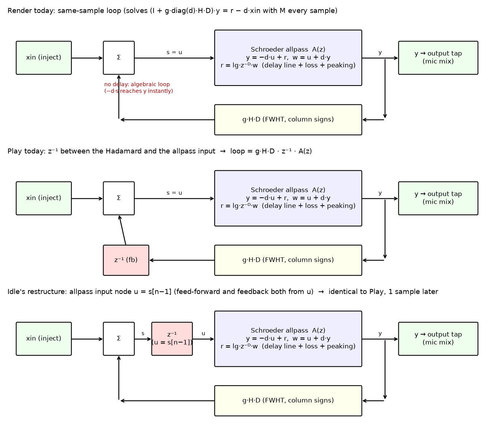
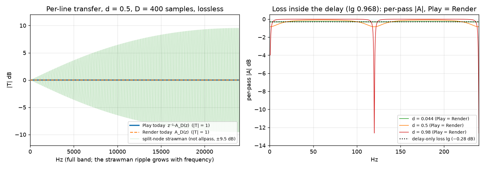
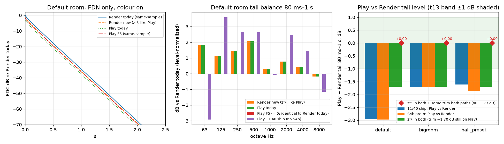

# F5 / D3 research: Idle's "z⁻¹ in both" allpass idea (2 Oct 2026, 15:55–16:35 BST)

Base for all measurements: snapshot `snapshot_2026-10-02_1140` plus the S4b prototypes: `roadmap/robotic_1240/fixwasm/fix.c` (DC restore) + `csign.c` (H·D column signs). Box only. Nothing on the PC `software\` was touched.
Tags: **VERIFIED** = measured or derived on the box, with a script and JSON in this folder. **ASSUMED** = reasoning or estimate.

## 0. Short answer

1. **Play's diffuser is already a true allpass. Idle's restructure is what Play already does.** VERIFIED.
   - Per line, Play is `z⁻¹ · A_D(z)` with `A_D = (z⁻ᴰ − d)/(1 − d·z⁻ᴰ)`. That has |T| = 1 at every frequency.
   - The extra z⁻¹ sits *in front of* the allpass input node. Feedforward and feedback already come from the same node `s`.
   - Idle's version (the allpass input node `u = s[n−1]`, with feedforward and feedback both from u) is the same system, delayed by one sample:
     - state model difference 0.0;
     - wasm null after a 1-sample shift −146 to −202 dB in every scene.
   - So no Play change is needed. **"z⁻¹ in both" means changing Render only.**
2. **"z⁻¹ in both" works.** VERIFIED. Render was given Play's loop (`sw/R_z1`). The two engines are then the same network:
   - with the trims equal, the FDN-only null is −72 dB in the default room, −64 to −66 dB in the big room and −62 to −63 dB in the Hall preset;
   - octave balance difference 0.0 dB, T30 ratio 1.000, L/R correlation identical;
   - the only remaining difference is the stale −1.70 dB F3 trim, which is applied on Play only.
3. **Today's real Play-vs-Render gap is about −3 dB, not 5.8 dB.** VERIFIED.
   - Default room tail: −2.95 dB (11:40 ship) and −2.97 dB (with the S4b prototype).
   - Big room and Hall: −1.6 to −1.9 dB.
   - The 5.8 dB number is stale. It was the pack's F5 *rise* on an older tree.
4. **The F5 same-sample port gives the same parity, but at +18.5 % Play CPU.** VERIFIED (box), PC estimate ASSUMED.
   - F5's PC estimate is 2.43 ms, which fails the t19 gate of 2.133 ms.
   - "z⁻¹ in both" costs 0 ms on Play, and Render's loop gets 14 % faster.
5. **Recommendation:** D3 = (a) z⁻¹ in both, plus D3b = equal trims (the F3 −1.70 dB row on Render too). Paste-ready S7 prompt in §8.

## 1. Structures (fig1)



Code read (VERIFIED):
- **Play** (`live_stereo.c` `DIFFUSE_FN`, the mix1 path when the bus has any Dffs):
  - `s = xin + fb`, where `fb = g·(H·D·y)[n−1]` is stored for the next sample;
  - `y = −d·s + r`, where `r` is the delay read with `lg` and peaking applied inside `read_peaked`;
  - write `s + d·y`.
  - The !mix1 path (no Dffs on the bus) is a plain same-sample FDN: H is applied to the current reads.
- **Render** (`fdn.py` `FDN.process_block_poly`):
  - with Dffs: `y = M·(r − d·xin)` with `M = (I + g·diag(d)·H)⁻¹`, then `s = xin + g·H·y` on the same sample;
  - without Dffs: the same plain same-sample FDN as Play.
- **Idle's restructure (APD):** `u = s[n−1]`, `y = −d·u + r`, write `u + d·y`. Prototype in `c/apd.c` (`-DAPD`).

## 2. Analysis (task 1): why the premise does not hold (VERIFIED, `scripts/analysis.py` → `data/analysis.json`)

**Per line.** Isolate line i and treat `s` as its input:
- `W = S + d·Y`
- `R = lg·z⁻ᴰ·W`
- `Y = −d·S + R`
- ⇒ `Y/S = A(z) = (lg·z⁻ᴰ − d) / (1 − d·lg·z⁻ᴰ)`

This is the same in Play and Render. The two engines differ only in where the feedback joins:
- Play's loop operator is `g·H·D · z⁻¹ · diag(A)`.
- Render's is `g·H·D · diag(A)`. Because A has a direct term (−d), Render needs the M solve.

Since |z⁻¹| = 1, |T| = 1 per line in both engines.

| Check (D = 400 samples) | Result |
|---|---|
| max \|20·log₁₀\|T\|\| for Play, lossless, d ∈ {±0.98, ±0.5, 0.044} | ≤ 2.5e-11 dB (rounding) |
| \|Play\| − \|Render\| | 3.9e-15 dB |
| "Split-node" strawman (feedforward taken from a delayed node, feedback not): not allpass | ±0.76 dB (d 0.044), ±9.5 dB (d 0.5), ±39.9 dB (d 0.98) |

The strawman is what you get if the z⁻¹ is absorbed into only one of the two paths. Getting this wrong is the real risk, not the current code.

**Per trip (loop gain and colour).**
- The z⁻¹ adds exactly 1 sample (0.021 ms at 48 k) and linear phase −ω per trip. It changes no magnitude.
- It does move the loop's modal frequencies slightly, and with large |d| it changes how loss is spread across modes. That is the only structural effect (measured in §4).
- With `lg` inside the delay (lossy allpass), each pass ripples. This is identical in Play and Render (fig2, right):

| d | ripple per pass (lg 0.968, −0.28 dB) |
|---|---|
| ±0.98 | −12.6 … −0.003 dB (narrow dips at the comb frequencies) |
| ±0.5 | −0.85 … −0.09 dB |
| 0.044 | −0.31 … −0.26 dB |

This is the "allpass holds energy" T30 effect from HANDOVER line 67. It is a separate topic: a lossy allpass decays per mode, not flatly. The z⁻¹ does not cause it.



**Passivity, stability, |dffs| range (VERIFIED).** The exact closed-loop state matrix was built for 32 lines with H·D and small random delays.

| d set | lossless g = 1/√32, lg = 1: ρ (Play / APD / Render) | lossy g 0.158, lg 0.97: ρ (Play / APD / Render) |
|---|---|---|
| all +0.98 (positive, pinned) | 1 / 1 / 1, every \|λ\| = 1 | 0.9978 / 0.9978 / 0.9979 |
| all −0.98 | 1 / 1 / 1 | 0.9979 / 0.9979 / 0.9975 |
| mixed U(−0.98, 0.98) | 1 / 1 / 1 | 0.9957 / 0.9957 / 0.9956 |
| hall-like \|d\| ≤ 0.14 | 1 / 1 / 1 | 0.9887 / 0.9887 / 0.9877 |
| zero | 1 / 1 / 1 | 0.9890 / 0.9890 / 0.9880 |

- Lossless means every eigenvalue is on the unit circle: the loop is paraunitary, with no growth and no decay.
- Small-gain proof:
  - ‖g·H·D‖₂ = g·√N ≤ 1 for g ≤ 1/√N;
  - |A(e^{jω})| ≤ 1 whenever lg ≤ 1 and |d| < 1, because 1 − |A|² ∝ (1 − lg²)(1 − d²) ≥ 0;
  - the peaking filters are cut-only (≤ 1) after the S4b DC fix;
  - z⁻¹ has magnitude 1.
  - So the loop gain is ≤ 1 at every frequency for any |d| < 1, either sign, in both structures.
- This also means HANDOVER line 73 ("positive Dffs can grow in the one-sample loop") does not hold for g ≤ 1/√N. VERIFIED for g = 1/√32. At the old 0.99/√N ceiling it is also stable.

## 3. Prototypes (task 2)

All C variants are built on `csign.c` (PEAK_DC_FIX + CSIGN), wasm32 via zig cc -O3:

| Variant | File | What it is |
|---|---|---|
| P_ship | `roadmap/robotic_1240/fixwasm/ship.wasm` | 11:40 Play as shipped |
| P_old | `c/base_csign.c` → `c/base.wasm` | Play today + S4b prototypes (the z⁻¹ structure) |
| P_apd | `c/apd.c -DAPD` → `c/apd.wasm` | Idle's restructure (fb register holds u; `APD_U`/`APD_NEXT` macros) |
| P_f5 | `c/f5.c -DF5` → `c/f5.wasm` | F5 same-sample port of `build_support/engine/briefs/live_stereo.F5_same_sample.diff` (`build_mix` with H·D, `diffuse32_f5`) |

Render trees (monkeypatch copies; the snapshot is untouched):
- R_ship = the snapshot;
- `sw/R_cur/software` = fdn.py with `loop_hadamard` (csign H·D, ungated);
- `sw/R_z1/software` = R_cur plus the z⁻¹ loop.

The Render change is about 10 lines (diff in §8).

## 4. Measurements (task 3) (VERIFIED, 48 k, FDN only, 3 s IRs, both colour on (col) and BYPASS (byp); `scripts/measure.py` → `data/measure.json`, `data/null_trimfit.json`)

Scenes:
- **default** = Idle's live 11:40 scene (`s4_verify_1140/measure/client_body_1140.json`);
- **bigroom** = 57 × 34.2 × 97 m;
- **hall_preset** = `robotic_1240/hall.py` body;
- **binaural** = the default scene with `mic_setup = binaural` (Play only; Render has no binaural path, because `render()` never calls `render_binaural_fdn_ir`).

The tail window is 80 ms–1 s throughout.

### 4.1 Play − Render, t13 metrics (PAR.full_metrics)

| Scene / bus | Pair | Tail level | Worst octave balance | T30 ratio range | L/R corr P vs R |
|---|---|---|---|---|---|
| default col | **P_ship vs R_ship (today)** | **−2.95 dB** | +1.7 dB (1–2 kHz) | 0.96–1.02 | 0.437 vs 0.472 |
| default byp | P_ship vs R_ship | −2.81 dB | +1.8 dB (1 kHz) | 0.95–1.02 | 0.320 vs 0.411 |
| default col | P_old vs R_cur (S4b proto) | −2.97 dB | +1.8 dB (500 Hz) | 0.96–1.01 | 0.457 vs 0.429 |
| default byp | P_old vs R_cur | −3.34 dB | +2.2 dB (500 Hz) | 0.95–1.01 | 0.341 vs 0.318 |
| bigroom col / byp | P_ship vs R_ship | −1.71 / −1.70 dB | 0.0 / 0.0 | 0.97–1.01 | 0.816 vs 0.816 |
| hall col / byp | P_ship vs R_ship | −1.61 / −1.61 dB | ≤ 0.1 | 0.98–1.00 | 0.481 vs 0.483 |
| hall col / byp | P_old vs R_cur | −1.86 / −1.92 dB | ≤ 0.2 | 0.97–1.03 | 0.494 vs 0.495 |
| **all scenes, col + byp** | **P_old vs R_z1 (z⁻¹ in both)** | **−1.70 dB** (= the trim) | **0.0** | **1.000** | identical |
| all scenes, col + byp | P_f5 vs R_cur (same-sample in both) | −1.70 dB | 0.0 | 1.000 | identical |

On today's tree, t13 at Idle's scene fails on tail level (−3 dB) and on the 500 Hz balance. With z⁻¹ in both and equal trims, the remaining difference is 0.00 dB.

### 4.2 Nulls (t18 style, FDN only)

| Scene | P_ship vs R_ship (raw) | P_old vs R_cur (raw) | P_old vs R_z1 raw | P_old ×(+1.70 dB) vs R_z1, full IR [0–80 ms / 80 ms–1 s / 1–2 s] | P_f5 ×(+1.70 dB) vs R_cur, full IR |
|---|---|---|---|---|---|
| default col | +3.4 / +4.0 dB | +3.8 / +4.2 | −13.3 | **−72.3 / −72.0** [−80 / −69 / −58] | −72.2 / −72.1 |
| default byp | +3.4 / +4.0 | +4.4 / +4.6 | −13.3 | **−72.7 / −72.6** [−81 / −70 / −58] | −72.5 / −72.5 |
| bigroom col | −11.1 / −11.0 | −10.7 / −10.7 | −13.3 | **−64.9 / −64.2** [−118 / −65 / −40] | −64.9 / −64.2 |
| bigroom byp | −10.4 / −10.5 | −10.0 / −10.2 | −13.3 | **−66.2 / −65.9** | −66.2 / −65.9 |
| hall col | −10.6 / −11.0 | −9.9 / −10.2 | −13.3 | **−61.5 / −62.1** [−152 / −62 / −46] | −61.6 / −62.2 |
| hall byp | −9.5 / −10.0 | −8.8 / −9.5 | −13.3 | **−62.8 / −63.3** | −62.9 / −63.3 |

Reading the table:
- The raw −13.3 dB is exactly the 1.70 dB scalar: 20·log₁₀(10^(1.70/20) − 1) = −13.3 dB (the residual is referenced to the Play IR). gainprobe.json gives R/P gain 1.2163 on every bus.
- The residual grows late in the tail, to −40…−58 dB at 1–2 s.
- That late growth is the same for F5 vs Render, so it is not the loop structure. Play runs float32 and Render float64 (ASSUMED cause).
- Both structures land in the same place: the 2026-09 pack's F5 prototype reached −48 dB on an older tree.

### 4.3 Structural effect of z⁻¹ vs same-sample (R_z1 vs R_cur = what Render's sound would change by)

| Scene | IR tail level | Octaves 63 / 125 / 250 / 500 / 1k / 2k / 4k / 8k Hz (balance, dB) | T30 | Corr | Comb index L/R | ac max L/R |
|---|---|---|---|---|---|---|
| default col | −1.44 dB | +1.8 / +1.1 / +1.5 / +2.1 / +0.3 / +0.8 / +0.5 / −0.2 | 1.777 vs 1.779 s | 0.457 vs 0.429 | 4.08 / 3.65 vs 4.61 / 4.75 dB | 0.15 / 0.18 vs 0.23 / 0.24 |
| default byp | −1.80 dB | +2.2 / +1.4 / +1.9 / +2.3 / +0.6 / +0.8 / +0.5 / −0.4 | 1.779 vs 1.788 s | 0.341 vs 0.318 | 4.94 / 3.81 vs 5.23 / 5.18 | 0.18 / 0.19 vs 0.28 / 0.27 |
| bigroom col | −0.01 dB | ≤ 0.03 | 1.660 vs 1.662 s | 0.817 = | ≈ | 0.02 = |
| hall col | −0.14 dB | +0.1 to +0.15 | 2.675 = | 0.494 vs 0.495 | 1.81 / 2.06 vs 1.83 / 1.97 | ≈ |
| hall byp | −0.16 dB | ≈ +0.12 | 2.656 vs 2.736 s (−3 %) | 0.313 vs 0.304 | ≈ | ≈ |

- The effect is only audible in small rooms with large |Dffs|, i.e. short delays where one sample is a larger fraction of the trip.
- There, the z⁻¹ network is a bit darker at the top, about −1.4 dB in the tail, slightly *less* combed and slightly more correlated.
- Explanation (ASSUMED): moving the modes changes how they line up with the lossy allpass dips (§2).

### 4.4 Comb (S4b metric) and the S4b proofs

- S4b column signs keep working with the z⁻¹ loop: P_old and R_z1 have the same comb index of 4.08/3.65 dB (gate ≤ 6) and ac max 0.15/0.18 (gate ≤ 0.40). VERIFIED.
- 11:40 ship for comparison: 12.3/10.7 dB (Play) and 12.7/10.6 dB (Render).

### 4.5 Binaural (Play only)

| Pair | Result |
|---|---|
| P_apd vs P_old (1-sample shift) | −146 dB: identical |
| P_old vs P_ship | +2.8/+3.4 dB raw null. This is S4b (column signs + DC), not F5. Comb 8.8/4.9 → 2.7/2.5 dB |
| P_f5 vs P_old | tail +1.29 dB; octaves −0.1 to −1.6 dB; L/R corr 0.006 vs 0.011; T30 1.800 = |

- Under "z⁻¹ in both", binaural is bit-exact: Play does not change.
- F5 would change binaural, and would need `test_binaural_play_tail_coherence_matches_head` re-checked.



fig3:
- **Left:** default-room EDCs. Play is 1.70 dB under its Render twin: that is the trim.
- **Middle:** octave balance vs Render today. "Play today" and "Render new" overlap exactly. F5 equals Render today (0).
- **Right:** the Play − Render tail level per scene. With equal trims it is exactly 0.00 (diamonds).

## 5. CPU (task 4)

**Play** (`scripts/cpu.py`, t19 scene: std_lock18 + two directional sources + colour, node bench, min of 6 alternating rounds):

| Variant | Box ms | × ship | PC estimate (ASSUMED proportional; PC ship 2.052 ms) | t19 gate 2.133 ms |
|---|---|---|---|---|
| P_ship | 1.847 | 1.000 | 2.052 | pass |
| P_old (S4b, z⁻¹) | 1.872 | 1.014 | 2.08 | pass |
| P_apd | 1.906 | 1.032 (noise: same op count as P_old) | 2.12 | pass |
| **P_f5** | **2.190** | **1.185** | **2.43** | **FAIL** |

- The box is noisy (runs spread ±10 %).
- F5 adds the 32×32 dense matvec per sample per bus. HANDOVER line 69 already records it "blowing the audio thread", with the instruction "do not put the matrix back".

**Render** (`scripts/render_cpu.py`, 32 lines, 0.5 s):
- R_cur 0.458 s → R_z1 0.394 s (×0.86);
- one matvec instead of two per sample, and no 32×32 inverse.

## 6. Guitar A/B WAVs (task 5) (`wav/`, `scripts/wav.py`, `data/wav_ab.json`)

Method:
- Dry = Idle's render-derived estimate `robotic_1240/real/dry_est_0.001.npy`, 2–22 s, resampled 44.1 → 48 k, as dual mono.
  - It is an estimate: Idle's real dry file on F:\ could not be copied, because CopyToBox only allows the user folder.
- Play variants run the real worklet on the file at 48 k with colour on.
- Render variants are the 3 s FDN IR (colour on) convolved with the dry.
- FDN only. 16-bit 48 k stereo.
- All files are RMS-matched to Render today. The raw level differences are listed so you can judge the level separately.

| File | Raw dB vs Render today |
|---|---|
| `default__Play_today_z1.wav` | −1.83 |
| `default__Play_F5_same_sample.wav` | −1.70 |
| `default__Render_today_same_sample.wav` | 0 |
| `default__Render_new_z1_like_Play.wav` | −0.13 |
| `hall_preset__Play_today_z1.wav` | −1.70 |
| `hall_preset__Play_F5_same_sample.wav` | −1.70 |
| `hall_preset__Render_today_same_sample.wav` | 0 |
| `hall_preset__Render_new_z1_like_Play.wav` | 0.00 |

- What to listen for: **Play_today ≈ Render_new** (z⁻¹ in both) vs **Play_F5 ≈ Render_today** (same-sample in both).
- In the default room the difference between the pairs is small: the IR tail differs by −1.4 dB, and the guitar by only 0.13 dB. In the Hall preset there is no difference.
- **Caveat (earlier WAVs, VERIFIED):** `wasm_run_file.js` hard-codes SR = 48000. The earlier Play guitar A/Bs (`real/ab_real/P1_*`, `hall_b/ab_wav*`) therefore ran 44.1 k params at 48 k with colour off, and were written as 44.1 k files (time-stretched by 8.8 %). Comparisons *within* each of those sets are still valid. The WAVs here avoid this: params are dumped at 48 k and the files are written at 48 k.

## 7. Sound-changing decisions (with recommendations)

- **D3, loop semantics: recommended (a) z⁻¹ in both.**
  - Render takes Play's loop. Play is bit-exact, binaural is untouched, and t19 is unchanged.
  - Render at defaults changes:
    - Idle's default room: tail −1.4 dB, balance up to +2 dB below 500 Hz (relative to the treble), slightly less comb;
    - guitar level −0.13 dB;
    - big room and Hall: < 0.2 dB.
  - The Render goldens must be regenerated.
  - Under `reaktor_parity` too (one rule). Reaktor Core resolves feedback with a unit delay, so z⁻¹ is probably what the 2011 instrument does (ASSUMED). The 2011 capture (b) can confirm this; if it says same-sample, revisit.
  - Rejected (b), same-sample in both (F5): +18.5 % Play CPU (fails t19), changes Play and binaural, and puts back the matrix HANDOVER forbids.
- **D3b, trim parity: recommended: put the F3 row on Render too** (`f3_play_rate_delays.render = −1.70`).
  - Play loudness and t14 (Play-based) are unchanged. Render FDN gets −1.70 dB quieter.
  - Combined with D3, a Render IR in Idle's default room is about −3.1 dB vs today, and about −1.8 dB in the big room and Hall.
  - Alternative: Play's F3 row → 0. Play becomes +1.70 dB louder, and t14 would move to about +1.8 dB (fails ±0.5 unless T14_REF is re-based).
  - Either way, rewrite the stale fdn.py comment ("F5 … about +5.8 dB hotter") with the measured numbers.
- **Not needed (ASSUMED, negligible):**
  - compensating the delay lengths by −1 sample. That would only shift the modes back by the same 1 sample;
  - extra lg for the D+1 trip: 1 sample of loss is about 0.0007 dB per trip at 1.8 s.
- **Follow-up, not this session:** the per-mode decay spread of the lossy allpass (§2) is the HANDOVER line-67 "allpass holds energy" topic. It belongs to D4 / J10, not to F5.
- **Doc correction found during this task (VERIFIED).** S4b final item 5 said that with Decay lock the loop runs "at the decay-lock g (about 0.158)". That is wrong:
  - the live params have `g = 1/√32 = 0.1768`, i.e. a lossless mix, with the per-line `line_t60` loss setting the decay;
  - `g_decay` ≈ 0.158 is used only for the makeup gain.
  - Fixed in `BUILD_PROMPTS.md` and the roadmap §5 copy, 2 Oct 16:30.

## 8. Paste-ready S7 prompt (replaces the old "S7: F5" plan)

> Hi Build. Session S7: F5 = **D3 "z⁻¹ in both"** (Idle's decision; research `handoff_build_support_2\research_f5_allpass\REPORT.md`). Render takes Play's loop timing. **Play does not change.**
>
> **1. Render loop** (`engine/fdn.py`, `FDN.process_block_poly`, Dffs branch only)
> - Replace the same-sample solve with Play's one-sample feedback:
>   ```python
>   # __init__ (and wherever bufs/idx/peaking state is reset):
>   self._hy = np.zeros(self.n)
>   # per sample, Dffs branch (H is the loop H, i.e. H·D after S4b, plain H under parity):
>   s  = inj_t + self._hy                # fb from the previous sample, as Play's DIFFUSE_FN
>   yv = reads - dffs * s                # y = -d·s + r
>   bufs[i][wi] = s[i] + dffs[i] * yv[i]
>   self._hy = g * (H @ yv)              # used on the next sample
>   ```
> - The no-Dffs branch stays same-sample. It already matches Play's !mix1 path.
> - Remove `_y_mix`. Delete `diffuser_output_mix`, or keep it unused and say so.
> - One rule for every path, `reaktor_parity` included.
> - `render_binaural_fdn_ir` inherits the change.
>
> **2. Play** (`live_stereo.c`, worklet, wasm): no edits; the wasm stays byte-identical, and no `WORKLET_VER` bump.
>
> **3. CORE `loop_semantics`** stays 0. Document "0 = z⁻¹ in both (D3, 2 Oct)" in `render_pipeline.py` (CORE packer) and in `fdn.py`. Do not edit `live_stereo.c` for a comment.
>
> **4. Trim (D3b)**
> - `LOOP_LEVEL_TRIM_DB["f3_play_rate_delays"]["render"] = -1.70`. Play and Render then carry the same total trim.
> - Keep the `f5_same_sample` row at 0/0 with the comment "D3 = z⁻¹ in both: Play unchanged; Play − Render tail 0.00 dB with equal trims (research_f5_allpass)".
> - Replace the stale "+5.8 dB" comment.
> - [If Idle picks the alternative, set Play's F3 row to 0 instead and re-base T14_REF with `--reason`.]
>
> **5. Selfcheck:** rewrite `selfcheck.test_diffuser_output_mix_holds_decay_lock` for the z⁻¹ loop:
> - first output sample `y = −d·xin` (no M);
> - a zero-Dffs burst equals the plain FDN;
> - the spectral radius of the 32-line state matrix ≤ 1 + 1e-9 at the live g and Dffs.
>
> **6. Tests and probes**
> - `tests/probes.py::f5_same_sample_play` should also accept the Render z⁻¹ marker (for example `LOOP_SEMANTICS = "z1_both"` in `fdn.py`), so that `test_p0_4` runs.
> - run_all t18 and `test_p0_4`: gate ≤ −30 dB stays; the −60 dB target is now expected to pass (box: −72 dB at Idle's scene, −64 dB big room, −62 dB Hall preset). Update the docstrings: "z⁻¹ in both", not "same-sample loop solve".
> - t13 must PASS on tail level (±1 dB), balance (±1.5 dB) and T30 (±10 %). Box: 0.00 dB, 0.0 dB, ratio 1.000 on all buses.
> - t14 unchanged (Play).
> - `test_binaural_play_tail_coherence_matches_head` unchanged (Play bit-exact). Run it once to show this.
> - Keep every S4b proof green: `test_s4b_tail_solo_runaway.py` (Render comb index ≤ 6 dB; the box R_z1 has 4.1/3.7 dB) and `test_s4_followups`.
>
> **7. Goldens:** regenerate the **Render** goldens only, with `--reason "D3 z^-1 in both (F5): Render loop takes Play's one-sample feedback; D3b equal trims"`. Play goldens must be unchanged: diff 0.0.
>
> **8. Proof numbers to print**
> - t13/t18 values.
> - Render default-room tail delta vs before: expected about −3.1 dB including D3b, about −1.4 dB from D3 alone.
> - Render CPU before/after (box: ×0.86).
> - t19 unchanged.
> - Re-render Idle's default scene and report the level change.
>
> List anything else that changes the sound at defaults instead of choosing it quietly.

Diff of the box prototype (`sw/R_z1` vs the snapshot, the Dffs branch):
```
-                yv = mix @ (reads - dffs * inj_t)
-                hy = g * (H @ yv)
+                hy = self._hy_prev
+                sv = inj_t + hy
+                yv = reads - dffs * sv
+                self._hy_prev = g * (H @ yv)
 ...
-                    s = float(inj_t[i]) + float(hy[i])
+                    s = float(sv[i])
```
(Plus `self._hy_prev = zeros(n)` in `__init__`, and `loop_hadamard` = the S4b H·D.)

## 9. Files

- `scripts/`:
  - `analysis.py` (task 1 and the proofs);
  - `common.py`, `measure.py`, `gainprobe.py`, `cpu.py`, `render_cpu.py`, `wav.py`, `figs.py`, `mk_probe.py`.
- `c/`: `base_csign.c`, `apd.c`, `f5.c` plus their `.wasm` files.
- `data/`:
  - `analysis.json`, `measure.json`, `null_trimfit.json`, `gainprobe.json`, `cpu.json`, `render_cpu.json`, `wav_ab.json`;
  - the IR `.f32` files stay on the box only.
- `fig/fig1_structures.png`, `fig/fig2_per_line_magnitude.png`, `fig/fig3_parity.png`.
- `wav/`: the 8 A/B WAVs.
- `sw/R_z1/software/engine/fdn.py` and `sw/R_cur/software/engine/fdn.py`: only the two prototype fdn.py files are synced, not the whole trees.
