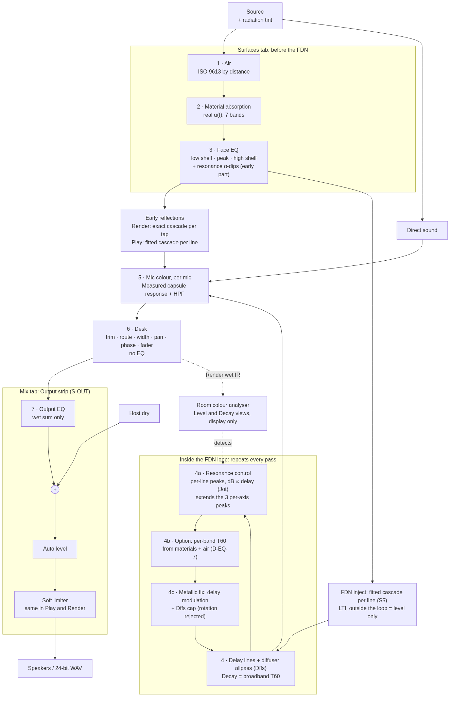
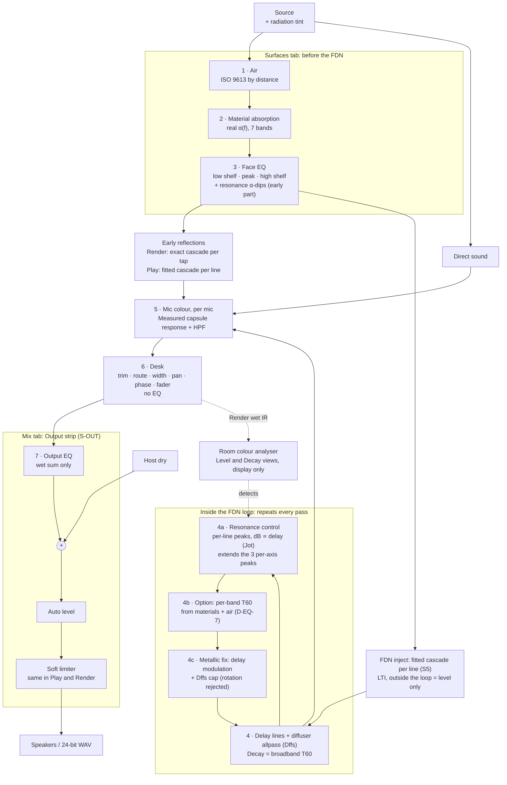

# EQ plan: 2011 Room Reverb (v3.2, 4 Oct 2026, 10:20 BST — recommendations locked by Idle; Smooth + Movement LOCKED as session EQ-1, §4f)

This is a planning document only. Nothing in `software\` was touched, and nothing here is a Build prompt. It is built on `RESEARCH_EQ_MODES_METALLIC.md` (the research, cited below as R§). Baseline: the S-MIX + D-MIX-J tree (wasm `272c0eb16fc6`, WORKLET_VER 48), with S-AUDIT running in Build. Code was read from copies taken from the PC at 06:17 BST (`src/`). The box measurements used the 18:29 audit copy, whose FDN bus is the same as today's. Scripts and data are in `measure/`.

**The plan in five lines**
1. **Fix metallic ringing first** (§4). It is the tone that is actually measured. The FWHT stage rotation was tried and **rejected** (no audible difference, §4e); delay modulation with Frenette's values plus the Dffs cap is now being prototyped, and needs Render to run the loop. Linear interpolation is a problem for both the backup and Play at 44.1 kHz.
2. **Then resonance control** (§3). Cuts go **inside the loop**, with each line's dB **proportional to its delay** (Jot), extending the three per-axis in-loop peaks that already exist. Matching dips go in the face reflection filters for the early part. Detection uses the engine's own output; box modes are labels only.
3. **Correction from v2:** a cut on the FDN inject (pre-FDN, including S5's SURF) **cannot build up over passes**. The FDN is LTI, so it acts exactly like a post EQ on the tail. It is a level control, not a decay control.
4. **Colour EQ** (air, materials, face EQ) stays on Surfaces, before the FDN.
5. **One Output EQ** goes on the Mix tab after the desk. There is no strip EQ.

---

## 1. Signal order

Diagram check: re-rendered with mermaid-cli 11 after the v3 edits, no errors (`check/signal_order.mmd` → `signal_order.png`).

---

## 2. What the box measured (VERIFIED unless marked)

Test rooms: **default** 6 × 3 × 8 m, Decay 1.8 s, and **box** 3 × 2.4 × 4 m, Decay 0.8 s. Render FDN only, 4 s IR at 48 kHz. Reference: flat-decay Gaussian noise with the same T60 and the same analysis.

| Question | Result |
|---|---|
| **Does the engine already cut in the loop?** | **Yes, crudely.** Each FDN line has one cut-only RBJ peak inside the loop: **−1.5 dB per pass on every line, whatever its length**, Q 1.5, at the first axial mode of X, Y or Z (line i % 3). It is in both engines (`fdn.py` `live_peaking_banks`, `DEFAULT_DEPTH 1.5`, `PEAKING_Q 1.5`; Play `read_peaked`). This is the inhomogeneous case from R§1.6. |
| **What it does** | It over-cuts the bass. Octave T20 with / without the banks: default 31.5 Hz **0.58 / 1.53 s**, 63 Hz **0.97 / 1.65 s** (dial 1.8); box 63 Hz **0.37 / 0.83 s** (dial 0.8). A loop-gain predictor gives box 0.38–0.43 s, against 0.34–0.46 s measured. |
| **Do room modes ring in the tail?** | **No, not beyond chance.** With the banks off, per-bin T60 scatter matches flat noise (std log T 0.13 default, 0.26 box; noise 0.22–0.31). The default room has 229 modes below its Schroeder frequency (224 Hz), so "matches a mode" means nothing. This fits R§1.6: FDN modes are not room modes. |
| **Engine ringing, default room (new quick check)** | Late-tail peakiness (std of fine-bin dB, 0.3–1.3 s, decay removed, trend removed, 100 Hz–8 kHz): **engine 7.20 dB** (7.22 with the banks off), against **noise 5.53 dB** (textbook Rayleigh 5.57). Strongest lines are at **724, 1285, 781 and 2008 Hz**, +18.5 to +21 dB over the local median. Noise's biggest is +10.7 dB. So the default tail rings, in the mid band, **not at room modes, and not from the banks**. It is metallic (§4), not modal. `measure/frac_ring.py` → `frac_ring.json`. |
| **Box-room ringing (v2)** | Worse. Line peaks p99.5/median 19.6 dB (noise 8.6–8.8), flatness 0.394 (noise 0.565), autocorrelation 0.22 at 14.15 ms. There is a 138 Hz line at +28.6 dB. 15 of 32 diffuser gains sit at the −0.98 clamp (5 of 32 in the default room). |
| **Are today's FDN delays fractional? (new quick check)** | **Render: no.** Delays are `int(round(·))` samples at 48 kHz (`fdn_delays_from_taps`). **Play at 48 kHz: no.** The blob's ms are on the 48 k grid, and the fractions computed are < 5·10⁻¹³ (the glide converges to the target). **Play on a 44.1 kHz device: yes, all of them.** `ms_to_delay` multiplies by the device rate, and the AudioContext is created at the device rate. Fractions spread up to 0.5, and `read_lane` interpolates linearly, giving **−0.05 to −2.4 dB per pass at 10 kHz, uneven per line**. Predicted by the loop-gain formula (computed, not rendered): the 10 kHz T60 falls from 1.8 s to **about 0.63 s** in the default room, from the interpolator alone, and per-line loss varies 25 : 1. That is both a Play/Render mismatch and an inhomogeneous HF loss. Parity tests run at 48 kHz, so they cannot see it (ASSUMED). |

**Honest assessment of the resonance idea**
- **What holds.** Per-pass compounding is real and the engine proves it: R§0.3 gives cumulative cut = 60·t·(1/T_target − 1/T_now), so transients are barely touched and the long tail is re-timed.
- **What fails.** (1) Pre-FDN cuts, including SURF, cannot do this (LTI). (2) Predicted room modes are the wrong cut list for the tail. (3) Today's tone is mostly metallic, which cuts can't fix.
- **What it does well.** It is an in-loop **decay equaliser** for measured outliers against a target curve. The outliers come from fixed banks, interpolation loss, D-EQ-7 shapes or extreme face EQ, plus the real box tone in the early, image-source part, which the face dips handle.

---

## 3. Resonance control (after the metallic fix)

**(a) Detection: from the engine output.**
1. Render the wet IR (Render only, off the audio thread). Take a fine-band STFT (16384 points), and per bin run Schroeder EDR plus a **decay-plus-noise fit** (Mäkivirta, R§1.2-1). Refine the frequency with a three-bin parabola. Reject bins with low SNR or no decay.
2. **Target: the Mäkivirta curve** (R§1.3). Mean T60 over 500 Hz–2 kHz, rising linearly on log-f by +0.2 s from 300 Hz down to 50 Hz.
3. **Flag** a band when T60 exceeds the target by more than **5–10 %** (the T60 JND, R§1.3). Average about 6 renders (channels × small offsets), because a single IR scatters like noise (§2). Calibrate the threshold so that flat noise gives < 5 % false flags.
4. **Rank** by audibility: Fazenda thresholds (lenient below 63 Hz), level above the local median, and Glasberg–Moore excitation from Idle's `psychoacoustic-eq`. Merge flags within one ERB. Low-Q peaks count for more than narrow ones (R§1.4).
5. **Box modes are labels only.** Axial, tangential and oblique modes below f_S = 2000·√(T/V) appear as ticks ("1-0-0 of the 8 m dimension"). They never create a cut.
6. Optional cross-check: the loop-gain predictor or pole bound (R§1.2-5) shows what any in-loop shape does without rendering.
7. **Iterate** (R§1.2-3): cut the longest outlier, re-render, repeat. Re-detect after any metallic-fix change.

**(b) Sizing: by formula.** For line i with delay dᵢ: **cᵢ = 60·dᵢ·(1/T_target − 1/T_now) dB per pass** at the centre frequency.
- One shared Q per resonance; only the gain differs per line, ∝ dᵢ.
- Example: 2.4 → 1.8 s gives 0.17 dB per pass on a 20 ms line and 0.33 on a 40 ms line, which adds up to 0.8 dB at 0.1 s, 4.2 at 0.5 s and 8.3 at 1 s.
- An amount knob scales the excess: T_target = T_now − amount·(T_now − T_curve).
- Caps: cut ≤ 0 dB, normalised to unity at DC as today (`pb2`), ≤ 1 dB per pass, no band below 0.9 × target. Q from the excess width, 1–8.
- RBJ peaks are only approximately proportional across gains. A Regalia–Mitra or Jot proportional section is exact (R§1.3), so prefer it if the CPU allows.

**(c) Placement.**

| Where | Effect | Verdict |
|---|---|---|
| **In the loop, on every line, dB ∝ dᵢ** (extends the 3 per-axis peaks) | Builds up every pass with homogeneous decay: neighbouring modes decay together | **Use** |
| Today's form: one frequency per line (i % 3), same dB on all lengths | Inhomogeneous: neighbouring modes decay at different rates (R§1.6) | Keep only for `reaktor_parity` / 2011 |
| **Face reflection filters: matching dip** | An order-k image gets the dip k times, so the early part builds up too (−10·log₁₀(1−α) per bounce) | **Use, for the early part** |
| FDN inject (S5 SURF) or post EQ | LTI and outside the loop: the same dB at every moment, level not decay | Only the "too loud everywhere" knob (Jot's E(z)), never for ringing |

- **CPU.** Homogeneous means every resonance runs on every line: one biquad slot per line per resonance. The existing per-axis slot is free to re-use. Each extra slot is 192 biquad steps per sample, about **+0.047 ms on the two-source t19** (ASSUMED, scaled from S5). Shared-off headroom is 2.40 − 2.224 = 0.176 ms, minus Output EQ (0.003) and delay modulation (about 0.015, ASSUMED). That leaves room for **3 extra slots, so up to 4 resonances**, shared with D-EQ-7 shelves. Face dips ride the existing S5/early cascade (K up to 6), so they are about free while K stays ≤ 6.
- **Parity.** The same coefficients in `FDN._apply_peaking` and `read_peaked`; t18 (−71.8 dB) and `test_mirror_exact` must hold. Mirror: coefficients depend only on delay, so a mirrored scene gets the same cuts.

**(d) UI on Surfaces** (no new tab). The Room colour card gets a **Level / Decay** chip. The Decay view shows fine-band T60 against the Mäkivirta target (dashed), mode ticks below f_S, and markers for detected resonances. A list of at most 4 rows: frequency · "1.3× longer" · cut ("−4 dB at 0.5 s") · **Auto / amount / bypass / solo-listen** (a Play-only band-pass monitor, never rendered). There is a global amount and a **Detect** button. Nothing changes until Auto is on.

**(e) Validation.** Flatness F = rms log₂(T/T_target) over the flagged bands drops ≥ 30 % at 100 %. Broadband T30 stays within ±3 % of the dial. The **0–80 ms early field moves ≤ 0.3 dB per band** for the loop part. Face dips are checked on their own. Tail level outside flagged bands moves ≤ 0.5 dB. t18, t19 and mirror hold. Listening A/B (guitar, pad, click; default and box) is the later step.

---

## 4. Metallic ringing (do first)

**(a) Measured.** Default peakiness 7.2 dB against 5.53 for noise, with lines at 724, 1285 and 2008 Hz (§2). Box room line peaks 19.6 dB against 8.7 for noise. Engine results with Diffusion Master at today's value / halved / off:

| Room | Line peak p99.5/median (dB) | Flatness | Autocorrelation |
|---|---|---|---|
| Default | 13.9 / 10.9 / 10.0 | 0.540 / 0.560 / 0.564 | 0.164 / 0.086 / 0.066 |
| Box | 19.6 / 15.8 / 11.8 | 0.394 / 0.503 / 0.542 | 0.22 / 0.134 / 0.08 |

Echo density reaches about 1.0 by 100 ms in every case, so density isn't the problem. The likely causes are uneven modal excitation (a plain Hadamard is the most colour-prone matrix, R§2.1), diffuser gains at the clamp, and exact duplicate delays (kept by the "Do not uniquify delays" lock).

**(b) Options, in order.**
1. **FWHT stage rotation (R§2.3) — tried and REJECTED, see (e).** FWHT32 is 5 butterfly stages of Ref(π/4). Replace one stage's angle with π/4 + ε·sin(2π·f·t).
   - The matrix stays exactly orthogonal, so the loop stays lossless and stable.
   - No interpolator and no HF loss. A few multiplies per sample.
   - Coppola's settings: ε = **2–15 % of π**, **0.1–1 Hz**. Start at **5 % of π, 0.3 Hz**, and audition up to 15 % and 1 Hz.
   - The author claims less pitch artefact than delay modulation (no formal test). This is untested on this engine, so it needs a box prototype before Build.
   - Column signs (loop_semantics 0) stay where they are.
2. **Delay modulation (backup, R§2.2, Frenette).**
   - About **0.10 ms peak (about 5 samples at 48 kHz)**, range 0.05–0.15 ms.
   - **0.7 Hz centre, each line × 0.6–1.4**, not commensurate. Rates below 0.5 Hz are weak, above 2 Hz audible.
   - **Sinusoids with phases spread ≥ 45°**, on **16 of 32 lines**. Coefficient update every ≤ 16–25 samples.
   - Pitch cost about 0.8 cents per pass at 0.1 ms and 0.7 Hz (R§2.2 table).
   - **This needs a new interpolator on the modulated lines.** Linear is audibly dull and its HF loss would breathe. My box prototype showed a −24 dB HF tilt and T60 −14 %. Use a first-order allpass (flat; v2 prototype) or cubic (about −5 dB tilt).
3. **Static, bit-exact options (R§2.4).**
   - **Cap or scale Dffs** on the modern path. This is the only one with engine evidence: halving takes the box from 19.6 to 15.8 dB and removes the 138 Hz line.
   - Offline optimisation of the inject and output weights b/c and Dffs for flat modal excitation.
   - Co-prime nudges would conflict with the uniquify lock.
4. **Fix linear interpolation where it already bites:** Play at 44.1 kHz (§2). Options are integer-rounding the delays at the device rate (cheapest, but the delays move by up to ½ sample), allpass reads, or running Play at 48 kHz. This is needed whatever is chosen above.
5. The 2011 ensemble: the Structure-mining notes show **no modulation or LFO** in the FDN (absence in notes is not proof).

**(c) Costs.**
- **Pitch and chorus on sustained tones.** Rotation is claimed to be lower. Delay modulation stays inside Frenette's values. Always audition sustained guitar and pads, not only clicks.
- **CPU.** Rotation about 0.005 ms; delay modulation with allpass reads about 0.01–0.02 ms (both ASSUMED). Both fit t19.
- **Determinism and parity.** LFO phase indexed by absolute sample from a seed, with one shared C function in Play and Render. Sample-exact is possible if both start at t = 0, and live Play may run free.
- **Mirror test:** rotation is mirror-safe if the rotated stage maps onto itself under the D-MIX-J line mirror (to check). Delay-modulation phases are assigned by mirror-symmetric key.
- **Goldens:** off means bit-exact. On means new goldens plus statistical gates (third-octave tail, per-band T30, echo density, peakiness against 5.57 dB).
- **Off** in `reaktor_parity`, flat cards and mirror/null modes.
- **S5:** outside the loop, so no interaction.
- **Resonance control:** modulation spreads narrow peaks, so detect **after** the metallic fix, on the modulated tail.

**(d) Recommendation (as written before the prototype; superseded by (e)).** Prototype FWHT rotation on the box at 5 % of π and 0.3 Hz. If it brings default peakiness from 7.2 dB toward 5.6 and the box lines down by ≥ 6 dB without audible wobble, make it the default "Tail motion". Otherwise fall back to Frenette delay modulation with allpass reads. Treat the Dffs cap and the 44.1 kHz interpolation fix as separate, cheap items alongside.

**(e) Prototype results and locked notes (4 Oct, after Idle's lock)**
- **FWHT stage rotation: REJECTED.** Box prototype `proto_rot/` (one outer butterfly stage, ±5 % π at 0.3 Hz and ±10 % π at 0.5 Hz; guitar run through the loop). Named peaks moved only 0–4 dB (within window-to-window scatter), peakiness unchanged (7.21 → 7.27 / 7.12 dB; noise 5.53), T30 within 5 %. **Idle listened: no audible difference.** Decision 3 therefore moves to (b) delay modulation, tested in `proto_mod/`, together with the Dffs cap.
- **Delay modulation + Dffs cap prototype (`proto_mod/`, awaiting Idle's ears).** Peakiness 7.21 dB today → mod10 6.51 · mod15 6.28 · dcap 6.57 · mod10+dcap 6.07 (noise 5.53). Named peaks down 0–9 dB (mod15 best at 781/2008 Hz, about −9 dB). Wobble on a sustained 440 Hz tone 0.2–0.3 cents rms (p95 ≤ 0.55). T30: modulation within 5 %; **the Dffs cap lengthens the low/mid decay by 4–8 %** (250 Hz +8 %), so it would need a decay-lock touch-up.
- **Render must run the loop.** Today's Render builds one IR and convolves the dry file with it (`render_pipeline.py` `fft_convolve`). A time-varying loop (any modulation) would be frozen into a single IR snapshot, so Play and Render would differ. **Any modulation needs Render to run the dry signal through the FDN loop** (as the prototypes do: inject × dry, then the loop), with Play/Render parity tested on that path. LTI-only features (cuts, Dffs cap, EQ) can keep the IR path.
- **Idle's idea for later: a lean Play/plugin version** that just runs an efficient (partitioned) convolution of a rendered IR, because many stacked instances multiply the cost of the live FDN. Note the conflict: a convolution engine is LTI, so it cannot carry modulation exactly (it would play one IR snapshot, as above). Options to decide later: lean mode without modulation, or a few pre-rendered IR variants cross-faded. Not part of the current sessions.

**(f) LOCKED by Idle (4 Oct, 10:13): sessions EQ-1a (Smooth) then EQ-1b (Movement, baseline after EQ-1a), after S-AUDIT** (prompts: `EQ1a_PROMPT.md`, `EQ1b_PROMPT.md`; `EQ1_PROMPT.md` is superseded)
- **Smooth** switch: diffuser gain |Dffs| capped at 0.7, **ON by default**, with a decay correction so T30 stays within 5 % of the Decay setting per octave (the uncorrected cap was +4–8 % at 63–500 Hz). Off = today's engine, bit-exact.
- **Movement** knob on the Room tab, **default 0**: 0 = off, 50 % = mod10 (0.10 ms peak), 100 % = mod15 (0.15 ms peak), linear in between (the 50 % midpoint is the plan's reading of "0 → off to mod10 to mod15"). Frenette set: sine, 0.7 Hz × 0.6–1.4 per line, phases k·112.5°, 16 of 32 lines, first-order allpass reads on the modulated lines only.
- Both are **forced off** in `reaktor_parity`, flat cards and the mirror/null test modes.
- **Render runs the dry signal through the loop when Movement > 0**; at Movement 0 it keeps today's IR + convolution path.
- Not in EQ-1: D-INT (44.1 kHz interpolation), resonance control, the Output strip, Idle's lean convolution mode.

---

## 5. The other EQ stages (unchanged from v2)

**Tabs:** Room · Source · Mic · Mix · Space · Surfaces · Polar. EQ controls appear only on Surfaces and Mix.
- **Air:** on the Surfaces Air card. No change.
- **Materials:** the default card is not a real material (α 0.05 → 0.22, "ASSUMED plaster-ish").
- **Face EQ:** LS, peak and HS as an S5 per-line cascade, K up to 6. Picking a material should keep the EQ; today it zeroes it (`colour_surfaces.js` 1079–1081).
- **Mic colour:** read-only.
- **Desk:** no EQ.
- **Output EQ (S-OUT):** on `accL/accR` before the host dry and `soft_limit` in Play, and on the wet IR in Render. About 0.003 ms.

**CPU on PC t19** (2.224 ms shared-off, ceiling 2.40; Build-reported): Output EQ 0.003 + delay modulation 0.015 + up to 3 extra in-loop slots 0.141 ≈ **2.38 ms**. It fits, only just.

---

## 6. Decisions for Idle

**Main decisions (from R§3)**

| # | Question | Options | Recommendation |
|---|---|---|---|
| **1** | Where the "build up over passes" cuts live | **(a) in the loop, dB ∝ delay, generalising the 3 per-axis peaks** · (b) keep the shared per-axis peaks (inhomogeneous). Both get matching face α-dips for the early part. Pre-FDN/SURF is not an option for this (LTI). | **(a)**, keeping today's banks under 2011 parity only. Today they halve the 63 Hz decay. |
| **2** | Auto target | **(a) Mäkivirta curve (mid T60, +0.2 s from 300 down to 50 Hz), 5–10 % tolerance** · (b) flat T60 | **(a)** |
| **3** | Which anti-metallic option first | (a) FWHT stage rotation — **tried and rejected (no audible difference, §4e)** · **(b) delay modulation about 0.1 ms, 0.3–1.5 Hz, allpass interpolation** · (c) static b/c and Dffs optimisation (bit-exact) | **LOCKED: Smooth (Dffs cap, default ON) + Movement (delay modulation, default 0) = session EQ-1** (§4f) |
| **4** | How the gates handle modulation | **New goldens plus statistical gates; modulation off in parity, flat and mirror-test modes** · keep bit-exact only (modulation off by default) | **New goldens + statistical gates** once Idle likes the sound |

**Other decisions (carried from v2, shortened)**
- **D-INT (new):** fix Play's linear-interpolation HF loss at 44.1 kHz (round to integers at the device rate / allpass read / force 48 kHz). Recommend: round first, because it is the cheapest and makes the loss even.
- **D-DFF: LOCKED** as the Smooth switch (cap 0.7, default ON, decay-corrected), session EQ-1.
- **D-RES-3/4:** default amount 50 %, Auto on after an A/B; at most 4 resonances (CPU), Q 1–8.
- **D-RES-5:** no modal bass resonators for now.
- **D-EQ-1…9:** Output EQ with low cut and high cut, on the wet only, with Auto level compensation; the analyser shows the room before the Output EQ plus the Decay view; real default materials (plaster and parquet); face EQ ±12 dB in the UI; per-band T60 as a chip, off by default; no strip EQ; excitation weighting now.

---

## 7. Order of work (outline, after S-AUDIT)

1. **EQ-1a (Smooth), then EQ-1b (Movement)**, both LOCKED, one session each after S-AUDIT (Build usage resets Thu 8 Oct); gates in `EQ1a_PROMPT.md` / `EQ1b_PROMPT.md`. Then D-INT (44.1 kHz interpolation) as its own small item.
2. **Resonance control:** a detection script on engine renders, homogeneous in-loop peaks, face dips, the Surfaces Decay view, the gates in §3e.
3. Default materials; then the Output strip (Output EQ and Auto level); then the face-EQ UI.
4. **Later step:** before/after guitar renders (default, box, carpet; loudness-matched; Play and Render) at the end of steps 1 and 2. Box "before" IR-convolved files from v2 are in `measure/guitar/`. Nobody has listened to them.

---

## 8. VERIFIED and ASSUMED

**VERIFIED on the box:** every measured number in §2 and §4(a) (`measure/`: `edr.py`, `metallic.py`, `frac_ring.py` and their JSON). The delay integer-ness, from both the code and the blob. The banks' code and their T20 effect. Code facts (`read_lane` linear, `ms_to_delay` × device rate, AudioContext at the device rate, `SURF_K_MAX` 6).

**Computed, not rendered:** the 44.1 kHz HF loss and its 10 kHz T60 of about 0.63 s (loop-gain formula).

**Build-reported:** t19 2.224 / 1.742 ms, t18 −71.8 dB.

**ASSUMED:** all new CPU figures. Transfer of the v2 C-prototype results. (Rotation: prototyped and rejected.) The Coppola and Frenette values at 48 kHz on 32 lines. That parity tests run at 48 kHz.

**Not done:** Play-side metallic measurement, carpet and two-source runs, 6-render averaging, any listening.
