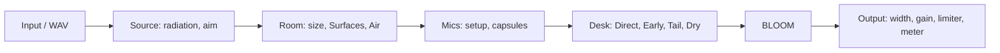

# UI design proposal: 2011 Room Reverb as a control surface (2026-10-21)

Read-only review. No code was changed. This builds on `UI_REVIEW_2026-10-21.md` (34 issues).
**Correction to that review:** U12 is wrong. `index.html:970` sets `RR_SL_STAGE = 3`, so the Surfaces hint already reads "Surfaces in Play". Drop U12 from the batch.

**SOUND** marks anything that would change what is heard. Each of those needs Idle's decision.

---
## 0. The short version
The app is a very good *acoustic model* with a *lab bench* on top of it. It is not yet a *mixing tool*. Today, getting from "open the app" to "my guitar sits in a room and I've rendered it" takes 6 tabs and 15 or more clicks. The things an engineer reaches for first are pre-delay, decay, wet level, low cut, width and a meter. Of those, Decay is buried on the Mix tab's FDN strip, and the other five don't exist at all. Every graph shows *the model's inputs* (geometry, assumed absorption, polar patterns), plus one post-render analyser. **No graph shows what Play is actually doing right now:** no level, no decay per band, no energy-time curve, no stereo picture, and no gain reduction for BLOOM.

The proposal:
- **One main page.** It has a big plan view, a "Room / Character / Decay / Pre-delay / Mix" strip, a live output meter, and a "What you hear" panel with ETC, decay per band and stereo.
- **The existing tabs become editors** you open from the main page, not the main path.
- **Undo, A/B, snapshots and save/load** become first-class.

---
## 1. Graphs: what they plot now, and what they should plot

Data traced end to end. "Live" means it updates as you drag. "Render" means it only updates after Render.

| # | Canvas (index.html) | What it plots now (data source) | Reflects Play/Render? | Problems | Proposed |
|---|---|---|---|---|---|
| G1 | `floorCanvas` :60, `elevCanvas` :82 (room_editor.js `drawFloor`/`drawElev`) | Room box, source dot and facing lobe, the mic stand and room-mic dots, in metres. Drawn from `state` client-side. Live. | Yes for positions. | It is the only place to place things, yet it shares the Room tab with a 3D view of the same scene. There is no scale bar or grid labels, no distance readout on the drag line (only the `liveMetres` text), no critical-distance ring, and no image of "where the reflections come from". | Make it **the** main-page view: grid in metres, a critical-distance ring around the source (where direct = reverberant), a distance label on the source→mic line, and the first-order reflection points drawn on the walls (from `/api/images`, order 1) as small ticks sized by level. |
| G2 | `view3dCanvas` :72 (room_3d.js, three.js) | The same scene in 3D, orbit only. | Same as G1. | It duplicates G1 at the same size and costs GPU. It's nice to show, but it doesn't help with decisions. | Shrink to a small inset or a toggle on the plan view. |
| G3 | `srcFloorCanvas`, `srcElevCanvas` :126/129 (source_desk.js) | Source position and aim, a third copy of the plan. Keyboard aim (arrows, F, O): good. | Yes. | It is a third plan view. | Merge into G1 as an "aim" handle (already exists on G1). Keep the Source tab for radiation choice only. |
| G4 | `sourcePolar` :149 (source_desk.js `drawPolar`, `/api/source_preview`) | The radiation preset polar at a chosen band (250 Hz to 8k), H or V plane, plus the "What the room hears" text. | Direct and early only. The tail uses the average (the hint says so, :117). | Good and honest. | Keep it. Add an overlay of the source→mic direction, so you see which part of the lobe the mic gets. |
| G5 | `micFloorCanvas` :174 (mic_desk.js `drawTop`/`drawSide`) | A zoomed stand: capsules, aim, look cones. | Yes. | Fine as an editor. | Keep it on the Mic tab. |
| G6 | `mic3dCanvas` :184 | The combined polar "halo", a slice facing the camera. | It's a picture of maths, not of the sound. | The hint itself has to say "This is not the frequency stack". That is confusing. | Move it to Polar. Show the Polar *At speakers* page by default (that answers "what reaches L and R"). |
| G7 | `imageCanvas` :345 (image_views.js, `/api/images`) | The 3D image-source lattice, folded paths and last legs, with hover 1k/4k level (`_annotate_images` app_server.py:933). | Geometry only. It ignores Surfaces absorption/EQ, jitter, air and mic colour. **CONFIRMED 2026-10-21:** `build_images_payload` is passed only the stand (`mcx`, `mcz`, `my`, `space`); room-mic `mic_x_*` are never applied. Probe: room mics at L(0.5,1.8,4)/C(3,2,7)/R(5.5,1.8,4) still drew at the stand (error 3.5–5.5 m). Play/Render via `_place_stand` were correct. Also `fetchImages` posts raw `state`, not `heardMix`. | It is impressive, but it has no time axis, so you can't see *when* reflections arrive. | Add a **2D Early Reflection map**: a time (ms) × level (dB) stick chart for L and R, coloured by wall, with gaps visible. This is the thing an engineer uses (a "reflectogram"). Keep the lattice as "3D". |
| G8 | `absorbCanvas`/`eqCanvas` :392/397 (colour_surfaces.js) | The assumed α(f) and face EQ for the selected face. | The inputs to Render and Surfaces Play. | Labelled ASSUMED, which is honest. | Keep. |
| G9 | `slRtCanvas` (sl_room_result.js `draw` :296, `/api/room_result`) | Predicted T(f) per 1/3 octave from Eyring/Arau (faces, faces + air), the Mäkivirta target, Schroeder, axial-mode ticks, EBU band. | **No.** It is a textbook prediction from the faces. It is not the FDN decay that Play and Render use (that comes from the dial plus per-room k and physics: `/api/phys_preview`). The legend says "dots = last Render T20", but nothing ever sends `rendered_t20`: app_server.py:1294 reads it, and no JS or render code sets it. **The dots never appear.** | It is the closest thing to "decay per band", but it shows the wrong curve. | Make it **Decay per band (what you hear)**: plot the physics row from `/api/phys_preview` (`bands[].t`, the same helper the pack uses) as the main line. Keep Eyring as a faint "room theory" line, and plot measured T20 after Render (needs a Render-side T20, which is analysis only, no sound change). Also show "dial unreachable" (`reachable:false`). |
| G10 | `colourCanvas` :474 + spark :479 (colour_surfaces.js, from `/api/render` → `info.colour`) | The 1/3-octave spectrum of the rendered wet IR, with Now/Last/Hold A/Hold B. | Render only ("updates after Render", :441). `/api/colour` (app_server.py:1344) would compute it without a file, but **no JS calls it**. It is dead, and it also uses `fdn_g` and a ≤1 s IR at 44.1 kHz, not the decay lock or physics, so it would disagree anyway. | It is called an "Analyser" but it is a post-render static plot. Hold A/B is a nice idea, but it's stuck in Surfaces. | Move Hold A/B into a global **A/B compare**. Use one IR-analysis endpoint (Render-matched) for G9, G10, G11 and G12. |
| G11 | — (missing) | — | — | **There is no output meter.** `live_fdn.js:58` computes RMS only to auto-stop. `limiterLed` :29 only lights up after it has acted. | Add a **Live output meter**: L/R peak and RMS, the limiter as gain reduction, and a clip hold. Data: the existing `AnalyserNode` (UI-only). |
| G12 | — (missing) | — | — | No energy-time curve and no IR view. | **ETC / IR view** for L and R, in dB over time: direct, early window shaded, the tail slope with a fitted T line, and pre-delay marked. Source: the Render IR, or a short preview IR. |
| G13 | — (missing) | — | — | No stereo picture. | A **correlation meter and goniometer** (Lissajous) on the live output. Spaced pairs vs XY are a big part of this app, so the user should *see* the width and the mono risk. UI-only from the analyser. |
| G14 | — (future) | — | — | BLOOM gain reduction isn't visible anywhere. | When BLOOM lands: a **GR meter** plus a "tail lifted by x dB" readout. This answers Idle's worry about a compressor lifting quiet tails back up. It needs the worklet to export GR (SOUND-adjacent; Build). |
| G15 | `polarCanvas`/`polarSpeakerCanvas` :518/525 (polar_field.js, `/api/polar`) | Assumed/measured polar × frequency, Combined / Each / At speakers. | Pattern maths, not the room. | "At speakers" exists (backlog 5.4 listed it as missing; it is in :504, so update the backlog). The jagged stack is B12. | Keep it as an editor page. |
| G16 | `roomPolarL/C/R` :764-788 | Small polars for the room mics. | Yes. | Fine. | Keep. |
| G17 | text readouts: `physReadout` :314, `decayHint` :305, `hadamardReadout`, `liveMetres*` | Strings. | Partly (NaN with two sources, U7). | A wall of text in place of graphs. | Fold into G9 and G11. |

**Update rate.** The plan views redraw on requestAnimationFrame. The server-backed graphs are debounced, e.g. phys preview at 80 ms (app.js:694). The colour graph is Render only. The live meters should run at 30 fps from the analyser. The ETC and per-band graphs should update on mouse-up, not every drag tick.

---
## 2. Workflow today, tab by tab

**Path from opening the app to placing a guitar and rendering, today:**
1. Upload WAV (top bar).
2. Room tab: Studio/Club/Hall chip. **This resets everything** (U1).
3. Size the room with W/H/L in the sidebar.
4. Drag the source and mics on the floor plan, and heights on the elevation.
5. Source tab: radiation preset, aim.
6. Mic: setup dropdown (sidebar "Listen"), Mic tab for capsules, presets and HPF.
7. Mix tab: bring up Direct, FDN and Early. **Decay** is here, on the FDN strip.
8. Surfaces tab: materials and the Decay mode (Flat/Surfaces), which lives inside "Room result".
9. Play live to audition, then Render.
10. The result is shown on the status line in the Preview panel, and the colour graph on the Surfaces tab.

That is 6 of 7 tabs and roughly 15 to 25 clicks. Decay is split across three places: the dial on Mix, the "Physical ceiling" box on Mix, and the Decay mode on Surfaces. The sidebar changes contents per tab (`data-sidebar`), so the same control seems to move around.

**Per-tab findings**
- **Room** (`editViews`): floor, 3D and elevation, with Link heights. The sidebar has Room size (place chips, W/H/L, Smooth, hidden Movement), Listen (mic setup, stand and heights), Hadamard, Preview and Advanced. *Good:* direct manipulation. *Bad:* three views of one scene, Hadamard size (an engine detail) is on the main sidebar, and the place chips are destructive.
- **Source**: a clean three-column design, and the best tab in the app. The "+ Link track" button is disabled (the Studio One idea).
- **Mic**: very deep (presets, HPF, proximity, family/polar per side, split, third mic, room spots). *Bad:* the "Listen" mic setup is in the sidebar while the capsule detail is in the tab. Two "Link heights" boxes (`link_heights`, `link_heights_mic`). Hidden legacy inputs.
- **Mix**: a real desk (Mics, then Buses). Trim, width and pan knobs have fine drag, detents, double-click and wheel (rr_controls.js), which is good. *Bad:* the faders have no detents or double-click reset. There's no master section: no output gain, no width, no wet/dry, **no meter**. The Decay slider sits on a channel strip. "Host" is the dry bus, but it is called Host. The Natural button gangs faders, and its meaning isn't obvious.
- **Space**: the image lattice / paths / last legs. A research view.
- **Surfaces**: net, materials, cards, α/EQ graphs, Advanced (smear, diffusion, seed, λ_ref), Room result (decay mode plus the T(f) graph), Room colour, Air. *Bad:* it is the longest page by far and mixes three jobs: wall materials, decay design and analysis.
- **Polar**: Combined / Each / At speakers. An editor and teaching view.

**Play vs Render clarity.** These things differ between Play and Render with little or no notice:
- 64/128 lines are Render-only (U13).
- Shared tail is Play-only (:875).
- Movement is forced off in both.
- Physics is forced off with two sources.
- The colour graph is Render-only.

**Proposal:** a permanent **Engine badge** next to Play/Render, e.g. "Play: 32 lines · shared tail · Surfaces ✓ | Render: 64 lines". Wherever a control is Render-only, mark it with an "R" tag and dim it while Play runs.

**Studio One / linked tracks.** `sourceLink` :98 is disabled, and design study `book\10_studio_one_shared_room.md` exists. UI implication: each source needs a name and colour on the plan, and a sources list (A, B, …) with mute/solo. The two-source split (`twoSourceBtn`) is the start of this. Plan the main-page sources list now, so it grows to N tracks without another redesign.

---
## 3. Control design

**Main page vs Advanced**

| Main page (always visible) | Editor tabs | Advanced (one drawer) |
|---|---|---|
| Room (Studio/Club/Hall/…) with a confirm, Size W×L×H | Source radiation and aim detail | Hadamard N, Smooth, colour impl (IIR/FIR) |
| **Character** (new macro) | Mic presets, capsule, HPF, prox, split | Reaktor parity, 2011 law (fdn_g), 2011 Air 1-pole, Min IR length |
| **Decay** (s) + Physical ✓ + "reachable" | Surfaces materials and cards | Diffusion seed, λ_ref, smear, structure diffusion |
| **Pre-delay** (new, SOUND) | Desk: per-mic trim/pan/route/place | Shared tail, live-drag render |
| **Mix**: Dry / Direct / Early / Tail faders, **Output** + **Width** (new, SOUND) | Air (humidity/climate/ISO) | Reaktor snapshot |
| Mic setup dropdown | Polar views | |
| Meter, ETC, decay per band, stereo | Space lattice | |
| Undo/Redo, A/B, Snapshots, Save/Load | | |

**Character macro.** This is the parked backlog idea, which Idle wants.
- One knob, from **Natural room** (0) to **Warm chamber** (100).
- It drives three places at once:
  - **Surfaces**: wall hardness and how fast the highs decay.
  - **Engine**: tail density and Movement, once Movement is allowed.
  - **BLOOM** amount.
- Show the three sub-amounts as small linked bars under the knob, so it's clear what moves. Once you touch a sub-control by hand, the macro shows a "modified" dot, like the Ocean Way mic mute state. This is all **SOUND, Idle's decision**: the curve, what 100 means, and whether the macro overwrites manual Surfaces.
- It can be built UI-first, as a mockup knob that only moves existing controls (Surfaces α scale, the air "ISO depth"), behind a flag. Even that changes sound when it is moved, so Idle decides.

**Ranges and tapers**
- Decay is 0.05 to 8 s, *linear* (index.html:280). Most of the travel is wasted on long times, so it should be log. That is a UI taper only; the value semantics don't change.
- The faders are 0 to 1 linear (:222), with the dB shown separately. They need an audio taper with 0 dB detents.
- W/L/H are linear up to 80/120/40 m. Use log, or a size multiplier as in Altiverb.
- Stand/height maxima: U11.

**Fine adjust and reset.** Extend rr_controls `attachKnob` (fine on Shift, double-click reset, wheel, detents, click to type) to *every* slider: Decay, faders, W/H/L, humidity, polar. It's UI-only, and the code already exists.

**Undo/Redo.** None exists. The rr_controls.js:5 comment mentions "undo", but there is no undo code. All edits go through `state` + `syncUI`, so a state-snapshot stack (debounced, about 50 deep) is straightforward. Medium effort.

**A/B compare.** Two full states, with a toggle that pushes the other one to Play. This is a level-matched A/B: show the RMS difference, and offer level match as an option (SOUND only at monitoring). Today only the colour graph has Hold A/B.

**Snapshots and presets.** 8 snapshot slots in the session (Altiverb-style), saved to JSON. Factory presets: name, room, character, mic setup.

**Save/Load.** Download/upload the `state` JSON, plus autosave to `localStorage`. The server already accepts the whole state as JSON.

**MIDI and automation readiness.** For a plug-in later, every control needs a stable parameter ID, range, unit, taper and default. Today the defaults live in three places: app.js:100-160, app_server.py:114ff, and the place/Hall tables. **Recommend one parameter table**, shared by JS and Python (it was already suggested in the code-structure review). Mark the controls that cause recalculation (room size, Hadamard N, Surfaces) as "not smoothly automatable", the way Capitol Chambers does.

---
## 4. Reference UIs (quick research, 2026-10-21)
- **UAD Ocean Way Studios.** Plan view of the room. Near/Mid/Far pairs, each with mic choice, *Distance*, HPF/LPF, polarity, mute, solo, balance and level. Source type picks dispersion. Pre-delay 0 to 125 ms, master EQ, Reverb vs Re-Mic mode, wet solo, time-align. **Lessons:** distance as a single slider per mic pair; a Reverb/Re-Mic mode switch (this app's Direct bus *is* Re-Mic); mic strips beside the plan.
- **UAD Capitol Chambers.** Four chambers. Drag the mics in the picture or use one Position slider. Pre-delay 0 to 250 ms (log taper), Decay (max = natural, can only go down), 80 to 750 Hz low cut, 3-band return EQ (125/500/5k ±10 dB, click the label to reset), Width, Mix, Wet Solo. Recalculation indicator lights. **Lessons:** a handful of big controls; a "recalculating" light for slow changes; click a label to reset.
- **UAD Sound City** (same Dynamic Room Modeling family): same pattern as Ocean Way.
- **EMT 140/250 and Lexicon 224/480 style.**
  - A few hardware-style controls: Decay with bass/treble multipliers and a crossover, Pre-delay, Diffusion, Depth, Mod.
  - Algorithm or room-type buttons.
  - Lexicon's register/snapshot workflow.
  - **Lessons:** low and high decay multipliers ×Decay are the universal "decay per band" control. The physics row here is the natural equivalent, so let the user *see* and nudge it.
- **Altiverb 8.** Positioner (move the speaker on the stage), Direct/Early/Tail levels, Decay, Low/Mid/High damp with a waterfall graph, 4-band wet-only EQ, Size, Bright, total-recall automation, snapshots. **Lessons:** Direct/Early/Tail as three faders (same as this Mix), a waterfall graph for damping, snapshots per instance.
- **ValhallaRoom.** Early and Late pages, a Depth crossfade, Bass/High Mult + Xover, Mod. **Lesson:** a two-page Early/Late editor with a single mix knob between them.
- **LiquidSonics Seventh Heaven (Pro).** Decay 0.2 to 30 s, pre-delay, low/high decay multipliers, early/late/VLF levels, tempo-synced delay, preset browser. **Lesson:** a big preset browser and a clean single main page.
- **Waves Abbey Road Chambers.** Signal-flow layout (Input meter → STEED → Chamber → Mix → Output), each section with an ON button. **Lesson:** show the signal flow left to right with a bypass per block. This maps directly onto Source → Room → Mics → Desk → BLOOM → Output.
- **dearVR PRO 2 / Sound Particles.** XYZ or azimuth/elevation/distance placement, top/side/front views, per-wall reflection gain and filters, occlusion. **Lesson:** a view switch on one canvas (Top/Side/Front) rather than three canvases.

---
## 5. Missing features (ranked)
1. Output meter (L/R peak/RMS, limiter GR, clip). UI-only.
2. Undo/Redo, A/B, snapshots, save/load/autosave. UI-only.
3. Pre-delay. **SOUND.**
4. Output gain, Width, wet/dry or Wet-solo master section. **SOUND**, though output gain is trivial.
5. Return EQ / low cut on the wet return (ties to the Colour module, backlog 98). **SOUND.**
6. ETC/IR view and an early-reflection map (analysis only).
7. Decay per band showing the real engine curve, plus Render T20 dots.
8. Stereo correlation and goniometer.
9. Character macro. **SOUND.**
10. Preset browser with factory and user presets.
11. Engine badge for Play vs Render differences.
12. Named sources list (N tracks), the groundwork for linked Studio One instances.
13. Reverb vs Re-Mic mode switch (it presets the Direct/Host faders). This is a UI preset over existing faders, but it changes what's heard when pressed (Idle).
14. Keyboard map and a help overlay ("?").

---
## 6. Proposed main page layout

```
┌────────────────────────────────────────────────────────────────────────────────────────┐
│ 2011 Room Reverb   [File: guitar.wav ▾]  ▶ Play  ● Render   ↶ ↷   [A|B]  Snap 1 2 3 4 … │
│ Engine: Play 32 lines · Surfaces ✓ · shared tail   |  Render 64 lines   [Save] [Load]   │
├───────────────┬───────────────────────────────────────────────┬────────────────────────┤
│ ROOM          │  PLAN (Top ▸ Side ▸ 3D)              grid 1 m │  OUTPUT                │
│ [Studio][Club]│  ┌─────────────────────────────────────────┐ │  L ▮▮▮▮▮▮▯▯ -12 dB     │
│ [Hall][+Save] │  │ Front                                   │ │  R ▮▮▮▮▮▯▯▯ -14 dB     │
│ 5.6×7.2×2.8 m │  │        ★ Gtr (A)  ◜ crit. dist ring ◝  │ │  Limiter GR ▯ 0.0      │
│               │  │          ╲ 3.1 m                       │ │  Corr  ─────●── +0.6   │
│ CHARACTER     │  │   ·  ·    ╲    · reflection ticks ·     │ │  [goniometer]          │
│ Natural ◯──── │  │         L ◉─C─◉ R   (stand)             │ ├────────────────────────┤
│  ─────● Warm  │  │ Back                                    │ │  WHAT YOU HEAR         │
│ Surf▮▮ Dens▮  │  └─────────────────────────────────────────┘ │  [ETC] [Decay/band]    │
│ Bloom▮        │  Sources: ● Gtr A [S][M]  ● Vox B [S][M] + │ │  [Early map] [Spectrum]│
│               │  Mics: ORTF ▾   Distance ───●──  Height 1.5 │ │  ┌──────────────────┐  │
│ DECAY  1.80 s │                                             │ │  │ curve            │  │
│ ◯ log knob    │                                             │ │  └──────────────────┘  │
│ Physical ✓    │                                             │ │  reachable ✓ 1.80 s    │
│ PRE-DELAY 12ms│                                             │ │                        │
├───────────────┴───────────────────────────────────────────────┴────────────────────────┤
│ MIX   Dry ▮  Direct ▮  Early ▮  Tail ▮   |  Width ◯  Output ◯  [Wet solo]  [Re-Mic|Rev]│
├────────────────────────────────────────────────────────────────────────────────────────┤
│ Editors: Source · Mics · Desk · Surfaces · Air · Polar · Space(3D) · Advanced           │
└────────────────────────────────────────────────────────────────────────────────────────┘
```

**Per-tab (editor) sketches**

```
SURFACES editor (split into 3 sub-pages)
[Materials] [Decay design] [Analysis]
Materials:  net A–F | material chips | card list | α(f) + EQ graphs
Decay:      mode Flat/Surfaces/Natural | Decay per band (engine line + theory + T20 dots) | Air
Analysis:   spectrum Now/Last/A/B (moves to global A/B)

MICS editor
[Setup ▾ ORTF]  [Mirror|Linked|Split]  [3rd: Off|Centre|Room]
┌ Left ──────┐┌ Centre ────┐┌ Right ─────┐   ← one column per capsule, same fields
│ preset ▾   ││ preset ▾   ││ preset ▾   │
│ family/pol ││ family/pol ││ family/pol │
│ HPF  prox  ││ HPF  prox  ││ HPF  prox  │
│ place:stand││ room x z y ││            │
│ polar mini ││ polar mini ││ polar mini │
└────────────┘└────────────┘└────────────┘

DESK editor = today's Mix tab, plus a master strip (Width, Output, meter) and fader tapers/detents
SOURCE editor = today's Source tab minus its plan (aim on the main plan)
```


(Signal-flow strip, Abbey Road Chambers style. Each block is clickable and opens its editor, with an ON/bypass light.)

---
## 7. Roadmap of Build prompts (ordered, with gates)
Every UI-only prompt has the same gate:
- selfcheck 45/45
- the `test_s_audit_ui.py` file
- the Play MD5 on `std_lock18` unchanged
- `WORKLET_VER` stays 59
- the Render MD5 on the acceptance body unchanged

**Quick wins: UI-TIDY-1 (fits the ~7% budget, one prompt)**
1. Place chips: confirm before reset, correct the hint, active state (U1 stop-gap, U2, U4).
2. Physical readout: hide it when `on:false`, and show "reachable / max x s" (U7, U8).
3. Show server `warnings` and failed fetches as a toast (U10, U20).
4. Slider limits follow the room size (U11).
5. Grey 64/128 while Play runs, with an "R" tag (U13).
6. A `:focus-visible` outline (U24).
7. **New, UI-only:** a live **output meter** (L/R RMS/peak from the existing AnalyserNode in live_fdn.js, ~60 lines).
8. **New, UI-only:** **autosave to localStorage plus Save/Load JSON** (~60 lines). Restoring a save is just the existing state path.

If the budget is tight, drop 7 and 8 first. Items 1 to 6 are tiny.

**Medium (after Thursday, one prompt each)**
- M1 Undo/Redo plus A/B (two states) plus snapshot slots. UI-only.
- M2 rr_controls on every slider: log taper for Decay, audio taper and 0 dB detent for the faders, double-click reset. UI-only (the values sent are unchanged).
- M3 Decay-per-band graph from `/api/phys_preview` bands, plus Render-side T20 (analysis only) to make the "last Render" dots real.
- M4 Analysis endpoint: ETC/IR view and an early-reflection map from the Render IR / `/api/images` taps. Remove the dead `/api/colour` or make it Render-matched. **Include U35:** pass room-mic positions into `build_images_payload` (or place the stand first) and have `fetchImages` send `heardMix(state)`.
- M5 Stereo correlation and goniometer. UI-only.
- M6 Engine badge for Play vs Render differences.
- M7 One shared parameter table (IDs, range, unit, taper, default) in JS and Python, with a byte-match test. It is automation groundwork.

**Big (each needs Idle's decisions)**
- B1 The main page redesign (the layout above). Tabs become editors. Merge the three plan views.
- B2 Master section: Pre-delay, Width, Output, Wet-solo, Re-Mic/Reverb. **SOUND.**
- B3 Character macro. **SOUND** (after BLOOM).
- B4 What a place chip may touch, plus a preset browser (F5 rule, backlog 6.14). **SOUND rule.**
- B5 Hall jump ramp/crossfade (F4). **SOUND.**
- B6 BLOOM GR meter (worklet export). Build-side.
- B7 N-source list and linked Studio One instances.
- B8 A Surfaces split into Materials / Decay design / Analysis.

## 8. Decisions Idle needs to make
1. Is the main-page layout direction (section 6) OK?
2. Pre-delay, Width, Output and Wet-solo: add them? (SOUND)
3. Character macro: what Natural and Warm mean, and does it overwrite manual Surfaces?
4. What may a place chip change? (F5)
5. Should a Hall ramp or crossfade be applied? (F4)
6. A Reverb vs Re-Mic mode button?
7. Can Hadamard N, Smooth and the 2011 controls move into Advanced?


## 9. Follow-up: Space lattice room mics (2026-10-21)

## G. Space-lattice room-mic positions — CONFIRMED (2026-10-21 follow-up)

**Verdict: confirmed.** The Space tab lattice does **not** use room-mic positions. Play and Render do.

Trace:
1. Play/Render: `heardMix` (app.js:597-605) writes `mic_x_*/mic_y_*/mic_z_*` from each capsule's room spot when `place_*=="room"` (or centre third is Room). `/api/live_params` and `/api/render` take that body. `render_pipeline._place_stand` → `desk_matrix.place_stand` / `position_override` (engine/desk_matrix.py:329-341) moves each capsule to those coordinates.
2. Space lattice: `fetchImages` (app.js:1461) posts **raw `state`**, not `heardMix`, so even the client never converts `room_l_x` into `mic_x_l` for this call. `api_images` (app_server.py:918-927) calls `build_images_payload` with only the stand knobs (`mcx`, `mcz`, `my`, `space`, …). The function signature (image_geometry.py:168-194) has **no** `mic_x_*` parameters.
3. Probe on Idle's PC (2026-10-21), room 6×3×8, stand at (3, 1.5, 1.5), non-default room mics L(0.5,1.8,4) C(3,2,7) R(5.5,1.8,4):
   - Lattice capsules: L(2.915,1.5,1.5) C(3,1.5,1.5) R(3.085,1.5,1.5) — the ORTF stand.
   - Play/Render after `place_stand`: L(0.5,1.8,4) C(3,2,7) R(5.5,1.8,4).
   - Error: L 3.489 m, C 5.523 m, R 3.489 m.
4. Effect for the user: with any capsule on "Room mic", the Space lattice / Paths / Last legs still draw the stand array. Paths, delays and levels shown there are wrong for those capsules. Floor/Mic editors show the true spots.
5. Severity: **Med**. Effort: **small** (pass `mic_x_*` into `build_images_payload` / use `_place_stand`, and have `fetchImages` send `heardMix(state)`). UI/visual only; the sound path is already correct. No SOUND flag.

---

## 10. Editor mockups: what changes from today, per tab (2026-10-21, v2 mockup)

The mockup is `review\mockup\UI_MOCKUP_2026-10-21.html`; v1 is kept as `.v1.html`. The main page is unchanged. Each Editors button opens a full-view editor with "← Back to main" (Esc). ←/→ switches editors and every focusable has a 2 px focus ring. All text is at least 12 px. All data is EXAMPLE.

- **Source.** Every current control is kept: This track, + Link track, Radiation preset, Yaw/Pitch/Size, Face mic/away/Omni, and the frequency and plane chips. Changes:
  - The plan view is larger, the radiation polar has readable ring labels, and "What the room hears" also gives distance and off-axis angle.
  - Two sources / Mirror B / Balance move here from the Room sidebar.
  - Arrow keys nudge the source.
- **Mics.** Everything from Listen, Mics and Advanced capsule has one home: setup, space, stand X/Z, heights, link heights, colour, align, Mirror/Linked/Split, third mic, presets, HPF, family, pattern, room-mic X/Z/H/Aim with Return to stand, and response/capsule size. Changes:
  - The mic setup also shows where mics are placed (U38).
  - The Stand X/Z maximums follow the room size (U11).
  - The room mic can be dragged on its own.
- **Desk (Mix).** Every current control is kept: pair mode, pan law, L/R routing, trim, pan, solo, fader, mute, On stand / Room mic, the Direct/FDN/Early/Host buses, Natural, Decay, Physical ceiling and Rumble. Changes:
  - Text is at least 12 px (U36).
  - Double-click returns a fader to its own default: Early goes to −∞, the others to 0 dB (U37).
  - The faders have a 0 dB detent and Shift for fine moves.
  - You can click a value to type dB.
  - Decay double-click returns to 1.80 s.
- **Surfaces** is split into three tabs, switched with the arrow keys:
  - *Materials*: room net with solo and mute, a material palette, Paint all, Solo off, a draggable absorption bar view plus band sliders, and the surface EQ. The sparklines now actually draw.
  - *Decay design*: Room result with model, faces-only and target ±10 %, plus a new **last-Render T20 dots** overlay (gap found in the live run). Smear, tail diffusion, seed and λ_ref sit here.
  - *Analysis*: Room colour with peak / 1 kHz reference, Hold A/B, Clear, face sparkline, and Render readouts.
- **Air.** Humidity, Climate and ISO depth, plus a new air-loss graph. The "2011 Air 1-pole" control moves here from Advanced.
- **Polar.** Combined / Each mic / At speakers, the L/C/R/sum toggles, dB/Linear, and new frequency chips. The repeated Listen panel is replaced by a read-only summary with "Edit in Mics ›", so each control has one home.
- **Space.** Lattice / Paths / Last legs, mic toggles, zoom ± and Fit. Changes:
  - New **early map** (plan view and arrivals) that draws the room mic C **at its own room position**, not at the stand.
  - The image and FDN-line counts follow Hadamard.
- **Advanced.** Hadamard 8–128, Smooth, Reaktor parity, 2011 gain law, Reaktor snapshot (now asks first), Colour filter, min IR length, bake IR, shared tail, and Movement (placeholder). Changes:
  - **Every option has a Play+Render, Render-only or Play-only badge.**
  - 64 and 128 show an R badge, and while Play runs Play stays on 32 with a toast (U13).
  - The "Colour filter" label is styled like the other controls (U39).
- **Not decided / needs Idle:**
  - Movement and pre-delay are SOUND changes.
  - Moving the 2011 Air 1-pole and Two sources is a placement-only change.

