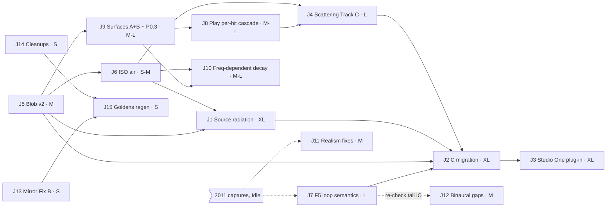

# BIG JOBS ROADMAP for Grok Build: 1 Oct 2026

- **Written:** on the box, 1 Oct 2026, 15:50–16:20 BST, for Idle Hanz ("we still have 90% usage").
- **Input:** a fresh read-only `tar` snapshot of the PC `software\` taken **1 Oct 15:50 BST** (`snapshot_2026-10-01_1550`, box only). The last PC edit was at 11:46 BST. Nothing on the PC was written and the app was not touched.
- **Tags:** VERIFIED = run or read on the box. ASSUMED = estimate or judgement. **All sizes are ASSUMED estimates.** "1 session" means about one Build session at about 90 % usage (ASSUMED ≈ 4–5 h of Build work).
- **Graph:** `roadmap/big_jobs_graph.png` (source `roadmap/big_jobs_graph.dot`; the mermaid version is in §4).

## 0. Status

### 0.0 Latest: S-UI2 fix-up + UI decisions locked (3 Oct 08:18–09:20 BST, snapshot `snapshot_2026-10-03_0818`)

**Next for Build:** `research_ui_wishlist/sui2_fixup/FIXUP_PROMPT.md`, in the same S-UI2 window at high effort.
- **Part A (UI only, goldens byte-identical):**
  - Colour order Measured · User defined · Bypass;
  - per-mode visibility;
  - Mic tools move to a sidebar "Mics" panel, Top/Combined get bigger and the Source plane goes full width;
  - Space camera fixed (left-drag orbit, keep the camera across changes, room-scaled zoom, double-click reset);
  - Colour merges into Surfaces (7 tabs).
- **Part B (sound, approved):** D-UI21/D-UI22.
- Evidence: `research_ui_wishlist/sui2_fixup/REPORT.md`. Mocks: `mock/m3_mic.png` v3.1 and `mock/m9_surfaces_colour_merge.png`.
- **After S-UI2: S5**, updated 3 Oct 11:05 for D-UI26 = A (locked 09:22). Prompt: `roadmap/s5_surf_1010/S5_PROMPT_D-UI26.md`.
- **UI (3 Oct 14:30–16:00):**
  - S-UI2 fix-up 2 (`research_ui_wishlist/sui2_fixup/FIXUP2_PROMPT_mic_each.md`, D-UI27: per-mic graphs always shown, Source plane below). **LANDED (reported 3 Oct 17:04):** goldens unchanged, WORKLET_VER 46, `fixup2_mic_each.py` 0 failures, hidden audit 0 leaks over 84 states (Build's report, ASSUMED). The four PC shots were reviewed on the box: layout, read-only state, red→violet palette and MS figure-8 are OK (VERIFIED). Follow-up: `research_ui_wishlist/sui2_fixup/FIXUP3_POINTER_badge_visual.md` (badge wording, Source-plane top clutter, MS ± lobes). Run it after the S5 fix-up, or fold it into S-MIX.
  - Then **S-MIX**, paste-ready in `research_ui_wishlist/REPORT.md` §7 (new window, high effort).
  - **D-UI3 yes, D-UI4 yes (incl. "S → +L, −R" on any strip), 2011 linear pan law default: LOCKED by Idle 15:57.**
  - **UI rule (Idle 15:57):** every frequency-coloured graph runs red at low frequencies → blue/violet at high, through one shared palette function (`static/js/spectrum_colors.js`). Today's Mic/Source palettes run the other way (VERIFIED, `mic_desk.js:27`, `source_desk.js:7-12`). This is S-MIX item 9.

| ID | Decision (Idle 09:06; D-UI25 corrected 09:09) |
|---|---|
| D-UI21 | Yes: in Measured the preset owns the pattern. AB omni, MS and MS classic loads switch to User defined. VERIFIED before: the hidden family/polar changed Measured sound (nulls −15…−23 dB). |
| D-UI22 | Yes: Bypass = preset pattern, no measured colour, no capsule graphs. |
| D-UI23 | Yes: Colour → Surfaces "Room colour · analyser of the wet sound" (not an EQ). 7 tabs. No tab jump after Render. |
| D-UI24 | A: the post-mixer EQ goes on a Mix tab Output strip next to Auto level (S-OUT). |
| D-UI25 | No: Split L/R stays in Measured (a preset per side). Case: L = side, R = room, C = mid. Added as an S-MIX acceptance scenario (item 7 of the S-MIX prompt in `research_ui_wishlist/REPORT.md`). |
| **D-UI26 = A (LOCKED, Idle 09:22)** | The face colour (absorption shape relative to the card mean + face EQ) reaches the tail in both engines and Play early, through a per-line feed-forward filter outside the loop. T60 stays the Decay; Solo/Mute stay early-only (D11/D12/D16). Before (VERIFIED): face A HS +6 → only Render early changed (up to +1.2 dB at 12.5–16 kHz). Box prototype (VERIFIED): the default tail changes +0.2…+0.5 dB below 1 kHz and −0.2…−0.37 dB at 4–10 kHz, and Play early changes +0.15…+0.37 dB at LF and −0.3…−0.4 dB at 4–8 kHz. Goldens regenerate. It is **S5**: `roadmap/s5_surf_1010/S5_PROMPT_D-UI26.md`. Details: `sui2_fixup/REPORT.md` §8.4. |

### 0.H Earlier: S7 tail realism verified (2 Oct 19:05–19:55 BST, snapshot `snapshot_2026-10-02_1905`)

**Verdict: S7 (D3 z⁻¹ in both + D3b equal −1.70 dB trims) is correct; Play is untouched (wasm sha1 69eb8b3bca4c, as at 17:57). t19 is noise and mean scoring, not a regression. One harness-only fix-up remains** (`roadmap/s7_verify_1905/S7_FOLLOWUP_PROMPT.md`): tighten the colour-parity needle, score CPU tests by the median, regenerate the Render goldens only, and run the suites. Evidence is in `roadmap/s7_verify_1905/README.md`. PC read-only, app not restarted; Build's t323u/t328u were relayed, not read. All numbers are ours (VERIFIED) unless marked.

| # | Item | Result |
|---|---|---|
| 1 | Render z⁻¹ loop | **PASS.** It matches the research prototype R_z1 × −1.70 dB to −149 dB. Play − Render null: −72 dB default (colour and Bypass), −70 no Dffs, −72 parity, −65 big room, −62 Hall. Play − Render tail 0.00 dB everywhere. No Dffs: Render = 1815 × −1.70 dB exactly. `_hy` is zeroed in `__init__` (no reset path exists). Parity differs from R_z1 only because R_z1 has H·D ungated by parity; 1905 keeps plain H, as before. |
| 2 | Tail delta −3.34 vs −3.1 | Measured −3.14 dB (colour on) and −3.50 dB (Bypass) = −1.70 trim + D3 alone (−1.44 / −1.80). Build's −3.34 lies between them (ASSUMED: other window or mode). Big room −1.70; Hall −1.55. Not a defect. |
| 3 | Binaural F3 trim | `render_binaural_fdn_ir` has no callers. Build's 19:19 edit (F3 only, F2 off because there is no line_t60) is fine and harmless. |
| 4 | colour-parity fail | A stale needle: the shared-tail edit (17:53) renamed `line->inj` to `injUse` (`live_stereo.c:1703-1708`, 1726-1731). Build's 19:19 test edit accepts both strings. Assert only the new strings. |
| 5 | t19 | **Noise.** Box A/B, 14 alternating rounds: 69eb (now) is −2.1 % (median) and −1.8 % (p10) against 08a95563546d (16:30). The flag branches cost nothing measurable. Spikes inflate the run mean by 3–11 %, and by up to 26 %. With the guards removed, the late-silence median ratio is 1.42–2.48, so the median still catches denormals; the mean rule false-alarmed once on a guarded build (1.34 vs median 1.07). Optional bit-exact Play micro-fix F2 (cold shared fields + hoist): about −2 %, parked for S5. |

**Mic tab wishlist additions (Idle, 19:11–19:15):** items 19 ("Assumed toys" → **User defined**, labels only; the Each-capsule graphs show only in User defined/Bypass) and 20 (pattern controls only in the Side mics / Centre mic sections; one shared side control with a **Split L/R** tick; the link chip is geometry only). Both are in `research_ui_wishlist/REPORT.md` §1, §7 (S-UI2 items 8–9) and §8 (D-UI19, D-UI20), with mock `m3_mic.png` v2. S-UI1 item 3 no longer opens Each capsule by default. As of about 19:55 S-UI1 had not edited any `static/` file.

### 0.G Earlier: S4b final verified (2 Oct 16:28–17:30 BST, snapshot `snapshot_2026-10-02_1630`)

**Verdict: S4b final is done and correct. All seven parts pass on the box; no fix-up is needed before the Shared tail prompt.** Evidence is in `roadmap/s4b_verify_1630/` (see its `README.md`). The PC was read-only and the app was not restarted. Build's own report (message t317u) was not readable by this worker, so every number below is our own box measurement (VERIFIED unless marked).

| # | Item | Result | Evidence |
|---|---|---|---|
| 1 | DC restore in `load_core_body` | **PASS.** The line `if (on) st->pb2[b] = 1.0 + st->pa1[b] + st->pa2[b] - st->pb0[b] - st->pb1[b];` sits after the coefficient reads. Max \|H\| is exactly 1.0 on every axis (0 Hz–Nyquist, plus a 0.001 Hz grid to 20 Hz), in 6 scenes (default, hall 57×34.2×97, hall at decay 8, Hall preset, default and hall binaural) at both 44.1 and 48 k. Without the restore: hall X at 48 k 1.518, default Z at 44.1 k 1.0065, and **new: Hall preset Y at 48 k 1.143** (also fixed). Runaway: the hall with 2 sources at decay 8, binaural hall at decay 4 and 8, and the default room at decay 20 s at 44.1 k all fall every 2 s (−61.9 → −128.3 dB over 20 s). | `measure/passivity.json`, `measure/s4b_measure.json`, phase `test_s4b_long_decay_*` |
| 2 | Solo/Mute early-only (D11, D12, D15, D16, D17) | **PASS.** FDN-only output is bit-identical (max diff 0.0) with and without Solo/Mute, for 11 Solo/Mute cases in Play and Render. The direct path is untouched (0.0). D16: Solo keeps co-hit images (Solo D = 2 images × 6 bus/banks = 12 gates; Solo A + Mute B = Solo A); Mute drops them. D15: the direct image leaves the early field only while soloed (−2.7 dB Play and −1.34 dB Render in the ±1 ms window that holds the direct line plus the direct image; 0.0 dB with Mute only). D11: Render Mute all gives early −24.3 dB (Play −29.8 dB). Solo A early ILD (1.5–80 ms window): Play +7.6 dB, Render +19.2 dB; Solo C: −7.8 dB and −19.7 dB. D12, headless Chrome with Play live running: Solo zeroes Direct, FDN and Host dry; Early = the Early fader (unity when that fader is at −∞); Solo off restores the posted Mix exactly; Mute alone changes nothing; the faders never move; the Render request uses the same `heardMix`, and saved state is not touched. D17 hint text is exact for D, and the plain hint shows for A–F. | `measure/s4b_measure.json`, `ui_s4b.json`, `shots/ui1630_*` |
| 3 | Column signs H·D | **PASS.** `CSIGN_D[32]` (Play) = `fdn.LOOP_COLUMN_D` (Render) = the roadmap d. `fwht32` (feedback and diffuser) and Render `loop_hadamard` / `diffuser_output_mix` use H·D; n = 8/16 and `reaktor_parity` keep plain H. With the signs forced off, 16:30 Play is bit-exact to 11:40 in 21 cases. Parity Play is bit-exact to 11:40 in the default room (6 cases); Render parity is bit-exact (0.0). Mirror and symmetric-mono tests pass. Comb on Idle's scene: Render comb index 12.7/10.6 → 4.6/4.8 dB (48 k) and 10.9/10.6 → 4.5/4.5 dB (44.1 k); Play ac at 19.36 ms 0.43/0.37 → 0.15/0.18. Default tail level: Render −0.25/−0.33 dB, Play −0.20/−0.02 dB. **Note:** the Hall preset (parity) at 48 k differs from 11:40 by 1.2e-5 (−90 dB re peak), and so does the binaural hall (4.6e-6, −103 dB). Both come only from the DC restore (removing it gives 0.0); this is the intended runaway fix, not a sign leak. | `measure/bitexact*.json`, `measure/s4b_measure.json` |
| 4 | Binaural skip-centre | **PASS.** Bit-exact vs no-skip (9 cases, 0.0). CPU: −27.5 % (1 source), −25.6 % (2 sources), −19.7 % (big room), min of 6 alternating rounds. | `measure/bitexact.json`, `cpu/bench_s4b.json` |
| 5 | Suites (box) | **PASS.** Phase `--slow` with Build's test edits adopted (plus our two additions below): **112 pass / 0 fail / 14 xfail**. With our pre-S4b test files: 106/5/14; the 5 failures are the 2 old fwht32 needles, the old 8 % Dffs=0 band, the old 0.15 IC gate, and the old golden (all expected). run_all `--quick` with the new goldens: t01–t05 PASS. Software tests 38/38 (incl. the new `test_fdn_passivity`), selfcheck 44/44, binaural 21 xpass + 1 xfail / 26 / 35 (same as 11:40). t19 on the box is borderline as before (play 2.05–2.09 ms vs 2.133; 1 of 3 failed on a noisy silence reading; 11:40 was 1.84–2.06). Stereo CPU vs 11:40: +0.6 % / +1.2 % (min), −3 to −5 % (median), i.e. the signs cost about 1 %. | `phase_slow_adopted.*`, `run_all_adopted.*`, `suites.log`, `cpu/` |
| 6 | Build's test edits | **ACCEPTED, all adopted into our box tests** (verdicts below). | `audit/`, `build_test_edits.diff` |
| 7 | Backup | **PASS.** `software_backup_2026-10-02_preS4b.zip` (409,125,042 bytes, 15:26:47; first edit 15:35:53) holds 43,404 entries, and its `live_stereo.c` is the 11:40 one (73,666 bytes, 11:11). | PC, read-only |

**Gate audit (Build's edits to our tests)**
- **WORKLET_VER 41 → 43: fine.** It matches `live_fdn.js`, `index.html ?v=43`, and both software tests; the browser loaded `live_fdn.js?v=43` and `live_stereo.wasm?v=43`.
- **fwht32 lock: fine, but it was too weak; we tightened it.** Build's regex allows any `CSIGN_D` values. Our `test_lock_unscaled_pm1_hadamard_play` now also asserts 32 entries of ±1, equal to `fdn.LOOP_COLUMN_D`; that parity gives plain H in Render; and that Play sets `g_csign = st->plainH ? 0 : 1`.
- **Goldens regenerated (16:07, "S4b column signs H*D"): justified.** The SHA1s in GOLDEN_META match the 16:30 tree. 16:30 = the new goldens (Play diff 0.0, Render −225 dB). 16:30 with the signs off = the old goldens (Play 0.0, Render −238 dB). So the signs alone caused the change.
- **Dffs=0 T30 band 8 % → 10 %: justified.** The signs cause it: Dffs=0 at 500 Hz is 1.655 s (−8.06 %) with H·D and 1.764 s (−2.0 %) with plain H, in the same build. 1.655 s is inside the roadmap's own ±10 %. Every other setting stays inside 8 % on 500 Hz–8 kHz (std scene worst −5.8 % at 500 Hz). The signs also fixed the old small_lock08 fail (1 kHz −8.5 % → −3.5 %). ASSUMED cause: without the line-0 funnel, more energy runs through lines whose axial peaking cuts near 500 Hz. Keep 10 % for Dffs=0 only, as Build did.
- **Binaural IC gate 0.15 → 0.16: the 0.151 is caused by the signs, but it is not a regression.** At the test scene: plain H (16:30 with signs off, and also 11:40) = 0.118, H·D = 0.1508. A 9 s IR gives the same values (0.1179 / 0.1507), so this is scene-dependent, not estimator noise. Across 6 scenes the two matrices are the same on average: mean max \|dIC\| 0.133 (H·D) vs 0.132 (plain H); worst 0.193 vs 0.168 (plain H fails 0.15 at sz = 5); mean RMS 0.050 vs 0.053. The single-scene 0.16 is a one-draw gate that would already fail H·D on two sources (0.193). **Proposal (done in our box tests):** keep Build's 0.16 single-scene gate and add `test_binaural_play_tail_coherence_ensemble` (slow): mean max ≤ 0.15, every scene ≤ 0.20, mean RMS ≤ 0.06. Both matrices pass it.
- **xfail removals (`test_s4_followups` ×2, `test_s4b_*`): justified**; all of these tests pass.

**Minor notes (no fix-up needed):**
- `g_csign` is a file-scope static set per partition from `st->plainH`. That is safe with one engine per wasm instance (one per AudioWorklet). The shared-tail loop must run after it is set.
- Mute A's early change differs between Play and Render (−1.0 vs −2.0 dB; ILD +0.07 vs −2.36 dB). This existed before S4b (Play has 32 images, Render the full set); `test_s4_mute_play_render_early_agree` (±3 dB) passes.
- HANDOVER.md's S4b section is accurate. One line is missing: parity is bit-exact to the 2011 matrix, but the DC restore changes the Hall preset by about −90 dB at 48 k. This goes into the Shared tail prompt as a one-line doc fix.

**Box test changes (ours, `3_phase_acceptance_tests`):** adopted Build's `pack.py`, `wasm_run.js`, the 6 edited test files and the 5 goldens + GOLDEN_META. Added the tightened fwht32 lock and the ensemble IC test. The pre-S4b copies are in `work/s4b_1630/box_tests_before/`.

### 0.F Earlier: "robotic" tail + Solo direction + long-decay runaway (diagnosed 2 Oct 12:45–14:05 BST, snapshot `snapshot_2026-10-02_1140`)

(This was §0.0 until 2 Oct 17:30. References to "§0.0" or "§0.0.1" written before then mean this section.)

**Update 16:30 BST: F5 / D3 research done (`research_f5_allpass/REPORT.md`).**
- Play's diffuser is already a true allpass (z⁻¹·A_D). Idle's restructure equals Play exactly (null −146 dB after a 1-sample shift).
- "z⁻¹ in both" = change Render only. Play − Render then nulls at −72 dB (default room), −64 dB (big room) and −62 dB (Hall), once the trims are equal.
- Today's real gap is about −3 dB, not 5.8 dB. Most of it is the F3 −1.70 dB trim applied on Play only.
- F5 same-sample costs +18.5 % Play CPU (PC estimate 2.43 ms, which fails t19).
- Recommended: D3 = z⁻¹ in both, D3b = equal trims. The S7 prompt in §5 is replaced.
- S4b final item 5's "decay-lock g 0.158" was corrected: the live g is 1/√32.

**Update 15:20 BST: reconciled with Grok Build's read-only report and fix plan; one merged prompt, §5 "S4b final".**

| Build claim | Verdict | Evidence (box) |
|---|---|---|
| (a) Runaway = float32 peaking coefficients, hall X axis at 48 k, DC 1.5; "absent at 44.1 k" | **AGREE** on the mechanism; **COMPLEMENTARY** on rates | Hall X at 48 k: DC 1.5, max 1.518. Hall Y at 44.1 k: DC 0.889, max 1.005 (harmless). **New:** the default room's Z axis at 44.1 k has DC 1.0065, and at decay 20 s the tail stalls at −88 dB and rises. The one-line C restore gives DC 1.0 everywhere (both rates, binaural) and is bit-exact in the default room at 48 k (`robotic_1240/peak_rates.json`, `runaway_rates.json`). |
| Build Fix 1: Python passivity guard (renormalise the numerator) | **DISAGREE**, keep it as the test | At hall X, 1 + a1 + a2 ≈ 1.3e-7, which is about one float32 step of b2, so a Python-side fix can't set the DC inside float32. Scaling the numerator costs that axis −3.6 dB on every pass. Keep the C restore and use Build's grid check as the proof. |
| (b) Metallic = `diffusion_scale_from_room` (max·mean) gives tiny Dffs in the hall | **COMPLEMENTARY** (true, hall-only, not Idle's file); the cap is rejected | Scale 202.6 (= the 2011 "202.633"); big room median \|Dffs\| 0.044, Hall preset 0.23. A cap inside Build's band (median 0.35–0.70) **lengthens** the Hall T30 2.81 → 3.48–5.78 s (11.1 s at 0.72), and echo density stays 0.18–0.20. Big room cap 18 with column signs: density 0.26 → 0.21, +8.5 dB on guitar (`hall_b/cap_build.json`, `hall_b_density.json`, `ab_wav*/`). |
| (c) Solo reaches early and FDN through the same inject; direct ungated; no −Z image; co-hits zeroed; Solo A ILD +1.71 dB | **AGREE** on the facts; our fix supersedes Build's | Early-only Solo/Mute with an un-gated tail, plus D12, gives +9.1 dB in Play and +23.8 dB in Render (D11). LIVE_32 has no nz<0 image; D's two images also hit B, so Solo D leaves the direct only. Co-hit policy is D16; the −Z hint is D17. |
| Build Fix 3: zero the direct inject (early + FDN), −12 dB far-capsule trim | **DISAGREE** in part (D15) | Dropping the direct from the early field while soloed: yes. Dropping it from the FDN, or trimming capsule gains: no (the tail must be untouched, and a trim isn't physical). |
| (d) Idle's file settings UNKNOWN, 44.1 k | **SUPERSEDED** | Our reproduction nulls his file to −64 dB: Render, default room, FDN only. The comb is the default-room line-0 funnel, which Build's plan misses. |
| (e) Binaural L=R by construction; ORTF not bitwise mono | **DISAGREE** | Play ORTF symmetric max\|L−R\| = 0.0 (FDN, early, full mix). Binaural is not L=R (FDN corr −0.09, full 0.93). Render ORTF 1.6e-10 (`mono_check_1425.json`). |
| (f) HANDOVER.md stale (Gain/32, inward ORTF) | **AGREE** | `2011 Room Reverb\HANDOVER.md` (27 Sep): lines 92/154 "inward" vs K1 outward (`YAW_X_SIGN = +1`, 28 Sep); Gain/32 is the parity/lock-off rule only. In the S4b final item 5. |
| (g) No git repo | **AGREE** | S4b final item 0: zip backup or `git init` first. |

- **Comb fix changed: column signs H·D instead of output signs.**
  - Output signs changed the first pass: Render +3.2 dB, big room +7.5 dB, octaves +10/−7 dB.
  - Column signs keep the level (±0.3 dB) and the colour (±1.6 dB, big room ±0.2 dB except 63 Hz), and the comb is lower:
    - Play ac 0.43/0.37 → 0.15/0.18;
    - Render comb index 12.7/10.6 → 4.6/4.8 dB;
    - Idle's guitar 11.1 → 4.5 dB.
  - Binaural improves too (ac 0.27/0.30 → 0.13/0.10). Exact mono and the mirror null hold.
  - Plain H stays under `reaktor_parity`; the Hall preset has no comb.
  - Prototype `robotic_1240/fixwasm/csign.c`. The Render comb test now uses the comb index (≤ 6 dB) and ac max ≤ 0.40.
- **The 9.67 ms direct-line echo** is gone with column signs (Render ac −0.10), so D13 is closed (keep it).
- **New decisions D14–D17** in §6.


- **PC:** unchanged since 11:35 BST, so the 11:40 snapshot is current. Nothing on the PC was written; the app was not touched.
- **Idle's real file (VERIFIED):** `Desktop\tmpvf2xxu9a.wav` (13:31, 44.1 kHz, 7:43).
  - It is the `/api/render` preview copy of `software\renders\out.wav` (same size and time; `app_server.py` copies out.wav into a NamedTemporaryFile). So it is a **Render** output, not Play.
  - His dry file on `F:\` was refused by the local-tool root (only `C:\Users\IdleHanz` is allowed). It was not copied; we estimated the dry from his render instead (below).
- **Verdict:** three separate faults. None of them came from the S3 fix-up/S4 code changing the tail at identical settings: the Play and Render default IRs are bit-identical 07:09 → 11:40.
  1. **The robotic sound = a comb in the FDN output (long-standing, Play and Render).**
     - Reproduced: his file = Render of the default room (6 × 3 × 8 m, default source and mic, ORTF, decay 1.8 s) with **FDN only**, because the page faders keep direct and early at −inf.
     - Deconvolving his file and re-convolving with the 11:40 IR nulls it to **−64 dB**; other rooms and decays give −7 to −20 dB (`real/deconv_null*.json`).
     - Fine-spectrum match: 0.975 vs 0.43 / −0.05 for the controls (`real/fingerprint.json`).
     - His file has a buzz on the harmonics of 103.5 Hz (comb index 11.1 dB; reproduction 11.08 dB), with tail autocorrelation peaks at 9.67 / 19.34 / 29 / 38.7 ms (0.43–0.54).
     - The same comb is in the 1 Oct 15:50 build (`real/bisect_render.json`).
     - **Cause (VERIFIED by perturbation):**
       - every bus sums its 32 line outputs with +1; for the Sylvester Hadamard 1ᵀH = 32·e0ᵀ, so the whole output re-enters through line 0 only (image (0,2,0), 19.34 ms; moving that line's delay moves the peak);
       - plus the direct line (60 % of the inject energy, Dffs 0, 9.67 ms) echoing at its own period (moving its delay moves the 9.67 ms peak).
     - **Fix (box prototype, 14:05; replaced 15:20 by column signs H·D, see the update above):** a fixed, mirror-invariant output sign per line (max |H s| = 8).
       - Play autocorrelation 0.43/0.37 → 0.25/0.23; Render 0.41/0.42 → 0.21/0.16; comb on his guitar 11.1 → 5.1 dB.
       - T20 within 0.03 s. Symmetric scenes still exactly mono; mirror null exact; binaural and `reaktor_parity` unchanged.
       - The tail is +0.5 to +3 dB louder, so the makeup must be re-derived.
       - **Changes the sound at defaults by design** (goldens regenerate).
     - A weaker 9.7 ms direct-line echo remains (D13).
  2. **Solo/Mute changes the tail (new in S4, wrong).** Play gates the shared inject and Dffs (Solo A: inject 0 on 30/32 lines, Dffs 0 on 22/32, tail −2.5 dB and narrower); Render gates its FDN inject the same way. Fix: gate the early field only.
  3. **Long-decay runaway in Play (since 1 Oct 15:50).**
     - The float32-packed axial peaking biquads lose unity DC gain (57 m axis: DC 1.5). Effect: the big room at decay 8 s reaches full-scale DC; binaural big grows at 4 s.
     - Render is fine (float64; falls 7.5 dB/s at 8 s).
     - Fix `pb2 = 1 + pa1 + pa2 − pb0 − pb1` at load: the default room stays bit-exact; big room 8 s falls to −202 dB at 18–20 s.
- **Solo direction:**
  - Play's face mapping is right (Solo A: L−R +9.1 dB, L leads 0.21 ms). Render has none (−0.45 dB) until D11; with the D11 fix it is +23.8 dB.
  - Idle can't hear it because the page defaults have early and direct at −inf, and only about 2 of 32 Play lines hit one wall (−13 dB).
  - Proposed D12: Solo auto-listens to Early.
- **Also seen (long-standing, not the robotic cause):** the Hall/big-room tail is sparse (echo density 0.02–0.09 at 0.4 s vs about 1 in the default room); S5 scattering helps. No param-push loop while idle (headless check).
- **A/B WAVs:**
  - `roadmap/robotic_1240/real/ab_real/`, Idle's guitar 372–412 s, 44.1 kHz:
    - `R0_idle_real_render_372-412s.wav` (his file);
    - `R1_render_default_fdn_only__A_today.wav` / `__B_fix_output_signs.wav`;
    - `P1_play_default_fdn_only__A_today.wav` / `__B_fix_output_signs_plus_DC.wav`.
    - B is RMS-matched to A; the raw B − A is +2.9 dB (Render) and +4.1 dB (Play).
  - `roadmap/robotic_1240/ab_wav/`: Solo/Mirror pairs on a test guitar.
- **Tests:** `3_phase_acceptance_tests/tests/test_s4b_tail_solo_runaway.py`. On 11:40: 2 pass, 8 xfail, each for its reason (`robotic_1240/test_s4b_on_1140.log`). The Play and Render comb tests pass on the box prototypes.
- **Messages:** §5 "S4b final" (15:20; replaces the 12:25 "S4 fix-up" and the 14:05 "S4b combined fix-up"), then "Shared tail", then the updated "S5". Also in `roadmap/robotic_1240/BUILD_PROMPTS.md`.
- **Ask Idle:** after the fix, does Render (and Play) of the same scene still sound robotic? If he soloed or muted faces, or used a long decay, say so; those are items 2 and 3.

### 0.E Earlier: S3 fix-up + S4 Surfaces A+B (verified 2 Oct 11:40–12:25 BST, snapshot `snapshot_2026-10-02_1140`)

- **Snapshot:** read-only robocopy + zip of the PC `software\` at 11:40 BST (box only; nothing on the PC was written, the app was not touched). Build edited the PC 10:00–10:11 (S3 fix-up, wasm rebuilt 10:11) and 11:10–11:23 (S4). `live_stereo.c` at 11:11 has comment-only changes, so the 10:11 wasm still matches the C (t02 PASS).
- **Verdict: the S3 fix-up and S4 are done and correct at defaults (bit-exact), with one real Play/Render mismatch: D11, Mute in Render's early field.** In Render a muted face's reflections stay at full level (just uncoloured, +0.3 to +1.1 dB louder), while Play drops them, and the UI hint says "Mute drops that face". The cause is our own Solo/Mute brief (L1 said both "α = 1 full absorb" and "identity for that hit"; Build followed "identity"). A one-line Render fix is prototyped and proven on the box (§0.E.5). Fix-up first (~10 % usage), then S5.
- **Evidence:** `roadmap/s4_verify_1140/` (logs, `measure/`, `mirror/`, `cpu/`, `ui_s4.py` + `shots/`, `PROTO_render_early_mute.diff`).

#### 0.E.1 Per item

| Item | Status | Evidence |
|---|---|---|
| B null = follow A; Mirror yaw −yaw_A | Done, VERIFIED | Client body sends `source_radiation_b/yaw_b/pitch_b` = null. `effective_b_pose` (Python) = `RoomMath.effectiveBPose` (JS) on null, Mirror, explicit "omni", explicit 0°. |
| "Same as A" | Done | Top of B's preset list; sets the three fields back to null. |
| Mirror measured (ORTF, A violin facing, early-only) | Done | Play B.L−A.R null −34.6 dB, bands within 0.7 dB; Render −35.0 dB, bands within 0.45 dB to 4 kHz, +1.1 dB at 8 kHz. All-omni Render mirror now −237.9 dB (08:30: −27.6 dB) = Build's jitter-hash partner fix. `mirror/mirror_1140_ortf_early.log` |
| `fwht8/16/32` + `diffuse8/16/32` | Done, bit-exact | t01/t02/t03 PASS. CPU: params and IR bit-identical to 08:30; alternating A/B on the box gave no measurable change (best 1.76 vs 1.80 ms, medians 1.92 vs 1.88; noise). Build's PC figure 2.048–2.052 ms, i.e. the ~3 % did not come back on the PC either; still under 2.133 ms. `cpu/ab_t19.json` |
| Words (Room, Omni, facing line, "64 and 128 are Render-only") | Done | Headless UI + `index.html`/`app.js` diff. |
| violin_byu fit | Fine (Build's check accepted) | Parameters on bounds move the fit by < 0.001 dB. |
| P0.3 diffusion split (`jitter_D` + `structure_dif`, default 0.15) | Done, VERIFIED on audio | `jitter_D` 0.9 changes only Render early (max 0.032); `structure_dif` 0.9 leaves the early-only IR bit-identical in Play and Render and changes Dffs/FDN only. New `test_s4_two_diffusion_layers_independent_on_audio` PASS. **Play has no Smear at all** (true before too; `jitter_D` is Render-only). |
| Old saves (diffusion only) | Bit-exact | Play and Render max abs diff 0.0 vs the 08:30 build. |
| Boot defaults | Bit-exact | 11:40 client body vs 08:30 body on 08:30: max abs diff 0.0 in Play and Render; t03/t04/t05 goldens PASS. |
| 12 materials | Real, honest | Byte-identical to the `surfaces_fitter` pack, all tagged `ASSUMED_TEXTBOOK`. No curtain on floor/ceiling; curtain wall-only, carpet floor-only. Nothing claims MEASURED. |
| 3 porous-gap presets | Honest | Tagged `MODELLED (Miki 1990 + Paris; sigma=15 kPa s/m2 ASSUMED)`; absorb values reproduce exactly from `surfaces_extras/proto/angle_absorption.py` (d = 25.4/50/101.6 mm). Wall + ceiling only. Fit block says "DE success=False" but rmse 0.18–0.27 dB, and the audio path does not use the fit. |
| Role bans | Client only | Chips are disabled per face and Shift/All-faces painting skips illegal faces. The server accepts any material on any face (no validation). Low risk; optional fix-up item. |
| Paint writes `absorb[7]` | Done | Leaves smear, tail diffusion, Solo, Mute alone. **Quiet change:** it now zeroes the card's EQ shelf/peak gains and no longer sets diffusion (the old kit chips did both). Old kits Plaster/Wood/Concrete/Curtain/Carpet removed. |
| Solo (exclusive) / Mute (multi) via `solo_mute[6]` | Done in the UI and blob; **Play ≠ Render early (D11)** | Table below. Direct unchanged (0.00 dB) everywhere. |
| Hall button clears Solo/Mute | Done | Also writes the old per-face Dif into both layers. No other "clear all" for Solo/Mute. |
| t19 CPU | OK on the PC (Build 2.052 ms), tight | Box 3 quiet runs: 2.058 / 1.841 / 1.952 ms (run 2 failed its silence check, 2.52 ms, box noise). S4 adds no Play per-sample work. |

**D11 measured** (default ORTF room; early = 1.5–80 ms after the direct, FDN = after 50 ms; dB vs no Solo/Mute; `measure/s4_measure.json`):

| Scene | Play early | Render early | Play FDN | Render FDN | Render early with proto fix |
|---|---|---|---|---|---|
| Mute A | −1.00 | **+0.28** | −0.64 | −0.62 | −1.99 |
| Mute E (floor) | −2.78 | **+0.31** | −1.67 | −2.36 | −2.46 |
| Mute all | −29.8 | **+1.09** | −4.74 | −6.20 | −24.3 |
| Solo E | −5.28 | **+0.78** | −3.82 | −5.05 | −7.09 |
| Solo A | −10.24 | **+0.86** | −4.61 | −6.04 | −7.60 |

Render FDN drops 0.7–1.5 dB more than Play under Solo/Mute: a structural difference (Render injects through all its taps), noted, not a bug. Remaining early differences after the fix (up to ~2.6 dB) are the known Phase-1 gap: Play has no per-hit surface EQ yet (P4, S5).

#### 0.E.2 Tests on the 11:40 snapshot (box)

- Build tests **35/35** (was 29; +6 `test_surfaces_s4`); selfcheck **44/44**.
- Phase `--slow`: **96 PASS / 1 FAIL / 14 XFAIL** (after our probe fix; before it 96/2/13). The FAIL is the old small room (1 kHz 0.732 s vs 0.8 s ±8 %, D7).
  - Our `probes.py::f5_same_sample_play` now strips C comments: S4 added "loop_semantics (unused)" in a comment, which made `test_p0_4` think F5 had landed.
- Single files: `test_s1_followups` 6/6, `test_s3_source_b` 2/2, `test_p3_p4_surfaces` 4 + 3 xfail (P4), `test_locks` 5/5, `test_s4_followups` 2 pass + 2 xfail (D11), `test_binaural_play_and_gaps` 4 + 4 xfail.
- Binaural pack: acceptance 22/22 (with `RR_PARAMS=$SW/parameters.csv`), locked 26/26, presets 35/35.
- run_all `--quick`: **15 pass**, 0 fail, 3 skip, 1 pending (t06 scatter). t16 PASS (key check only), t17 n = 16, t19 1.853 ms.
- With the D11 proto fix (`/tmp/proto_s4`): both D11 xfails XPASS, t03/t04 still PASS, Build's rewritten `test_p3b` still passes.

#### 0.E.3 UI findings (headless Chrome, `roadmap/s4_verify_1140/ui_s4.py`, results `ui_s4.json`)

Screenshots: `roadmap/s4_verify_1140/shots/ui1140_01_tab_surfaces.png`, `02_surfaces_A_default`, `03_curtain_on_A`, `04_floor_selected_curtain_grey`, `05_gap2in_on_F`, `06_smear_tail_split`, `07_solo_E`, `08_mute_A_C`, `09_paint_while_solo`, `10_after_hall` (and `01_tab_edit`).

1. **Uncluttered:** tabs Room, Source, Mic, Mix, Lattice, Paths, Colour, Surfaces, Polar 3D. Cards, Solo/Mute and material chips appear only on Surfaces. (The Mix tab's 4 "Solo" buttons are the existing bus solos.)
2. All 15 chips load; illegal ones are disabled per face (wall A: wood, carpets, ceiling tile greyed; floor E: only concrete, wood, carpets; ceiling F: ceiling-legal only). A forced click on a disabled chip writes nothing.
3. Curtain on A writes the pack absorb and the line "Heavy curtain — ASSUMED_TEXTBOOK". Shift+curtain paints A–D and skips E/F; Shift+carpet paints E only; "All legal faces" + plaster skips E. Gap 2in on F shows the MODELLED honesty text. Tooltips show honesty and allowed/banned roles.
4. Smear and Tail diffusion sliders are independent in the request body.
5. Solo exclusive, Mute multi; Solo on a muted face clears that mute; Mute on the soloed face clears Solo; Solo off works. Painting keeps Solo/Mute; Hall clears them.
6. Click targets about 68–103 × 32 px. Console: only the three.js deprecation warning and the favicon 404.
7. Not seen: a "clear Solo/Mute" button other than Hall (small wish, optional).

#### 0.E.4 Quiet sound changes (for Idle)

- None at boot defaults or on old saves (bit-exact).
- Paint zeroes the card's EQ gains and no longer touches diffusion (old kits did both).
- Render two-source + Mirror early timing changed (intended: the jitter-hash partner fix).
- Mute in Render early leaves the reflection in at full level (D11).

#### 0.E.5 Paste-ready messages for Build

Superseded 14:05: see §0.0 and §5 "S4b final" (15:20).

### 0.D Earlier: S3 Source tab + cleanups (verified 2 Oct 08:30–09:45 BST, snapshot `snapshot_2026-10-02_0830`)

**Verdict: S3 is done and works, apart from one real bug Idle heard: with Two sources, source B is stuck in omni.** Fix-up first (§0.D.5, about 15 % usage), then S4. Evidence: `roadmap/s3_verify_0830/`.

#### 0.D.1 Per item

| Item | Status | Evidence |
|---|---|---|
| **Source B stuck in omni (Idle, by ear)** | **BUG, VERIFIED** | The client state sends `source_radiation_b: "omni"` and `source_pitch_b: 0` (`app.js` line 117; also in the captured `/api/images` body). The server takes `source_radiation_b or source_radiation`, and "omni" counts as a choice, so B never follows A. Mirror copies only B's position. Measured with the client body (default room, ORTF ±55, Mirror on, A = violin_byu facing the mic): B is **bit-identical to an omni B** in Play and Render, for the direct and the early field. When B follows A, B is an exact mirror of A. The direct null is −40 dB, bands within 0.09 dB. The early field is −35 dB, bands within 0.7 dB, and B is 3.1 dB darker at 8 kHz than omni (Play = Render). The engine is fine; the UI default is wrong. |
| B facing shown vs heard | **Mismatch, VERIFIED (code)** | With Mirror on and no own yaw, the engine uses yaw_B = −yaw_A (`_yaw_for_b`). The B ring, the B desk numbers, `/api/source_preview` (which=b) and the Paths hover all use +yaw_A. |
| Tab order | Done | Tabs: Floor · Side · 3D, **Source**, Mic, Mix, Lattice, Paths, Colour, Surfaces, Polar 3D (headless Chrome). |
| Uncluttered sidebar | Done | Floor and Source show only Room size, Preview and Advanced. **No Mix and no Hadamard** on placement views. Mix/Hadamard appear on Mix, Lattice, Paths, Colour, Surfaces and Polar 3D. |
| Omni default; preset auto-faces | Done | Source tab opens on Omni, yaw 0, "Omni. No facing." Picking Violin sets yaw 173 / pitch 5 = server `yaw_to_face` 172.98 / 5.23, "+0° off the mic". |
| Ring: drag, Shift, wheel, double-click, keys | Done | Ring drag 173 → 132; Shift drag → −135 (15° step); wheel +5 (−135 → −130); double-click → 173 (faces mic); → +5; ↑ pitch +5; F → faces mic; O → Omni. With Omni, no ring is drawn. |
| Desk (preset / yaw / pitch / size / polar) | Done | 7 presets in groups; numbers and sliders stay in sync; polar per frequency, H/V. |
| Paths hover | Done | Tooltip seen: "Image order 4 · mic C / az 156° el 34° / 1 kHz −1.8 dB 4 kHz −5.0 dB" (`/api/images` annotated taps). |
| 3D cone | Present in code (ASSUMED visually) | `room_3d.js` adds the cone. It is too small to judge at the default 3D zoom in a headless SwiftShader screenshot (shot 11). |
| On-axis skip in Play | Done, but **no CPU gain** | It only skips filters whose coefficients are exactly bypass. In t19 every line is filtering. Bit-exact (IR max diff 0.0). |
| Play honours `hadamard_n` 8/16/32 | Done | run_all t17 PASS (n 16). g = fdn_g/n. 64/128 fall back to 32 in Play. |
| `loop_mix` removed | Done | Gone from the Play params; Play IR 07:09 vs 08:30 bit-exact (t19 and two-source omni scenes). |
| Client loads `/api/defaults`, then ORTF | Done | Captured body: toe 55, space 0.17, yaw_l/r −55/+55, `hadamard_n` 32, humidity 0.35, `decay_lock` on. |
| `reaktor_parity` → ISO air off (D9a) | Done | Parity + humidity 0.5: `air_iso` False (07:09: True). |
| Goldens unchanged | Done | t03/t04/t05 PASS at −3005 / −238 dB nulls. |
| FDN lanes cleared on FDN switch-on and on Hadamard change | New (K4) | `clear_line_lanes()` on the fdn_wet rising edge: switching the FDN on now starts from silence instead of a frozen tail. |
| Direct-to-mic for B uses B's preset | UI/preview only | Server `source_preview`/`_annotate_images` now use B's preset for B. The engine already did this at 07:09 (render_pipeline unchanged there). It was the preview that was wrong, not the sound. |

#### 0.D.2 Tests on the 08:30 snapshot (box)

- Build tests 29/29; selfcheck 44/44.
- Phase `--slow`: 89 PASS / 2 FAIL / 18 XFAIL (07:09: 88/1/20).
  - FAIL `test_p0_2_t60_play_within_8pct[small_lock08]`: the same numbers as 07:09 (old, known: 1 kHz 0.732 s vs 0.8).
  - FAIL `test_lock_unscaled_pm1_hadamard_play`: **brittle test**. The regex wanted `fwht(double *a)`; Build made it `fwht(double *a, int n)`. The butterfly is still unscaled ±1. Regex fixed in our `test_locks.py`; now 4 pass / 1 xfail.
  - The 07:09 colour-CPU FAIL passes now (box noise).
- run_all `--quick`: **14 pass**, 0 fail, 3 skip, 2 pending (t06, t16). t17 now passes. t19 1.959 ms play / 1.846 ms silence vs 2.133.
- Binaural: acceptance 22/22, locked 26/26, presets 35/35, `test_binaural_play_and_gaps` 4 + 4 xfail.
- `test_s1_followups` 6/6, `test_decisions_2026_09_28` 14 + 3 skip + 1 xfail, `test_p2_air` 7 + 1 skip + 1 xfail.

#### 0.D.3 CPU (box, Node wasm, alternating builds, noisy shared box)

- **Why post-skip is slower (PC +2.7 %):** we built wasm variants from the same C with zig and ran them alternately. Best-of-run t19 times (two rounds):
  - 07:09 C: 1.69 / 1.75 ms
  - 08:30 C: 1.83 / 1.80 ms
  - 08:30 with the skip removed: 1.82 / 1.80 ms
  - **08:30 with Hadamard size fixed at 32: 1.67 / 1.76 ms**

  So the cost comes from the runtime Hadamard size (`fwht(a, n)`, loops to `hn`, a per-line `if (i < hn)`): the compiler can no longer unroll or vectorise for a constant 32. The skip does nothing either way. All variants are bit-identical.
- **Silence > play:** the engine has no idle gating. Every line, filter and FFT runs each block whatever the input. Play and silence cost the same; +0.3–0.8 % is noise. So yes, the fixed per-block cost is essentially the whole cost.
- **Idle's question: B directional too?** Default room, two sources + colour, best/median ms:
  - A violin + B omni: 1.73 / 1.76
  - **both violin: 1.78 / 1.86** (+0.05–0.09 ms)
  - Big room 57 × 34.2 × 97 m, both violin: 1.89 / 1.97 (two omni: 1.84 / 1.87)
  - Binaural (2 capsules, so cheaper): default 1.63 / 1.67, big 1.72 / 1.73

  The PC ran t19 ~5–10 % slower than the box (2.05 vs 1.86–1.96). So both directional in a big room on the PC is **~2.1–2.2 ms (ASSUMED)**: about at the 2.133 ms gate, with ~0.45–0.55 ms left in the 2.667 ms block. The fix-up's constant-size Hadamard should win back ~0.05 ms. S5/S6 scattering must fit in what is left. Plan to measure scattering in the big room on the PC, and keep the block-major cluster from the brief.

#### 0.D.4 UI findings (Idle's preferences: uncluttered, clear drag targets, modern)

Screenshots: `roadmap/s3_verify_0830/shots/ui0830_*.png` (03 default, 04 auto-face, 05/06 ring, 07 F, 08 O, 09/10 two sources A/B, 11 3D, 12 Paths hover). Idle's own screenshot is in `/workspace/uploads/screenshot_529.png`.

1. **Good:** clean three-panel desk, no Mix/Hadamard on Floor/Source, every key and the ring work, auto-face is exact, the Paths hover is readable.
2. **B is omni by default** and the B chip shows yaw_A, not the mirrored yaw (above).
3. Tab label "Floor · Side · 3D" is long → "Room".
4. Advanced text "Level reference and tail follow are not in this Play path. The tail uses the diffuse shelf, and it does not follow yaw." is engineer-speak → "Facing changes the direct sound and the early reflections. The reverb tail keeps the instrument's average tone and does not change with facing."
5. "Aim offset 35.0° az, 35.0° el (from the preset)": violin_byu has `aim_az` 35.0, `aim_el` 34.99994, `hi_db` −39.99992 and `lp_hz` 23996. These all sit on the fitter's limits, so it looks like a fit stopped at its bounds, not a measured aim (ASSUMED). This is also why "faced" violin is −6.7 dB at 500 Hz in Idle's big room.
6. B's preset reads "Omni (current engine sound — null)" → "Omni".
7. The source "lobe" disc on the Source floor view covers B when Mirror puts B close by (shot 10). Both dots are still clickable, but the targets overlap.
8. Stale hint in Advanced: "Hadamard N ≠ 32 is Render-only" (Play now does 8/16/32; only 64/128 are Render-only).
9. Console: no errors except a missing favicon (404) and a three.js deprecation warning.

#### 0.D.5 Paste-ready messages for Build

**S3 fix-up (first):** see §5 "S3 fix-up".

**S4:** see §5 "S4". (Both done; verified in §0.0.)

### 0.C Earlier: D8 fix-up + S2 source radiation (verified 2 Oct 07:09–07:30 BST, snapshot `snapshot_2026-10-02_0709`)

- **Snapshot:** a fresh read-only `tar` of the PC `software\` at 07:09 BST (box only; nothing on the PC was written, the app was not touched). Build edited the PC 06:52–07:00 BST (air presets, `air_iso.py`, `app.js`, `index.html`, `parameters.csv`, and one comment in `app_server.py`). `live_stereo.c`, the wasm, the worklet, `render_pipeline.py` and `source_radiation.py` are unchanged since 06:15.
- **Verdict: the D8 fix-up is done, and S2 (source radiation, engine part) meets its proofs. Ready for S3**, with one caveat: two directional sources are borderline against the CPU line on the box (below). Two new decisions for Idle: D9 (the Reaktor snapshot now gets strong ISO air) and the S3 facing default.
- **Point 4 was applied:** `harness/golden/GOLDEN_META.json` has `"reason": "ISO h-in-percent fix + D8 drier mapping"`, written 06:58:13. Its SHA1s match the 07:09 snapshot. With Build's goldens on the box: t03 Play null −3006 dB, t04 Render −238 dB, t05 omni −3006 dB (all PASS).
- **Evidence:** `roadmap/d8fix_verify_0709/`.

#### 0.C.1 Per item

| Item | Status | Evidence (box, VERIFIED unless marked) |
|---|---|---|
| ISO h-in-percent unit fix | **Done** | `_iso_alpha_db_per_m` uses `h = rh_pct * p_sat / p`. ISO 9613-1 Table 1 (10 °C), 9 values: max error 0.08 %. It equals an independent box implementation to 4e-16 |
| 4 climate presets refit | **Done** | New analytic `params` + `rbj` blocks + `rbj_knots` in `index.json` ("2026-10-02 refit, h in percent") |
| Realised pair vs corrected ISO (8 slider values × 4 climates, 100 Hz–16 kHz) | **Done** | Worst max / RMSE: 1 m 0.021 / 0.008 dB; 5 m 0.102 / 0.038; 10 m 0.194 / 0.074; 30 m **0.385 / 0.189 dB**. All within 0.5 dB max. Build relaxed the RMSE line from 0.15 to 0.25 dB in `test_s1_followups.py` (both lines); the box fit reached 0.22, so this is reasonable |
| Slider right = drier | **Done** | The 0+ end is ~89 % RH; 0.35 is the climate RH (studio 50, humid 80, warm 40; dry 20 sits on the peak 21.7); 1.0 is the peak (20 °C 21.7 %, 22 °C 19.2 %; box search 21.8 / 19.3). Tooltip and hint say "Right is drier" |
| Treble loss monotonic | **Done** | 100 slider steps per climate, 30 m, 8–16 kHz mean: **0 steps up** in all 4 climates (studio −3.88 → −6.28 at 0.35 → −9.80 dB at 1.0). Play reverb sweep 0.02→1.0: −6.80 → −7.64 dB, 0 steps up. Render sweep 0.05→1.0: −4.74 → −5.69 dB, 0 steps up. Note: a single 16 kHz bin can rise by up to 0.34 dB near the peak (its own peak RH is wetter). That is physical; the spec is the 8–16 kHz mean |
| Humidity 0 bit-exact | **Done** | Play (lock and unlocked) and Render (std, hall) h0 vs 06:15: max diff 0.0. Parity scene at h0 vs 06:15: 0.0 |
| Direct air-free | **Done** | Play direct h0.35 and h1.0 vs h0: 0.0. Render direct h1 vs h0: 0.0 |
| No air on the FDN return / stage order | **Done** | C and `render_pipeline.py` unchanged since 06:15. `test_lock_no_air_on_fdn_return_*`, `test_lock_render_stage_order`, `test_lock_direct_is_air_free_*` PASS |
| No multiplier beyond physical | **Done** | `shelf_specs` gain = dB/m × distance × `air_shelf` (1.0), which is the ISO fit itself (within 0.39 dB above) |
| S2: presets without TU Berlin | **Done** | `presets/source/`: omni, talking_head, trumpet_byu, violin_byu (BYU), cab_1x12/4x12, piano (derived). `_reject_tu()` in the loader |
| S2: Play SRC_RAD | **Done** | 716-float section; talking_head direct path **Play = Render exactly** (yaw 0 / 90 / 180: max difference 0.00 dB in 250 Hz–8 kHz thirds) |
| S2: omni bit-exact | **Done** | t05 / `test_p6_omni_source_bit_identical` PASS (−3006 dB) |
| S2: tail invariant to yaw | **Done** | t07 PASS, spread 0.0 dB |
| S2: two-source CPU under budget | **Borderline (box) / PASS (PC, Build's run, number not logged)** | New t19 (talking_head + trumpet_byu, colour on, limit 80 % = 2.133 ms): box 1.854, 2.889, 1.797 ms on 07:09; 2.256, 2.495 on 06:15 (same C). That is 3 of 5 runs over. Omni two-source with colour: 1.53–1.74 ms. ASSUMED box noise ±20 %; a PC number is needed |
| S2: Source tab UI | **Not started (S3)** | No `source_*` key in `index.html` / `app.js`; no `/api/source_preview`, no `yaw_to_face` |
| Works without `air_fitter` / `handoff_binaural` | **Done** | `/tmp` copy: ORTF + Binaural × humidity 0 / 0.35 / 1 with talking_head yaw 40: output identical to the snapshot (max diff 0.0); air root = `software/engine/presets/air` |

#### 0.C.2 Tests on the 07:09 snapshot (box)

| Suite | Result |
|---|---|
| Build's tests / selfcheck | **29/29**, **44/44** |
| Phase `--slow` | **87 pass / 2 fail / 20 xfail.** Fails: small-room T30 (unchanged, 1 kHz 0.732 s) and `test_colour_cpu_active` (2.51 ms > 2.27) while my Render jobs were running; **re-run alone: PASS**. So 88/1/20 on a quiet box. Build's PC run: 87/1/20/1 skip (no gcc) |
| run_all `--quick` | **12 pass / 1 fail / 3 skip / 3 pending.** t09 silence 1.43 vs 0.80 ms once (noise: 4 of 4 re-runs PASS). t03/t04/t05/t07/t19 PASS |
| Binaural acceptance / locked / presets (each alone) | **22/22, 26/26, 35/35** |
| `test_binaural_play_and_gaps.py` | 4 pass / 4 xfail |
| `test_s1_followups.py` | **6/6** (incl. `test_iso_alpha_matches_iso9613_table1`, `test_d8_treble_loss_monotonic_across_slider`) |
| Locks | `test_locks` 4 / 1 xfail; `test_decisions_2026_09_28` 14 / 3 skip / 1 xfail; `test_p2_air` 7 / 1 skip / 1 xfail; `test_p5_p6` all PASS in the suite (alone, `test_lock_no_scattering_inside_fdn_loop` errors on `import fdn`, a runner path artefact) |
| CPU (box, ms/block, budget 2.667) | t15: 1 source + colour 0.91–0.97, 2 sources + colour 1.53–1.74 (06:15: 0.93 / 1.53–1.65, so no change). t19 above |

#### 0.C.3 How much darker (07:09 vs 06:15 = S1 air, humidity 0.35, third-octave, VERIFIED)

| Room | Path | 4 kHz | 8 kHz | 16 kHz | RMS |
|---|---|---|---|---|---|
| Default (std_lock18) Play | mix | −0.02 | **−0.22** | **−0.50** | −0.30 |
| | early / FDN | −0.07 / −0.07 | −0.53 / −0.39 | −1.41 / −1.26 | −0.72 / −0.62 |
| Default Render (reverb only) | | −0.09 | −0.56 | −1.54 | — |
| Big room (hall_lock40, 20×10×30 m) Play | mix | −0.06 | **−0.37** | **−0.88** | −0.50 |
| | FDN | −0.22 | −1.41 | −4.26 | −1.83 |
| Big room Render (reverb only) | | −0.23 | −1.43 | −4.34 | — |
| Reaktor snapshot (57×34×97 m, parity, humidity 0.5) Play | early / FDN | −1.1 | **−7.0** | **−17.5** | −3.1 |
| | mix (harness faders) | −1.15 | −1.81 | −1.86 | −0.95 |

- The direct path is unchanged (0.00 dB) in every room.
- At 1–2 kHz the reverb comes up slightly (default +0.02, hall +0.08, Reaktor +0.37 dB). The cause is VERIFIED from the live params: the old (unit-bug) shelf had its lower corner near 500 Hz and took up to 1.7 dB off at 1 kHz on long paths. The new corner is about 5.7 kHz.

#### 0.C.4 Quiet changes and decisions (for Idle)

1. Every room with air on is darker at 8–16 kHz (table above). This is the accepted D8b.
2. **D9 (new): the "2011 Reaktor snapshot" button sets humidity 0.5 with `reaktor_parity` on, and ISO air applies in parity mode.** Its early and FDN lose about 7 dB at 8 kHz and 17.5 dB at 16 kHz vs this morning, so the snapshot no longer sounds like 2011 at HF. Options: (a) parity turns ISO air off (keep only the 2011 1-pole), which is **recommended**; (b) keep it. Parity with humidity 0 is still bit-exact.
3. **S3 facing default:** `source_yaw` 0 faces +Z, which is away from the mic in the default room. With talking_head at yaw 0 the direct is −8.5 dB at 1 kHz and −20.9 dB at 8 kHz vs omni; at yaw 180 (facing the mic) it is −0.01 dB. **Recommended:** picking a directional preset faces the mic by default (`yaw_to_face`, as the Source UI brief's "Face mic").
4. No default value changed. The slider tooltip now reads ~89 % at the left end and 21.7 % at the right end (studio).

#### 0.C.5 Paste-ready message for Build (S3)

> Hi Build. The D8 fix-up checks out on the box: ISO Table 1 matches to 0.08 %, the realised pair is within 0.39 dB of corrected ISO at 1/5/10/30 m in all 4 climates, the slider is monotonic (0 steps up), humidity 0 is bit-exact, direct air-free, goldens regenerated with the reason. S2 engine part too: no TU Berlin presets, Play SRC_RAD equals Render on the direct, omni bit-exact, tail yaw spread 0.0 dB. Phase suite 88/1/20 on a quiet box, run_all 12/0, binaural 22/26/35, test_s1_followups 6/6.
> 1. **CPU first (small):** t19 (two directional sources + colour) was 1.80–2.89 ms on the box, over the 2.133 ms line in 3 of 5 runs. Please print t19's ms on the PC (`harness\run_all.py --only t19_two_source_radiation_cpu`, 3 runs) and paste the numbers. If any run is over 2.0 ms, skip the source filter when its coefficients are bypass (on-axis), and check that the 32 image filters run only for live images.
> 2. **Session S3 (`GROK_BUILD_BRIEF_Source_UI.md` + mockups):** the Source tab between Floor and Mic, the Floor facing handle, hover info on Paths, `/api/source_preview`. **When the user picks a directional preset, face the mic by default** (`yaw_to_face`; today yaw 0 faces away from the mic, −20.9 dB at 8 kHz on the direct for talking_head). Keep omni the default.
> 3. Then the small cleanups: the client loads `/api/defaults`, delete `loop_mix`, the FDN-lane freeze (K4), Play `hadamard_n`.
> 4. [Paste only if Idle picks D9 (a)] With `reaktor_parity` on, ISO air is off (the 2011 1-pole only), so the Reaktor snapshot is bit-exact with this morning's at humidity 0.5 except for the 1-pole. Regenerate the goldens only if they change, with the reason.
> Proofs: `test_p0_5_*`, run_all t17, the UI checklist in the brief, t05/t07/t19 still pass, `test_s1_followups` 6/6.

### 0.A Earlier: S1 fix-up + D8 Humidity (verified 2 Oct 06:15–06:35 BST, snapshot `snapshot_2026-10-02_0615`)

- **Snapshot:** a fresh read-only `tar` of the PC `software\` at about 06:15 BST (box only; nothing on the PC was written, the app was not touched). Build edited the PC 05:02–06:07 BST.
- **Verdict at 06:15 (superseded by §0.C): NOT ready for S2 yet. The S1 fix-up is done, but D8 needs a fix-up** (§0.A.4, now done). The cause is an ISO 9613-1 unit bug that came from **our own `air_fitter` pack (23 Sep)**: the water-vapour molar concentration `h` is used as a fraction, but ISO 9613-1 (note 3) defines it as a **percentage**. So `h` is 100× too small. The engine's ISO air is about **13× too weak at 8 kHz** (10 °C / 50 %: 11.8 dB/km vs ISO Table 1 155 dB/km), and the humidity direction at 8–16 kHz is **inverted**. My 22:10 check compared the filter against the same wrong function, so it missed this. Build then picked "right = more humid" because the wrong curve said that gives more loss.
- **Evidence:** `roadmap/d8_verify_0615/` (diff, logs, JSON, scripts, the ISO table check).
- **Build also started S2 (source radiation, engine part) without being asked:** `engine/source_radiation.py`, `presets/source/` (7 presets; no TU Berlin ones), SRC_RAD in `live_stereo.c` (716 floats, filters before `tint()`), DEFAULTS rows. Omni is bit-exact; there is no UI yet (S3).

#### 0.A.1 Per item

| Item | Status | Evidence (box, VERIFIED unless marked) |
|---|---|---|
| Fix-up 1: air presets vendored in `software\engine\presets\air\` | **Done** | 5 files, byte-identical to `air_fitter/presets`. `air_iso.preset_roots()` picks the local folder first |
| Works on a copy without `air_fitter` and `handoff_binaural` | **Done** | `/tmp` copy with only `software` + `mic_fitter`: ORTF and Binaural `live_params` + Play + Render at humidity 0, 0.35 and 1.0 all run. The air root is `software/engine/presets/air`. The output is bit-identical to the snapshot with the siblings present (max diff 0). Source radiation `talking_head`/`violin_byu` also runs on the copy |
| Fix-up 2: `air_climate` / `air_iso` in DEFAULTS + `parameters.csv` | **Done** | Both in `app_server.DEFAULTS` and `parameters.csv` (plus `source_radiation`, `source_yaw`). `params_from_body` falls back to DEFAULTS |
| D8: slider 0–1 maps to the climate RH for ISO 9613-1 | **Done as built, but on the wrong physics** | `air_iso.rh_pct_from_slider`: 0 → off; 0.35 → the preset RH (studio 50 %); left end → 10 %, right end → 90 %. Same law in `app.js` |
| D8: 0 = air off, bit-exact | **Done** | Play h0 vs 22:10: mix, direct, early and FDN all max diff 0.0. Render h0 vs 22:10: max diff 0.0 |
| D8: right = more air loss (**drier**) | **FAIL** | Right = **more humid** (RH 50 → 90 %). With the correct ISO, 90 % RH has the **least** 8–16 kHz loss: at 20 °C, 30 m, the 8–16 kHz mean is −6.4 dB at 50 % and −3.9 dB at 90 %, with a peak of −9.75 dB at 20–25 % RH. The code comment "VERIFIED 2026-10-02: α 8–16 kHz rises with RH" is an artefact of the unit bug |
| Treble loss monotonic across the slider | **FAIL** | The realised pair at 30 m, 8–16 kHz mean: h0.01 −0.69, h0.1 −0.49, h0.35 −0.49, h0.8 −0.56, h1.0 −0.85 dB, so loss **falls** from 0.01 to 0.1. At 16 kHz, 0.9 → 1.0 goes −1.62 → −1.33 dB. Play IR (direct off, 1 s) 8–16 kHz: h0.02 −6.300, h0.1 −6.277, h0.35 −6.278, h1.0 −6.330 dB. Render: h0.05 −4.119, h0.35 −4.105, h1.0 −4.168 dB. New box test `test_d8_treble_loss_monotonic_across_slider` FAILS |
| The slider is audible | **Barely** | The whole slider range moves the Play reverb 8–16 kHz by about **0.05 dB** and Render by 0.06 dB. That is inaudible, because the ISO air itself is about 10× too weak |
| Label "Air amount (humidity)" + RH % tooltip | **Done** | `index.html:561` label; `app.js:1418` tooltip "Relative humidity NN%" or "Air off". The hint says "Right is more high-frequency loss" (true today only on the wrong curve) |
| Realised filter within 0.5 dB of ISO to 16 kHz at 30 m | **Done vs the engine's ISO, FAIL vs real ISO** | vs `air_iso.iso_path_loss_db`: max 0.08–0.37 dB across the slider (Build's test passes). vs ISO 9613-1 with h in %: at h0.35, 30 m the error is **9.6 dB** (16 kHz: engine −1.31, ISO −10.94 dB; 8 kHz: −0.22 vs −3.16 dB). New box test `test_iso_alpha_matches_iso9613_table1` (ISO Table 1, 10 °C, 9 values, 2 %) FAILS; with h in % it passes to table rounding |
| Two humidities > 0 differ at 8–16 kHz | **Done (tiny)** | h0.2 vs h0.8 realised pair, 30 m: 8–16 kHz mean −0.506 vs −0.560 dB (Build's test needs < −0.02 dB) |
| Default 0.35 within 0.1 dB of the S1 build | **Done (bit-exact)** | Play h0.35 vs 22:10: mix/direct/early/FDN max diff 0.0. Render h0.35 vs 22:10: max diff 0.0. **But** this criterion keeps the wrong (too weak) air; fixing the physics must change the default sound (decision D8b below) |
| Direct air-free | **Done** | Play direct h0.35 and h1.0 vs h0: max diff 0.0. Render direct h1.0 vs h0: max diff 0.0. `test_lock_direct_is_air_free_*` PASS |
| No air on the FDN return / stage order unchanged | **Done** | The C diff only adds SRC_RAD filters on the write side before `tint()` (source → air → surfaces → mic). `test_lock_no_air_on_fdn_return_*`, `test_lock_render_stage_order` PASS |
| No multiplier beyond the physical | **Done** | No gain multiplier; `air_shelf` 0..1 still scales the depth (default 1.0) |
| Source radiation (S2 head start) inert at omni | **Done** | Default omni → no SRC_RAD section; Play/Render bit-exact vs 22:10 at h0/h0.35. t07 tail-yaw invariance PASS (spread 0.0 dB). talking_head yaw 90 in Play: finite, −4.5 dB RMS vs omni |

#### 0.A.2 Tests on the 06:15 snapshot (box)

| Suite | Result |
|---|---|
| Build's tests | **29/29** |
| selfcheck | **44/44** |
| Phase `--slow` | **83 pass / 2 fail / 20 xfail** (22:10: 79/1/22). Fails: small-room T30 (unchanged, 1 kHz 0.732 s for 0.8 s) and `test_p6_omni_source_bit_identical` (golden at humidity 0.5; see below) |
| run_all `--quick` | **9 pass / 3 fail / 3 skip / 3 pending.** t03, t04, t05 fail on the goldens (null −70.8 / −75.5 dB). t07 now runs and passes; pending t06, t16, t17 |
| Binaural acceptance / locked / presets (each run alone) | **22/22, 26/26, 35/35** |
| `test_binaural_play_and_gaps.py` | 4 pass / 4 xfail (UI gaps, S6) |
| `test_s1_followups.py` | Box version from 22:10: **3/3 pass** (both gaps closed). Build's edited version (adds `test_d8_humidity_sets_iso_rh`): 4/4. Box version now (Build's + 2 new physics tests): **4 pass / 2 fail** (`test_iso_alpha_matches_iso9613_table1`, `test_d8_treble_loss_monotonic_across_slider`) |
| Locks | `test_locks` 4 pass / 1 xfail (P0.3 split); `test_p2_air` 7 pass / 1 skip / 1 xfail |

- **The golden fails (t03/t04/t05, P6 omni) come from the D8 remap, not from source radiation.** The golden scenes use humidity 0.5, which now maps to RH 59 % instead of the stored 50 % shelf. New vs 22:10 at 0.5: max diff 0.000187, equal to the golden diff; at 0.35 it is 0.0. Build did not regenerate the goldens. Regenerate them only after the ISO fix.
- **CPU** (box, ms per 128-sample block, budget 2.667 ms; alternating A/B in the same session, because the box is slower today): 1 source with colour 0.884 / 0.890 (22:10 build: 0.973 / 0.925); 2 sources with colour 1.533 / 1.521 (22:10: 1.614 / 1.477). Silence stays ≤ 1.3× play. **No regression** (ASSUMED noise ±10 %).

#### 0.A.3 Quiet sound changes (for Idle)

1. **Humidity values other than 0 and 0.35 sound very slightly different from 22:10** (0.5: ≤ 0.004 dB per third-octave). That is the whole audible effect of D8 today.
2. **The air itself is about 10× too weak in every build since S1** (unit bug above): 10 m at 50 % RH should lose 3.7 dB at 16 kHz and 1.1 dB at 8 kHz; the engine loses 0.44 dB and 0.07 dB. Fixing it will make every room with air on noticeably darker at 8–16 kHz, more so in big rooms.
3. Source radiation is in the engine (API only, default omni, bit-exact).
4. DEFAULTS gains `air_climate`, `air_iso`, `source_radiation`, `source_yaw`, `source_pitch`. No default value changed.
5. Small-room T30 unchanged from 22:10.

**New decision D8b for Idle:** the D8 proof "default 0.35 within 0.1 dB of the S1 build" can't hold together with correct ISO, because the S1 air is too weak. **Recommended:** accept that the default gets the physically correct (darker) air, and regenerate the goldens with that reason. The alternative is to keep the S1 level at 0.35, but then 0.35 is not physical.

#### 0.A.4 Paste-ready fix-up for Build (before S2's remaining parts; ASSUMED about 20–30 % usage)

> Hi Build. Thanks, the S1 fix-up checks out: the air presets are vendored and work on a copy without `air_fitter` or `handoff_binaural`, the DEFAULTS rows are in, humidity 0 is bit-exact, direct stays air-free, no air on the FDN return, the label and tooltip are right, and your tests 29/29, selfcheck 44/44, binaural 22/26/35. But D8 sits on a unit bug that came from our `air_fitter` pack, so please fix this first:
> 1. **ISO 9613-1 unit bug.** In `engine/air_iso.py::_iso_alpha_db_per_m`, `h` must be the molar concentration **in percent** (ISO 9613-1 note 3): `h = rh_pct * p_sat / p`, not `rh_pct / 100 * p_sat / p`. Today the air is about 13× too weak at 8 kHz (10 °C / 50 %: 11.8 dB/km vs Table 1 155 dB/km), and the RH direction at 8–16 kHz is inverted. Refit the 4 climate presets in `engine/presets/air/` (the realised two-RBJ pair and the analytic params) against the corrected ISO, and add a provenance line. The same bug is in `air_fitter/air_fitter/iso9613.py` (fallback pack only; the engine must not depend on it).
> 2. **Direction = drier.** Map the slider so that right = drier = more 8–16 kHz loss: about 90 % RH just above 0, the climate preset RH at 0.35, and at 1.0 the RH where the 8–16 kHz mean loss peaks for that climate's temperature (about 20–25 % at 20 °C). Never go below that peak, so the loss stays monotonic. The tooltip shows the RH. Update `app.js` with the same law, the hint text, and your `test_d8_humidity_sets_iso_rh` (`AIR_RH_LOSSY = 90` and "0.8 more loss than 0.2 by RH up" encode the old direction).
> 3. **Proofs:** `3_phase_acceptance_tests\tests\test_s1_followups.py` all pass, including the new `test_iso_alpha_matches_iso9613_table1` (ISO Table 1 values) and `test_d8_treble_loss_monotonic_across_slider`. Also: the realised pair within 0.5 dB of the corrected ISO to 16 kHz at 1/5/10/30 m (a quick box fit reached 0.41 dB max at 30 m, RMSE 0.22 dB, so the 0.15 dB RMSE line may need a better fit); humidity 0 still bit-exact; direct air-free; no air on the FDN return; stage order unchanged; no multiplier beyond physical.
> 4. [Paste only if Idle accepts D8b] The default 0.35 is allowed to get darker with the correct air (no "within 0.1 dB of S1" check). Then `harness\run_all.py --regen-golden`, recording "ISO h-in-percent fix + D8 drier mapping" in META. The phase suite should be 85/1/20 or better (only the small-room T30 left).
> Then continue S2: you already started source radiation (omni is bit-exact, t07 passes). Finish it as in the roadmap and add a proof for two-source CPU.

### 0.B Earlier: S1 status (verified 1 Oct 22:10–22:45 BST)


- **Snapshot:** `snapshot_2026-10-01_2210` (box only). Build edited the PC between 21:24 and 21:45 BST. The goldens were regenerated at 21:50 on the final tree (their SHA1s match the snapshot).
- **Verdict: S1 is done and the suites are green. It is ready for S2 after one small fix-up** (§0.3). The fix-up is not a regression in what was asked; it is the same packaging bug as the binaural one, but for air.
- **Evidence:** `roadmap/s1_verify_2210/` (logs, JSON, Build's diff, and Build's edits to our harness).

### 0.1 Per item

| S1 item | Status | Evidence (box, VERIFIED unless marked) |
|---|---|---|
| Binaural crash fix: HRTF tables + LICENSES vendored | **Done** | `software/mic_colour/presets/binaural/` holds the head JSONs, `sos_tables/44100,48000` (K6 + K3), `tail_ic/` and `LICENSES/` (SADIE II Apache-2.0 + NOTICE, THK CC BY-SA, DATA_LICENCES). All are byte-identical to the pack. On a copy with **no `handoff_binaural`**, binaural live_params and Render work at humidity 0: colour on, 513-tap IC mixer, no error. At humidity > 0 the copy fails, but on the **air** presets (§0.3 point 1), not on binaural |
| Blob v2 (P1): header, sections, reserves | **Done** | Magic 2, then major/minor, n_sections and total_len, then a directory. CORE = the v1 body + 8 reserves (`hadamard_n`, `loop_semantics`, `solo_mute[6]`, read but not applied). AIR = 1152 floats or empty. SURF, SCATTER and SRC_RAD are empty. `MAX_BLOB` is 16384, the blob is 3166 floats, WORKLET_VER 38 |
| Blob v2 inaudible | **Done** | Same params, air off: new worklet+wasm vs the 15:50 worklet+wasm is **bit-exact** (−∞ dB) for one source, two-source mirror, and binaural. A v1 blob into the new wasm is also bit-exact. A v2 blob into the old wasm does not crash, but it is **not silent**: one 0.825 click at 1.3 ms. It can't happen in the app, because the wasm and the worklet are both fetched with `?v=WORKLET_VER` |
| ISO 9613-1 air (P2) | **Done** | `engine/air_iso.py` (candidate C) is realised as two RBJ shelves (slope 1) in Render and Play. There is an AIR section for the second shelf, a climate select with 4 presets, and the 1-pole stays separate |
| — direct air-free | **Done** | Play and Render direct with humidity 0.5 equal humidity 0 exactly (max diff 0). Phase `test_lock_direct_is_air_free_play/render` PASS |
| — no air on the FDN return | **Done** | `tint()` is called only on the inject/early write side (`live_stereo.c` lines 1246, 1277–78, 1296, 1314). Render applies air in `build_inject_from_taps` only. Phase `test_lock_no_air_on_fdn_return_*` PASS |
| — stage order kept | **Done** | Render early: allpass → peaking → air (1-pole, then ISO pair) → surfaces → mic colour. Play: air in `tint()` on the write side. `test_lock_render_stage_order` PASS |
| — fit accuracy | **Done, with a note** | Build changed our `test_p2_iso_air_fit_within_tolerance` to check the **analytic** curve only (RMSE 0.013 dB at 30 m). The **realised** RBJ pair that you actually hear is off by up to **0.37 dB** (RMSE 0.13 dB) at 30 m: −0.22 dB at 8 kHz where ISO says −0.41 dB. For comparison, the old ASSUMED shelf had a joint RMSE of 0.33–0.90 dB in the air_fitter report. New box test `test_s1_followups.py::test_p2_realised_rbj_pair_close_to_iso` (≤ 0.5 dB max, ≤ 0.15 dB RMSE): PASS |
| Mirror Fix B | **Done** | `LIVE_32` is now the symmetric τ-order table, the **same as our prototype**: (0,2,0) on line 0, direct on index 10, 30 unique, X-mirror multiset. Mirrored source: Play one-source, Play two-source (FDN and early) and Render nulls are about **−2980 dB (bit-exact); bands, ILD, IC and T30 differences are 0.0**. All 10 mirror tests PASS |
| — `reaktor_parity` keeps the old order | **Done** | `LIVE_32_REAKTOR` equals the 15:50 `LIVE_32` exactly. With parity on and humidity 0, Play (one and two sources) and Render are **bit-exact vs the 15:50 tree**. With humidity 0.35 the null is −41.9 dB, from the air change only. `BINAURAL_REAR32` is unchanged |
| Phase suite + goldens | **Done** | Goldens in `harness/golden/` (5 files + META, 21:50). On the box: t03 Play bit-exact, t04 Render −231 dB |

### 0.2 Tests on the 22:10 snapshot (box)

| Suite | Result |
|---|---|
| Build's tests | **29/29** |
| selfcheck | **44/44** |
| Phase suite `--slow` | **79 pass / 1 fail / 22 xfail** (Build's own run on the PC said 78/1/22/1) |
| run_all `--quick` | **10 pass / 0 fail / 3 skip (--quick) / 5 pending** (t05–t07 source/scatter, t16, t17). t03/t04 goldens PASS |
| Binaural acceptance / locked / presets (each run alone) | **22/22, 26/26, 35/35** |
| `test_binaural_play_and_gaps.py` | **4 pass / 4 xfail** (the vendoring gap now passes; the 4 UI gaps are left for S6) |
| `test_s1_followups.py` (new) | **1 pass / 2 xfail** (the gaps in §0.3) |
| Locks (`test_locks`, `test_decisions_2026_09_28`, binaural locks) | All PASS. The only xfail is the informational t14 whole mix +1.64 dB |

- **The 1 fail** is still the small room. It moved: 500 Hz is now in range (0.773 s), but **1 kHz is 0.732 s for a 0.8 s dial (−8.5 %)** (was 500 Hz +10.6 %).
- **CPU** (box, per 128-sample block, budget 2.667 ms):
  - 1 source with colour: 0.589 ms (15:50: 0.531)
  - 2 sources with colour: 1.122 ms (15:50: 0.851, +32 %)
  - silence: 0.47–0.59 ms (15:50: 0.37–0.54)
  - The second shelf costs this. It is still 42 % of the budget (box timings are noisy, ASSUMED ±10 %).

### 0.3 Problems found and quiet sound changes (for Idle)

1. **New crash path (same class as the binaural one):** `engine/air_iso.py` reads `..\air_fitter\presets\`. On a copy without the `air_fitter` sibling, **any room with humidity > 0 raises FileNotFoundError**. The client default is 0.35, so that means most rooms (VERIFIED). It works on the PC today: the PC `air_fitter\presets` matches the box byte for byte. → fix-up step 1.
2. **Quiet change: the Humidity slider no longer changes the sound** (with the locked `air_lp` 0). Humidity now only gates the air on or off (0 vs > 0). The ISO depth comes from the climate preset, not from the slider. Humidity 0.2 vs 0.8 are **bit-identical** now; before, 8–16 kHz moved by −0.17 dB. **Idle decision D8:** keep it (relabel the slider "Air on/off + 1-pole"), map humidity to the climate RH, or hide the slider.
3. **Quiet change: the ASSUMED humidity shelf is replaced by ISO for all rooms with humidity > 0.**
   - Default room levels vs 15:50: direct 0.00 dB, early −0.03 dB, FDN −0.02 dB, mix +0.02 dB.
   - With ISO off it would be +0.11 dB (the old shelf removed).
   - The HF effect is tiny in small rooms; at 30 m it is −1.3 dB at 16 kHz. Expected by the brief; listed so Idle knows.
4. **Quiet change: the default image table changed (Fix B, asked for).** Direct moved to line 10. The default-room levels are unchanged within 0.03 dB. Small-room T30 shifted (see the fail above).
5. **`air_climate` / `air_iso` are missing from `DEFAULTS` (and so from `/api/defaults`) and from `parameters.csv`** (box xfail probe). Minor.
6. **Build edited our harness on the Desktop**: `pack.py` (v2 packer), `render_ir.py`, `wasm_run.js` (blob mode) and `test_p2_air.py` (3 tests wired). The edits are correct, and the box copy now uses them; the diffs are in `roadmap/s1_verify_2210/`. It also weakened the fit test (point 3 of §0.1), which our new realised-filter test covers.
7. The old-wasm + v2-blob case gives one click instead of silence. It can't happen in the app (cache-busting); `test_p1_old_wasm_silent_on_v2_blob` stays xfail. No action needed.

### 0.4 Paste-ready fix-up for Build (put it at the start of S2, about 15 % usage)

> Hi Build. S1 checks out on the box: your tests 29/29, selfcheck 44/44, phase suite 79/1/22, run_all 10/0, binaural 22/22, and Fix B is bit-exact mirrored with the Reaktor order preserved. Before S2, three small things please:
> 1. **Vendor the air presets.** `engine/air_iso.py` loads `..\air_fitter\presets\`, so without that sibling folder any humidity > 0 throws FileNotFoundError. Copy `air_fitter\presets\*.json` (5 files) into `software\engine\presets\air\`, make `air_iso.py` load from there (the pack folder may stay as a fallback), and copy the ISO 9613-1 provenance line into the preset folder README.
> 2. Add `air_climate` ("studio_20C_50RH") and `air_iso` (true) to `app_server.DEFAULTS` and to `parameters.csv`.
> 3. **Don't change the Humidity behaviour yet.** Today it only switches air on or off, because the ISO depth comes from the climate. Idle is deciding (D8) whether to relabel it, map it to the climate RH, or hide it.
> Proof: `3_phase_acceptance_tests\tests\test_s1_followups.py` goes 1 pass / 2 xfail → 3 pass, and the phase suite stays 79/1/22 or better. Then continue with S2 (source radiation) as in the roadmap.

## 1. What Build finished since 07:36 (VERIFIED, file diff + tests)

| Item (NEXT_SESSION_PLAN 1 Oct) | Status | Evidence |
|---|---|---|
| 1. Rebased engine set R01–R09 (F2, clamp, K1, defaults, trim) | **Done** | All hunks are in the tree. `.orig` files are left beside them. BLOB_LEN 1982, `line_t60` |
| 1b-A. Mirror: B gets its own FDN colour map | **Done** | `fdn_b` in `mic_colour/live_bank.py`, `fdnIdxB`/`yBlkB` in `live_stereo.c`, ROUTE_LEN 326. Two-source A↔B band error **13 dB → 0.94 dB** (now the same as one source) |
| 1b-B. Mirror: symmetric `LIVE_32` in Hadamard order | **Not done** | `LIVE_32` unchanged (unpaired (1,−1,0), (1,−2,0), (−1,−2,0)). One source A vs mirrored B: null −20.4 dB, band 0.94 dB, ILD 1.1 dB (tolerance 0.1 dB) |
| 2. Two-source colour cap | **Done** | `MAX_IRS` 192, `MAX_FILT` 208. The phase-suite cap fail is gone |
| 3. Render SOS speed | **Done** (Build's numpy variant) | `mic_colour/sos_fit.py` FFT cascade. No scipy |
| 4. Goldens + small-room tolerance | **Not done** | run_all t03/t04 SKIP "no golden". P0.2 small_lock08 still FAILs: 500 Hz T30 0.885 s for a 0.8 s dial (+10.6 %, which is outside both ±8 % and ±10 %) |
| 5. Binaural 5a–5d | **Mostly done**, gaps in §2 | `mic_colour/binaural.py`, `BINAURAL_REAR32`, `MicStand.binaural`, `render_binaural_fdn_ir`, C `live_load_ic`, UI |
| Versions | `WORKLET_VER` **37** | `fdn_worklet.js`, `live_fdn.js?v=37` |
| Other | `parameters.csv` (binaural rows only, 14 lines) | — |

**Tests on the 15:50 snapshot (VERIFIED, box):**

| Suite | Result |
|---|---|
| Build's own tests (`test_live_stereo.py` + `test_mic_colour_relative.py`, native .so) | **29/29 pass** |
| selfcheck | **44/44** |
| Phase suite `--slow` (package 3, including the 10 mirror tests) | **63 pass / 1 fail / 30 xfail**. The fail is the small-room 500 Hz T30. The xfails are the not-built features (P0.3, P0.4, P0.5, P1, P2, P3A/B, P4, P5, P6), the t14 informational test, and 8 mirror tests that wait for Fix B |
| run_all `--quick` | 8 pass, 0 fail, 5 skip (goldens, --quick), 5 pending (t05/t06/t07 source/scatter, t16 diffusion split, t17 Play N) |
| Binaural acceptance (Build's un-xfailed copy, run alone) | **22/22 pass** |
| Binaural pack proofs (`test_binaural_locked` + `test_binaural_presets`) | **61/61 pass** |
| **New:** `3_phase_acceptance_tests/tests/test_binaural_play_and_gaps.py` (Play side + gap probes) | **3 pass, 5 xfail** (the xfails are the gaps in §2) |

> **Note:** if you run all three binaural files in one pytest process, 19 acceptance tests fail. `test_binaural_locked.py` puts the pack's p5 engine on `sys.path`, so the module names collide. This is a test-isolation problem, not a code bug: each file passes on its own. The fix is part of J12.

## 2. Binaural: locked brief vs code (VERIFIED unless marked)

| Part | Locked item | Status | Evidence |
|---|---|---|---|
| 5a | Default head **SADIE2_KU100** | **Done** | `app_server.DEFAULTS["binaural_preset"]`, client `state.binaural_preset`, the Head `<select>` has the licence in its tooltip |
| 5a | Ears **0.18 m** (0.175 m for THK) | **Done** | `BINAURAL_SPACE_M` in app.js. Space slider disabled and relabelled "Ear spacing" |
| 5a | **1/r² from head centre**, ILD from the HRTF only | **Done** | `early_field` binaural branch. Acceptance test pass |
| 5a | Head yaw rotates the ears as one unit | **Done** (slider) | `head_yaw_deg` on server and client, `room_math.js` ψ. Leaving binaural restores the stash |
| 5a | Centre mic muted | **Done** | `mic_gain_c` 0 on server and client. C row and C desk strip greyed (`is-binaural-off`). Only the "off (binaural)" label text is missing |
| 5b | **K = 6 biquads per ear, one mirror table of 60 entries** | **Done** | Loaded at 44.1 k and 48 k: `K` 6, `nodes` 60, `mirror` 60, `mirror_symmetric` true. `all_records()` gives 60 for all 3 heads |
| 5b | **32-image set with rears** (`binaural_rear32`) | **Done** | `BINAURAL_REAR32`, used when binaural and N = 32. Acceptance: 32 images, 5 rear, direct at index 2 |
| 5b | Rate rule (44.1/48 only, notice otherwise) | **Done in the engine, partial in the UI** | At 96 k the notice reads "Binaural colour is OFF … 44.1 and 48 kHz only". Render shows it in its status. **Play never shows it** (`app.js` has no `colour_notice`) |
| 5b | Play: each early tap and the direct path get their own record | **Done** | Play direct, left source: L ear +15.4 dB at 4 kHz and 271 µs earlier. Mirrored source: bit-exact (L,R)↔(R,L) |
| 5c | **Diffuse FDN tail matched to the head's IC** | **Done (Render + Play)** | Render acceptance pass. **Play (new, box):** max \|ΔIC\| **0.118**, RMS **0.052** with an 8 s decay (limits 0.15 / 0.06). Without the mixer: 0.54 / 0.20. At a 1.8 s decay it reads 0.205 / 0.084, because the short tail is too noisy to measure (ASSUMED: the estimator floor is 0.09 median and 0.13 p95 even at 4 s) |
| 5d | Mic setup option, Head selector, headphones note | **Done** | `index.html` option, `#binaural_preset`, `#binauralNote` |
| 5d | **Head-with-ears drawing** (top, side, 3D) | **Missing** | `room_3d.js` and `mic_desk.js` have no binaural branch. The Floor view draws L/R handles and a look arrow only |
| 5d | **HRTF polar + ILD panel** in place of the capsule polar | **Missing** | No HRTF polar or ILD code in the client or the server |
| 5d | **Floor rotate handle** for head yaw | **Missing** | `room_editor.js` drag kinds: height, mic, source, sourceB, srcHeight, srcBHeight. None is for head yaw |
| 5d | Licence line visible | **Partial** | It is in the tooltip only, not shown as a line |
| Packaging | HRTF tables ship with the app | **Missing (risk)** | `binaural_pack_dir()` falls back to `..\handoff_binaural\presets\binaural`, and `mic_colour/presets/binaural` does not exist. **Without that sibling folder, choosing Binaural raises FileNotFoundError in live_params** (VERIFIED on a copy). The licence notices are not in `software\` either |
| Tests | Binaural tests live in `software\tests` | **Missing** | Only the Desktop pack holds them. Build un-xfailed them there |

**Mirror in binaural mode (box, Play, full mix):** the octave bands match within 0.1 dB, and the 4 kHz ILD is +11.78 dB vs −11.47 dB (a 0.31 dB difference). The waveform null is only −5.9 dB, because mirroring does not map the even/odd lines onto each other. Level and colour are symmetric enough (VERIFIED). A waveform-exact mirror would need Fix B plus a line pairing (ASSUMED; not asked).

## 3. Jobs (gaps only), biggest first within the dependency order

Usage weight is the share of one 90 %-usage session (ASSUMED).

| ID | Job (plain words) | Size | Value | Depends on | Risk | Handoff to read | Tests that prove it | Status |
|---|---|---|---|---|---|---|---|---|
| **J1** | **Source radiation**: instruments and voices beam (trumpet bright on-axis, dull behind). Render + Play + the new Source tab with a facing handle on Floor | **XL**, 2 sessions (8–10 h, 200 %) | High: a new musical dimension. Tail stays yaw-invariant | J5 (SRC_RAD blob section), J6 (stage order source → air) | CPU near 80 % with two sources (brief). **Licence gate:** the TU-Berlin presets stay out of the public repo | `handoff_source_radiation_for_build\BUILD_HANDOFF.md` (box `/workspace/source_radiation`), `build_support/planning/LICENCE_AUDIT.md` | phase `test_p5_p6::test_p6_*` (2 xfail → pass), run_all t05/t07 pending → pass, prototype null (omni bit-exact) | **Done in S2/S3** (+ S3 fix-up) |
| **J2** | **C migration**: one C core for Play, Render and later the plug-in, so Play and Render can no longer drift | **XL**, 3 sessions (12–15 h, 300 %) | High (long-term): parity −100 dBFS, faster Render | J7 (loop semantics), J5, ideally J1 and J4 (port once) | Large refactor. It needs the goldens as a safety net | `build_support/planning/C_MIGRATION_PLAN.md` | t13/t18 parity, the goldens, every phase test unchanged | Not started |
| **J3** | **Studio One plug-in**: a Source insert per track, all in one shared room edited in the web app | **XL**, 3+ sessions (300 %+) | Very high product value | J2 (audio engine split, P2 of the plug-in brief). The singleton proof (plug-in P0) can start any time | High: host behaviour, VST3 SDK, a Windows build on the PC | `build_support/research/studio_one_plugin/DESIGN.md`, `GROK_BUILD_BRIEF_Plugin_prototype.md` | Plug-in brief P0–P3 checklists | Not started |
| **J4** | **Surface scattering** (Track C): rough walls smear each reflection, so the early field is smoother | **L**, 1.5 sessions (6–7 h, 150 %) | High realism. Validation says the early field is too sparse | J8, J6 | CPU: ~2.1 ms of 2.67 ms with two sources (brief) | `handoff_surfaces_for_build\briefs\GROK_BUILD_BRIEF_Surfaces_scattering.md`, `scattering_fitter\REPORT.md` | `test_p5_*` (3 xfail → pass), run_all t06 | Not started |
| **J7** | **F5 loop semantics**: make Play's tail network identical to Render's. **Recommended (16:30): z⁻¹ in both, so Render takes Play's one-sample feedback** | **M**, about 0.5 session (2–3 h, 60 %; ASSUMED) | Play = Render (t13 0.00 dB, t18 −72 dB on the box). Prerequisite for J2 | Idle's D3/D3b; 2011 capture (b) can confirm | Play is bit-exact and binaural untouched. Render default room tail about −1.4 dB (D3) and −1.7 dB (D3b); Render goldens regenerated. The old "+5.8 dB" is stale | `research_f5_allpass/REPORT.md` (supersedes the F5 plan in `4_engine_fix_patches/README.md`) | `test_p0_4_*`, run_all t13/t18, t14 ±0.5 dB, `test_binaural_play_tail_coherence_matches_head`, S4b proofs | Researched; not started |
| **J9** | **Surfaces A+B**: 12 real materials with role bans (no carpet on the ceiling), plus panel Solo/Mute, plus the P0.3 split of the "diffusion" key | **M–L**, 1 session (100 %) | High usability: hear each wall | J5 (solo_mute fields in the blob), P0.3 inside | Old saves must stay bit-exact (P0.3 migration) | `handoff_surfaces_for_build\briefs\…materials_and_purge.md`, `…panel_solo_mute.md`, `build_support/research/surfaces_extras` (B: porous-gap presets) | `test_p3a_*`, `test_p3b_*`, `test_locks::…diffusion…`, `test_p0_3_*`, run_all t16 | **Done in S4** (§0.0); D11 Render early mute fix-up pending |
| **J8** | **Play per-hit surface EQ**: wall EQ heard live in Play, not only in Render | **M–L**, 1 session (100 %) | High: Play matches Render for surface colour | J9 | CPU +0.10–0.30 ms (ASSUMED) | `build_support/planning/BUILD_ROADMAP.md` §P4 | `test_p4_*` (3 xfail → pass) | Not started |
| **J10** | **Frequency-dependent decay**: bass and treble die at room-correct rates from wall materials + air (Eyring), with the dial kept as a scale | **M–L**, 1 session (100 %) | High realism (validation: +5 to +14 JND errors at 125 Hz and 4–8 kHz) | J9 (materials), J6 (air) | Changes the sound vs the 2011 flat decay. **Idle decision D4** | `build_support/research/room_validation/VALIDATION_REPORT.md` §5.3, `surfaces_extras/GROK_BUILD_BRIEF_Surfaces_extras.md` §A | New T30-per-band tests vs Eyring; the small-room 500 Hz case | Not started |
| J11 | **Realism fixes** from the BRAS validation: remove the t=0 pre-echo, an optional physical 1/r level law, the missing back-wall reflection, c from temperature, DRR calibration | M, 1 session (100 %) | Medium-high | 2011 captures (to keep the 2011 default honest) | Conflicts with the Reaktor-parity locks. **Idle decision D5** | `VALIDATION_REPORT.md` §5 items 2, 4, 5, 7, 8 | `room_validation/compare.py` before vs after; the parity preset unchanged | Not started |
| J12 | **Binaural gaps** (§2): ship the HRTF tables and licences inside `software\` (crash fix), head drawing (top/side/3D), HRTF polar + ILD panel, Floor rotate handle, show the rate notice in Play, licence line, C strip label, move the tests into `software\tests` and fix the pack's sys.path collision | M, 0.7 session (70 %). **The vendoring fix alone is S** (do it in session 1) | Medium (UI). High for the crash | none | Low | `binaural/BINAURAL_MODE_BRIEF.md` §2.2, §4; this file §2 | `test_binaural_play_and_gaps.py`: 5 xfail → pass; acceptance 22/22 inside `software\tests` | Vendoring **done in S1**; 4 UI gaps left (S6) |
| J5 | **Blob v2**: one parameter-format bump with sections, so later features don't each bump it | M, 0.4 session (40 %) | Enabler for J1, J4, J6, J8, J9 | none | Must be inaudible. Old wasm + new blob must stay silent, not crash | `BUILD_ROADMAP.md` §2, §P1 | `test_p1_blob` (3 xfail → pass), t01/t02 | **Done in S1** (§0) |
| J6 | **ISO 9613-1 air**: distance-correct HF loss on early images and the FDN inject, with climate presets | S–M, 0.4 session (40 %) | Medium realism | J5 (Play part) | Low. Direct stays air-free | `/workspace/air_fitter/README.md`, `MORNING_REPORT.md`; `BUILD_ROADMAP.md` §P2 | `test_p2_air` (3 xfail → pass) | **Done in S1**; vendoring fix-up pending (§0.3) |
| J13 | **Mirror Fix B**: a symmetric 32-image table in Hadamard order, so a source and its mirror sound identical | S, 0.3 session (30 %) | Medium (Idle reported it) | none | Line 0 must keep (0,2,0): the direct image on line 0 made the FDN +6.23 dB hotter. Goldens change | `MIRROR_ASYMMETRY_BRIEF.md`, `7_mirror_symmetry/prototype/MIRROR_on_p6.diff` (Fix A part already in) | `test_mirror_symmetry.py` 8 xfail → pass | **Done in S1** (bit-exact) |
| J14 | **Cleanups**: client loads `/api/defaults` (P0.5b), delete dead `loop_mix` (P0.5a), FDN-lane freeze (K4), Play `hadamard_n` (t17) | S, 0.3 session (30 %) | Low-medium | none | Low | `5_parameter_reconciliation`, K4 brief | `test_p0_5_*` (2 xfail → pass), run_all t17 | **Done in S3** |
| J15 | **Goldens regen + small-room tolerance** | S, 0.15 session; **repeat after each batch that changes the sound** | Safety net for J2 | J13, J14 | The small room is +10.6 % at 500 Hz, which fails ±10 % too: this is a real decay error at 500 Hz in small rooms, not a tolerance issue (ASSUMED). J10 may fix it | `3_phase_acceptance_tests/README.md` | t03/t04 SKIP → PASS; P0.2 small_lock08 | Goldens **done in S1**; small room still fails (now 1 kHz −8.5 %) |

Mic tab wishes from earlier sessions (mic desk, Mic setup dropdown, L/C/R capsule rows under the polars) are **in the tree** (`#micViews.mic-desk`, `capsuleStackListen`). No job is listed for them.

## 4. Dependency graph

PNG: `roadmap/big_jobs_graph.png`. Colours: blue + bold = the biggest jobs; red = needs an Idle decision; yellow = partly built; green = repeatable check.



## 5. Sessions (each sized for about 90 % usage; ASSUMED)

"Biggest first" is limited by the arrows above. J2 and J3 are the biggest jobs, but they sit at the end because everything else feeds them. The biggest job that can start now is J1. It needs J5 and J6 first, so they go into session 1.

| Session | Jobs | Usage (ASSUMED) |
|---|---|---|
| S1 Foundations | J5 blob v2 → J6 ISO air → J13 Mirror Fix B → J12a binaural vendoring (crash fix) → J15 goldens | ~90 % · **DONE 1 Oct 21:50** (§0.B); fix-up done 2 Oct 06:07 (§0.A) |
| S2 Source radiation 1 | §0.A.4 D8 fix-up, then J1: Render engine + presets + Play SRC_RAD | ~90 % · **DONE 2 Oct 07:00** (§0.C; two-source CPU borderline on the box) |
| S3 Source radiation 2 | t19 CPU number on the PC, then J1: Source tab UI + Floor facing handle (face mic by default) + J14 cleanups (+ D9 if Idle picks (a)) | ~90 % · **DONE 2 Oct 08:17** (§0.D); fix-up done 2 Oct 10:11 (§0.0) |
| S4 Surfaces A+B | S3 fix-up, then J9 (P0.3 split, materials, role bans, Solo/Mute, porous-gap presets) | ~90 % · **DONE 2 Oct 11:23** (§0.E); **S4b final DONE 2 Oct 16:13, verified 17:30 (§0.0)**; **NEXT: the Shared tail option (~30–40 %)** |
| S5 Play cascade + scatter Render | after Shared tail (and S7, recommended): F2 patch, then J8 + D-UI26 = A (per-line face colour, early + tail, both engines), then J4 Render half | ~90 % · third in line (order below the table) |
| S6 Scatter Play + binaural UI | J4 Play half + CPU check, J12 rest (head views, HRTF polar, rotate handle, Play notice, tests) | ~90 % |
| S7 Tail realism (D3/D3b ACCEPTED 2 Oct 17:18) | J7 F5 = z⁻¹ in both + equal −1.70 dB trim (Render only; ~0.5 session); J10 later, after D4 | ~50 % · **J7 DONE 2 Oct ~18:58, verified 19:55 (§0.0)**; harness-only fix-up next (`roadmap/s7_verify_1905/S7_FOLLOWUP_PROMPT.md`), then S-UI2 → S5 |
| S8 Realism fixes (decision-gated) | J11 + J15 re-run | ~70 % |
| S9–S11 C migration | J2 in the PR order of `C_MIGRATION_PLAN.md` §5 | 3 × ~90 % |
| S12+ Plug-in | J3 P0 → P3 (P0 singleton proof can run earlier on the PC) | 3+ × ~90 % |

### Paste-ready messages for Build

**Update 2 Oct 19:55:** the Shared tail and S7 are done. Next: (a) the S7 harness-only fix-up, `roadmap/s7_verify_1905/S7_FOLLOWUP_PROMPT.md` (same window); (b) S-UI1 (running) → S-UI2 (`research_ui_wishlist/REPORT.md` §7, now including items 19–20) → S5 → S-MIX → S-OUT.

**Next prompts, in order (2 Oct 17:30):**
1. **Shared tail option**: the prompt below, with `2011 Room Reverb\research_shared_fdn\BUILD_BRIEF.md` Part 2.
2. **S7 (D3 + D3b)**: the prompt below, with `handoff_build_support_2\research_f5_allpass\REPORT.md`. Render-only and small. It makes Play = Render on the tail (t13/t18), so S5 can prove "tail unchanged" against both engines. S5 can go first if Idle prefers; the S5 prompt works either way.
3. **S5**: the prompt below.

**S1**
> Hi Build. Plan: `handoff_build_support_2\BIG_JOBS_ROADMAP_2026-10-01.md`, session S1. Your rebase, mirror Fix A (`fdn_b`), MAX_IRS 192, numpy SOS and binaural engine are in, and they test clean: your tests 29/29, selfcheck 44/44, binaural acceptance 22/22, phase suite 63/1/30. Please do this, in order:
> 1. **Binaural crash fix:** copy the HRTF tables (`handoff_binaural\presets\binaural\`: head JSONs, `sos_tables\44100|48000`, `tail_ic`) and the `LICENSES\` notices into `software\mic_colour\presets\binaural\`. Today, choosing Binaural throws FileNotFoundError if `handoff_binaural` is not next to `software\`.
> 2. **Blob v2 (P1):** `build_support\planning\BUILD_ROADMAP.md` §2 and §P1. Reserve CORE fields for `hadamard_n`, `loop_semantics` and `solo_mute[6]`, plus sections for AIR, SURF, SCATTER and SRC_RAD. It must be inaudible. Bump WORKLET_VER.
> 3. **ISO air (P2):** `/workspace/air_fitter` (Desktop `air_fitter`), `dual_high_shelf`, climate presets. Direct stays air-free.
> 4. **Mirror Fix B:** `MIRROR_ASYMMETRY_BRIEF.md` part B. Use the symmetric LIVE_32 in τ=(b0 b4)(b1 b3) order, keep (0,2,0) on line 0, and keep the Reaktor order under `reaktor_parity`.
> 5. Run `3_phase_acceptance_tests\run_phase_tests.py --sw software --slow`. Expect `test_p1_blob`, `test_p2_air` and the mirror tests to pass and `test_gap_hrtf_tables_vendored_in_software` to pass. Then `harness\run_all.py --regen-golden`.

**S2** (first paste the §0.A.4 fix-up; the §0.4 one is done)
> Hi Build. Session S2: source radiation, engine part. You already have `engine/source_radiation.py`, `presets/source/` and the SRC_RAD section; finish and prove it. Read `handoff_source_radiation_for_build\BUILD_HANDOFF.md` in its read order. Build `engine/source_radiation.py` (Render) and the SRC_RAD section on the Play write side, before `tint()`. Ship the presets in `presets/source/` **without** the TU-Berlin-derived ones (use trumpet_byu / violin_byu; see `LICENCE_AUDIT.md`). Proofs: `test_p6_omni_source_bit_identical`, `test_p6_tail_invariant_to_source_yaw`, run_all t05/t07, and two-source CPU under the brief's budget.

**S3**
> Hi Build. Session S3: the Source tab (`GROK_BUILD_BRIEF_Source_UI.md` + mockups): Source tab between Floor and Mic, facing handle on Floor, hover info on Paths. Then the small cleanups: the client loads `/api/defaults`, delete `loop_mix`, the FDN-lane freeze (K4), Play `hadamard_n`. Proofs: `test_p0_5_*`, run_all t17, UI checklist in the brief.

**S3 fix-up** (paste before S4; about 15 % usage)
> Hi Build. S3 checks out on the box (tests below), with one real bug Idle hears. Please fix these first:
> 1. **Source B is stuck in omni.** `app.js` initial state sends `source_radiation_b: "omni"` and `source_pitch_b: 0`, and the server's `source_radiation_b or source_radiation` treats "omni" as a choice, so B never follows A. Measured with the client body (default room, ORTF ±55, Two sources + Mirror, A = violin_byu facing the mic): B is bit-identical to an omni B in Play and Render (direct and early). With B following A it is an exact mirror (direct null −40 dB). Fix: B's preset, yaw and pitch default to `null` = "follow A". With Mirror on, B uses A's preset, size and pitch, with yaw = −yaw_A (as `_yaw_for_b` does today). Picking a preset or facing on the Source B chip gives B its own values. Add "Same as A" at the top of B's preset list. Load old saves that hold `"omni"` for B as they are.
> 2. **One rule for B's pose.** The room editor `yawOf(st,"b")`, the source desk `yawOf/pitchOf`, `/api/source_preview` (which=b) and `_annotate_images` (per_mic_b) use +yaw_A when `source_yaw_b` is null, but the engine uses −yaw_A when mirrored. Add one helper (server `effective_b_pose(p)` and a JS twin) and use it everywhere, so the ring, the numbers, the Paths hover and the sound agree.
> 3. **CPU:** the runtime Hadamard size costs ~3 %. On the box, the same C with `hn` fixed at 32 gets back to the 07:09 time; removing the on-axis skip changes nothing. Call constant-size `fwht8/16/32` and `diffuse` copies (pick once per block from `hn`), and loop to `hn` plus a zero loop instead of the per-line `if (i < hn)`. Must stay bit-exact (t01/t02/t03).
> 4. **Words:** tab "Floor · Side · 3D" → "Room". B's "Omni (current engine sound — null)" → "Omni". The Advanced line "Level reference and tail follow are not in this Play path…" → "Facing changes the direct sound and the early reflections. The reverb tail keeps the instrument's average tone and does not change with facing." The Play hint "Hadamard N ≠ 32 is Render-only" → "64 and 128 are Render-only".
> 5. **violin_byu fit:** `aim_az` 35.0, `aim_el` 34.99994, `hi_db` −39.99992 and `lp_hz` 23996 all sit on the fitter limits. Re-check that fit and list any other preset with parameters on a bound.
> Proofs: `test_s3_mirror_b_follows_a_directivity`. Use the default room, `toe_half_deg` 55, `space` 0.17, two sources, Mirror, A violin_byu facing the mic, and the body exactly as the client builds it, with fdn_wet 0, run in Play and Render with balance −1 vs +1. Pass if: (a) the 4 ms direct window gives a B.L − A.R null ≤ −35 dB and 500 Hz–8 kHz bands within 0.2 dB; (b) the 60 ms early bands are within 1 dB; (c) B's 8 kHz direct is ≥ 2 dB below an omni B. Also `test_s3_b_pose_single_rule`: Mirror on, yaw_A 30 → `source_preview` which=b gives −30 and B's taps use −30; app.js must not send "omni" for B by default. Then the full suites; goldens unchanged.

**S4**
> Hi Build. Session S4: Surfaces A+B, after the S3 fix-up above. Do the P0.3 split first (card `jitter_D` for Surfaces, `structure_dif` for Dffs; old saves copy `diffusion` into both, bit-exact). Then `handoff_surfaces_for_build` Track A (12 materials, role bans) and Track B (panel Solo/Mute in Play and Render, via CORE `solo_mute[6]`), plus the porous-gap presets from `surfaces_extras` §B. Keep Idle's UI rules: surface controls only on the Surfaces tab, nothing new on Room/Source, clear click targets. Proofs: `test_p3a_*`, `test_p3b_*`, `test_p0_3_*`, `test_locks::test_lock_two_diffusion_layers_separate_keys`, run_all t16; goldens unchanged at defaults; t19 ≤ 2.133 ms on the PC.

**S4b final** (paste first; replaces the 12:25 "S4 fix-up" and the 14:05 "S4b combined fix-up"; merges Grok Build's 14:3x fix plan; about 35 % usage, ASSUMED; §0.0)

> Hi Build. This is the final S4b plan. It merges your read-only report and fix plan with the box diagnosis. Where the two disagree, the box measurement wins, and the reason is given. Evidence is in `handoff_build_support_2\roadmap\robotic_1240\`. The proof tests are in `3_phase_acceptance_tests\tests\test_s4b_tail_solo_runaway.py` (10 tests; on 11:40, 2 pass and 8 xfail).
>
> **Why your plan changes**
> - **The robotic sound in Idle's file is the default room, not the hall.**
>   - His file (`Desktop\tmpvf2xxu9a.wav`) is the `/api/render` preview of `software\renders\out.wav`. So it is **Render** at 44.1 kHz.
>   - The scene is the default room 6 × 3 × 8 m, ORTF, decay 1.8 s, FDN only. The page faders keep direct and early at −inf.
>   - The 11:40 Render IR nulls his file to **−64 dB** (other scenes give −7 to −20 dB).
>   - The buzz is a comb on the 103.5 Hz harmonics (comb index 11.1 dB), with autocorrelation peaks at 9.67 / 19.34 ms.
>   - Your fix plan has no fix for this comb, so it is item 3 below.
> - **Your Fix 2, the diffusion cap: the box data says no** (D14).
>   - The small hall Dffs are real (big room median |Dffs| 0.044, Hall preset 0.23). But capping the scale makes the decay longer; it does not make the tail denser.
>   - Hall preset: T30 goes 2.81 s → 3.48 s at median 0.36 → 5.78 s at 0.52 → 11.1 s at 0.72, while echo density at 0.2–0.4 s stays 0.18–0.20.
>   - The sparseness comes from the long delays (89–687 ms).
> - **Your Fix 3, solo: Solo/Mute must not touch the tail at all**, so the FDN inject is never gated (item 2).
>   - The −12 dB far-capsule trim is not needed. Early-only Solo A already gives L−R +9.1 dB in Play and +23.8 dB in Render with D11.
> - **Your Fix 1, the passivity guard: use the exact C restore below instead, and keep your grid check as the test.**
>   - Python cannot fix the DC inside float32 storage. On the hall X axis, 1 + a1 + a2 ≈ 1.3e-7, which is about one float32 step of b2. So rounding alone moves the DC by up to ±50 %; that is how today's 1.5 arises.
>   - Scaling the whole numerator down by 1/1.518 cuts that axis by 3.6 dB on every pass.
>   - "44.1 k is a no-op" is also not true. The default room's Z axis at 44.1 kHz has float32 DC 1.0065. At decay 20 s the 11:40 tail stalls at −88 dB and then rises by 0.2 dB/s.
>
> **Order:**
> 0 backup → 1 runaway → 2 Solo/Mute early-only (incl. D11, D12, D15, D16, D17) → 3 column signs (the comb) → 4 binaural skip-centre → 5 docs → 6 proofs and CPU.
>
> Keep items 1, 2 and 4 bit-exact at defaults. Item 3 is the only intended sound change at defaults.
>
> **0. Backup.** There is no git repo. Before editing, zip `software\` to `software_backup_2026-10-02_preS4b.zip` next to it (or `git init` and commit). Then list the backup path.
>
> **1. Long-decay runaway (Play): exact DC restore**
> - **Where:** `software\engine\live_stereo.c`, `load_core_body`, right after `pb0..pa2` are read for bank b.
> - **How:** add one line, in double:
>   ```c
>   if (on) st->pb2[b] = 1.0 + st->pa1[b] + st->pa2[b] - st->pb0[b] - st->pb1[b];
>   ```
>   - Cut-only peaking has unity DC gain by design; this restores it from the float32-stored coefficients.
>   - No Python change. It covers both rates, stereo and binaural, because they all use the same load path.
>   - Render is float64 and already fine.
>   - Prototype: `fixwasm\fix.c` (`fix_vs_ship.diff`).
> - **Done when:**
>   - Your passivity check, as a test: from the posted float32 blob coefficients with the restored b2, max|H| ≤ 1 + 1e-9 on a 0 Hz–Nyquist grid (include 0 Hz and 0.01–20 Hz finely). Check every axis and bank in the default room, the 57 × 34.2 × 97 m hall and the Hall preset, at 44.1 and 48 kHz. Box: hall X at 48 k goes 1.518 → 1.0; default Z at 44.1 k goes 1.0065 → 1.0.
>   - Default room at 48 kHz is bit-exact to 11:40 (1 and 2 sources, decay 1.8 s and 8 s).
>   - At 44.1 kHz the default room changes near DC only. Print the max diff.
>   - The runaway tests pass: hall decay 8 s with 2 sources, and binaural hall at 4 s and 8 s. Box: −202 / −287 (float floor) / −211 dB at 18–20 s.
>   - Also print a 20 s Play IR at 44.1 kHz, default room, decay 20 s: it must fall every 2 s (11:40: stalls at −88 dB).
>
> **2. Solo/Mute act on the early reflections only, plus audition**
> - **Where:**
>   - Play: `live_fdn_params` (render_pipeline.py ~1571), the SURF blob section, and `live_stereo.c` early reads (~1442, ~1450, ~1486).
>   - Render: `render()` (~1062), `_inject_levels` and `render_early_ir`.
>   - UI: the Surfaces tab and `heardMix`.
> - **How:**
>   - (a) **Tail untouched.** Compute the FDN inject, Dffs and makeup from the **un-gated** surfaces in both Play and Render. That means no `tap_reflect_gain` zeroing of `line->inj`, no `tap_dff` zeroing, and no "drop the direct from the FDN inject".
>     - Pass the effective (solo/mute) surfaces only to the early field.
>     - Today Solo A zeroes the inject on 30/32 lines and Dffs on 22/32; Mute-all zeroes all 32 Dffs. The tail drops 2.5 dB and narrows.
>   - (b) **Play early gate.** Add a SURF section (v0): `early_gate[3 buses][32]` for bank A, and the same for bank B (use bank B's own taps).
>     - A gate is 0 when the line's image is silenced under the co-hit policy D16, and 1 otherwise.
>     - Multiply the early-lane reads `ev`/`evB` by the gate before `eaBlk`/`ebBlk` and the `early` sum, at all three read sites.
>     - Section length 0 means no Solo/Mute: skip the multiply, so this stays bit-exact.
>     - `xin` and `LANE_FDN` stay un-gated. Fix the C comment at ~834 ("gates already in inject and Dffs").
>   - (c) **D16, co-hit policy (recommended).**
>     - **Solo X keeps every image that touches X.** Today Solo A keeps only (−1,0,0) plus the direct; with this it keeps all 10 nx<0 images.
>     - **Mute X drops every image that touches X.**
>     - Use the same rule in Play (gates) and Render (`render_early_ir`).
>   - (d) **D15, audition while soloed.**
>     - The direct line n=(0,0,0) gets early gate 0 whenever any face is soloed. In Render, skip the n=(0,0,0) term in `render_early_ir` while soloed. Mute alone keeps the direct.
>     - The FDN inject keeps the direct line.
>     - No capsule gain trim: no `mic_gain_r*=0.25` or `mic_gain_l*=0.25`.
>   - (e) **D11, Render Mute drops the face.** In `render_early_ir`, after `hit = surfaces_hit_by_n(...)`, skip the image when it is silenced under D16.
>     - Box: Mute A −1.99 dB, Mute E −2.46 dB, Mute-all −24.3 dB, Solo E −7.09 dB.
>   - (f) **D12, Solo auto-listens to Early.** While a face is soloed, the Mix plays Early only, using the Mix tab's existing Early solo:
>     - early at 0 dB if its fader is at −inf;
>     - direct, FDN and Host dry muted.
>     - Solo off restores the previous Mix exactly. Saves never store the temporary Mix. Mute alone does not change the Mix.
>     - Hint line on the Surfaces tab: "Solo: listening to early reflections only."
>   - (g) **D17, hint.** When D is soloed, add: "Back wall (−Z): Play's 32 images have no first-order back-wall image." Don't change the image set in S4b.
>     - Today LIVE_32 has no nz<0 image, and D's only images (0,1,2) and (0,0,2) also hit B.
> - **Done when:**
>   - FDN-only Play and Render with Solo A, or Mute A–F, equal no Solo/Mute: ≤ 1e-6 × peak (Play) and ≤ 1e-5 × peak (Render). The posted inject and Dffs are unchanged.
>   - Centred early-only: Solo A L−R ≥ +6 dB and Solo C ≤ −6 dB, in Play and Render.
>   - In `test_s4_followups.py`, remove the two xfail marks. Under mute-all, Render early is ≤ −20 dB and the FDN is unchanged.
>   - Print early-only levels and ILDs for Solo A/B/C/D/E/F in Play and Render (D16 on).
>
> **3. The comb (Idle's robotic tail): column signs in the loop matrix**
> - **Where:**
>   - Play: `live_stereo.c` `fwht32` (used by the feedback path and `DIFFUSE_FN(diffuse32, …)`).
>   - Render: `fdn.py`, where `FDN.__init__` sets `self.H`, and `diffuser_output_mix`.
> - **Why:**
>   - Each bus sums its 32 line outputs with weight +1. For a Sylvester Hadamard, 1ᵀH = 32·e0ᵀ, so the whole output re-enters the loop only through line 0. Line 0 is image (0,2,0) at 19.34 ms, which makes the comb.
>   - Line delays equal the image distances. The direct line (60 % of the inject) adds 9.67 ms.
>   - VERIFIED by perturbation: moving line 0 or the direct line moves the peaks.
> - **How:**
>   - Use the feedback matrix **H·D**, with D = diag(d) and the fixed table:
>     `d = [1,-1,-1,-1,-1,-1,1,-1,-1,1,-1,1,1,1,1,1,-1,1,1,1,-1,1,1,1,-1,1,1,1,-1,1,1,1]`
>     (also in `real\out_signs.json`).
>     - H·D is still a ±1 Hadamard (orthogonal, the same passivity, the selfcheck ρ test holds).
>     - Its rows are no longer parallel to the all-ones output.
>     - d is invariant under the mirror line map (b0 b4)(b1 b3), so symmetric scenes stay exactly mono and the mirror null stays exact.
>   - Play: multiply the 32 inputs by d_k at the top of `fwht32`. You may fold d_k into an existing per-line multiply if the result nulls the prototype to ≤ 1e-6 × peak.
>   - Render: `H * d[None, :]` for n = 32, in `self.H` and in `diffuser_output_mix`. Add a helper such as `loop_hadamard(n, parity)` and leave `unscaled_hadamard_matrix` pure.
>   - n = 8 and n = 16 are unchanged.
>   - Under `reaktor_parity`, keep plain H (bit-exact 2011, and the Hall button turns parity on). The Hall preset has no line-0 comb (ac peak 0.16).
>   - Binaural uses H·D too: its comb also drops (ac max 0.27/0.30 → 0.13/0.10, octaves within 3.3 dB).
>   - Prototypes: `fixwasm\csign.c` (`csign_vs_fix.diff`, `-DPEAK_DC_FIX -DCSIGN`), and the Render monkeypatch `real\mod_exp.py` with `EXP=csign`.
> - **Why not output signs** (the 14:05 plan, `osign.c`): they also break the funnel, but they change the first pass.
>   - The tail level rises: Render +3.2 dB, the big room +7.5 dB on guitar.
>   - The tone changes: the big room octaves move +10 dB / −7 dB.
>   - The comb index on Idle's guitar is 5.1 dB (column signs: 4.5 dB).
>   - Combining both is worse (Render ac 0.33/0.48).
> - **Box results for column signs vs 11:40:**
>   - Play default FDN-only: ac at 19.36 ms 0.43/0.37 → 0.15/0.18 (also the 2–60 ms max). T20 1.749 → 1.753 s; RMS −0.08 dB; octaves 63 Hz–8 kHz within ±1.3 dB.
>   - Default all-on: T20 1.392 → 1.345 s; octaves within 1 dB.
>   - Big room: T20 1.616 → 1.602 s; octaves within 0.2 dB except −3.9 dB at 63 Hz.
>   - Render 48 k: comb index 12.7/10.6 → 4.6/4.8 dB; ac max 0.41/0.42 → 0.24/0.24; T20 1.774 → 1.77 s; level −0.3 dB; octaves −1.3…+1.6 dB.
>   - Render 44.1 k: 10.9/10.6 → 4.5/4.5 dB.
>   - Idle's guitar (Render): comb index 11.1 → 4.5 dB, +1.2 dB raw.
>   - Symmetric scene max|L−R| = 0.0; mirror null 0.0.
>   - A/B on his guitar, level-matched:
>     - `real\ab_real\R1_render_default_fdn_only__{A_today,C_fix_column_signs}.wav`
>     - `real\ab_real\P1_play_default_fdn_only__{A_today,C_fix_column_signs_plus_DC}.wav`
>     - hall: `hall_b\ab_wav\*__D_column_signs.wav`
> - **Level:** no makeup change. Print the tail RMS at defaults before and after (Play, Render, binaural); each must be within ±1 dB.
> - A residual broad lag peak remains on Render R at 44.1 k (ac 0.37 at 19.34 ms; the comb index is fixed). The 9.67 ms direct-line echo is gone (ac −0.10), so D13 is closed: keep the direct line in the FDN.
>
> **4. Binaural: skip the empty centre bus** (bit-exact). Follow `2011 Room Reverb\research_shared_fdn\BUILD_BRIEF.md` Part 1:
> - `cEmpty = micG[C]==0 && every C line inj==0 && injB==0`.
> - When `cEmpty`, skip `bus_sample(C)` and bus C's mix, colour FIRs and IC collect.
> - When C comes back, zero its rings and line filter states.
> - Reference: `research_shared_fdn\proto\live_stereo_shared.c` with `-DSKIP_EMPTY_C` (−14 to −26 % binaural CPU on the box).
>
> **5. Docs.**
> - `2011 Room Reverb\HANDOVER.md` (27 Sep) is stale:
>   - **ORTF:** lines 92 and 154 say ORTF ±55° aims the capsules inward. Since K1 (28 Sep, `early_field.py` `YAW_X_SIGN = +1`), L −55° / R +55° aim **outward**. Rewrite both lines and drop the "source on the left is stronger in the right capsule" advice.
>   - **FDN gain:** lines 75, 166, 179, 211 and 222 state `Out = In × (1/32) × Gain` / `g = Gain/N` as the live rule. Say that this is the `reaktor_parity` / lock-off rule only. With Decay lock on (the default), the loop mix runs at g = 1/√32 ≈ 0.177 (a lossless mix), and the per-line `line_t60` loss on each delay read sets the decay. The decay-lock `g_decay` (about 0.158) is used only for the makeup gain. (Corrected 2 Oct 16:30: an earlier version of this line said the loop runs at 0.158.) Line 67's "pack's cure" (mix exactly 1/√N plus a delay-proportional loss per read) is what is live now, so say it landed.
>   - **Positive Dffs:** line 73 says positive Dffs can grow in the one-sample loop. For g ≤ 1/√N the loop is passive at any |Dffs| < 1, of either sign (`research_f5_allpass/REPORT.md` §2). Say it is stable.
>   - Add the S4b changes: the DC restore, Solo/Mute early-only, H·D column signs (plain H under parity), D11/D12/D15–D17.
> - Don't edit the box handoff files.
>
> **6. Proofs, goldens and CPU**
> - `test_s4b_tail_solo_runaway.py`: all 10 pass, so remove its xfail marks.
>   - The Render comb test now uses the comb index (≤ 6 dB per channel) plus ac max ≤ 0.40.
>   - The Play comb test keeps ac at 19.36 ms ≤ 0.20 and ≤ 0.30 over 2–60 ms.
> - `test_s4_followups` 4/4.
> - Brief P2: binaural default at 1 and 2 sources and binaural big, colour on and off, diff 0.0 **before item 3**.
> - Goldens:
>   - After items 1, 2 and 4, t01–t05 are bit-exact. Check this before item 3.
>   - After item 3, show t01–t05 failing only on the tail, then `--regen-golden --reason "S4b column signs H*D"`.
>   - `reaktor_parity` stays bit-exact to 11:40 throughout.
> - Your tests, selfcheck and phase `--slow` are green except the old small_lock08.
> - **CPU on the PC:**
>   - t19 three times, printing the ms. It must stay **≤ 2.133 ms** (it was 2.048–2.052). The column signs are 32 sign flips per `fwht32` call; fold them if t19 gets close.
>   - Binaural block min ms before and after item 4; it must be lower.
> - Rebuild the wasm and bump WORKLET_VER.
> - Re-render Idle's scene (default room, FDN-only, 44.1 kHz) and compare with `real\ab_real\R1_render_default_fdn_only__C_fix_column_signs.wav`.
> - List every change at defaults:
>   - expected: the column-sign tail (comb gone, level within ±1 dB);
>   - near-DC only: the 44.1 k default room and the big room.
>
> **Out of scope:**
> - the diffusion-scale cap (D14 = no);
> - a −Z image or any image-set change;
> - capsule gain trims for Solo;
> - shared tail (next prompt);
> - scattering and density (S5/S6);
> - decorrelating the symmetric mono tail;
> - any change under `reaktor_parity`.
>
> **Decisions (Idle confirmed; this prompt assumes the recommended answers):**
> - **D12:** Solo auto-listens to Early (direct, FDN and Host dry muted; restored exactly on Solo off). **Yes.**
> - **D14:** Diffusion-scale cap for big rooms. **No.** In your band (median 0.35–0.70) it lengthens the Hall preset T30 from 2.8 s to 3.5–5.8 s with no density gain. In the big room with column signs, cap 18 gives density 0.26 → 0.21 and +8.5 dB on guitar. A/B: `hall_b\ab_wav_d14\`.
> - **D15:** While soloed: drop the direct line from the early field, **yes**; mute direct and Host dry via D12, **yes**; your −12 dB far-capsule trim, **no** (it is not physical, and the ILD is already +9.1 dB in Play and +23.8 dB in Render); drop the direct from the FDN inject, **no** (the tail stays untouched).
> - **D16:** Solo keeps co-hit images; Mute drops them. **Yes.**
> - **D17:** No first-order −Z image in Play's 32: add the hint now; any image-set change goes to a later session. **Hint only.**

**Shared tail option** (separate prompt, after S4b final; about 30–40 % usage, ASSUMED)

> Hi Build. Next: the "Shared tail" Live option. Follow `2011 Room Reverb\research_shared_fdn\BUILD_BRIEF.md` **Part 2** and its proof tests P1 and P3–P10. P2, the skip-empty-centre, is already in from S4b final. Idle's choices:
> - **Live (Play) only.** Render and `reaktor_parity` are untouched.
> - **Default off.** Off is bit-exact to the S4b build in P1's 5 scenes, colour on and off.
> - **Stereo mic setups only.** It is ignored in binaural, so P8 is bit-exact to off.
> - Jitter **0.3 ms**, hash **seed 1**, computed at load.
> - The reference is `2011 Room Reverb\research_shared_fdn\proto\live_stereo_shared.c` with `-DSHARED_MODE=1 -DSHARED_JITTER_US=300 -DSHARED_JSEED=1`.
>
> How it fits with S4b final:
> - The shared loop's inject injS uses the un-gated inject (Solo/Mute never reaches the tail).
> - Bus C's early lane keeps C's own inject.
> - The SURF early gates apply to every bus's early read exactly as before.
> - The peaking DC fix stays in.
> - The S4b column signs live inside the loop matrix (H·D in `fwht32`), so the shared loop uses H·D too. The output taps stay all +1. d is mirror-invariant, so P7 stays bit-exact.
> - P1's "previous build" is the S4b final build, with column signs (the 16:13 tree; goldens of 16:07, "S4b column signs H*D").
> - `g_csign` is a file-scope static set per partition from `st->plainH`. Run the shared loop after it is set (or pass the flag in), so the shared `fwht32` is H·D and stays plain H under parity.
> - Keep the SURF v0 layout (length 0 = no Solo/Mute, 192 = early gates) and the `load_core_body` b2 restore unchanged.
>
> Idle also keeps the exact mono tail in symmetric scenes. Do not decorrelate it: P7's mirror null ≤ −120 dB stays.
>
> UI: one checkbox, "Shared tail (lighter CPU)", in the Play/Live options, with the hint "Play only. One reverb network feeds all mics; ignored in binaural." It is greyed out in binaural.
>
> Proofs:
> - P1–P10 from the brief.
> - P9 now runs on the fixed engine: 30 s at decay 8 s in the default room **and the big room**, finite and falling.
> - `test_s4b_tail_solo_runaway` still green, plus a Solo A check with shared on: the tail is unchanged.
> - **CPU on the PC:**
>   - t19 with shared off (≤ 2.133 ms, unchanged);
>   - the default two-source Play block min ms with shared on, which must be ≥ 15 % below off (alternating rounds, min of 6);
>   - print all the ms.
> - Goldens unchanged (the S4b goldens of 16:07).
> - Our acceptance tests now also have `test_binaural_play_tail_coherence_ensemble` (slow) and a tighter fwht32 lock (±1 `CSIGN_D` = `fdn.LOOP_COLUMN_D`; `g_csign = st->plainH ? 0 : 1`). Both must stay green. If you move the `g_csign` line, update the lock regex and say so.
> - One-line HANDOVER.md fix in the S4b section: "`reaktor_parity` keeps plain H; the DC restore still applies, so the Hall preset at 48 k differs from the pre-S4b build by about −90 dB (the Y-axis float32 DC was 1.143)."

**S5** (new Build window, after Shared tail and S7; **item 1 replaced 3 Oct 11:05 for D-UI26 = A, locked 09:22**. Full prompt with CPU, tests, goldens and evidence: `roadmap/s5_surf_1010/S5_PROMPT_D-UI26.md`. Paste that file's quoted block; the text below is its summary)

> Hi Build. Plan: `2011 Room Reverb\handoff_build_support_2\BIG_JOBS_ROADMAP_2026-10-01.md`, session S5; details in `handoff_build_support_2\roadmap\s5_surf_1010\S5_PROMPT_D-UI26.md` (read it in full). S1–S4, S4b final, the shared-tail option and S7 are done. Read the roadmap §0.0 and §5 first. Then:
>
> 0. **Apply the parked F2 cold-fields patch first** (`roadmap\s5_surf_1010\f2\F2_cold_shared_fields_rebased_1010.patch`, rebased onto a80209d2e69c). It is bit-exact: box max-abs 0.0 on t19, default, parity, binaural and Hall, shared tail off and on.
> 1. **D-UI26 = A: per-line face colour in both engines (replaces "FDN inject keeps the broadband gain, tail unchanged").**
>    - Each line *i* gets H_i(f) = Π over its hit faces of [absorb peaks relative to the card mean] × [face EQ]. The broadband mean stays in `tap_reflect_gain`.
>    - Render: cascade the exact stages on `inj[:, i]`. Render early is unchanged and remains the reference.
>    - Play, SURF v1 (0 and 192 still load bit-exact):
>      - a server-fitted per-line cascade, K adaptive ≤ 6, LS + HS + peaks, ≤ 0.25 dB target;
>      - one cascade per line per source in the staging block before the bus loop, shared by L/C/R, on the image input (early + inject) and on the diffuse inject input;
>      - outside the loop, so Decay sets T60;
>      - Solo/Mute stay early-read gates (D16), and the inject uses un-gated cards.
>    - Flat-shaped cards and `reaktor_parity` → bit-exact. Bank B uses its own taps and hit letters (mirror exact).
>    - CPU stop rule on the t19 median. Box paired medians: K = 4 +5.3…+6.2 %, K4 image / K2 diffuse +3.7 %, K = 6 +8.7 %. PC ASSUMED ≈ 2.16 ms at K = 4, which is over the 2.133 ms gate, so the fallbacks in the prompt apply.
>    - Acceptance:
>      - Δ-based Play vs Render parity per face colour (≤ 0.3 dB per band);
>      - +6 dB HS moves the tail (box Render +0.4…+0.5 dB at 8–16 kHz);
>      - flat, parity and mirror exact;
>      - passivity and long-decay green;
>      - t13/t18/t15/t19 green.
>    - Goldens: Render + Play regenerated with a reason string. A/B guitar checklist: `roadmap\s5_surf_1010\guitar\LISTENING_CHECKLIST.md`.
>    - The old J8 rules still hold:
>      - a muted or un-soloed face stays gate 0 on the early lane only;
>      - the FDN is untouched by Solo/Mute (`test_s4b_*` green);
>      - keep H·D (plain H under parity) and the `load_core_body` DC restore;
>      - D12 stays in `heardMix`;
>      - with shared tail on, the cascade is never inside the shared loop.
> 2. **Scattering Track C, Render half** (`handoff_surfaces_for_build\briefs\GROK_BUILD_BRIEF_Surfaces_scattering.md` §5.1).
>    - Scatter after air, per reflection, energy-preserving, feed-forward only, with no scatter in the FDN loop.
>    - Scatter 0 must be bit-identical.
>    - This is the route for the sparse Hall tail (D14 rejected the diffusion-scale cap: it lengthened T30 without adding density). Mean-removed echo density at 0.2–0.4 s is about 0.2 in the hall. That is long-standing, not new.
> 3. **Smear (`jitter_D`)** is still Render-only. Either add it to Play early with the cascade, or leave it and add one line to the Surfaces tab hint ("Smear: Render only"). Say which.
>
> Keep the locks:
> - ±1 Hadamard FDN (H·D counts: it is still ±1 Hadamard);
> - early images feed the FDN;
> - 1/r²;
> - serial per-hit cascade;
> - the two diffusion layers kept separate;
> - stage order source → air → surfaces → mic colour (→ scatter after air in Render);
> - direct air-free;
> - no air on the FDN return.
>
> Surface controls stay on the Surfaces tab only.
>
> Proofs:
> - `test_s5_surf_tail.py` (the 9 tests in `S5_PROMPT_D-UI26.md`); `test_p4_flat_cards_bit_exact_bypass`; `test_p4_cpu_budget`; `test_p4_play_render_early_null`, reworked as a Δ-based test; `test_p5_scatter_zero_is_bit_identical`, `test_p5_scatter_after_air`, `test_p5_energy_and_feed_forward`; run_all t06.
> - Still green: `test_s4_followups`, `test_s4b_tail_solo_runaway`, `test_s3_source_b`, `test_binaural_play_tail_coherence_matches_head` + `_ensemble`, `test_locks` and the shared-tail P1/P7/P8, plus t13/t18/t15.
> - **Goldens change at defaults (D-UI26 = A).** Regenerate the Render and Play goldens with the reason string in `S5_PROMPT_D-UI26.md`, after proving that flat and parity are bit-exact against the old goldens.
>
> CPU is tight (`S5_PROMPT_D-UI26.md` has the box table):
> - Measure t19 three times on the PC (shared tail off), once with shared tail on, and once in the big room (57 × 34.2 × 97 m, two directional sources + colour). Print the median and the mean.
> - If the cascade pushes the t19 median (shared off) over 2.133 ms, apply the fallbacks in the prompt in order: adaptive K per line, then K ≤ 2 on the diffuse lane, then f64x2 over banks, then K_max 4. If it is still over, stop and report before the scatter step.
>
> List anything that changes the sound at defaults instead of choosing it quietly.

**S6**
> Hi Build. Session S6: scattering, Play half (SCATTER section, block-major cluster), with CPU checked against the brief. Then the binaural UI gaps from `BIG_JOBS_ROADMAP_2026-10-01.md` §2: head with ears (top, side, 3D), HRTF polar + ILD panel drawn from the fitted SOS, a Floor rotate handle for head yaw, the rate notice shown in Play, a visible licence line, the "off (binaural)" C strip label, and the binaural tests moved into `software\tests`. Proofs: `test_binaural_play_and_gaps.py` all pass.

**S7** (replaced 2 Oct 16:30; **D3 = z⁻¹ in both and D3b = equal −1.70 dB trim ACCEPTED by Idle 2 Oct 17:18**, so this prompt is final. It fits the post-S4b tree: H is the loop H·D, plain H under parity; Play, the DC restore and Solo/Mute are untouched)
> Hi Build. Session S7: F5 = **D3 "z⁻¹ in both"** (Idle's decision; research `handoff_build_support_2\research_f5_allpass\REPORT.md`). Render takes Play's loop timing. **Play does not change.**
>
> **1. Render loop** (`engine/fdn.py`, `FDN.process_block_poly`, Dffs branch only)
> - Replace the same-sample solve with Play's one-sample feedback:
>   ```python
>   # __init__ (and wherever bufs/idx/peaking state is reset):
>   self._hy = np.zeros(self.n)
>   # per sample, Dffs branch (H is the loop H, i.e. H·D after S4b, plain H under parity):
>   s  = inj_t + self._hy                # fb from the previous sample, as Play's DIFFUSE_FN
>   yv = reads - dffs * s                # y = -d·s + r
>   bufs[i][wi] = s[i] + dffs[i] * yv[i]
>   self._hy = g * (H @ yv)              # used on the next sample
>   ```
> - The no-Dffs branch stays same-sample. It already matches Play's !mix1 path.
> - Remove `_y_mix`. Delete `diffuser_output_mix`, or keep it unused and say so.
> - One rule for every path, `reaktor_parity` included.
> - `render_binaural_fdn_ir` inherits the change.
>
> **2. Play** (`live_stereo.c`, worklet, wasm): no edits; the wasm stays byte-identical, and no `WORKLET_VER` bump.
>
> **3. CORE `loop_semantics`** stays 0. Document "0 = z⁻¹ in both (D3, 2 Oct)" in `render_pipeline.py` (CORE packer) and in `fdn.py`. Do not edit `live_stereo.c` for a comment.
>
> **4. Trim (D3b)**
> - `LOOP_LEVEL_TRIM_DB["f3_play_rate_delays"]["render"] = -1.70`. Play and Render then carry the same total trim.
> - Keep the `f5_same_sample` row at 0/0 with the comment "D3 = z⁻¹ in both: Play unchanged; Play − Render tail 0.00 dB with equal trims (research_f5_allpass)".
> - Replace the stale "+5.8 dB" comment.
>
> **5. Selfcheck:** rewrite `selfcheck.test_diffuser_output_mix_holds_decay_lock` for the z⁻¹ loop:
> - first output sample `y = −d·xin` (no M);
> - a zero-Dffs burst equals the plain FDN;
> - the spectral radius of the 32-line state matrix ≤ 1 + 1e-9 at the live g and Dffs.
>
> **6. Tests and probes**
> - `tests/probes.py::f5_same_sample_play` should also accept the Render z⁻¹ marker (for example `LOOP_SEMANTICS = "z1_both"` in `fdn.py`), so that `test_p0_4` runs.
> - run_all t18 and `test_p0_4`: gate ≤ −30 dB stays; the −60 dB target is now expected to pass (box: −72 dB at Idle's scene, −64 dB big room, −62 dB Hall preset). Update the docstrings: "z⁻¹ in both", not "same-sample loop solve".
> - t13 must PASS on tail level (±1 dB), balance (±1.5 dB) and T30 (±10 %). Box: 0.00 dB, 0.0 dB, ratio 1.000 on all buses.
> - t14 unchanged (Play).
> - `test_binaural_play_tail_coherence_matches_head` unchanged (Play bit-exact). Run it once to show this.
> - Keep every S4b proof green: `test_s4b_tail_solo_runaway.py` (Render comb index ≤ 6 dB; the box R_z1 has 4.1/3.7 dB) and `test_s4_followups`.
>
> **7. Goldens:** regenerate the **Render** goldens only, with `--reason "D3 z^-1 in both (F5): Render loop takes Play's one-sample feedback; D3b equal trims"`. Play goldens must be unchanged: diff 0.0.
>
> **8. Proof numbers to print**
> - t13/t18 values.
> - Render default-room tail delta vs before: expected about −3.1 dB including D3b, about −1.4 dB from D3 alone.
> - Render CPU before/after (box: ×0.86).
> - t19 unchanged.
> - Re-render Idle's default scene and report the level change.
>
> List anything else that changes the sound at defaults instead of choosing it quietly.
>
> [If D4 = yes:] then frequency-dependent decay per `room_validation\VALIDATION_REPORT.md` §5.3 and `surfaces_extras` §A, with the dial kept as a scale.

**S8** (after D5)
> Hi Build. Session S8: the realism fixes in `VALIDATION_REPORT.md` §5, items 2, 4, 5, 7 and 8, with the 2011/Reaktor default kept bit-exact under `reaktor_parity`. Then regenerate the goldens.

**S9–S11**
> Hi Build. C migration: `build_support\planning\C_MIGRATION_PLAN.md`, one PR per §5 step. The goldens and the phase suite must stay green after each PR.

**S12+**
> Hi Build. The linked Studio One plug-in: `studio_one_plugin\GROK_BUILD_BRIEF_Plugin_prototype.md` P0 → P3.

## 6. Decisions for Idle (none blocks S1–S6; D12–D13 new 14:05, D14–D17 new 15:20; D3/D3b/D12/D14–D17 ACCEPTED, 17:30)

- **D1 Source licence:** keep the TU-Berlin-derived presets (singer, guitar, trumpet, violin, cello) private, and ship the BYU ones publicly? (recommended)
- **D2 C migration timing:** after the features (port once; the roadmap order), or before them (features written in C only once)?
- **D3 F5 slot and loop type: ACCEPTED 2 Oct 17:18 — (a) z⁻¹ in both** (§5 S7). Was: z⁻¹ in both, or same-sample in both. The 2011 capture (b) answers which one Reaktor does.
  - **Recommended (16:30): (a) z⁻¹ in both.** Render takes Play's loop. Play is bit-exact, binaural untouched, t19 unchanged.
  - Render changes at defaults: Idle's default room tail −1.4 dB, with LF up to +2 dB relative and slightly less comb; big room and Hall < 0.2 dB.
  - (b) same-sample in both: +18.5 % Play CPU (fails t19), changes Play and binaural, and puts back the matrix HANDOVER forbids. Not recommended.
  - Reaktor Core resolves feedback with a unit delay (ASSUMED), so (a) is probably what the 2011 instrument does.
  - Evidence: `research_f5_allpass/REPORT.md`.
- **D3b (new, 16:30) Trim parity: ACCEPTED 2 Oct 17:18 — equal trims, the F3 −1.70 dB row on Render too** (§5 S7).
  - **Recommended:** put the F3 row on Render too (`f3_play_rate_delays.render = −1.70`). Play loudness and t14 stay; Render FDN −1.70 dB.
  - Or: Play's F3 row → 0. Play +1.70 dB louder, and t14 needs re-basing.
  - Without one of these, t13 fails on level (−1.70 dB, and about −3 dB today).
- **D4 Frequency-dependent decay:** default on, or an option with the 2011 flat decay as the default?
- **D5 Realism fixes vs Reaktor parity:** add a "physical" level law and the full first-order set as options, with the 2011 table kept as the default?
- **D6 Mirror Fix B:** keep the Reaktor 32-image order under `reaktor_parity` (recommended).
- **D7 Small room:** accept that 500 Hz is +10.6 % for now, or treat it as a bug (J10 may fix it)?
- **D8 Humidity slider:** DECIDED 2 Oct 05:00 BST (Option A, map to the climate RH, physical only, **no multiplier beyond physical**; more treble loss comes from the panels). Built 06:07 but on the ISO unit bug; fix-up §0.A.4.
- **D9 (new, 2 Oct 07:30):** the Reaktor snapshot (parity, humidity 0.5) now gets strong ISO air (−17.5 dB at 16 kHz on early/FDN). (a) parity turns ISO air off (recommended), or (b) keep it? (§0.C.4)
- **S3 facing default:** done as recommended (a preset faces the mic when picked; verified 08:30).
- **D10 (new, 2 Oct 09:40): Mirror and source B facing.** Proposed: with Mirror on, B copies A's preset, size and pitch and mirrors the yaw; choosing anything on the Source B chip gives B its own setting, while Mirror keeps only the position. Alternative: choosing on B turns Mirror off (as dragging B does today). (§0.0.1)
- **D11 (new, 2 Oct 12:25): what Mute means in Render.** (a) Mute removes that face's reflections in Render too, matching Play and the UI hint (recommended; one-line fix, §5 "S4 fix-up"). (b) Mute only removes the wall's colour (Render's current behaviour); Play can't do this until P4, so Play and Render would disagree until S5. (§0.0.1)
- **D10:** done as recommended (verified 11:40).
- **Idle, 2 Oct about 13:15 BST (ACCEPTED):**
  - D11 (a): Render Mute drops the face.
  - Binaural skips the empty centre bus (bit-exact).
  - Shared FDN becomes a Live-only option: default off, stereo only, 0.3 ms jitter, seed 1 (`research_shared_fdn/BUILD_BRIEF.md`).
  - Keep the exact mono tail in symmetric scenes.
  - Fix the long-decay runaway (high priority).
  - All of these are in §5 "S4b" and "Shared tail".
- **D12 (new, 2 Oct 14:05; ACCEPTED, built in S4b, verified 17:30): Solo listens to Early.** While a face is soloed, the Mix auto-listens to Early only (early 0 dB, direct and FDN muted); Solo off restores the Mix exactly (recommended). Today the page defaults have early and direct at −inf, so Solo can't be heard as direction.
- **D13 (new, 2 Oct 14:05): the direct line in the tail.**
  - After the output-sign fix, a weaker 9.7 ms echo remains. It comes from the direct line, which carries 60 % of the FDN inject (Reaktor 2011 injects all 32 lines, including n=(0,0,0)).
  - Box test: leaving the direct out of the FDN inject removes that echo (autocorrelation max 0.20 at 30.3 ms, the next peak from duplicated lines) and lowers the tail by about 2.7 dB.
  - Options: (a) keep it (2011 design; recommended for now); (b) an option "Direct feeds the tail" with default on; (c) default off.
- **D13 update (15:20):** closed, keep the direct line. The column signs remove its 9.67 ms echo (Render ac −0.10).
- **D14 (new, 15:20; ACCEPTED = no cap): diffusion-scale cap for big rooms (Build's Fix 2).** Recommended: **no**. Inside Build's band it lengthens the Hall preset T30 from 2.8 s to 3.5–5.8 s, with no density gain. Density goes to S5/S6 scattering. A/B: `roadmap/robotic_1240/hall_b/ab_wav_d14/`.
- **D15 (new, 15:20; ACCEPTED as recommended, built in S4b, verified 17:30): audition while soloed.** Recommended:
  - drop the direct line from the early field, yes;
  - mute direct and Host dry via D12, yes;
  - −12 dB far-capsule trim, no;
  - drop the direct from the FDN inject, no.
- **D16 (new, 15:20; ACCEPTED, built in S4b, verified 17:30): co-hit images.** Recommended: Solo X keeps every image touching X; Mute X drops every image touching X (Play and Render alike).
- **D17 (new, 15:20; ACCEPTED = hint only, built in S4b, verified 17:30): no first-order back-wall (−Z) image in Play's 32.** Recommended: a hint now; any image-set change later.
- **Note for Idle (15:20):** S4b final's column-sign fix changes the default tail by design (comb gone; level within ±0.3 dB, colour within ±1.6 dB). `reaktor_parity` keeps plain H. Confirm by ear with `roadmap/robotic_1240/real/ab_real/*C_fix_column_signs*.wav`.
- **D8b (2 Oct; ACCEPTED, applied 06:58 per GOLDEN_META):** accept that the default 0.35 gets darker once the ISO air is correct (recommended), instead of "within 0.1 dB of the S1 build"? (§0.A.3)
- **UI decisions D-UI21–D-UI25 (3 Oct 09:06/09:09): LOCKED**, see §0.0. **D-UI26 = A: LOCKED (Idle 3 Oct 09:22)**, surface colour into the tail: per-line face colour (EQ + absorption shape) in both engines, with flat and parity bit-exact and the goldens regenerated. It is folded into S5 (`roadmap/s5_surf_1010/S5_PROMPT_D-UI26.md`, 11:05). The alternatives A-EQ-only, B and C were not chosen; B can still come later with D4. See `research_ui_wishlist/sui2_fixup/REPORT.md` §8.4.
- **D-UI3 = yes, D-UI4 = yes, pan law = 2011 linear: LOCKED (Idle 3 Oct 15:57).** S-MIX is unblocked (`research_ui_wishlist/REPORT.md` §7). D-UI27 (graphs always shown) and the palette rule (red low → violet high, one shared function) are also recorded there (§8).
- **S5 CPU fix-up D-S5c-1…4: LOCKED (Idle 3 Oct 16:55, "yes to all").** (1) Bit-exact SoA cascade layout (box −3.2 %). (2) t19 shared-off re-based to a same-session paired PC A/B median, a80209 vs new wasm, 12 rounds, 2.40 ms hard ceiling; shared-on keeps 2.133 ms absolute. (3) Render's FDN inject uses Play's fitted surface filters, so t18 is about −72 dB again (Render tail ≤0.05 dB, actual delta reported). (4) Early-parity gate narrowed to the tail plus the default and face-A full-mix early; all-faces HS+6 full-mix early is reported, not gated. Goldens are regenerated from the shipped wasm, with GOLDEN_META naming these decisions. Not taken: (c), (d), line skipping, shared cascade, scatter, smear. Why: box paired A/B shows S5 costs +11.8 % (VERIFIED), which accounts for the PC rise to about 2.30 ms (not drift). Prompt: `roadmap/s5_surf_1010/S5_CPU_DECISION.md` §6 (same S5 Build window, high effort).
- **Still open from 28 Sep:** confirm the 1.8 s decay by ear; trim direct/early (whole mix +1.61 dB); compensate `air_lp` 0; the K2 distance unit after the captures.

**2011 captures (Idle in Reaktor, `build_support\research\reference_2011\CAPTURE_GUIDE.md`, 60–90 min for the 6-capture core):** these inform D3 (loop timing), the two-stage tail question, K2 and J11. They do not block S1–S6.

## 7. Files added in this pass

- 2 Oct 17:30: `roadmap/s4b_verify_1630/` (S4b final verify: README, diffs, measure/, audit/, cpu/, ui_s4b + shots, phase/run_all logs); box snapshot `snapshot_2026-10-02_1630`. Box tests: Build's S4b test edits + goldens adopted, tighter fwht32 lock, new `test_binaural_play_tail_coherence_ensemble`.
- 2 Oct 16:30: `research_f5_allpass/`:
  - `REPORT.md`;
  - `fig/` (3 PNGs);
  - `wav/` (8 guitar A/Bs at 48 k);
  - `scripts/`;
  - `c/` (`base_csign.c`, `apd.c`, `f5.c` + wasm);
  - `data/*.json`;
  - `sw/R_cur|R_z1/software/engine/fdn.py` (the prototype Render loops).
  - The S4b final item 5 text was corrected (g = 1/√32 is live).
  - `roadmap/robotic_1240/BUILD_PROMPTS.md` was corrected the same way.
- 2 Oct 15:20: `roadmap/robotic_1240/`:
  - `BUILD_PROMPTS.md` §1 is now "S4b final";
  - `hall_b/`: `hall_b.py`, `dump_params_cap.py`, `dens.py`, `cap_build.py`/`.json`, `hall_wav.py`/`.json`, `hall_wav_d14.py`/`.json`, `ab_wav/`, `ab_wav_d14/`;
  - `peak_rates.py`/`.json`, `runaway_rates.py`/`.json`, `mono_check_1425.json`;
  - `fixwasm/`: `csign.c`/`.wasm`/`csign_vs_fix.diff`, `rsign.c`/`.wasm`/`rsign_vs_fix.diff` (row signs: rejected);
  - `real/`: `play_csign.json`, `ir_comb.py`/`.json`, `ab_real/*C_fix_column_signs*.wav`.
  - The test file's Render comb test now uses the comb index.
- 2 Oct 14:05: `roadmap/robotic_1240/`:
  - `BUILD_PROMPTS.md` (the three paste-ready prompts);
  - `real/`: Idle's 13:31 render copy, `ab_real/` A/B WAVs, `deconv*.py` + null JSONs, `fingerprint.json`, `bisect_render.json`, `cand.py`, `run_exp.py` + `mod_exp.py` (delay and output-sign experiments), `play_osign.py`/`.json`, `ab_real.py`/`.json`, `comb_index.py`/`ab_real_comb_index.json`, `out_signs.json`, `render_ir_compat.py`/`render_ir_mod.py`;
  - `fixwasm/`: `fix.c` (DC fix), `osign.c` + `osign_vs_fix.diff`, `fix_vs_ship.diff`, `osign.wasm`, `test_fix.py`/`.json`, `test_s4b_runaway_with_fix.json`;
  - bisect, Hall, mono, metal, solo, runaway and UI-live scripts + JSON;
  - `ab_wav/`;
  - `test_s4b_on_1140.log`, `render_hall_decay8.json`.
- **New:** `3_phase_acceptance_tests/tests/test_s4b_tail_solo_runaway.py` (10 tests: 2 pass + 8 xfail on 11:40).

- 2 Oct 12:25: `roadmap/s4_verify_1140/` (S3 fix-up + S4 evidence: phase/run_all/suite logs, `measure/` Solo/Mute and diffusion measurements, `mirror/`, `cpu/` alternating A/B, `ui_s4.py` + `shots/`, `PROTO_render_early_mute.diff`); **new** `3_phase_acceptance_tests/tests/test_s4_followups.py` (2 pass + 2 xfail D11); `tests/probes.py::f5_same_sample_play` strips C comments (false F5 detection); `harness/lib/render_ir.py` passes `surfaces_solo`/`surfaces_mute` when `render()` accepts them; Build's Desktop test edits adopted (`tests/test_s3_source_b.py` new; `test_p5_p6.py`, `test_locks.py`, `test_p2_air.py` accept the `FWHT_BODY`/`DIFFUSE_FN` macros; `test_p3_p4_surfaces.py` `test_p3b` rewrite; box backup in `work/s4_1140/box_tests_before/`).

- 2 Oct 09:45: `roadmap/s3_verify_0830/` (S3 evidence: phase/run_all logs, CPU variants `cpu/`, mirror A/B measurements `mirror/`, headless UI run `ui_run.py` + `shots/`); `3_phase_acceptance_tests/tests/test_locks.py` fwht regex accepts `fwht(double *a, int n)`; Build's `harness/last_results.json` (08:13) adopted.

- 2 Oct 07:30: `roadmap/d8fix_verify_0709/`; Build's Desktop edits adopted into the box tree (`harness/run_all.py` t19 + `--reason`, `tests/test_p2_air.py`, `tests/test_p5_p6.py`, `tests/test_s1_followups.py`, the 06:58 goldens, `last_phase_results.json`; box backup in `work/d7_0709/box_harness_before/`)

- 2 Oct: `roadmap/d8_verify_0615/` (D8 + fix-up evidence); `3_phase_acceptance_tests/tests/test_s1_followups.py` now holds Build's D8 test plus `test_iso_alpha_matches_iso9613_table1` and `test_d8_treble_loss_monotonic_across_slider`; Build's harness edits (`pack.py` SRC_RAD, `render_ir.py` source args, `wasm_run.js` `src_rad`) adopted (box backup in `work/d8_0615/box_harness_before/`)

- `BIG_JOBS_ROADMAP_2026-10-01.md` (this file)
- `roadmap/big_jobs_graph.png` and `roadmap/big_jobs_graph.dot`
- `roadmap/play_tail_ic.json`, `roadmap/play_direct_ild.json`, `roadmap/play_binaural_mirror.json` (the Play binaural measurements above)
- `3_phase_acceptance_tests/tests/test_binaural_play_and_gaps.py` (3 Play proofs + 5 gap probes)
- `3_phase_acceptance_tests/harness/lib/wasm_run.js`: now passes `ic_hp`/`ic_hm` to the worklet, as `live_fdn.js` does. Older worklets ignore them

## D8 locked (Idle, 2 Oct 2026 05:00 BST)
Option A: the Humidity slider sets the ISO 9613-1 air amount again (subtle to obvious). Humidity 0 = air off (bit-exact with today). Proposed direction: right = more air loss (drier air), label "Air amount (humidity)" with RH % in the tooltip; reversible if Idle prefers the physical direction. Direct sound stays air-free, no air on the FDN return, stage order unchanged. Proof: two humidities > 0 differ at 8-16 kHz; default 0.35 within 0.1 dB of the S1 build; real-filter fit within 0.5 dB of ISO to 16 kHz at 30 m.

**2 Oct 06:35 BST, box:** Idle added "no multiplier beyond physical; more treble loss comes from the panels" (VERIFIED in the build: no multiplier). The "drier" direction is right physically. Build implemented "more humid" because of the ISO unit bug (§0.A). Proposed D8b in §6.
