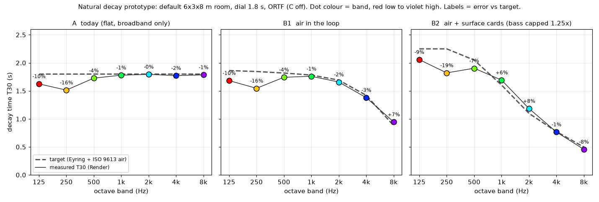

# Sound tricks: what the experts do that we don't (yet)

Written 4 Oct 2026, 17:20 BST. Research and box prototypes only; nothing on the PC has changed. Build checked: S-AUDIT app copy, WORKLET_VER 51 (`ui_audit_1004/app/software`).

**Tags:** VERIFIED means I measured it on the box or read it in the code or source. ASSUMED means it comes from memory or an estimate.

**Excluded (already locked):** EQ-1a Smooth, EQ-1b Movement, in-loop resonance cuts and face dips, the Mäkivirta target, the velvet smear, the opt-in Physical setting (D22), non-rectangular rooms, U87 defaults, the MS fixes, and FWHT rotation (rejected).

## Short answer
Yes, one big trick is missing. **The tail decays at the same rate in every band.** Every real room and every respected reverb (Moorer 1979 onwards; Jot & Chaigne 1991; Lexicon, Valhalla, Bricasti) makes the highs die faster than the mids. Ours does not. The air in our rooms and the surface colour only tint what goes *into* the loop, and the loop itself is broadband (VERIFIED, `engine/fdn.py` 866–872: `lg` is one scalar per line; Play `live_stereo.c` 1893–1907).

The fix is one small filter per delay line, and the prototype hits its targets within ±3 % from 500 Hz to 4 kHz (A/B group 1). The second-biggest gap is already in the pipeline: the direct sound sits about 18 dB too loud against the room (A/B group 2).

## Ranked top 10 (audible gain per Play CPU)
| # | Trick | Status today | Audible gain | Play CPU | Goldens | Size |
|---|---|---|---|---|---|---|
| 1 | **Natural decay, air in the loop** | **NOT DONE** (open D4/N11) | High: removes tail fizz, natural darkening | ~0.02 ms (one-pole) ASSUMED | Yes if default | S–M |
| 2 | **Direct/room balance (DRR, C50)** | PIPELINE L2/S8, opt-in under D22 | High: distance and "in the room" feel | 0 (gains only) | Yes if default | S |
| 3 | **Low-band decay fix** (peak cuts shorten 125/250 Hz by 10–16 %) | **NOT DONE**, new finding | Medium: thin bass tail | 0 extra once #1 exists | Yes | S |
| 4 | **Real-room accuracy gate** (BRAS CR2: T20, C50, EDC, NED as a standing test) | PARTLY (27 Sep one-off) | None directly; stops regressions | 0 | No | M |
| 5 | **t=0 pre-echo removal** (−41 dB, 9.6 ms before direct) | PIPELINE L2/S8 | Low–medium on transients | ~0 | Yes | S |
| 6 | **Pre-delay** (mix control, early + tail relative to direct, 0–80 ms) | NOT DONE | Medium (mix clarity), creative | ~0.003 ms ASSUMED | No (default 0) | S |
| 7 | **Diffuse-field mic colour on the tail** | PARTIAL (`render_pipeline.py` 981–986 uses each line's first-image angle) | Low–medium: tail tone with fig-8/cardioid | 0 (inject tint) | Yes | S–M |
| 8 | **Surfaces in the loop** (B2, needs octave GEQ per line, Prawda 2019) | NOT DONE | Medium, but the B2 prototype is darker than real rooms | ~0.05–0.15 ms ASSUMED | Yes | M–L |
| 9 | **Wet ducking** (wet dips while the source plays) | NOT DONE | Creative only | ~0.002 ms ASSUMED | No (off) | S |
| 10 | **Stereo tail IC matching** | MOSTLY OK once ORTF C is off (N18); binaural already has it | Low; AB LF needs a multi-position check | ~0.02 ms ASSUMED | Yes | M |

**Already done or locked (no action):**
- Per-bounce surface EQ on the early taps: `render_pipeline.py` 682–685, and the Play SURF cascade.
- Source directivity: `engine/source_radiation.py`.
- Air by path length on the early taps: `render_pipeline.py` 674–681, `early_field.apply_air_absorption` 2225.
- Denormals: `ls_flush` 1e-20 at `live_stereo.c` 501, plus an `LS_DC` offset.
- Binaural tail IC: `render_binaural_fdn_ir` around 1001; Play `ic_collect`/`ic_apply` 2518–2557.
- Smooth early-to-late transition: the FDN's first pass *is* the early field, so there's no gap or lump by construction (`fdn_delays_from_taps`, `fdn.py` 785–814).
- Locked or in the pipeline: echo density build-up (the velvet smear), modulation (EQ-1b), tail gating (D23), and the 44.1 k interpolation fix (D-INT/N6).

**Below the line:**
- **Dither:** `render_pipeline.py` 272–283 rounds to nearest with no dither. At 24 bits the error sits around −144 dBFS, which is inaudible. Adding TPDF would change every golden hash. Recommend TPDF only if a 16-bit export is ever added (Lipshitz et al. 1992, ASSUMED).
- **Jot "tone correction":** not needed. Physically, each band's reverb level scales with its T, so the darker tail level that #1 produces is correct.
- **Doppler:** not needed for static scenes.

## 1. Natural decay: air in the loop (prototype P1)
**What it is.** Each pass round the loop now loses a little more treble than bass, by exactly the amount a sound wave loses in air while travelling that line's delay length. Highs die first, the way they do in a real room.

**Method (VERIFIED, box).** Each line gets one in-loop filter after `lg`: a first-order low shelf times a first-order high shelf, packed into one biquad. Each line's filter is fitted by least squares to
−60·τᵢ·(1/T(f) − 1/T_dial) dB (Jot & Chaigne 1991; Schlecht & Habets, DAFx 2017).

The target T(f) is Eyring plus ISO 9613-1 air (4mV), at the room's own humidity, anchored so that the 500 Hz–1 kHz mean equals the dial. The patch is `proto/p1_freq_decay.diff`; it's inert when `FREQ_DECAY = None`.

**Accuracy check (VERIFIED):**
- Per-line predicted T error is at most 0.5 % (B1) at every octave.
- Measured T30 on the rendered IR is within −4…+7 % of target at 500 Hz–8 kHz. The JND is about 5 % (ISO 3382-1 and Prawda 2019, ASSUMED/VERIFIED).
- 125 and 250 Hz are short by 10–16 %, as they are today. See #3.

**Matches a measured room.** BRAS CR2, a real seminar room, measured 2k/4k/8k decay ratios against 1 kHz of 0.90 / 0.79 / 0.57 (VERIFIED, `results/cr2_octave_table.md`). B1 predicts 0.95 / 0.80 / 0.49 at a 1.8 s dial. Today's engine gives 1.00 / 1.00 / 1.00.

**Cost:** about 0.02 ms for a one-pole HF-only version; air needs no low shelf. About 0.047 ms for the full biquad (both ASSUMED, from the EQ_PLAN slot cost). This fits the 0.1–0.18 ms headroom, but it shares that headroom with EQ-1b and the resonance cuts, so the Play budget needs checking first.

**Goldens:** every FDN reference changes if this is on by default.

**Recommendation:** make "Natural decay (air)" the default and keep "Flat (2011)" as an option. Re-baseline the goldens in the same session as the U87 switch.

## 2. Direct/room balance (pipeline L2, D22 says opt-in)
**VERIFIED, box:** in the default scene the direct sound is 91 % of the energy in the first 50 ms. The measured figures:
- DRR (left channel) is +6.7 dB.
- C50 at 1 kHz is +8.4 dB, and EDT at 1 kHz is 1.04 s against a T of 1.8 s.

What a room like this should give:
- Barron's revised theory, at 3.3 m in this room, puts C50 at about −3 dB and DRR at about −16 dB omni, or about −11 dB for a cardioid (my calculation, ASSUMED).
- BRAS CR2 measured C50 at −3.4 dB (VERIFIED).

The reflections-to-tail balance is already about right: C50 without the direct is −0.6 dB. Only the direct is too hot. A/B group 2 lowers just the first arrival, by 9 dB and by 18 dB.

**Recommendation:** listen first. If B (−9 dB) wins, revisit D22 and consider a "Distance" control or default. Otherwise leave it opt-in as locked.

## 3. Low-band decay fix (new)
**VERIFIED:** T30 at 125 and 250 Hz is 1.62 / 1.51 s against a 1.8 s dial, which is 2–3 JND short. The cause is the per-axis peak cuts inside the loop (`fdn.py` 581–609, depth 1.5 dB, Q 1.5), whose loss adds to `lg`.

**The fix:** subtract each line's peak-bank response from #1's fit target, so the attenuation filter gives the lost bass back. Zero extra CPU.

**Recommendation:** do it with #1.

## 4–10 in brief
- **4. CR2 gate.** Rerun `research/room_validation/compare.py` as a test, reporting per-band T20, C50, EDC and NED in JNDs. CR2 data is CC BY-SA 4.0: credit BRAS and don't redistribute without attribution.
- **5. Pre-echo.** Already in S8. Pull it forward with #2.
- **6. Pre-delay.** A Lexicon/Valhalla staple. Here it would break the image geometry, so label it as a mix control. Default 0.
- **7. Mic colour on the tail.** Use the power-averaged (diffuse-field) polar response rather than the first-image angle (Elko 2001, VERIFIED).
- **8. Surfaces in the loop.** The B2 prototype hit −19…+8 % against its target, and per-line fit error reached 12.8 % (first-order shelves are too simple). It is also *darker than CR2*: 8 kHz is 0.31× against 0.57×. Wait for the Surfaces redesign and use an octave GEQ (Prawda, Välimäki & Schlecht, DAFx 2019). Render-first.
- **9. Ducking.** A creative extra (the Valhalla/Lexicon "duck"). Off by default.
- **10. IC.** ORTF with C off is within ±0.1 of diffuse theory above 1 kHz. XY and AB deviate at LF, but single-IR estimates are noisy (`proto/ic_measured.json`). Use a velvet-noise decorrelator only if a multi-position check confirms the problem (Alary, Politis & Välimäki, DAFx 2017, ASSUMED).

## Decisions for Idle (all change the sound unless marked)
| ID | Decision | Recommendation |
|---|---|---|
| ST-1 | Natural decay (air) in the loop, on by default with a "Flat (2011)" option. Settles D4/N11 | **Yes**, after the A/B group 1 listen |
| ST-2 | Fold the peak-cut loss into the fit (bass decay back to the dial) | **Yes**, with ST-1 |
| ST-3 | Surface cards in the loop (B2) | **Later**: after the Surfaces redesign, with a GEQ, Render first |
| ST-4 | Direct level: keep 2011 (D22 opt-in) or move towards physical | **Listen to group 2 first**. Revisit D22 only if B or C wins |
| ST-5 | Pull the pre-echo fix (S8/L2) forward with ST-4 | Yes |
| ST-6 | Pre-delay control, default 0 (no golden change) | Yes, small |
| ST-7 | CR2 accuracy gate as a standing test (no sound change) | Yes |
| ST-8 | Diffuse-field mic colour on the tail | Yes, low priority |
| ST-9 | Wet ducking, default off (no golden change) | Optional |
| ST-10 | Dither: none at 24-bit; TPDF only for any future 16-bit export | Yes (no change) |

## Files
- `ab/` holds 12 WAVs, `LISTENING_CHECKLIST.md`, `ab_levels.json` and `MD5SUMS.txt`.
- `proto/` holds the patch, harness, analysis and plot scripts, plus `p1_results.json`.
- `natural_decay_T30.png` is the diagram (checked; dot colours run red for low to violet for high).

## Sources
- **VERIFIED, read this session:**
  - Schlecht & Habets, DAFx 2017.
  - Prawda, Välimäki & Schlecht, DAFx 2019.
  - ValhallaRoom Late controls (valhalladsp.com, 2011).
  - Lindau, Kosanke & Weinzierl, JAES 2012 (mixing time 20V/S + 12 ms).
  - Abel & Huang, AES 2006 (NED).
  - Elko 2001.
  - BRAS database.
- **ASSUMED, not re-read:**
  - Moorer 1979.
  - Jot & Chaigne 1991.
  - Dattorro 1997.
  - Gardner 1998.
  - Frenette 2000.
  - Kuttruff, *Room Acoustics*.
  - Vorländer, *Auralization*.
  - Barron & Lee 1988.
  - ISO 3382-1.
  - Lipshitz et al. 1992.
  - Menzer & Faller 2009.
  - Griesinger.
