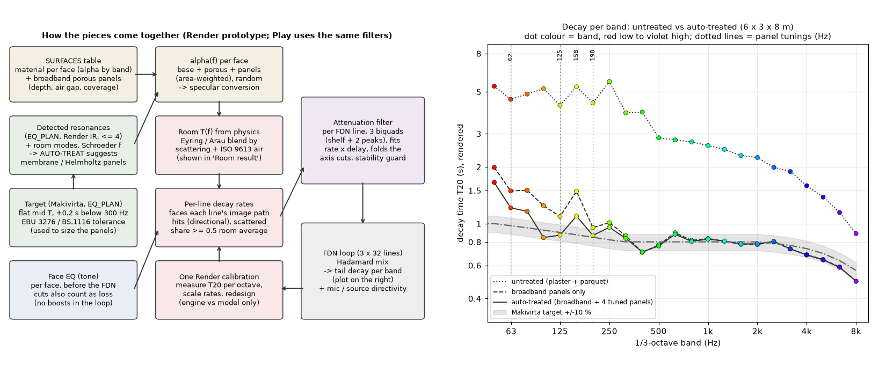
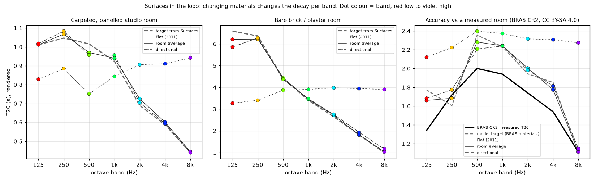

# SURFACES IN THE LOOP: tail decay per band from real treatment

*Box research and prototype, Sun 4 Oct 2026, 17:21–18:20 BST. Planning only. The app on the PC was not changed.*
*Follows ST-3/B2 in `SOUND_TRICKS.md`. Includes Idle's steering at 17:25 (directional) and 17:31 (decay comes from panels, absorbers and face EQ).*
*Tags: **VERIFIED** = measured on the box or checked against a cited source. **ASSUMED** = engineering guess, not yet checked.*

*Figure 1. Left: how the pieces come together. Right: the result per ⅓-octave band in the default 6×3×8 m room, rendered by the engine and measured as T20. Untreated (plaster + parquet) runs at about 2.6 s mid and about 5 s bass. Broadband panels alone bring the mids to target but leave the bass (50–160 Hz) at +35–100 %. Auto-treat (broadband plus 4 tuned panels) puts 16 of 23 bands inside the Mäkivirta ±10 % band. Dot colour is the band, from red (low) to violet (high).*

*Figure 2. Changing the materials changes the decay per band (T20, octaves). Flat (2011) gives the same T in every band, whatever the walls are made of. Surfaces mode follows the materials. Right: accuracy against a measured room (BRAS CR2).*

---

## 1. What changes (one paragraph)

Today every FDN line loses the same amount per pass at every frequency: Flat (2011). The proposed **Surfaces** mode gives each line its own small loss filter (3 biquads), designed from the physics of its own image path:
- which faces it hits;
- what each face is made of;
- what treatment is on the face (porous panels, tuned membrane or Helmholtz panels);
- the face EQ (cuts only);
- air.

The decay curve per band is therefore *not drawn*. It **emerges** from the treatment. The Mäkivirta target becomes the yardstick that **Auto-treat** uses to size panels, not a curve imposed on the tail.

## 2. Signal flow (Figure 1, left)

| Step | What it does | Where |
|---|---|---|
| 1. Surfaces table | Material per face (α per octave), plus **Treatment rows**: broadband porous panel (depth, air gap, coverage %) and tuned panels (membrane or Helmholtz: f0, build, area). | UI: Surfaces |
| 2. α(f) per face | Area-weighted mix of base material, porous coverage and panels, as a continuous α(f). Random-incidence data is converted with 1−e^(−α), which tames the HF overstatement of high-α library data in small rooms (ASSUMED, see §6). | `treatment.alpha_fn`, `surfdecay.face_bounce_db` |
| 3. Face EQ (tone) | Applied before the FDN, on the early taps and injection, as now. In the loop, only its **cuts** count as extra loss per bounce. No boosts in the loop: they can only add energy and break stability. | `face_bounce_db` clips at ≤0 dB |
| 4. Room T(f) | Eyring, Arau-Puchades and a scattering blend: `exp(s·lnT_Eyring + (1−s)·lnT_Arau)`, plus ISO 9613 air. Shown in **Room result**. | `surfdecay.room_target` |
| 5. Per-line rates (directional) | Each line's rate = air + s′·(room surface rate) + (1−s′)·κ·(its own faces' loss per metre of its path). κ is normalised so that the delay-weighted mean equals the room target. **s′ = max(mean scattering, 0.5)**; see §4 for why. | `surfdecay.line_rates` |
| 6. Attenuation filter per line | 3 biquads (low/high shelf + 2 peaks, "S1P2") fitted to rate×delay on 56 log points from 20 Hz to 20 kHz. Stability penalty and guard from DC to Nyquist. The 2011 per-axis cuts are either folded in or replaced by panels (decision D-SL3). | `attfilt.design_line`, `fdn.py` SURF_LOOP hook |
| 7. FDN loop | Unchanged: Hadamard mix, 3 × 32 lines. Mic and source directivity per line stay as they are. They now meet tails that differ per direction. | engine |
| 8. One Render calibration | Measure T20 per octave on the first render, scale the band losses by T20_measured/T_target (clamped 0.6–1.6), redesign once. This corrects engine-against-model error only; the room stays the room. | `run2.py *_cal` |

## 3. Treatment research: formulas used (Auto-treat and Treatment rows)

| Item | Formula / rule | Source | Tag |
|---|---|---|---|
| Room modes | f = (c/2)·√((nx/W)² + (ny/H)² + (nz/L)²); axial, tangential and oblique classed by the count of non-zero n. | Kuttruff, *Room Acoustics*; Everest | VERIFIED (standard) |
| Schroeder frequency | f_S = 2000·√(T/V). Default room: **270 Hz untreated → 149 Hz treated** (V = 144 m³). Below f_S the room is modal: treat resonances, don't trust a diffuse T. | Schroeder 1962; Kuttruff | VERIFIED |
| Membrane panel | f0 ≈ 60/√(m·d), or ≈ 50/√(m·d) with mineral-wool fill (m in kg/m², d in m). | Cox & D'Antonio, *Acoustic Absorbers and Diffusers*, ch. 7 | VERIFIED (formula) |
| Helmholtz (perforated) panel | f0 = (c/2π)·√(ε/(t′·d)), with t′ = t + 2·0.85·a (end correction) and ε = open-area fraction. | Cox & D'Antonio ch. 7 | VERIFIED (formula) |
| Resonant α curve | α(f) = αmax / (1 + Q²(f/f0 − f0/f)²). Membrane: Q 2, αmax 0.6. Helmholtz: Q 3, αmax 0.7. Off-resonance, the panel face counts as α ≥ 0.05. | shape is standard; the numbers are typical | **ASSUMED** (needs datasheet or impedance-tube fit) |
| Porous plus air gap | Uses the app library presets: 1″+1″ gap, 2″, 2″+2″, 4″+4″ (the air gap extends the low end, roughly quarter-wave). Auto-treat tries all 4 and keeps the best fit over 200 Hz–8 kHz; it chose **4″ + 4″ gap**. | library cards; Cox & D'Antonio ch. 5 | library VERIFIED in app; a Delany-Bazley/Miki model is an option for later |
| Room T | Eyring with area-weighted ᾱ, plus 4mV air; Arau = area-weighted geometric mean of per-axis Eyring T; blended by scattering. | Eyring 1930; Arau-Puchades 1988; Fitzroy 1959; Prawda, Schlecht & Välimäki, JASA 152(2) 2022 | VERIFIED (formulas); the blend is ASSUMED |
| Target | Mäkivirta (EQ_PLAN, locked): flat T_mid (500 Hz–2 kHz mean), rising +0.2 s on log f from 300 Hz down to 50 Hz. Above 2 kHz it follows air alone. | EQ_PLAN R1.3 | locked |
| Tolerance | EBU Tech 3276 / ITU-R BS.1116: Tm = 0.25·(V/100)^(1/3) s (**0.28 s** for 144 m³). ±0.05 s at 200 Hz–4 kHz; ±0.1 s at 100–200 Hz and 4–8 kHz; +0.3/−0.1 s at 63 Hz; adjacent ⅓-octave step <0.05 s. | EBU Tech 3276; ITU-R BS.1116-3 | VERIFIED |
| Low-frequency practice | Spread absorption over all three axis pairs. Bass control near boundaries and corners. Below ~f_S, treat modes rather than chase T. | Toole, *Sound Reproduction*; Everest | **ASSUMED** (paraphrased, not re-checked today) |

## 4. Auto-treat (new option): algorithm and plan for the default room

**Button on Surfaces:** "Auto-treat to target T_mid = [dial]". It *suggests* Treatment rows; the user accepts, edits or discards them. Algorithm (`treatment.auto_treat`, box prototype):
1. **Broadband, axis-balanced.** One common coverage % of porous panel on ceiling F, rear wall D and **both** side walls A and C, bisected until the model 500 Hz–2 kHz T equals T_mid. Front wall B is added only if 80 % isn't enough. The library porous options are each tried, and the best fit over 200 Hz–8 kHz is kept.
2. **Tuned panels, up to 4.** This shares EQ_PLAN's budget of 4 resonance rows. Find the ⅓-octave band (40–500 Hz) with the worst excess against the Mäkivirta target, stopping at ≤ +10 %. Design a panel there: membrane below 180 Hz (sheet from a list of 6 real boards, cavity 50–300 mm), otherwise Helmholtz (12 mm board, 6 mm holes, open area 0.5–20 %). Put it on the face pair of the nearest axial mode, falling back to rear wall, ceiling, sides, front, and floor last. Each face holds at most 90 % treatment. Size the area by bisection so the band reaches target.
3. Report: plan table, model before and after, Schroeder before and after, EBU Tm for reference.

**Why axis-balanced:** the first version put 80 % on the ceiling and 90 % on the rear wall only. The directional render then showed a **double slope** (EDT/T30 ≈ 0.25; T30 +25–37 % long at 1–8 kHz), because the untreated side-wall axis kept ringing. That is Fitzroy/Arau non-diffuse decay, and real rooms do the same. Spreading the panels over the axes removed it (VERIFIED on the box).

**Plan for the default room** (6 × 3 × 8 m, plaster walls and ceiling, parquet floor; target T_mid 0.8 s):

| # | Face | Kind | Build | f0 | Area / coverage | Mode it answers |
|---|---|---|---|---|---|---|
| 1 | F, D, A, C | broadband porous | 4″ panel on 4″ air gap | — | 21 % of each face | sets the mids |
| 2 | D (rear) | membrane | 3 mm hardboard (2.7 kg/m²) on 59 mm cavity with wool | 125 Hz | 9.0 m² | 107–129 Hz cluster (0,0,5), (4,0,0), (0,2,0) |
| 3 | F (ceiling) | membrane | 9 mm plywood (5.4 kg/m²) on 119 mm cavity with wool | 62.5 Hz | 10.3 m² | 57 Hz (0,1,0) and (2,0,0); 64 Hz (0,0,3) |
| 4 | D (rear) | Helmholtz | 12 mm board, 6 mm holes, 2.3 % open, 100 mm cavity with wool | 198 Hz | 3.4 m² | 172 Hz cluster |
| 5 | B (front) | Helmholtz | 12 mm board, 6 mm holes, 1.4 % open, 100 mm cavity with wool | 157.5 Hz | 8.5 m² | 129–150 Hz (0,0,6), (5,0,0), (0,0,7) |

Coverage: A 21 %, B 47 %, C 21 %, D 90 %, E (floor) 0 %, F 43 %. The model predicts 20/24 ⅓-octaves within ±10 % (VERIFIED, model).
**Rendered** (engine + calibration, T20 per ⅓-octave, VERIFIED): **16/23 within ±10 %, 19/23 within ±20 %.**

Remaining misses:
- 50–80 Hz: +23…+65 %. This is below the lowest panel and modal; EBU allows +0.3 s at 63 Hz.
- 157 Hz: +26 %.
- 250 Hz: +17 %.
- 400 Hz and 8 kHz: −12 %.

Engine against its own model, per octave: −5…+3 % (VERIFIED). Strict EBU ±0.05 s is **not** met: worst deviation over 200 Hz–4 kHz is 0.136 s. EBU is also a *control-room* standard (Tm 0.28 s here), whereas 0.8 s is a treated live-room target. An "EBU control room" preset is possible: it needs about 83 m² Sabine of absorption, roughly ᾱ 0.4. That is ASSUMED feasible and not rendered.

## 5. How the existing resonance cuts map onto physical panels

| Cut today | Frequency (default room) | Physical counterpart | In Surfaces mode |
|---|---|---|---|
| 2011 per-axis in-loop cut, Y axis (−1.5 dB/pass, Q 1.5) | 57.2 Hz | **Membrane panel**, 9 mm ply on about 120 mm (Auto-treat row 3) | Replaced by the panel: the panel's α(f) enters every line that hits that face. |
| 2011 per-axis cut, X axis | 28.6 Hz | Membrane needs m·d ≈ 3 (for example 2 × 12.5 mm plasterboard on 150 mm). That is a whole stud wall, not a panel. | Keep as the engine cut (folded into the line filter), or use the "room shell" term (D-SL6). |
| 2011 per-axis cut, Z axis | 21.4 Hz | as X; impractical as a panel | as X |
| EQ_PLAN detected resonance rows (fine-band EDR, ≤ 4), f < ~300 Hz | room-dependent | real room modes. **"Make it a panel"** action: `design_membrane` below 180 Hz, else `design_helmholtz`, placed on the axis pair of the nearest axial mode. | The row turns into a Treatment row. Its absorption shows up in the per-line rates and in Room result. |
| EQ_PLAN rows above ~500 Hz | — | none. These are engine ringing from delay-line periodicity, not room modes. | Stay as decay-EQ cuts (EQ_PLAN, locked), or Smooth/Movement. |
| Face EQ dips (locked) | any | the absorptive "colour" of a face | Count as loss in the loop (cuts only), as tone on injection. |

Data behind "replace" (VERIFIED, 96 lines per render):
- **Folded** 2011 cuts plus a long-bass target: 3–17 lines hit the guard and 0–8 fell back to the plain broadband loss. Median per-line octave error was 14–23 %.
- **Replaced** (the g5 renders): 0 guard hits, median per-line error about 5 %.

## 6. Accuracy

**Measured room, BRAS CR2** (T20, 125 Hz–8 kHz; measured 1.34 / 1.72 / 2.00 / 1.94 / 1.74 / 1.54 / 1.11 s; VERIFIED):

| Mode | Error against measured, per octave | 8k/1k ratio (measured 0.57) |
|---|---|---|
| Flat (2011) | +58 / +29 / +20 / +22 / +33 / +50 / +105 % | 0.96 |
| Surfaces, room average (+ calibration) | +24 / −2 / +14 / +16 / +15 / +15 / 0 % | 0.50 |
| Surfaces, directional (+ calibration) | +26 / +3 / +10 / +15 / +14 / +18 / +3 % | 0.51 |
| B2 prototype (Task 1, for reference) | — | 0.31 (too dark) |

- The engine sits within −6…+10 % of **its own** target.
- The remaining +10–18 % at the mids is the **material data** (BRAS fitted α, plus the app humidity 0.35 rather than BRAS's 41.7 % RH). This matches Prawda et al. 2022: absorption error matters more than the formula.
- The 8 kHz darkness of B2 is fixed at the root. Real materials replace the placeholder cards, and air at the app humidity does the rest.

**Small-room HF overstatement** is handled three ways:
- α conversion 1−e^(−α);
- Arau/scatter blend;
- the s′ ≥ 0.5 floor.

The raw directional variant (s′ = 0.15) ran +10–27 % long at mid and HF in the studio room, and +17 % at 125 Hz in CR2.

**Changing a material changes the tail per band** (Figure 2, VERIFIED, T20):

| Room | 125 Hz | 1 kHz | 8 kHz |
|---|---|---|---|
| Carpeted and panelled studio | 1.0 s | 0.94 s | 0.44 s |
| Bare brick / plaster | 6.2 s | 3.45 s | 1.03 s |

Flat (2011) gives 0.83–0.94 s and 3.3–3.9 s flat across bands. Tail energy (80–500 ms, relative), studio against brick: −2 to −6 dB per band.

**Directional or room average** (§9, D-SL2). After calibration, T20 differs by ≤ 5 % from 500 Hz up. At 125–250 Hz in the default room it differs by 8–12 %, with directional closer to target. Tail tone differs by ≤ 1 dB per band (g3: −0.6 dB at 125 Hz, +1.0 dB at 8 kHz). L−R tail balance is the same within 0.3 dB. The difference is real but small. Raw directional without the s′ floor is clearly *less* natural: tails too long and a double slope.

## 7. Filter choice and CPU

Offline fit study (per-line worst octave T error; room-average / directional; VERIFIED):

| Structure | Biquads | Room-average | Directional | Play cost (ASSUMED, 0.047 ms/slot on t19) |
|---|---|---|---|---|
| S1 (Jot shelf) | 1 | 10–14 % | 26–46 % | +0.047 ms |
| S1P1 | 2 | 10–14 % | 10–20 % | +0.094 ms |
| **S1P2 (chosen)** | 3 | 6–14 % (median ~3 %) | 8–13 % | +0.094 ms when the per-axis slot is reused (D-SL3), +0.141 ms if it isn't |
| GEQ (Välimäki–Liski / Prawda) | ~9 | 0.9–3 % | 3–7 % | ~0.42 ms: too much for Play |

- Play headroom from EQ_PLAN is 0.158 ms. S1P2 with slot reuse leaves about 0.06 ms (ASSUMED).
- Native microbenchmark (gcc −O2, box loaded, indicative only): 192 lines × 128 samples took 0.096 / 0.226 / 0.752 ms for K = 1 / 3 / 9 biquads.
- System-level (delay-weighted) error for S1P2 is about ±1–6 %.
- Render can use GEQ later if wanted (D-SL7).
- **Stability (VERIFIED, every render):**
  - Max loop gain is −0.006 to −0.40 dB from DC to Nyquist (below 0 dB everywhere).
  - Max pole is ≤ 0.99902.
  - Every IR is finite, with peak ≤ 0.53.
- How the guard works:
  - The fit aims for T ≤ 2× the longest target everywhere.
  - The guard rejects any line with T > 3× the longest target, and refits it with S1.
  - If that fails too, the line falls back to the broadband loss only.
- An earlier, stricter "2× everywhere" guard over-triggered: lines fell back, and HF ran +100–250 % long. An earlier, looser fit boosted near DC and Nyquist and blew up (IR saturated at 1.0). Both were fixed on the box.

## 8. Goldens, modes and the Room result panel

- **Modes:** `Flat (2011)` (today, default, and kept) / `Air` (ST-1/B1) / `Surfaces`.
  - Flat (2011): the hook is off and the loop code path is unchanged, so its goldens are unaffected. That rests on code inspection: **ASSUMED**, to be bit-checked in S-SL2.
  - Surfaces changes every FDN reference. Re-baseline the goldens once, together with ST-1 and U87, and not piecemeal.
- **Dial and lock:**
  - Decay lock on: the 500 Hz–1 kHz mean is anchored to the dial, and the other bands keep the material ratios.
  - Lock off: absolute length from the materials, and the dial *shows* the result.
- **Room result panel** (mockup `prebuild_app/software/static/mockups/surfaces.html`: Eyring per band, faces against faces + air, Air moved here). It becomes:
  1. **Target vs rendered** decay per band. The model curve shows live; the rendered T20 dots appear after Render, coloured red to violet like Figure 1. The Mäkivirta ±10 % band and the EBU tolerance can be toggled.
  2. **Treatment list** per face: porous rows (preset, gap, %) and tuned panels (f0, build, m²), each with on/off.
  3. **Auto-treat** button, plus "Make it a panel" on each EQ_PLAN resonance row below 300 Hz.
  4. Schroeder frequency and mode markers on the axis.

## 9. Decisions for Idle (every sound change; recommendation in bold)

| ID | Decision | Options | Recommendation |
|---|---|---|---|
| D-SL1 | Ship Surfaces mode | opt-in mode / new default | **Opt-in first** (Flat (2011) stays default). Make it the default only with the S-SL7 golden re-baseline. |
| D-SL2 | Per-line tail | directional (s′ ≥ 0.5) / room average | **Directional.** It costs the same CPU (only the coefficients differ) and lets faces, face EQ and mic/source directivity shape the tail per direction, which is the physics (Arau; image paths). Measured difference after calibration is small (≤1 dB, ≤5 %), so listen to A/B 3 and 4. Room average is the fallback if a project shows a double slope. |
| D-SL3 | 2011 per-axis cuts in Surfaces mode | fold into the line filter / replace with panels | **Replace.** Bass then comes from materials and panels. Keep the engine cut only for 21–29 Hz modes, where no practical panel exists. Replace means 0 guard hits and median line error about 5 %, against 14–23 % folded, and it frees the Play slot. |
| D-SL4 | Render calibration pass | none / one pass on T20 | **One pass, Render-only**, clamped 0.6–1.6. Over 12 renders × 7 octaves, bands within ±10 % of the engine's own target went from 65/84 to 76/84, and within ±5 % from 48/84 to 64/84. Worst band: −32…+15 % before, −16…+16 % after. Play uses the Render-designed coefficients. |
| D-SL5 | Auto-treat | suggest rows / apply automatically | **Suggest.** Rows are editable, at most 4 tuned panels (shared with EQ_PLAN's 4), broadband axis-balanced. |
| D-SL6 | Untreated bass with textbook plaster | as data (about 5 s at 125 Hz absolute) / "room shell" membrane term | **Room shell on by default:** 30 % of walls as a 90 Hz Q 1 membrane (ASSUMED values: doors, glazing, stud walls). Shown as a Treatment row the user can remove. With it, the untreated bass is 1.9 / 2.35 s instead of 3.4 / 3.1 s at 125 / 250 Hz (dial 1.8 s). |
| D-SL7 | Filter structure | S1P2 everywhere / GEQ in Render, S1P2 in Play | **S1P2 everywhere** for now: one design, and Play matches Render. Revisit GEQ for Render if listening finds the band shape too coarse. |
| D-SL8 | Default materials | placeholder cards / real "plaster + parquet" (D-EQ) | **Real materials** together with D-SL6. This is what fixed B2's darkness. |
| D-SL9 | Auto-treat target presets | dial only / + "EBU control room" (Tm = 0.25·(V/100)^(1/3)) / + "Live room" | **Dial plus EBU preset**, with the EBU check shown as pass or fail per band. |

Still open from Task 1: ST-1 to ST-10. This document refines ST-3/B2 and does not re-open any locked item (EQ-1a/1b, in-loop resonance cuts, face dips, Mäkivirta target, velvet smear, D22, non-rect rooms, U87, MS fixes, FWHT).

## 10. Build plan (small, self-contained sessions)

| Session | Scope | Sound change? | Done when |
|---|---|---|---|
| S-SL1 | Room-target model (`room_target`, α conversion, air) plus a Room result readout of the model curve. | none | readout matches the box model to 1 % on 3 rooms |
| S-SL2 | SURF_LOOP hook in the Render FDN, room average, S1P2, guard, behind the Surfaces mode. Flat (2011) bit-identical test. | Surfaces only | CR2 within the §6 numbers; Flat goldens bit-identical |
| S-SL3 | Play port: same coefficients, per-axis slot reused (D-SL3), CPU on t19. | Surfaces only | ≤ +0.10 ms and no xruns |
| S-SL4 | Directional rates (s′ floor) plus one calibration pass. | Surfaces only | A/B 3 and 4 sign-off |
| S-SL5 | Treatment rows: porous (library), membrane, Helmholtz, room shell. α(f) into the target and the rates. | Surfaces only | Room result moves when a row is toggled |
| S-SL6 | Auto-treat and "Make it a panel" on EQ_PLAN resonance rows. | suggestions only | default room ≥ 16/23 ⅓-octaves within ±10 % |
| S-SL7 | Real default materials (D-SL8), golden re-baseline with ST-1 and U87, docs. | yes (default) | Idle sign-off on A/B 3 and 5 |

## 11. Files

| What | Box | PC (`…\handoff_build_support_2\roadmap\sound_tricks\`) |
|---|---|---|
| This document | `/workspace/build_support_2/roadmap/sound_tricks/SURFACES_IN_LOOP.md` | `SURFACES_IN_LOOP.md` |
| Figures | `…/sound_tricks/surfaces_in_loop_overview.png`, `…/surfaces_in_loop_rooms.png` | same names |
| A/B WAVs (26) and checklist | `…/sound_tricks/surfaces_ab/` | `surfaces_ab\` |
| Prototype scripts, data, fdn diff | `…/sound_tricks/proto2/` | `proto2\` |

Scripts:
- `surfdecay.py`: target and per-line rates.
- `attfilt.py`: filter fit.
- `treatment.py`: modes, panels, Auto-treat.
- `rooms.py`: material sets.
- `run2.py`: renders.
- `a2.py`: analysis.
- `make_plan.py`, `make_wavs2.py`, `plots2.py`.
- `fdn_surf_loop.diff`: the patch to the scratch copy of `engine/fdn.py`. It also contains Task 1's `FREQ_DECAY` hook.

Data: `a2_results.json`, `target_treated.json`, and `meta_and_plans.zip` (holding `meta_*.json` and `plan_*.json`). The IRs (`ir_*.npy`, 82 MB) stay on the box at `/workspace/st_work/proto2/`.
