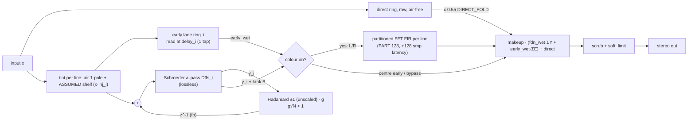

# Live Play fix: audit (read-only)

**Written:** Sat 26 Sep 2026, ~22:00 BST (box executor, for Idle Hanz / Grok Build)
**Scope:** What changed in `C:\Users\IdleHanz\Desktop\2011 Room Reverb\software\` since 25 Sep ~09:30 BST, what the fix actually is, how stable and fast it is, and what is still at risk.
**Method:** I copied the changed files read-only to the box (`/workspace/scratch_er_dropout/live_v2/`). Nothing on the PC was modified and the app was not touched.

I ran the real `static/wasm/live_stereo.wasm` in Node 20 through the real `static/js/fdn_worklet.js`, using a stub AudioWorklet global. The harness mirrors `live_fdn.js` `takeColour`/`buildRoute`. The params are the user's settings, generated by the *current* Python `render_pipeline.live_fdn_params`.

Tags:
- **VERIFIED** = read in code or measured on the box.
- **ASSUMED** = inference.

All CPU numbers are **box measurements** (a shared Linux Xeon VM), not the user's PC.

---

## 1. What changed (mtimes BST; no `.git` anywhere; no .dll/.pyd/.so in `software/`)

| Modified | File | Role |
|---|---|---|
| 25 Sep 14:24 | `engine/fdn.py`, `render_pipeline.py` | Render: `diffuser_output_mix`, `_attach_loop_mix`, 0.68 cap removed |
| 25 Sep 14:27 | `engine/selfcheck.py` | self-checks |
| 26 Sep 08:26 | `static/js/fdn_worklet.js` (6.9 KB) | now a thin WASM shim |
| 26 Sep 15:20 | `engine/live_stereo.c` (51 KB, 1481 lines) | **new C Play engine** |
| 26 Sep 15:21 | `static/wasm/live_stereo.wasm` (119 KB) | compiled Play engine |
| 26 Sep 15:20 | `static/js/live_fdn.js` (`WORKLET_VER=28`), `static/index.html` | loader: fetch wasm, pack params, error reporting |
| 26 Sep 15:20 | `tests/test_live_stereo.py`, `tests/test_mic_colour_relative.py`, `mic_colour/HOOKS.md` | tests; native `live_stereo.dll` built into `%TEMP%` via ctypes |
| unchanged (17 Sep) | `engine/fdn_core.c` | old ctypes core (Render skips it when Dffs are present) |

**The shipped WASM matches the source (VERIFIED).** I rebuilt `live_stereo.c` on the box with zig 0.16 (`pip install ziglang`), using the header's build line: `zig cc -target wasm32-freestanding -O3 -msimd128 …`. Driven through the worklet with the user's params for 3000 blocks, it gave bit-identical output to the shipped `live_stereo.wasm` (max |diff| = 0).

## 2. What the fix is (VERIFIED from code)

### 2.1 Play now runs in C → WASM
- `engine/live_stereo.c` is the whole Play DSP. The header says it is built with `zig cc -target wasm32-freestanding -O3 -msimd128 -nostdlib`.
- `fdn_worklet.js` receives the wasm bytes in `processorOptions` (fetched by `live_fdn.js ensure()`). It calls `live_bind` → `live_load_room` (a packed float blob, `BLOB_LEN` 1981) → `live_load_irs` → `live_load_route` (`ROUTE_LEN` 230), then `live_stereo()` once per 128-sample quantum.
- **The ConvolverNode bank is gone.** Mic-colour FIRs are now uniform-partitioned FFT convolution inside C (partition 128, FFT 256, up to 64 partitions, SIMD `mac_bins`). The node has a single stereo output.
- Each FDN line owns one ring with 4 interleaved lanes: FDN-A, early-A, FDN-B, early-B. The cap is 1000 ms + 8 guard samples.
- The FIR partition buffering adds **128 samples of latency (2.67 ms at 48 kHz)** to the coloured path.
- `port.onmessage` error reporting is now wired in `live_fdn.js`.
- **Render is still Python/numpy.** The ctypes `fdn_core.c` is not used when Dffs are present. The tests compile `live_stereo.c` natively (`%TEMP%/live_stereo.dll`) for Python-side null tests.
- **N is fixed at 32 in C** (`enum { N = 32 }`), so Play cannot run N=64/128.

### 2.2 Stability: the in-loop diffuser was re-plumbed (the actual correction)
- **Old JS worklet (the 25 Sep diagnosis):** the loop matrix was effectively (I−G²)·g·H + G. With the 0.68/√N cap its eigenvalues reached ≈ −1.021, which caused the 24 kHz runaway.
- **New C (`diffuse()`, live_stereo.c L948–964):** the Hadamard now mixes the Schroeder-allpass **output** y and feeds it back to the allpass **input**, one sample later:
  ```
  s = xin + fb ;  y = −gi·s + delayed ;  write(s + gi·y) ;  fb = g·H·y   (fb used next sample)
  ```
  The allpass is lossless and ‖H‖ = √N. So by the small-gain theorem the loop is stable whenever **g·√N < 1**, for any |gi| < 1.
- **Render (Python)** does the same topology with a same-sample implicit solve: `fdn.py diffuser_output_mix(g, dffs) = (I + g·diag(dffs)·H)⁻¹` inside `FDN.process_block_poly`.
- **The 0.68 cap was removed.** A test (`test_source_has_no_cap_and_keeps_32`) asserts that "0.68" no longer appears. The server caps g at 0.99/√N.
- At the user's settings the decay lock gives g = 0.15795, g√N = 0.894. C uses g unclamped.
- **Routing correction ("signals fed into the wrong places") — current routing, VERIFIED:**
  - **FDN inject** = `tint(x·inj)`: the air 1-pole plus the ASSUMED high shelf, on the **inject only**. There is **no air on the FDN return** (lock kept).
  - **Early lane** stores the same tinted xin and is read at `line.delay` (one tap per line). It is feed-forward and outside the loop.
  - **Direct** has its own raw ring (air-free, lock kept), × `DIRECT_FOLD` 0.55.
  - **With colour on:** early L/R join their FDN line's FIR (`early_target`). Centre early stays uncoloured. Tank B is added before colour. FIR output is not written back into the loop.
  - **Safety:** `scrub()` runs on non-finite output and `soft_limit()` on the final output. `bus_sample` skips early work when `early_wet ≤ 1e-4`.
- **Parity gaps (VERIFIED):**
  - `render_pipeline._attach_loop_mix` ships `bus["loop_mix"]` in the live params, but **`packRoom` never packs it, so it is dead payload**.
  - Play feeds back with a z⁻¹ (one sample late). Render solves same-sample. This is a small HF phase/decay difference between Render and Play.
  - The Play early tap has **no per-hit surface biquad cascade**; surfaces enter only as the broadband √(1−ᾱ) folded into `inj`. Render applies the full serial per-hit cascade (`apply_surface_to_buffer`). This gap predates this fix, and Track C must not widen it (see brief).

### 2.3 Signal flow (Play, one bus; there are 3 buses L/C/R, each with N=32 lines)



In words:
1. The input is copied raw into the direct ring (air-free) and folded in at 0.55.
2. Per line, it is scaled by `inj_i` (1/r, mic gain, broadband surface √(1−ᾱ)) and tinted (air 1-pole + ASSUMED shelf).
3. That tinted signal (a) is written to the early lane, which is read back once at the line's image delay, and (b) enters the FDN: it is summed with the Hadamard feedback, goes through the line's in-loop allpass Dffs_i, and the allpass output y_i is Hadamard-mixed × g and fed back one sample later.
4. FDN outputs and early taps go either through the per-line mic-colour FIR (colour on) or straight to the mix. Makeup, soft limit, out.

## 3. Headroom (box, per 128-sample block; budget 2.667 ms at 48 kHz)

Real `live_stereo.wasm` in Node 20 (V8), user settings, noise input. Native = the same C compiled with `gcc -O3 -msse2` on the box.

| Case | colour on (MEASURED_SHELF, 49 IRs) | colour bypass |
|---|---|---|
| FDN, Early off | 1.214 ms (45.5 %) | 0.430 ms (16.1 %) |
| FDN + Early 0 dB | 1.214 ms (45.5 %) | 0.482 ms (18.1 %) |
| FDN muted, Early on | 0.895 ms (33.6 %) | 0.260 ms (9.8 %) |
| Direct only | 0.101 ms (3.8 %) | 0.058 ms (2.2 %) |
| Two sources, all on | **1.770 ms (66.4 %)** | 0.837 ms (31.4 %) |
| *native gcc, FDN+Early, colour on* | 1.009 ms (37.8 %) | 0.389 ms (14.6 %) |
| *native gcc, two sources, colour on* | 1.276 ms (47.8 %) | — |

- WASM runs at about 1.2–1.4× native.
- The **colour FIR is ~60 % of the cost**.
- The old JS worklet measured 0.55–0.97 ms *plus* the ConvolverNode graph.
- Early on/off costs only ~0.05 ms in bypass. The Early path is no longer the stutter source it was (it no longer fans out to a ConvolverNode graph).
- N=64/128 cannot be measured because Play is locked to N=32.

### 3.1 NEW RISK: subnormal (denormal) CPU blow-up in silence (VERIFIED on box)
After the input stops, the IIR states (tint 1-pole/shelf, peaking, allpass) decay into floating-point subnormals, and there is no flush-to-zero.

**Native test** (`silence_native.c`, bypass params, 2 s noise then silence):

| Setting | While playing | In silence |
|---|---|---|
| FTZ/DAZ **off** | 0.56 ms/block | **3.6–3.9 ms/block** (over the 2.667 ms budget) |
| FTZ/DAZ **on** | 0.34 ms/block | 0.32–0.37 ms/block |

**WASM in Node:** the same pattern, 2.1 → **3.8 ms/block** once silent.

**WebAssembly has no FTZ/DAZ control** (see c_wasm_performance_roadmap.md, refs), so the C code must prevent subnormals itself (see roadmap §3).

Subnormal penalties differ by CPU vendor/generation, so **the user's PC may be affected less or more. Not measured there.** If it is affected, this shows up as crackle or dropouts a few seconds *after* playing stops, or on restart.

### 3.2 Observation: in-loop Dffs lengthens the real decay (VERIFIED on box, Play path)
- The decay lock sets g from the *mean line delay*: T60 = 3·29.34 ms / −log10(0.894) = **1.80 s**.
- But the in-loop allpass (Dffs up to −0.98 on some lines) adds strong frequency-dependent group delay, which the lock ignores.
- **Measured on the Play FDN only** (colour bypass, 2 s noise then silence):
  - T60 ≈ **2.6–4.5 s** in 125 Hz–4 kHz over the first second.
  - A slow narrowband residue with peaks at **9.05 kHz and 10.88 kHz** (late T60 ~13–50 s, at −51 dBFS rms 0.5 s after the stop, −72 dBFS at 8 s).
- It decays, so it is **not** a runaway. But the audible tail is longer than the dial says, and a faint HF ring can be heard on quiet material.
- Render uses the same topology, so it probably behaves the same; **Render was not measured**.
- **This is not a Track C issue.** Flag it to Build as "decay lock should include the allpass group delay (or cap |Dffs|)". Don't change it inside the scattering work.

## 4. Stability runs (VERIFIED, box)
- `v2/stab_v2.js`: 60 s runs, noise 0.3 for 30 s then silence, at g√N 0.894 and 0.99, with fractional and integer-rounded delays, colour on and off.
- All were stable: tails decay after the input stops, the Nyquist sign-flip rate is ≈0.5 (noise-like, no 24 kHz lock), and there were 0 errors.
- The 1.0 peaks at g√N 0.99 are soft-limit loudness while the input plays, not a runaway.

## 5. Open items for Build (priority)
1. **Denormal guard in `live_stereo.c`** (tiny alternating offset or explicit state clamp; see roadmap §3). This is a cheap, high-value fix.
2. Decide on `loop_mix`: pack it or delete it. Document the z⁻¹ vs same-sample parity difference and add a null test with a tolerance.
3. Decay lock vs allpass group delay (§3.2).
4. The Play early tap still lacks the per-hit surface cascade that Render has. Track C adds a per-tap specular filter slot in Play, and the same slot can carry the absorb cascade approximation.
5. Two sources with colour reach 66 % on the box, leaving little room. Keep scattering off the colour-FIR path (it rides the early lane before FIR input) and budget it (see brief).

## 6. Box artefacts
`/workspace/scratch_er_dropout/`:
- `live_v2/` — read-only copy
- `v2/wasm_harness.js`, `v2/stab_v2.js`, `v2/bench_native.c`, `v2/silence_native.c`, `v2/denorm_probe.js`, `v2/tail_probe.js`, `v2/tail_spec.js`, `v2/null_rebuild.js`
- `rebuild/live_stereo.wasm` (zig rebuild)
- `tree2/software/p_user_*.json` (params from the current code)
